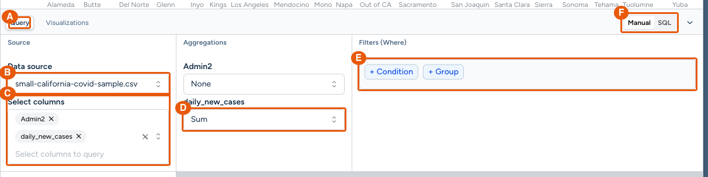
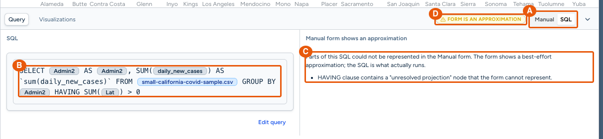
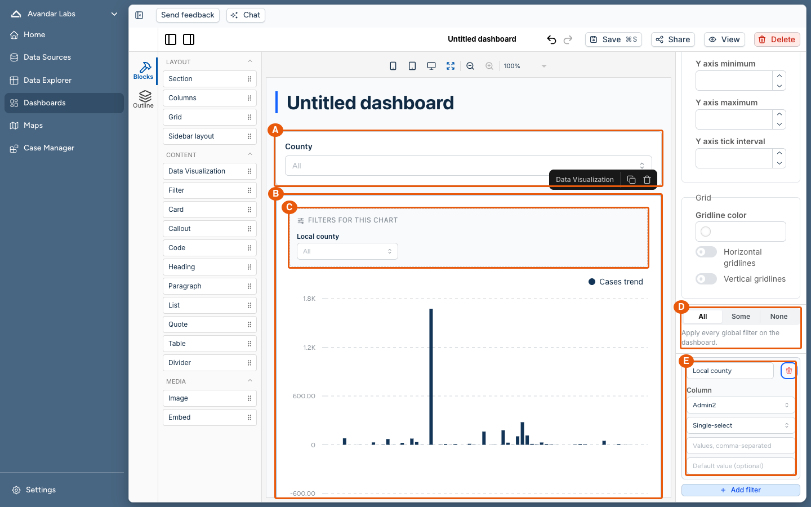
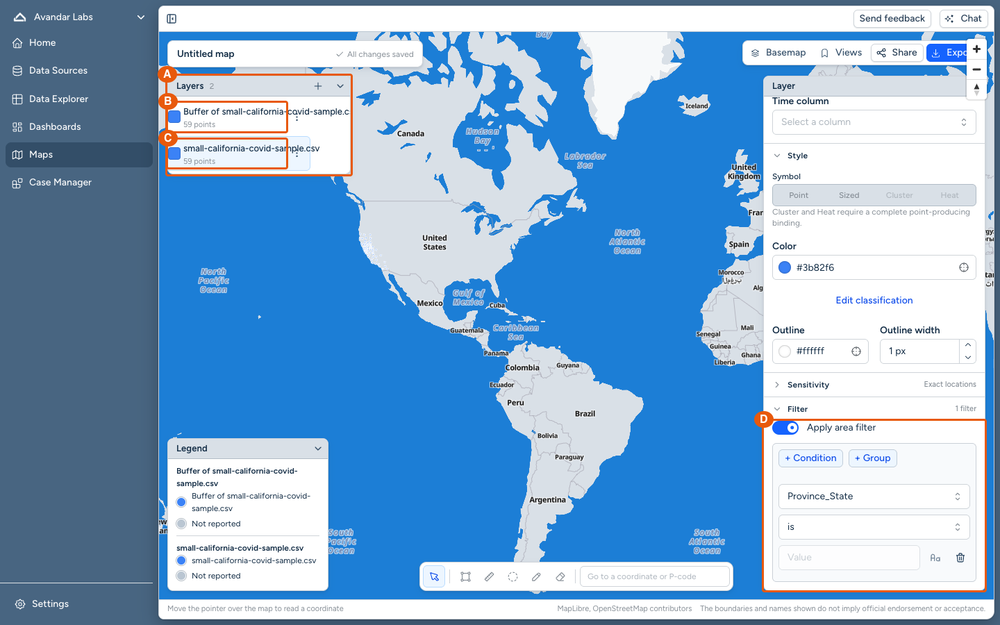
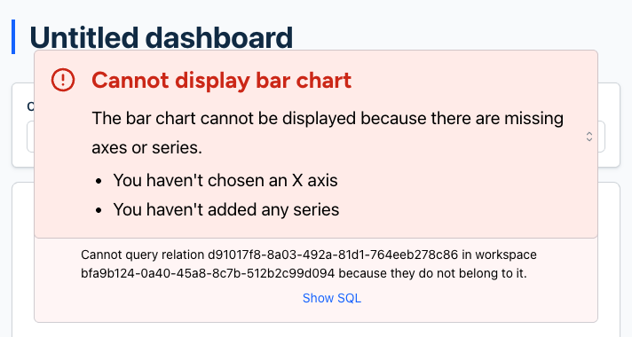
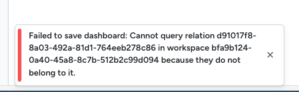
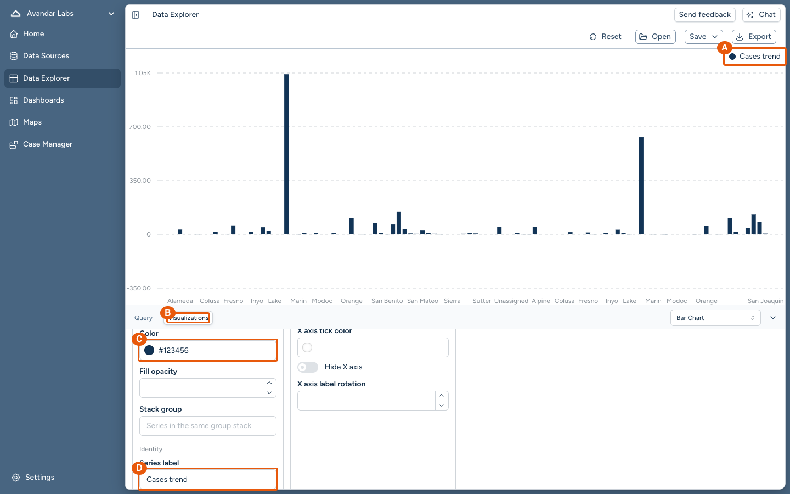
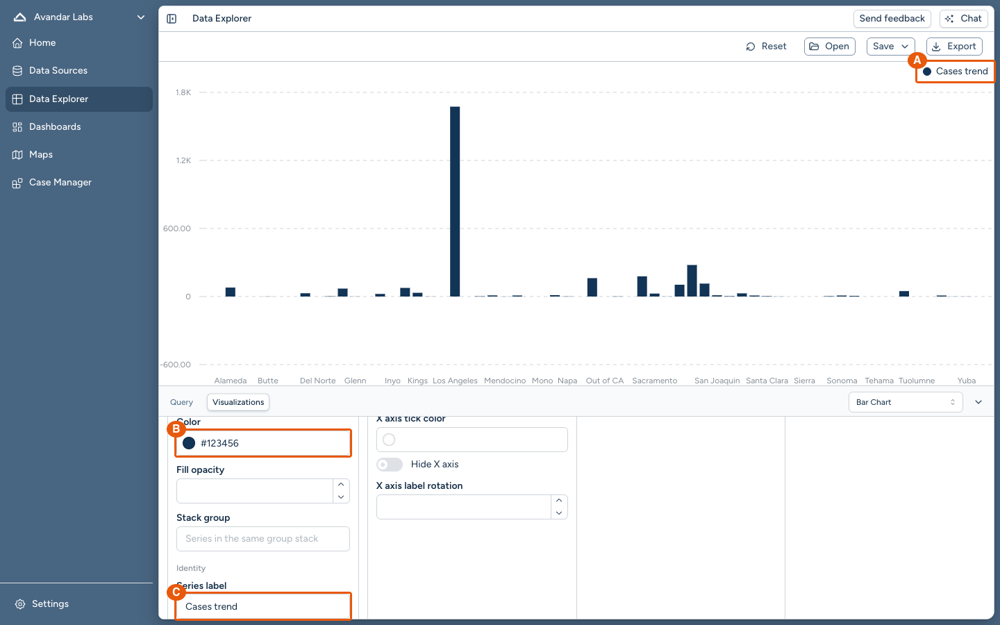

# Screenshots and their caption boxes: worked examples

Captures taken to the rules in
[Screenshots](../walkthrough/figures.md#screenshots), each followed by its
caption box exactly as it sits in the walkthrough. Match their style: a
capture shows only the part of the window its section is about, every element
the prose names is lettered or is the whole crop, and the caption box states
what to notice in one or two sentences before its key.

They come from a walkthrough of a change to the Avandar Data Explorer,
dashboards, and maps. Take the form from them, not the content.

One detail predates the current rules: the letters here sit on the ring's
top-left corner and can hide the first character of a short label. Place
letters with the snippet in
[Crop and letter the capture](../walkthrough/figures.md#crop-and-letter-the-capture),
which keeps them outside the ring.

Contents:

- [A lettered capture, clipped to one panel](#a-lettered-capture-clipped-to-one-panel)
- [A lettered capture of a state that needs setup](#a-lettered-capture-of-a-state-that-needs-setup)
- [A lettered full-window capture](#a-lettered-full-window-capture)
- [A lettered capture with relationships between its elements](#a-lettered-capture-with-relationships-between-its-elements)
- [A crop of one element](#a-crop-of-one-element)
- [A before-and-after pair](#a-before-and-after-pair)

## A lettered capture, clipped to one panel

Six names arrive together in one section, so one capture letters all six. The
clip keeps only the panel they share. Where the prose's name differs from the
screen's label, as with the **Manual** and **SQL** toggle and "the SQL view",
the key row gives the screen's label.

> *The **Query** tab, where a user picks a data source, the columns to select,
> each column's aggregation, and WHERE filters.*
>
> **Diagram key**
>
> | | |
> | --- | --- |
> | **A** | The **Query** tab. |
> | **B** | **Data source**, under **Source**: the dataset the query reads. |
> | **C** | **Select columns**: the columns the query selects. |
> | **D** | **Aggregations**: here `daily_new_cases` is set to **Sum**. |
> | **E** | **Filters (Where)**: the WHERE filter builder, with **+ Condition**. |
> | **F** | The **Manual** and **SQL** toggle. **SQL** opens the SQL view. |

## A lettered capture of a state that needs setup

The warning appears only for SQL the form cannot represent, so the capture
was taken after typing such SQL. Needing setup is not a block. The caption
sentence says what produced the state as well as what it shows.

> *Typed SQL whose HAVING names an aggregate the query does not select. The
> HAVING rule matches no selected column, so the SQL view lists it as a part
> the **Query** tab cannot represent.*
>
> **Diagram key**
>
> | | |
> | --- | --- |
> | **A** | **SQL** selected in the **Manual** and **SQL** toggle. |
> | **B** | The typed SQL. |
> | **C** | The warnings, under **Manual form shows an approximation**: here the unmatched HAVING rule. |
> | **D** | The **Form is an approximation** badge. |

## A lettered full-window capture

The elements sit in three parts of the window, so the capture keeps the whole
window and the letters do the pointing. Letters A to C mark blocks inside the
dashboard editor's iframe, which the snippet reaches through a frame locator.

> *A dashboard in the editor with one dashboard filter and one chart block. The
> chart's own settings choose which dashboard filters apply to it and hold its
> local filters.*
>
> **Diagram key**
>
> | | |
> | --- | --- |
> | **A** | A dashboard filter: a **Filter** block, here `County` on the column `Admin2`. |
> | **B** | A chart block, saved from the Data Explorer with **Save to dashboard**. |
> | **C** | The chart's local filter, shown in the chart under **Filters for this chart**. |
> | **D** | **All**, **Some**, **None**: which dashboard filters the chart subscribes to. |
> | **E** | The local filter's settings: its label, column, and mode. |

## A lettered capture with relationships between its elements

Key rows can point at each other ("drawn a fixed distance around layer C") when
the relationship between two elements is what the section explains.

> *A map in the Maps app with a dataset layer and a buffer layer drawn around
> it. Each layer's saved filters live in its **Filter** section.*
>
> **Diagram key**
>
> | | |
> | --- | --- |
> | **A** | The **Layers** panel: the map's layers, in drawing order. |
> | **B** | A buffer layer, drawn a fixed distance around layer C. |
> | **C** | A dataset layer: the layer B draws its buffer around. |
> | **D** | The selected layer's **Filter** section, with one condition on `Province_State`. |

## A crop of one element

A single message needs no letters. The crop is the element plus enough margin
to place it, and the caption box is the caption sentence alone, with no key.

> *A dashboard chart whose column lookup failed, here because its dataset was
> deleted. The chart shows the lookup's error instead of running its query.*

> *The notification the dashboard editor shows when a chart's column lookup
> fails during a save. The dashboard is not saved.*

## A before-and-after pair

Two captures of one screen, before and after the step the section describes,
lettered the same way so the reader compares like with like. The second
caption states what changed and what `develop` did instead.

> *Figure 1. A bar series on `daily_new_cases` with the label "Cases trend"
> and color `#123456`, before any aggregation.*
>
> **Diagram key**
>
> | | |
> | --- | --- |
> | **A** | The chart legend, showing the series label. |
> | **B** | The **Visualizations** tab, which holds the chart settings. |
> | **C** | The series' **Color** field. |
> | **D** | The series' **Series label** field. |

> *Figure 2. After switching the column to **Sum**, the series keeps its label
> and color. On `develop` this step removed the series.*
>
> **Diagram key**
>
> | | |
> | --- | --- |
> | **A** | The chart legend, still showing "Cases trend". |
> | **B** | The series' **Color** field, still `#123456`. |
> | **C** | The series' **Series label** field, still "Cases trend". |
