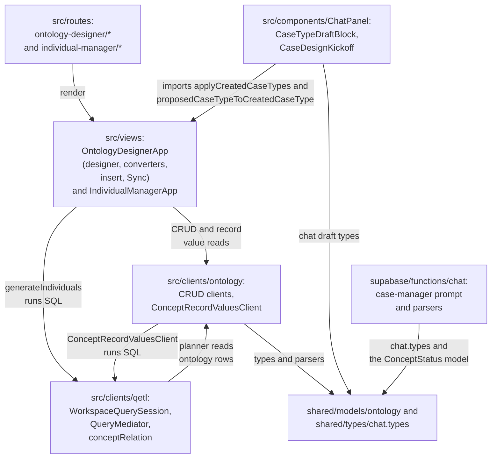
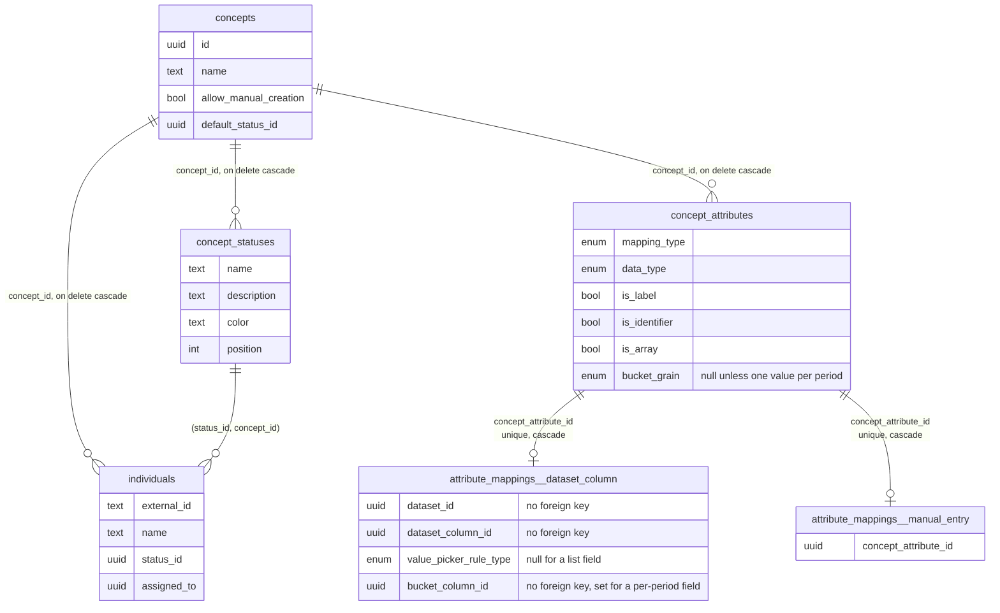
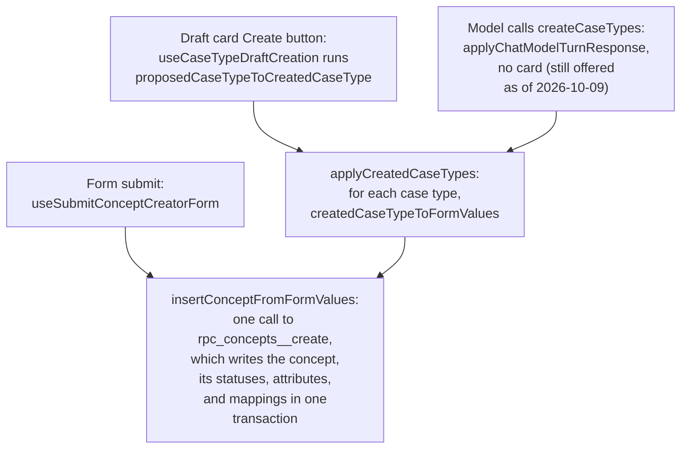
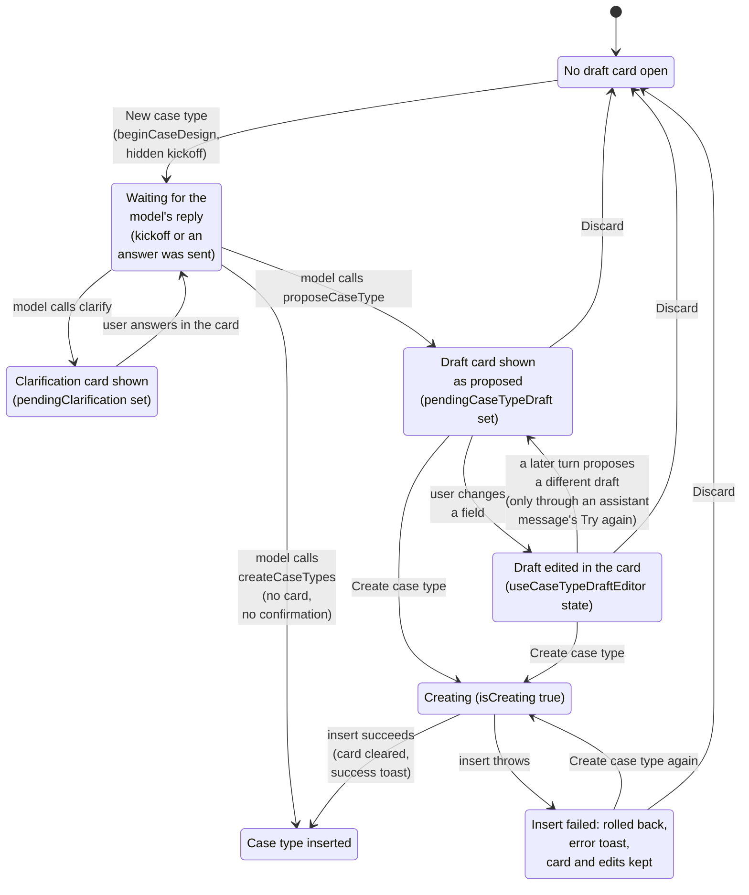
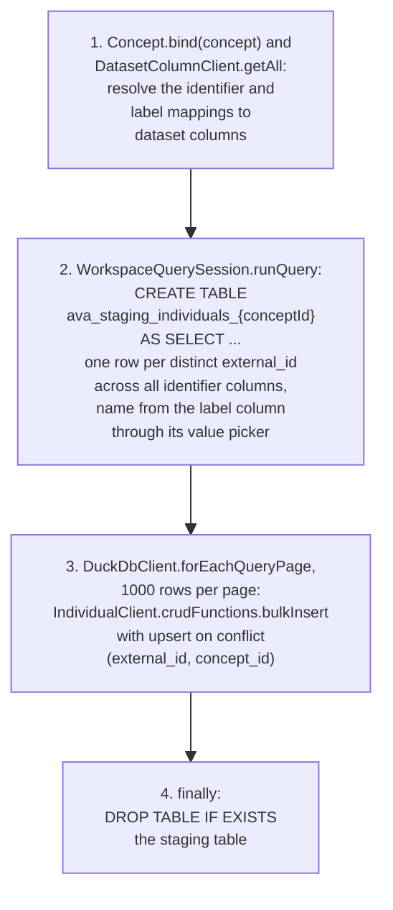
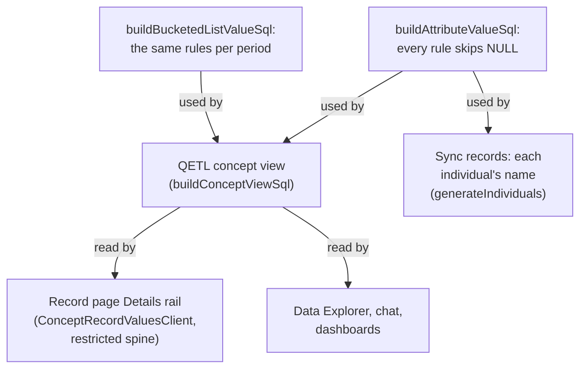
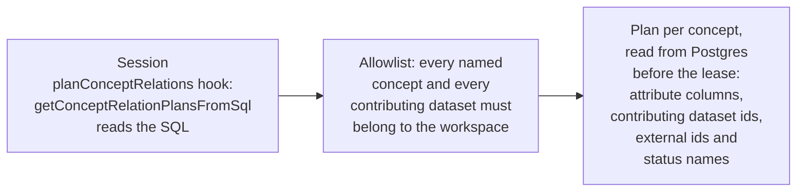
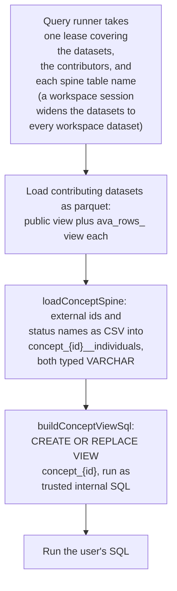
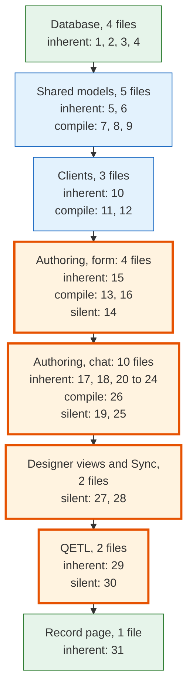
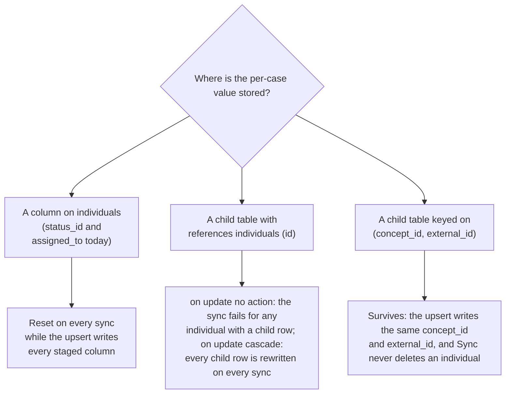

# Ontology architecture (case management)

How the ontology subsystem is built: the tables, the authoring paths, record
generation, value reading, the QETL bridge, and the UI. In the product it is
called **Case Manager**. Read this before changing anything under
`shared/models/ontology/`, `src/clients/ontology/`,
`src/views/OntologyDesignerApp/`, `src/views/IndividualManagerApp/`,
`src/components/ChatPanel/CaseTypeDraftBlock/`, or
`src/clients/qetl/QueryMediator/conceptRelation/`.

Terminology lives in [description-logic-nomenclature.md](description-logic-nomenclature.md).
The QETL engine this subsystem plugs into is described in
[qetl-architecture.md](qetl-architecture.md).

Behaviour marked **(as of 2026-10-09)** describes the code on that date and is
expected to change; everything else is the intended architecture.

## Contents

1. What the subsystem is
2. Terms
3. Code layout
4. Data model and row-level security
5. Authoring a case type
6. Generating records (Sync records)
7. Reading attribute values
8. Concepts as QETL relations
9. UI map
10. Invariants and rules
11. Design patterns and their caveats
12. How to add a new attribute source
13. How to add a per-case capability
14. How to add a dataset connector
15. Testing
16. Known limitations (as of 2026-10-09)
17. Roadmap and specs
18. References

## 1. What the subsystem is

A workspace imports datasets, and one real-world thing (a county, a patient) is
usually spread across several of them. A **case type** declares fields whose
values come from columns of those datasets; the app then shows one **record**
per real-world thing and lets SQL query the records like a table.

Internally this is Description Logic vocabulary [1]:

- The **TBox** (terminology) is the set of concepts, their attributes, and the
  mappings that say where each attribute's value comes from.
- The **ABox** (facts) is the individuals and their attribute values.

Two design facts:

- **Attribute values are never stored.** They are computed from the datasets
  every time they are read, which is the ontology-based data access (OBDA)
  reading of an ontology: a mapping defines an attribute as a query over the
  sources, and reading the ABox means evaluating those queries [2].
- **Individuals are stored.** Sync records materializes one `individuals` row
  per distinct dataset key, so concept membership (which keys belong to a case
  type) is persisted while attribute values stay virtual.

There is no reasoning: no subsumption between concepts and no roles
(relationships) between individuals. The TBox is a schema registry.

## 2. Terms

| Product term (UI) | Code term | Table | Model namespace |
| --- | --- | --- | --- |
| Case type | Concept | `concepts` | `Concept` |
| Field | Concept attribute | `concept_attributes` | `ConceptAttribute` |
| Where a field comes from | Attribute mapping | `attribute_mappings__dataset_column`, `attribute_mappings__manual_entry` | `AttributeMapping` |
| Record, case | Individual | `individuals` | `Individual` |
| A field's value on a record | Attribute assertion | none (computed) | none; read as `ConceptRecordValues` |
| Record's display name | Label attribute (`is_label`) | `concept_attributes` | |
| Join key of a dataset | Identifier attribute (`is_identifier`) | `concept_attributes` | |
| The key value | `external_id` | `individuals` | |
| Case Manager | Ontology Designer | routes under `/ontology-designer` | `OntologyDesignerApp` |
| Records screen | Individual Manager | routes under `/individual-manager` | `IndividualManagerApp` |

User-facing copy says case type, field and record; identifiers use the DL
names. Do not put DL terms in UI strings.

## 3. Code layout

- **Tables, policies, triggers**: `supabase/schemas/10.concepts.sql`, `20.concept_attributes.sql`, `20.individuals.sql`, `30.attribute_mappings__dataset_column.sql`, `30.attribute_mappings__manual_entry.sql`
- **RLS tests**: `supabase/tests/database/permissions/rls_{concepts,concept_attributes,individuals,attribute_mappings__dataset_column,attribute_mappings__manual_entry}.test.sql`
- **Shared models and parsers**: `shared/models/ontology/`
- **CRUD clients and mapping dispatch**: `src/clients/ontology/`
- **Value rules (the implementation for one value or every value)**: `src/clients/qetl/QueryMediator/conceptRelation/buildAttributeValueSql/`
- **Per-period values (the same rules, applied once per period)**: `src/clients/qetl/QueryMediator/conceptRelation/buildBucketedListValueSql/`
- **Field controls and formatters shared by the form, the draft card, the record page, and the results grid**: `src/components/caseFields/`
- **Record values for screens**: `src/clients/ontology/ConceptRecordValuesClient/`
- **Concepts as QETL relations**: `src/clients/qetl/QueryMediator/conceptRelation/`
- **Data Explorer status column**: `shared/models/queries/ConceptStatusColumn/`, `src/views/DataExplorerApp/makeQueryColumnsFromConcept/`
- **Case Manager (TBox authoring, Sync)**: `src/views/OntologyDesignerApp/`
- **Records screens (ABox browsing)**: `src/views/IndividualManagerApp/`
- **Case activity (comments, reactions, audit log)**: see [case-activity-architecture.md](measles-demo/case-activity-architecture.md)
- **Chat draft card and session kickoff**: `src/components/ChatPanel/CaseTypeDraftBlock/`, `src/components/ChatPanel/CaseDesignKickoff/`
- **Chat edge function pieces**: `supabase/functions/chat/PostChatMessages/parsing/parseProposeCaseType.ts`, `parseProposedCaseStatuses.ts`, `parseCreateCaseTypes.ts`, `prompt/buildCaseManagerSystemPrompt.ts`
- **Chat contract types**: `shared/types/chat.types.ts` (`ChatProposedCaseType`, `ChatCreatedCaseType`)
- **Routes**: `src/routes/_auth/$workspaceSlug/ontology-designer/`, `src/routes/_auth/$workspaceSlug/individual-manager/`

Module dependencies:

_Edges run both ways between the ontology clients and QETL, but no module
imports one that imports it: `ConceptRecordValuesClient` imports QETL, and
QETL imports only the ontology CRUD clients, which import nothing from QETL.
Keep it that way; a QETL module importing `ConceptRecordValuesClient` would
make a cycle._

The chat component layer imports from the views layer
(`useCaseTypeDraftCreation`).

## 4. Data model and row-level security

_Each attribute has exactly one mapping row, in the table its `mapping_type`
names. Every table also carries `workspace_id`, which the policies test. `concepts.default_status_id` points back at one of the case type's own statuses._

| Table | One row means | Notes |
| --- | --- | --- |
| `concepts` | A case type | `allow_manual_creation` is stored; nothing reads it yet. `default_status_id` is the status new records start in |
| `concept_statuses` | A status a case type's records can be in | Name unique per case type ignoring case; `color` is lowercase `#rrggbb`; `position` orders the set; `unique (id, concept_id)` is the target of both status foreign keys |
| `concept_attributes` | A field of a case type | `mapping_type` (`dataset_column`, `manual_entry`) discriminates which mapping table holds its mapping. `bucket_grain` makes a list field keep one value per period |
| `attribute_mappings__dataset_column` | "This field reads this column of this dataset, collapsed by this value picker" | `dataset_id`, `dataset_column_id`, and `bucket_column_id` are bare ids, not foreign keys. The value picker is NULL for a field that keeps every value (`is_array` with no `bucket_grain`). `bucket_column_id` names the date column a per-period field groups its rows by |
| `attribute_mappings__manual_entry` | "This field is typed by hand" | Holds no value; no table stores entered values yet |
| `individuals` | A record: one key of one case type | `unique (concept_id, external_id)`; `name` is `not null`; `status_id` and `assigned_to` are the only per-case state |

Field values have no table and no model. Screens read them as
`ConceptRecordValues` (section 7.2), keyed by attribute id, and take a value's
provenance from its field's mappings. (An `entity_field_values` table once
stored values; migration `20250929162612` dropped it.)

**RLS model.** Reads on all six tables test workspace membership
(`workspace_id = any(array(select util__get_auth_user_workspaces()))`), so the
Data Explorer and chat can query any case type in the workspace. Writes test
app roles through `util__auth_user_meets_min_app_role` (see
[permissions-architecture.md](permissions-architecture.md)): a Case Types
editor writes case types, attributes, mappings, and statuses, and a Case Types
admin deletes case types. Records accept inserts and updates from a Case Types
editor (who syncs them) or a Case Records editor, and deletes from a Case
Records admin. `tr_individuals__check_status_change` narrows that for one
column: only a Case Records editor may change a record's status. `anon` has no
grant.

Every `UPDATE` policy on these tables has both `using` and `with check`.

**Database-enforced integrity:**

- Concept delete cascades to statuses, attributes, mappings and individuals.
- The trigger `concept_attributes__validate_label_and_identifiers`
  (`after insert or update` on `concept_attributes`) requires exactly one label
  attribute per concept.
- A record's status and a case type's default status belong to that case
  type: both reference `concept_statuses (id, concept_id)`. The default's
  foreign key is deferred, so a case type and its statuses can be inserted in
  one transaction.
- A status that records use cannot be deleted, and neither can a case type's
  default. `rpc_concept_statuses__save` moves records to a replacement first.
- A new record without a status takes its case type's default
  (`tr_individuals__set_default_status`). Sync never sends a status.
- No attribute may be named `status` (`concept_attributes__name_not_reserved`),
  because the Data Explorer gives every case type a built-in `status` column.
- The same trigger also checks one identifier per contributing dataset, but
  **that half checks nothing on creation**: the insert path writes attributes
  before mappings, so the join to the mapping table is empty when it runs and
  the check passes vacuously. No trigger on the mapping tables re-checks it. See
  section 10 for where the rule is enforced instead.
- A field with a `bucket_grain` is a dataset list field that is neither the
  label nor an identifier (`concept_attributes__bucket_grain_requires_array`,
  `concept_attributes__bucket_grain_dataset_value_only`). Both are table
  checks, so they hold for every write.
- A dataset-column mapping names a `bucket_column_id` exactly when its field
  has a `bucket_grain`, and then a `date` or `timestamp` column of its own
  dataset (`tr__attribute_mappings__dataset_column__validate_bucket_column`,
  hints `bucket_column_not_allowed`, `bucket_column_required`,
  `bucket_column_not_in_dataset`, `bucket_column_not_a_date`). It runs on the
  mapping, after the RPC has written the field, so unlike the identifier check
  it never runs too early. It is `SECURITY DEFINER`, because it must read the
  field and the column whatever the caller's RLS allows, and a `BEFORE`
  trigger runs ahead of the RLS `with check`. So it looks up both only inside
  the mapping's own workspace, a field or column of another workspace reads
  as missing, and its errors name only ids the caller sent. It fires on an
  insert and on an update of `concept_attribute_id`, `dataset_id`, or
  `bucket_column_id`, so retyping a date column later does not lock other
  edits to the mapping.
- `rpc_concepts__create` writes `bucket_grain` and `bucket_column_id`. It
  refuses a dataset field whose value picker does not match its shape: a
  field that keeps every value names none, and every other dataset field, a
  per-period one included, names one (hint `value_rule_mismatch`, the check
  `(is_array and bucket_grain is null) = (rule is not null)`). It also refuses
  a list field that is the label or an identifier (hint
  `list_field_is_key_or_label`). Both raise `23514`. They check only case
  types created through the RPC.

## 5. Authoring a case type

Every creation, from any entry point, persists through one function,
`insertConceptFromFormValues`
(`src/views/OntologyDesignerApp/insertConceptFromFormValues/insertConceptFromFormValues.ts`).

Where:

- **`attribute_mappings__*`** - the per-kind mapping tables.

_Three entry points share one writer. The database writes the whole case type
or nothing, so a failed or abandoned creation leaves no partial case type._

### 5.1 The shared insert: one transaction

- `ConceptClient.create` calls `rpc_concepts__create` once, with the concept,
  its statuses, its attributes, and one array per mapping kind. The RPC
  inserts them in that order inside one transaction.
- The RPC is `SECURITY INVOKER`, so each insert passes the caller's RLS. A
  caller without Case Types editor fails on the first insert, and nothing is
  written.
- The client builds each payload with the model parsers (`makeParserRegistry`
  strips each to the table's columns), so the whole form object can be passed
  as the concept. Child rows take the case type's id and workspace from the
  inserted concept.
- New case types start with Active (the default) and Inactive, built by
  `makeDefaultStatusDrafts` in the creator's language. A field named after a
  dataset column called `status` is renamed `status (attribute)`.

### 5.2 Form path (concept creator)

`src/views/OntologyDesignerApp/ConceptCreatorView/`, route
`/ontology-designer/concept-creator`. Nothing in the Case Manager screens links
to it; it is reached from Spotlight or by URL.

- Form state (`conceptFormTypes.ts`) keeps **one attribute list per mapping
  kind** (`datasetColumnAttributes`, `manualEntryAttributes`) plus
  `sourceDatasets` (the join key chosen per dataset), and every attribute
  carries a draft of every mapping kind (`AttributeFormValues.mappings`; a type
  test enforces a key per kind).
- `transformValues` in `index.tsx` derives the identifier attributes from the
  join key choices, concatenates the per-kind lists into one `attributes`
  list, and flags the label.
- Manual-entry fields are hidden when `FeatureFlag.DisableManualData` is on.
- The value rule select offers only the rules the field's column type allows
  (`ValuePickerRule.getAllowedRuleTypes`). On submit, `transformValues` runs
  every field through `withFieldDataTypes`, which replaces a rule its column
  does not allow (`ValuePickerRule.toAllowedRuleType`) and stores the column's
  type for a field that keeps every value and the rule's output type
  otherwise. An identifier field always uses `most_frequent`: the select is
  disabled with the note "ID fields keep their value as is.", and
  `withDefaultValueRule` resets an identifier's rule to the default on submit.
- Each dataset field has a **One value** / **Every value** / **Per period**
  switch (`ValueShapeControl`). The value picker shows for one value and for a
  period, where it reduces each period's rows, and its label says so.
  **Per period** adds `PeriodControls`: a period select and a date column
  select over the date and timestamp columns of the field's dataset. It starts
  at month and the dataset's first date column. The switch is locked to One
  value, with a note, on a dataset's ID column and on the title field
  (`ValueShapeFields`), and choosing a field as either clears its period and
  date column. The submit transform also keeps identifiers and the label to one
  value with no period (`keepKeyAndLabelFieldsSingle`), and
  `insertConceptFromFormValues` writes no value picker for a list but keeps
  one for a per-period field.
- A per-period field with no date column fails validation
  (`createBucketColumnValidator`): the date column select shows "Choose the
  date column for this field" and the submit stops. The error is stored at the
  field's `bucketGrain` path, so choosing a period or a date column through
  `writeFormShapeFields` clears it. A dataset with no date column locks the
  select and says so under it.

A field can also keep one value per period (`bucketed_list`): per day, week,
month, quarter, or year of a date or timestamp column of its dataset, each
period reduced by the field's rule. The form and the draft card offer it as a
third choice, **Per period**, beside **One value** and **Every value**. Chat
proposes it when the user asks for a value "per month" or another period.

### 5.3 Chat path (design session and draft card)

Both visible "New case type" controls call
`ChatPanelStateManager.beginCaseDesign`, which opens the chat aside in composer
mode, bumps `caseDesignSessionNonce`, and clears any pending draft. `ChatPanel`
reacts to the nonce with `startNewChat`, which appends a hidden kickoff message
(`CaseDesignKickoff`, `"[Begin case type design]"`) so the assistant speaks
first. Any `/ontology-designer` path maps to chat context `case-manager`
(`makeChatPageContextFromPathname`).

On the edge function (`PostChatMessages`, context `case-manager`):

- `buildCaseManagerSystemPrompt` replaces the unified prompt. It is built from
  catalog metadata only (dataset and column names, types and ids, existing case
  type names), never row values.
  It tells the model every case type already has a built-in status, and asks
  for a status set, each status with a one-sentence description for the people
  working the cases, when the case type implies a workflow. It also tells the
  model to propose a per-period field, with a period and a date column of the
  same dataset, when the user wants a value per day, week, month, quarter, or
  year.
- Tools offered: `clarify`, `proposeCaseType`, `createCaseTypes`. The prompt
  tells the model to open with one clarification, then propose a fully
  prefilled draft (clarifying again only for a genuine ambiguity), and not to
  call `createCaseTypes`.
- `parseProposeCaseType` sanitizes the draft: it drops sources without a join
  key, attributes whose dataset is not a declared source, and a label that is
  not one of the attributes, defaults unknown value pickers to
  `most_frequent`, and replaces a value picker its column's catalog type does
  not allow with `most_frequent` too (`ValuePickerRule.toAllowedRuleType`).
  It reads each attribute's `valueShape` (`single` unless the model said
  `list` or `bucketed_list`) and keeps every join key and the label column to
  `single`, with no period. It keeps a per-period proposal only when it names
  a known period and a `date` or `timestamp` column of the same dataset that
  the catalog lists. Otherwise the field falls back to `single` with no period
  and the user can choose one in the card. A period sent with any other shape
  is dropped.
  The catalog columns are required at every level, from `fetchWorkspaceSchema`
  through `runChatAttemptsWithEscalation`. A column the catalog does not list
  keeps the proposed rule, and the client drops that attribute.
  It renames an attribute named "status" to "status (attribute)"
  (`ConceptStatus.toNonReservedAttributeName`), and keeps the proposal's status
  set only when it is valid as a whole (`parseProposedCaseStatuses`: 1 to 12
  statuses, names unique case-insensitively, the default one of them, colors
  from the palette with missing ones filled by `ConceptStatus.getNextFreeColor`).
  An invalid or absent set is dropped, and the client supplies the default set.

On the client, the draft becomes `pendingCaseTypeDraft` and
`CaseTypeDraftBlock` renders it.
The card lists the proposed statuses, or the translated default set for a
proposal with none, each badge beside its description, and swaps the list for
`StatusSetEditor` when the user chooses Edit statuses. An attribute or
hand-filled field named "status" is flagged and blocks Create.
Each attribute row has a **One value** / **Every value** / **Per period**
switch, locked on join keys and the label. Choosing a field as a join key or
label switches it to one value and drops its period. **Per period** shows
`PeriodControls` beside the rule select, with the date columns of the field's
dataset, which the card reads from the catalog. Create is disabled while an
included per-period field's date column is missing or is not one of its
dataset's date columns, which includes the moment before the catalog loads.
The session as a state machine:

_The composer is disabled in Case Manager (as of 2026-10-09), so every path
back to the model goes through a clarification card or an assistant message's
Try again button. New chat or New case type restarts from any state._

The draft card converts to the insert payload in two steps that do no I/O:

1. `proposedCaseTypeToCreatedCaseType` applies the user's edits: keeps checked
   attributes, re-includes every join key, drops sources left with no
   attribute, and falls back to the first join key as the label.
   It carries each attribute's `valueShape`, forced to `single` for the label
   and join keys, and its value picker for one value and for a period only. A
   per-period attribute also carries its period and date column.
   It also carries the card's status set as `statuses` and
   `defaultStatusName`.
2. `createdCaseTypeToFormValues` (called by `applyCreatedCaseTypes`) resolves
   column ids against the workspace's `dataset_columns` (unknown ids are
   dropped, and so is a per-period attribute whose date column is not a date
   or timestamp column of its own dataset), adds a missing identifier
   attribute for any source whose join key was not an attribute, and makes the
   first identifier the label when none is set.
   It holds each field's rule to its column's type and stores the rule's
   output type as the field's `data_type`. An identifier field always gets
   `most_frequent` and keeps its key column's type. Each mapped attribute's
   `isArray` and `dataType` come from `ConceptAttribute.valueShapeToIsArray`
   and `ConceptAttribute.getOutputDataType`, so a per-period field's type is
   its rule's output type.
   It builds the status set with `makeStatusSetValueFromChatStatuses`: chat's
   statuses with fresh ids and the named default, or the default set when chat
   sent none, which is always the case for `createCaseTypes`.

## 6. Generating records (Sync records)

`generateIndividuals`
(`src/views/OntologyDesignerApp/ConceptMetaView/generateIndividuals/generateIndividuals.ts`),
triggered by **Sync records** on the case type detail page. It recomputes the
full set of individuals for one concept in browser DuckDB and upserts them. It
computes no attribute values.

_Each page is a separate PostgREST request, so a sync has no atomicity: a
failed page leaves the earlier pages written._

Design points:

- The staging table carries the `ava_staging_individuals_` prefix because a
  bare UUID in a DuckDB table name always means a dataset to
  `RelationRef.fromTableName`.
- `neededColumnsByDatasetId` names the columns read (each dataset's key column,
  plus the label column), so the mediator does not acquire whole datasets for a
  `CREATE TABLE AS`, which has no top-level select list to infer from.
- The label must be a `dataset_column` attribute; Sync reads no other kind.
- The name is `buildAttributeValueSql` over the label mapping (section 7.1),
  so it is the label's first, or most frequent, non-NULL value.

**Current overwrite behaviour (as of 2026-10-09).** Each staged row carries a
fresh `gen_random_uuid()` id, `NOW()` timestamps, `status = 'active'` and
`assigned_to = NULL`, and the upsert (PostgREST `merge-duplicates`, nine
columns in the payload) updates every column it sends. So every sync:

- gives every existing individual a **new `id`** (open record URLs then hit
  TanStack Router's generic "Not Found"),
- **resets `status` and `assigned_to`**, and resets `created_at`,
- never deletes individuals whose keys left the data,
- fails a whole page (and stops) when a label resolves to NULL, because
  `individuals.name` is `not null`; this happens for keys that exist only in a
  dataset other than the label's, and for keys whose label cells are all NULL
  (or mostly NULL under `most_frequent`).

The fix direction: stage only `workspace_id`, `concept_id`, `external_id`,
`name` and `updated_at`, give `status` a column default, so the merge refreshes
names and new rows take defaults. See section 13.

## 7. Reading attribute values

A field has a **value shape** (`ConceptAttribute.ValueShape`, derived from
`bucket_grain` and `is_array` by `ConceptAttribute.getValueShape`):

| Shape | `is_array` | `bucket_grain` | Value picker | Value |
| --- | --- | --- | --- | --- |
| `single` | false | NULL | required | One value, picked by the rule |
| `list` | true | NULL | NULL | Every non-NULL value in `file_row_number` order, `[]` when there is none |
| `bucketed_list` | true | set | required | One entry per period that has a value, oldest first, `[]` when there is none |

A list or per-period field is never the label or an identifier. A list field's
`data_type` is its column's type, the type of one element. A per-period field's
is its rule's output type, the type of one period's value.

A per-period field is `STRUCT(bucket DATE, value R)[]`: one entry per period
with a non-NULL value, ordered by `bucket`, `[]` when none. `bucket` is
`CAST(date_trunc(<period>, <date column>) AS DATE)`, so weeks start on Monday
and quarters are calendar quarters. A missing period means no data, not zero.
`buildBucketedListValueSql`
(`src/clients/qetl/QueryMediator/conceptRelation/buildBucketedListValueSql/buildBucketedListValueSql.ts`)
normalizes the record's rows to `(bucket, value, row_order)`, where
`row_order` is `file_row_number`. It drops rows with a NULL value or a NULL
date, and applies the rule per period:

| Rule | Per period | `R` |
| --- | --- | --- |
| `first` | `first(value ORDER BY row_order)` | column type |
| `most_frequent` | count each value, then the highest count, ties by value | column type |
| `sum`, `avg` | `CAST(... AS DOUBLE)` | `DOUBLE` |
| `count` | `COUNT(value)` | `BIGINT` |
| `max`, `min` | `MAX`, `MIN`, uncast. A text column uses the same `arg_max` and `arg_min` as the single-value rule | column type |

A plain `TIMESTAMP` or `DATE` column is cut on its stored wall clock. A
`TIMESTAMP WITH TIME ZONE` column is read in UTC first
(`timezone('UTC', <column>)`), so a record's periods do not move with the
viewer's session time zone. Planning decides which it is (`isBucketColumnZoned`
in `makeConceptAttributeColumnsFromMetadata`), from the column's stored type
and its `detectedDataType`: it is zoned when the stored type is `timestamp`
and the detected type is `TIMESTAMP_TZ` or `TIMESTAMP WITH TIME ZONE`. A column
retyped to `timestamp` from another detected type is cast to a plain
`TIMESTAMP` on load, and is not zoned.

Attribute values are computed per read, by one function.
`buildAttributeValueSql`
(`src/clients/qetl/QueryMediator/conceptRelation/buildAttributeValueSql/buildAttributeValueSql.ts`)
turns one dataset-column mapping into a correlated subquery over one dataset,
keyed by the outer row's record key. The concept view uses it for every
dataset-backed attribute that is not per-period, and Sync uses it for each
record's name. A per-period field is built by `buildBucketedListValueSql`,
which applies the same rules once per period. Every other reader, the record
page included, reads the view.

Where:

- **Restricted spine** - a spine holding only the records a caller named
  (section 7.3).

_Changing a value rule means changing `buildAttributeValueSql`, and
`buildBucketedListValueSql` for a per-period field. The record page, the Data
Explorer, chat, dashboards, and Sync's names all follow._

### 7.1 Value pickers

A dataset is usually finer-grained than the case type, so each dataset-column
mapping names one of seven rules (a Postgres enum,
`attribute_mappings__value_picker_rule_type`), and an `is_array` attribute with
no `bucket_grain` keeps every value instead and names no rule. A per-period
field names a rule too and applies it to each period (section 7). Each renders
as a correlated scalar subquery over one dataset, filtered by the outer row's
key and by `IS NOT NULL` on the value.

| Shape | SQL shape | Determinism |
| --- | --- | --- |
| `first` | Reads `ava_rows_<datasetId>`, `ORDER BY file_row_number LIMIT 1` | Total order within a parquet file |
| `most_frequent` | `GROUP BY col ORDER BY COUNT(*) DESC, col LIMIT 1` | Ties broken by value |
| `max`, `min` | `MAX(col)`, `MIN(col)`, in the column's own type. On a text column: `arg_max(col, {'k': lower(strip_accents(CAST(col AS VARCHAR))), 'v': col})` for `max` and `arg_min` for `min`, so text compares alphabetically, ignoring case and accents, and gives back the original value. `'10' < '9'` still holds | Ties share one value. On text, values that share a key (`'apple'`, `'Apple'`) break by the value in byte order, because the struct compares field by field |
| `count` | `COUNT(col)`, `BIGINT`. `0` when no row matches | Exact |
| `sum`, `avg` | `CAST(<agg>(col) AS DOUBLE)` | Floating-point |
| List (`is_array`) | Reads `ava_rows_<datasetId>`, `COALESCE(list(col ORDER BY file_row_number), [])` | Row order; `[]` when there is no value |

**NULL means "no value".** No rule reads a NULL cell: `first` returns the
first non-NULL value, `most_frequent` the most frequent non-NULL value, a list
leaves NULL out, a per-period field ignores a row whose value or date is NULL,
and the aggregates skip NULL as they always have.

Key comparison is always
`CAST(outer."external_id" AS VARCHAR) = CAST(dataset."<key>" AS VARCHAR)`
(`getEntityKeyComparisonSql` in `src/clients/DuckDbClient/duckDbSqlText.ts`),
because `external_id` is Postgres `text` and a dataset key is often `BIGINT`.
Every identifier is quoted with `quoteSqlIdentifier`, and every value column is
qualified with the `dataset` alias, so a column name may contain `"` and a
value column named like a spine column cannot bind to the outer row.

The rule names are hand-written in four places: the database enum,
`DatasetColumnMappings.ValuePickerTypes` (which `parseProposeCaseType.ts` also
reads), `ChatCaseValuePickerRuleType` in `shared/types/chat.types.ts`, and the
tool's JSON schema in `makeChatToolConfigFromOptions.ts`.
`ValuePickerRule` matches the rules exhaustively, so a new enum value does not
compile until its output type and allowed column types are declared. The
correction migration also lists them, once, in SQL.

Value shapes are hand-written in five places too: `ConceptAttributeValueShape`,
`ChatCaseValueShape`, `parseProposeCaseType`, `parseCreateCaseTypes`, and both
tool schemas in `makeChatToolConfigFromOptions.ts`. Branches on a shape are
exhaustive `match`es, so widening `ConceptAttributeValueShape` makes
`pnpm type-check` list every other site.

**Typed rules.** Every rule has an output type, and a field's `data_type` is
always that type: `first`, `most_frequent`, `max`, and `min` keep the column's
type; `sum` and `avg` emit `double`; `count` emits `bigint`. A list field
stores its column's type, and so does an identifier field, which always uses
`most_frequent` because it shows the record's key as is. `sum` and `avg` are
allowed only on `bigint` and `double` columns, and `max` and `min` on every
type but `boolean`. The option labels say "alphabetically" for text, which
holds for accented Latin letters: the comparison ignores case and accents,
as the table says. Letters with no accent to strip are not folded: ß, æ, ø,
and ł keep their own place, so "Øystein" sorts after "Zebra".
`buildAttributeValueSql` takes the column's type (`columnDataType`) to know
when to compare that way.
`ValuePickerRule` (`shared/models/ontology/ValuePickerRule/`) is the one
implementation of this table, used by every authoring path. The query planner
refuses a stored rule its column's current type does not allow, naming the
field, which can only happen when the column's type is edited after the field
was made. A `DECIMAL` result keeps its scale when it is read back
(`arrowTableToJS`), so `max` and `min` over a decimal column read correctly.
Rows saved before the rules were typed were corrected by the hand-written
migration `*_correct_value_rule_data_types.sql`. It replaces a disallowed rule
with `most_frequent`, sets every identifier field's rule to `most_frequent`,
and sets each field's `data_type` to its rule's output type. It skips
manual-entry fields and any dataset-column mapping left over on one, mappings
whose column no longer exists, and mappings whose column belongs to another
dataset.

### 7.2 Record page read path

`useRecordFields`
(`src/views/IndividualManagerApp/SingleIndividualView/useRecordFields/`) reads
the case type's attributes, their mappings, the datasets those mappings name,
and `ConceptRecordValuesClient.getConceptRecordValues({ workspaceId,
conceptId, externalIds: [externalId] })`.

The client accepts at most 500 distinct keys and checks that before any read.
It then runs two reads side by side: the view's columns, through
`getConceptAttributeColumnsFromConceptId` (the read the planner uses), and
`SELECT * FROM "concept_<id>"` with `conceptSpineRestrictions` naming the
requested keys. It throws when the result's column names differ from the ones
the column read named, which happens when fields are edited between the two
reads; a retry recovers. Otherwise it maps each result column back to its
attribute through the column's `attributeId`, so two attributes with one name
never swap values, and returns `ConceptRecordValues` (`{ externalId,
valuesByAttributeId }`) for each key that names a record, in request order.

Rows reach JavaScript through `arrowTableToJS`
(`src/clients/DuckDbClient/duckDbArrowResults/duckDbArrowResults.ts`), which
turns lists into plain arrays and converts the fields of structs and maps, list
items included, the way it converts a top-level value. That is how a per-period
entry's `bucket` arrives in JavaScript: as `YYYY-MM-DD` text.

The rail shows every field of the case type in name order:

- a NULL value (a manual-entry field is always one) as "No value";
- a per-period field as a table of its periods and their values (section 9),
  or "No value" when it has none;
- under each value, the names of the datasets the field's mappings read;
- on a failed read of the fields or the values, a callout with Try again
  instead of placeholder rows.

The rows stay loading until the values and the source reads have both
arrived. A failed source read is not an error: the fields show without source
names. A case type with no fields reads no values. Record values are cached
under `["ConceptRecordValuesClient", "getConceptRecordValues", params]`, and
`invalidateDatasetRowQueries` marks every case type's values stale after a
Google Sheets or Postgres dataset refresh.

### 7.3 Restricted reads

`conceptSpineRestrictions` (`ConceptSpineRestriction[]`, each `{ conceptId,
externalIds }`) is an option on `WorkspaceQuerySession.runQuery`. It travels
through the mediator to the planner hook unchanged, never into the SQL. A
session without a planner (the public session) refuses a non-empty one. A
virtual dataset's nested query never receives the outer statement's
restrictions, because its bytes are cached without them.

`getConceptRelationPlansFromSql` checks each restriction before any read: it
must name a concept the statement reads, at most once, with at most 500
distinct keys. A restriction on SQL that reads no such concept, a dataset-only
statement included, is refused. For a restricted concept the spine holds only
the named records, read by `getIndividualsByExternalIds`: 50 keys per
PostgREST `in` filter, and a key holding `"` or `\`, or starting with a space
or tab, alone with an `eq` filter, because `postgrest-js` does not escape those
inside a list and PostgREST trims leading whitespace there. A key that names no
record has no spine row, and an empty restriction gives an empty spine.

The spine and the view keep their usual names. Every query that names the
concept rebuilds both inside its own lease, so a restricted view never answers
another workspace query. A public snapshot query never reads a concept view:
`runDuckDbRawQuery` refuses any relation but a dataset in public mode, and
refuses an internal table such as an individuals staging table.

## 8. Concepts as QETL relations

Any SQL naming `concept_<id>` (written by `RelationRef.toTableName`) is answered
by a DuckDB view built inside that query's lease. Nothing is materialized or
cached, and no source wrapper is involved. QETL itself is described in
[qetl-architecture.md](qetl-architecture.md); the spec is
[2026-08-18-qetl-concept-relations-design.md](superpowers/specs/2026-08-18-qetl-concept-relations-design.md).

Where:

- **lease** - an exclusive, per-name hold on DuckDB tables; work on the same
  names runs one at a time.

_Planning reads only the SQL text and Postgres, and finishes before the query
runner takes the lease._

_The view must be created last: DuckDB binds a view's sources when the view is
defined, so the datasets and the spine must already exist._

| Piece | File | What it guarantees |
| --- | --- | --- |
| Planning | `conceptRelation/getConceptRelationPlansFromSql/getConceptRelationPlansFromSql.ts` | No Postgres read for SQL that names no concept; foreign concepts and contributors throw (fail closed); statuses are read once per concept and matched to each record by `statusId`, and a record whose status is missing throws; a caller's `conceptSpineRestrictions` narrow a spine to the named records (section 7.3) |
| Column resolution | `conceptRelation/makeConceptAttributeColumnsFromMetadata.ts` | One column per attribute; one key column per dataset; `status` and `external_id` are taken before any attribute (`ConceptModule.STATUS_COLUMN_NAME`, `ConceptModule.RECORD_KEY_COLUMN_NAME`), and duplicate names (including an attribute named `status` or `external_id`) are suffixed `_2`, `_3`, ignoring case as DuckDB does (`EXTERNAL_ID` becomes `EXTERNAL_ID_2`; `age` and `Age` become `age` and `Age_2`). The names come from `ConceptAttribute.getViewColumnNames`, which gives each field a `columnName` (the view column) and a `resultName` (the name its value carries in a query result: the field's own name, unless an earlier field has the same name ignoring case, then its `columnName`). `QueryColumn.makeFromConceptAttributes` calls it too, so a structured query reads a suffixed field from its own column (`QueryColumn.sourceColumnName`) and still names the result column after the field; each column carries its attribute's id (`attributeId`); manual-entry and unmapped attributes become typed NULL columns; a missing dataset column or key column throws; a single-value attribute whose rule its column's type does not allow throws, naming the field. A per-period attribute needs a rule and a date column that exists, belongs to the dataset its mapping reads, and is a `date` or `timestamp`, and throws naming the field otherwise, as does a field with no period whose mapping names a date column. `getConceptAttributeColumnsFromConceptId` fetches each per-period mapping's date column along with its value column, and the resolved column carries `bucketGrain`, `bucketColumnName`, and `isBucketColumnZoned` |
| Spine | `conceptRelation/loadConceptSpine/loadConceptSpine.ts`, `conceptRelation/toCsvRows/toCsvRows.ts` | Keys and status names travel as RFC 4180 CSV, never spliced into SQL; both columns pinned to `VARCHAR`; empty `external_id` refused; empty concept gets an empty table with both typed columns |
| View | `conceptRelation/buildConceptViewSql/buildConceptViewSql.ts` | `FROM` is the spine alone, every attribute a correlated subquery, so the grain is one row per individual and a missing contribution is NULL; `external_id` and `status` come from the spine and win over an attribute of the same name, compared ignoring case; attribute columns sorted by name for byte-stable SQL; every dataset-backed value from `buildAttributeValueSql`, or from `buildBucketedListValueSql` for a per-period attribute. A list attribute reads every non-NULL value through `buildAttributeValueSql` and ignores any value picker its mapping still stores. An unmapped list attribute is `CAST([] AS <type>[])`, and an unmapped per-period attribute is `CAST([] AS STRUCT("bucket" DATE, "value" <type>)[])`. A single attribute with no value picker throws at planning (`makeConceptAttributeColumnsFromMetadata`) and when its SQL is built (`buildAttributeValueSql`) |
| Per-period columns | `conceptRelation/buildBucketedListValueSql/buildBucketedListValueSql.ts` | One entry per period that has a value, ordered by period, `[]` when none; a row with a NULL value or date never reaches a rule; a zoned timestamp is cut in UTC; an unmapped per-period field is a typed `[]`; a missing, foreign, or non-date date column throws at planning |
| Ordering and lease | `src/clients/qetl/QueryMediator/queryRunner.ts`, `conceptRelation/loadConceptRelations.ts` | Datasets, then spine, then view, then user SQL; spine names included in the lease |

**Naming.** `concept_<id>` is the view; `concept_<id>__individuals` is the
spine and deliberately does not resolve as a relation. Chat SQL uses short
aliases (`c0`, `c1`) that `SqlTableAlias` rewrites to `"concept_<uuid>"` on the
edge function; see
[2026-08-19-chat-concept-aliases-design.md](superpowers/specs/2026-08-19-chat-concept-aliases-design.md).
Structured queries reach the view through `structuredQueryToSql`, which emits
`concept_<id>` for a concept data source, including a form that is out of
sync with its SQL.

**Projected loads.** `getNeededColumnsFromQuery` lets a query load only the
columns it reads. For a concept view that is each dataset-backed attribute's
value column and its dataset's key column, and a per-period field's date column
too: a load without it would leave the view unable to bind.

**The status column.** Every concept view has a `status` column holding each
record's status name. The Data Explorer offers it after the attributes as a
`ConceptStatusColumn` base column whose id is the case type's id, so
`Model.getTypedId` gives it the same identity on every load and a selected
status column survives a refetch of the column list or a restore from the URL
(`makeQueryColumnsFromConcept`, used by `useQueryColumnsForDataSource` and
`getRestoredColumnsFromUrl`). Filters, grouping and aggregation need nothing
special, because they read only a base column's `name` and `dataType`.
Filters match the status name, so renaming a status changes
what a saved `status = '...'` filter matches. Chat's schema line lists each
case type's statuses in position order (`- c0: Cholera case (age, status:
Suspected | Confirmed)`), online through `fetchWorkspaceSchema` and offline
through `fetchOfflineChatSchema`.

**List columns in the explorer and dashboards.** List cells reach JavaScript
as plain arrays (`arrowTableToJS`), a list's dates as `YYYY-MM-DD` and its
timestamps as ISO strings, and a list result column is
`{ dataType: "varchar", isArray: true }`. A list query column
(`QueryColumn.isList`) can be shown, sorted, grouped, and counted; it is not
offered to filters, number aggregations, chart measures
(`QueryColumn.isNumeric` is false), or dashboard local filters. A saved
aggregation a list does not allow is reset to none before the SQL is built,
and a saved filter on a list is reported or dropped. The results grid joins a
list's values with `; `. Chat's schema line marks a list field
`<name> (list)` and lists each field under its view column name.
`SqlTableAlias.formatListFieldNote` explains `list_contains`, `len`, and
`UNNEST`, online and offline.

**Per-period columns in the explorer and chat.** A per-period field is a list
in every Data Explorer gate (`QueryColumn.isList`): it can be shown, sorted,
grouped, and counted, and is kept out of filters, number aggregations, chart
measures, and dashboard local filters. Its result column is a list's, with
`bucketGrain` added when the query reads the field whole (no aggregation, or
group by): `QueryColumn.getBucketGrain` sets it on the projection descriptor,
binding copies it onto the result column, and
`reconcileQueryResultColumnBindings` compares it. The results grid reads each cell as `label: value; label: value`
(`makeDataGridColumnDefs`), with each period labelled in the user's locale by
its length and each value kept to two decimals
(`useDataGridPeriodFormatters`). Chat's schema line marks a per-period field
`Temperature [per month: STRUCT(bucket DATE, value DOUBLE)[]]`, ahead of any
`(field "...")` note, and does not call it a list.
`SqlTableAlias.formatBucketedFieldNote` explains reading the entries with
`UNNEST`. `fetchWorkspaceSchema` and
`fetchOfflineChatSchema` supply `bucket_grain` and `data_type` for the marker.

## 9. UI map

| Route (under `src/routes/_auth/$workspaceSlug/`) | Renders | Key files |
| --- | --- | --- |
| `ontology-designer/route.tsx` | Case Manager slate; list pane on detail routes | `src/views/OntologyDesignerApp/index.tsx`, `ConceptNavbar.tsx`, `NewCaseTypeButton.tsx` |
| `ontology-designer/index.tsx` | Home grid of case types, delete with confirm | `src/views/OntologyDesignerApp/CaseTypeHome/` |
| `ontology-designer/$conceptId.tsx` | Case type page (`AppView`): record and attribute counts, Description, Attributes, and Statuses with a record count per status. Refresh records, View records, and Delete (in the overflow menu) are each hidden without the permission they need. Statuses are the only part editable after creation, through the Edit statuses modal. List fields carry an Every value badge, and per-period fields a badge naming the period (`useBucketGrainLabels`) | `src/views/OntologyDesignerApp/ConceptMetaView/` (`CaseTypeActions.tsx`, `CaseTypeAttributesList.tsx`, `CaseTypeStatusesSection.tsx`, `CaseTypeStatusList/`, `EditStatusesModal/`, `CaseTypeRail.tsx`, `useHydratedConcept.ts`) |
| `ontology-designer/concept-creator.tsx` | Concept creator form, with a Statuses section that starts from the default set | `src/views/OntologyDesignerApp/ConceptCreatorView/` (`ConceptStatusesFieldset/`) |
| `individual-manager/index.tsx` | Redirect to Case Manager home | |
| `individual-manager/$conceptId/route.tsx` | Records slate: an `AppListPane` with a status filter and the count of records it matches, each row marked with its status color, plus the outlet | `src/views/IndividualManagerApp/index.tsx`, `IndividualNavbar/` (`StatusFilter/`), `makeRecordsListWhere/`, `useConceptIndividuals.ts`, `useVirtualIndividualLinks.tsx`, `EditCaseTypeButton.tsx` |
| `individual-manager/$conceptId/index.tsx` | Select-a-record or sync-first empty state | `src/views/IndividualManagerApp/IndividualSelectionEmptyState/` |
| `individual-manager/$conceptId/$individualId.tsx` | Record page (`AppView`): the status beside the name (a menu for a Case Records editor, a badge for everyone else, each status's description on hover and focus), the activity feed and composer, and a fixed details band above that feed holding the case's fields (each with the datasets it reads, "No value" when empty, and a retry on failure) and record facts. Each value reads by its field's type (`createFieldValueFormatter`: dates and timestamps as dates in UTC, times as times, numbers grouped and at full precision, yes or no in words). A list field shows every value, formatted the same way: a list longer than five shows its first five and a Show all toggle. A per-period field shows as a table of period and value (`RecordFieldPeriodTable`): the six most recent periods, and an inline Show all toggle for the rest when there are more. Periods are labelled in the user's locale, and values keep at most two decimals. Each field's sources are a list named "Sources of <field>" | `src/views/IndividualManagerApp/SingleIndividualView/` (`RecordStatusControl/`, `useRecordStatusChange/`, `CaseActivityFeed/`, `CaseDetailsRail.tsx`, `useRecordFields/`, `RecordFactsGroup/`, `RecordFieldValue/`, `DetailsStatus/`), `src/components/caseFields/useFieldValueFormatter/`, `src/components/caseFields/useBucketPeriodFormatter/`, `src/components/caseFields/useBucketValueFormatter/` |

Outside the routes:

- **Chat draft card**: `src/components/ChatPanel/CaseTypeDraftBlock/`, rendered
  by `ChatThread` when `pendingCaseTypeDraft` is set.
- **Field controls and formatters**: `src/components/caseFields/` holds
  `ValueShapeControl` (One value, Every value, Per period) and `PeriodControls`
  (the period and date column selects), which the draft card and the case type
  form share, `makeDateColumnOptions`, `useBucketGrainLabels`, and the
  formatters `useBucketPeriodFormatter` and `useBucketValueFormatter`, which
  the record page and the results grid share.
- **Status components**: `src/components/caseStatuses/` holds `StatusSetEditor`
  (the controlled status set editor), `StatusBadge`, `StatusDot`, and
  `StatusColorPicker`. The create form and the Edit statuses modal use the
  editor.
- **Status cache invalidation**: `invalidateCaseStatusQueries`
  (`src/views/IndividualManagerApp/invalidateCaseStatusQueries/`) is the one
  place a record's status change or a status set save marks queries stale:
  the case type's record lists and counts, its statuses, every Data Explorer
  query, and the route loader.
- **Record value invalidation**: `invalidateDatasetRowQueries`
  (`src/views/DataManagerApp/DatasetMetaView/invalidateDatasetRowQueries/`)
  marks every `ConceptRecordValuesClient` query stale after a Google Sheets or
  Postgres dataset refresh. A status change or a Sync changes no value, so
  neither touches them.
- **Sidebar**: `WorkspaceLayout` adds one link per case type to its records
  screen.
- **Spotlight**: `SpotlightLinks.ontologyDesignerCreatorView` opens the form.
- Within this subsystem, chat runs only on `/ontology-designer` paths (context
  `case-manager`, where the composer is disabled as of 2026-10-09); records
  screens get chat context `other`, where chat is off.

## 10. Invariants and rules

| Rule | Enforced by | Notes |
| --- | --- | --- |
| One individual per `(concept_id, external_id)` | `individuals__concept_external_id_unique` in `supabase/schemas/20.individuals.sql` | The Sync upsert's conflict target and the source of the view's grain |
| Exactly one label attribute per concept | Trigger `concept_attributes__validate_label_and_identifiers`, `supabase/schemas/20.concept_attributes.sql` | `after insert`, so the bulk attribute insert is counted as a whole |
| One identifier attribute per contributing dataset | Not the database (see section 4). `createdCaseTypeToFormValues` (chat), form validation (`primaryKeyColumnId: isNotEmpty`), and a query-time throw in `makeConceptAttributeColumnsFromMetadata` | Any new authoring path must enforce it itself |
| At most one mapping row per attribute in each mapping table | `unique` on `concept_attribute_id` in both mapping tables | Nothing requires a row to exist (a partial write can leave none), and nothing checks that the row's table matches `mapping_type`; `_mappingsFromAttributes` keeps them consistent |
| TBox writes go concept, statuses, attributes, mappings, in one transaction | `rpc_concepts__create` | The label trigger relies on attributes arriving in one statement |
| Reads test workspace membership; writes test Case Types or Case Records roles | Policies in the six schema files; pgTAP files in `supabase/tests/database/permissions/` | A new ontology table follows the same split |
| Concept delete removes its whole subtree | `on delete cascade` foreign keys | Individuals and statuses included |
| A record's status is one of its own case type's statuses | `individuals__status_fkey` | `concepts__default_status_fkey` has the same shape for the default |
| A bare UUID DuckDB table name means a dataset | `RelationRef.fromTableName` (`shared/models/relations/RelationRef/`) | Hence `concept_`, `ava_rows_`, `ava_staging_individuals_` prefixes and the `__individuals` suffix (`src/clients/DuckDbClient/duckDbSqlText.ts`, `loadConceptSpine.ts`) |
| Keys are compared as text | `getEntityKeyComparisonSql`, `duckDbSqlText.ts` | Applies to every value read: the view and Sync |
| No user data spliced into concept SQL | `loadConceptSpine` loads keys and status names as CSV through `toCsvRows`; spine restrictions travel as data to `getIndividualsByExternalIds` | A restricted read narrows the spine, never the SQL |
| No value rule reads a NULL cell | `buildAttributeValueSql`, `buildBucketedListValueSql` | NULL means "no value": `first` and `most_frequent` skip it, lists leave it out, and a per-period field drops a row whose value or date is NULL |
| Identifiers in value SQL are quoted | `buildAttributeValueSql`, `getEntityKeyComparisonSql` (`quoteSqlIdentifier`) | A column name may contain `"` |
| A spine restriction names a concept the query reads, once, with at most 500 distinct keys | `getConceptRelationPlansFromSql` | Fails closed before any read |
| A concept view's `status` is the record's status | `makeConceptAttributeColumnsFromMetadata` reserves the name; `buildConceptViewSql` drops an attribute column of that name | Behind the `concept_attributes__name_not_reserved` check |
| `first` and lists order by `file_row_number` | `buildAttributeValueSql` and `buildBucketedListValueSql` (`row_order`); the `ava_rows_` view is created by `src/clients/DuckDbClient/duckDbParquetLoad.ts` | Never use `row_number() OVER ()`; parallel scan order is unstable |
| Concept refs and contributors outside the workspace throw | `getConceptRelationPlansFromSql` | Do not change this to dropping the reference: a stale view could answer |
| Datasets and the spine before the view | `queryRunner._runLeasedQuery`, `loadConceptRelations` | DuckDB binds a view's sources when it is defined; the code loads datasets, then the spine, then the view. The lease must include each spine name (`_getLeaseNames`) |
| An edge function's model imports stay free of `shared/lib/uuid.ts` | Nothing automatic. `deno info --config supabase/functions/<fn>/deno.json supabase/functions/<fn>/index.ts` lists an import that does not resolve, which `deno check` (`pnpm type-check:deno`) does not | `uuid` is a bare specifier that `supabase/functions/chat/deno.json` does not map, so a model that reaches that file stops the function from booting. `ConceptModule.STATUS_COLUMN_NAME` has no dependencies for this reason: `ConceptAttributeModule` reads the name from it instead of importing the status column model |
| Chat prompt sees catalog metadata only | `buildCaseManagerSystemPrompt` | Never add row values |
| A field's `data_type` is its rule's output type (its column's type for a list field or an identifier) | `ValuePickerRule.getOutputDataType` in `createdCaseTypeToFormValues` and the form's `withFieldDataTypes`; the correction migration for older rows | A column type edited later in the Data Manager can leave it stale (section 16) |
| A dataset field names a value picker exactly unless it keeps every value | `rpc_concepts__create` (`(is_array and bucket_grain is null) = (rule is not null)`); `makeConceptAttributeColumnsFromMetadata` throws for a single or per-period field without one | Case types created before list fields could store no rule may keep an unread rule on a list field |
| A list field is never the label or an identifier | `rpc_concepts__create`; `parseProposeCaseType`, `parseCreateCaseTypes`, `useCaseTypeDraftEditor`, `proposedCaseTypeToCreatedCaseType`, `createdCaseTypeToFormValues`, `keepKeyAndLabelFieldsSingle` | Sync and record names read the label as one value. A per-period field is a list for this rule, and the form's ID and title controls also clear its period and date column |
| A field with a `bucket_grain` is a dataset list field that is neither the label nor an identifier | `concept_attributes__bucket_grain_requires_array` and `concept_attributes__bucket_grain_dataset_value_only`, `supabase/schemas/20.concept_attributes.sql` | Table checks, so they hold for every write |
| A mapping names a `bucket_column_id` exactly when its field has a `bucket_grain`, and then a `date` or `timestamp` column of its own dataset | Trigger `tr__attribute_mappings__dataset_column__validate_bucket_column`, `supabase/schemas/30.attribute_mappings__dataset_column.sql` | `SECURITY DEFINER`, scoped to the mapping's workspace, fired only by an insert or an update of its three columns (section 4). Planning checks the same three facts again for a column retyped later |
| A zoned timestamp is cut into periods in UTC | `buildBucketedListValueSql`, through `isBucketColumnZoned` from `makeConceptAttributeColumnsFromMetadata` | Only a `timestamp` column detected as `TIMESTAMP_TZ` or `TIMESTAMP WITH TIME ZONE` is zoned. Passing the flag for a plain `TIMESTAMP` reverses its meaning |
| A per-period field is a list in every Data Explorer gate | `QueryColumn.isList` | Sort, group by, and count only. No filter, sum, or chart measure |
| A stored rule is one its column's type allows | Option lists use `ValuePickerRule.getAllowedRuleTypes`; `parseProposeCaseType`, `createdCaseTypeToFormValues`, and `withFieldDataTypes` replace a disallowed rule; `makeConceptAttributeColumnsFromMetadata` throws on one | List fields apply no rule and are not checked. A per-period field is checked like a single value |
| Every draft attribute names a declared source with a join key | `parseProposeCaseType`, `parseCreateCaseTypes`, `useCaseTypeDraftEditor` | Otherwise column resolution throws at query time |

## 11. Design patterns and their caveats

| Pattern | Where | Caveat |
| --- | --- | --- |
| Description Logic TBox/ABox split [1] | Tables, models, clients, apps | No reasoning: no subsumption, no roles |
| OBDA with global-as-view mappings [2], [3] | Mappings, `buildAttributeValueSql`, `buildConceptViewSql` | Concept membership is materialized |
| Mediator with wrappers | `QueryMediator` | Concepts use a planner hook, not a wrapper |
| Table Data Gateway plus Data Mapper | `createRdbCrudClient`, `makeParserRegistry` | `ConceptRecordValuesClient` is a service client with no table |
| Tagged union with exhaustive `match` | Five `match(mappingType)` sites | No runtime registry of per-kind behaviour; `AttributeMappingModelRegistry` is a type only |
| Adapter chain onto one writer | `proposedCaseTypeToCreatedCaseType`, `createdCaseTypeToFormValues` | The chat path fabricates form-only fields |
| Single-transaction RPC | `rpc_concepts__create`, `rpc_concept_statuses__save` | The save RPC is `SECURITY DEFINER` and checks Case Types editor itself, because it moves records |
| Staging table then merge | `generateIndividuals` | The merge overwrites every column and never deletes (as of 2026-10-09) |
| Fail-safe defaults | Concept allowlist, column resolution, spine loader | A `dataset_column` attribute with no mapping row becomes a typed NULL column rather than a throw |
| Injected reads around a pure core | `ConceptRelationAllowlist`, `makeConceptAttributeColumnsFromMetadata` | Older code calls singleton clients directly and is harder to test |
| Reducer stores | `ChatPanelStateManager`, `ConceptCreatorStore` | `ConceptCreatorStore` holds only derived strings |

## 12. How to add a new attribute source

A new mapping kind is for values that are not rows of a dataset (for example a
`computed` field derived from other attributes of the same individual). A value
that comes from an external system should be a **dataset connector** plus a
`dataset_column` mapping instead, which needs no ontology change
(section 14).

The checklist below is for a `computed` kind, as of 2026-10-09. **Compile**
means TypeScript lists the site once the database enum gains the value;
**silent** means nothing fails until a user hits it.

| # | File | Change | Caught by |
| --- | --- | --- | --- |
| 1 | `supabase/schemas/20.concept_attributes.sql` | Add the enum value; decide label and identifier eligibility (the trigger only consults dataset mappings) | Inherent |
| 2 | New `supabase/schemas/30.attribute_mappings__computed.sql` | Table (`concept_attribute_id unique references concept_attributes on delete cascade`, `workspace_id`, config), four policies with a `using` on `UPDATE`, `updated_at` trigger, index | Inherent |
| 3 | New `supabase/tests/database/permissions/rls_attribute_mappings__computed.test.sql` | Cross-tenant tests, plus an insider update | Inherent |
| 4 | `apps/desktop/sync/syncable-tables.ts` | List the table in `ACTIVE_TABLES` or `EXCLUDED_TABLES` (the SQLite generator errors otherwise) | Inherent |
| 5, 6 | New `shared/models/ontology/AttributeMapping/ComputedMapping/ComputedMapping.types.ts` and `ComputedMappingParsers.ts` | Model and parsers | Inherent |
| 7 | `shared/models/ontology/AttributeMapping/AttributeMapping.types.ts` | `AttributeMappingModelRegistry` key | Compile |
| 8 | `shared/models/ontology/ConceptAttribute/ConceptAttributeParsers.ts` | Hard-coded `z.enum` | Compile (zod type test) |
| 9 | `shared/models/ontology/ConceptAttribute/ConceptAttributes.ts` | Metadata entry (no readers) | Compile |
| 10 | New `src/clients/ontology/ComputedMappingClient.ts` | `createRdbCrudClient` call | Inherent |
| 11 | `src/clients/ontology/AttributeMappingClient.ts` | `bulkInsert` arm | Compile |
| 12 | `src/clients/ontology/ConceptAttributeClient.ts` | `getAllAttributeMappings` arm | Compile |
| 13 | `src/views/OntologyDesignerApp/ConceptCreatorView/conceptFormTypes.ts` | `mappings.computed` draft in both factories | Compile |
| 14 | `src/views/OntologyDesignerApp/ConceptCreatorView/index.tsx` | Per-kind list, its block, and the `.concat` in `transformValues` | **Silent** (a missing `.concat` drops the attributes) |
| 15 | New `ConceptCreatorView/ComputedAttributesBlock.tsx` | Form block | Inherent |
| 16 | `insertConceptFromFormValues.ts`, `supabase/schemas/50.rpc_concepts__create.sql`, and `ConceptClient.create` | `_mappingsFromAttributes` arm, plus a parameter and an insert for the new mapping table | Compile for the arm; **Silent** for the RPC (the new kind's mappings are never written) |
| 17 | `shared/types/chat.types.ts` | `ChatCreatedCaseAttribute` arm, proposal list | Inherent |
| 18 | `supabase/functions/chat/PostChatMessages/parsing/parseProposeCaseType.ts` | Parse the list | Inherent |
| 19 | `supabase/functions/chat/PostChatMessages/parsing/parseCreateCaseTypes.ts` | `kind` branch | **Silent** (unknown kinds dropped) |
| 20 | `supabase/functions/chat/PostChatMessages/prompt/makeChatToolConfigFromOptions.ts` | Both tool schemas | Inherent |
| 21 | `supabase/functions/chat/PostChatMessages/prompt/buildCaseManagerSystemPrompt.ts` | When to propose it | Inherent |
| 22, 23, 24 | `src/components/ChatPanel/CaseTypeDraftBlock/useCaseTypeDraftEditor.ts`, `CaseTypeDraftCard.tsx`, new section component | Draft card editing | Inherent |
| 25 | `src/views/OntologyDesignerApp/proposedCaseTypeToCreatedCaseType/proposedCaseTypeToCreatedCaseType.ts` | Carry the list | **Silent** |
| 26 | `src/views/OntologyDesignerApp/createdCaseTypeToFormValues/createdCaseTypeToFormValues.ts` | Kind branch and `_makeMappedAttribute` draft | Compile |
| 27 | `src/views/OntologyDesignerApp/ConceptMetaView/CaseTypeAttributesList.tsx` | Badge ternary labels every non-dataset kind "Entered manually" | **Silent** |
| 28 | `src/views/OntologyDesignerApp/ConceptMetaView/generateIndividuals/generateIndividuals.ts` | Only if the kind may be the label | **Silent** (crash) |
| 29 | `src/clients/qetl/QueryMediator/conceptRelation/buildConceptViewSql/buildConceptViewSql.ts` | Column kind and selector; a computed column needs an outer `SELECT`, since DuckDB cannot reuse an alias whose expression is a subquery | Inherent |
| 30 | `src/clients/qetl/QueryMediator/conceptRelation/makeConceptAttributeColumnsFromMetadata.ts` | Otherwise the kind becomes a typed NULL column | **Silent** |
| 31 | `src/views/IndividualManagerApp/SingleIndividualView/useRecordFields/makeCaseDetailsRowsFromAttributes/makeCaseDetailsRowsFromAttributes.ts` | Source names for the new kind, if shown | Inherent |

Generated afterwards: the migration (`pnpm db:new-migration`, after the
Supabase switch checks in `CLAUDE.md`), `shared/types/database.types.ts`, and
`apps/desktop/migrations/*.gen.sql`. No change is needed in
`ConceptRecordValuesClient`, the routes, `useHydratedConcept`,
`getConceptRelationPlansFromSql` or `getNeededColumnsFromQuery`.

Where:

- **Numbers** - rows of the table above; arrows follow its order.
- **Green** - only inherent edits; **blue** - incidental edits, all caught by
  the compiler; **orange, thick border** - at least one silent edit.

_31 files: 17 inherent, 8 compile-enforced, 6 silent. Search for the silent
sites by name before declaring a new kind done._

Why it is scattered, and what would consolidate it:

- Per-kind behaviour is a `match` repeated at each call site; a runtime
  registry (client, record reader, view-column builder, form block) per kind
  would collapse items 7, 8, 9, 11, 12, 16, 27 and 30.
- Form state and the chat contract keep one list per kind; a single attribute
  list removes items 13, 14, 25 and 26.

### 12.1 Adding a value shape

A new value shape (`single`, `list`, and `bucketed_list` exist) starts by
widening `ConceptAttributeValueShape` and `ChatCaseValueShape`; `pnpm
type-check` then lists every exhaustive branch. These sites compile without
change and must be found by hand:

| Site | Failure if missed |
| --- | --- |
| `rpc_concepts__create` column lists and its `value_rule_mismatch` check | Columns silently not written; fields refused |
| The model parsers' `DBReadSchema` | Columns dropped from reads and from the insert payload |
| `getConceptAttributeColumnsFromConceptId` (the dataset columns it fetches for a mapping) | Planning cannot find a column the shape reads |
| `getNeededColumnsFromQuery` (the columns it unions per dataset) | A projected load omits it and the view fails to bind |
| `parseProposeCaseType` and the key and label coercion in the parser, the draft editor, `_keepKeyFieldsSingle` in the form, and `keepKeyAndLabelFieldsSingle` | The shape is read as one value, or kept on a key |
| `SqlTableAlias.formatSchemaBlock`'s markers and notes, `fetchWorkspaceSchema`, `fetchOfflineChatSchema` | Chat writes SQL for the wrong shape |
| `makeDataGridColumnDefs` | The grid prints `[object Object]` |

## 13. How to add a per-case capability

Status workflows, comments, assignment and manually entered values are state
written by users, keyed to an individual, and not derived from datasets. Where
that state lives decides whether Sync erases it:

_Incremental sync (October 2026) upserts only `external_id`, `name`, and
`missing_from_source_at`, so it no longer rewrites `id`, `status`, or
`assigned_to`. All three placements now keep their data. Comments use an
`id`-keyed child table (`comments.individual_id`), covered by a Sync replay
in `supabase/tests/database/case_activity/comment_audit_triggers.test.sql`.
Statuses take the column placement: `individuals.status_id`, which Sync
never sends and the default trigger fills on insert._

Layers a per-case capability touches:

1. **Sync first.** Narrow the upsert (section 6) or key the new table on
   `(concept_id, external_id)`.
2. **Schema**: the new table(s) with membership policies (with a `using` on
   `UPDATE`), pgTAP tests, and `syncable-tables.ts`.
3. **Models and clients** for the new tables.
4. **Record page**: controls in `SingleIndividualView`, the way the status
   control sits beside the name; new kinds of activity go through
   `activityFeedItemRenderers` (see
   [case-activity-architecture.md](measles-demo/case-activity-architecture.md)).
5. **A list or grid view** to filter by the new state. The records list pane
   filters by status: `StatusFilter` picks the statuses, and
   `makeRecordsListWhere` builds the one `where` that both the
   page query and the count use. A new filter follows the same path. The pane
   still has no ordering or search.
6. **QETL**, if SQL and dashboards should see the state: the spine carries
   `external_id` and the status name (`ConceptRelationPlan.spineRows`, written
   by `toCsvRows`), so a new per-case field widens the spine row type, the
   spine's columns in `loadConceptSpine`, and the view's select list, as status
   does.
7. **Chat**, if case types should propose the capability: types, parser, tool
   schema, prompt, and draft card, as status sets do
   (`parseProposedCaseStatuses`, `proposeCaseType.statuses`,
   `CaseTypeDraftStatusSection`).
8. **Permissions**: writes need Case Types or Case Records roles (section 4).
   A capability that some writers must not change, like status, needs its own
   guard, the way `tr_individuals__check_status_change` guards `status_id`.
   Assignment needs a principal model (see
   [permissions-architecture.md](permissions-architecture.md)).

## 14. How to add a dataset connector

No ontology change is needed. Ontology SQL names only two relations per
dataset, its public view `"<datasetId>"` and `ava_rows_<datasetId>`, and both
are created by `DuckDbClient.loadParquet` for every relation the mediator loads.
Every source wrapper returns a parquet blob (`AcquiredRelation.parquetBlob`),
and the dataset wrapper's own rule in `createDefaultRegistry.ts` is that a new
source type is "an entry in this match plus a wrapper". Two conditions, both
needed by the Data Explorer anyway: `dataset_columns.name` must equal the parquet
column names, because ontology SQL quotes `datasetColumn.name`; and keys may be
of any type, because every value read compares them as text (section 7.1).

## 15. Testing

Follow [rules/testing.md](rules/testing.md). Existing coverage:

| Layer | Files | Run with |
| --- | --- | --- |
| RLS (pgTAP) | `supabase/tests/database/permissions/rls_concepts.test.sql` and the four peers | `pnpm test:db`, only after `ava supabase status` reports the right project for the current branch (on any branch other than `develop`, that means its own switched project; see `CLAUDE.md`) |
| Concept view and column resolution against real DuckDB | `src/clients/qetl/QueryMediator/conceptRelation/buildConceptViewSql/buildConceptViewSql.executed.test.ts`, `src/clients/qetl/QueryMediator/conceptRelation/__tests__/conceptAttributeColumns.integration.executed.test.ts`, `src/clients/qetl/QueryMediator/conceptRelation/toCsvColumn/toCsvColumn.executed.test.ts`, `src/clients/qetl/QueryMediator/conceptRelation/toCsvRows/toCsvRows.executed.test.ts`, `tests/integration/queries/structuredQueryConcepts.executed.test.ts` | `pnpm vitest run --config vitest.executed.config.ts <files>` (or `pnpm test:executed`) |
| Value rules (NULL, ties, quoting) against real DuckDB | `src/clients/qetl/QueryMediator/conceptRelation/buildAttributeValueSql/buildAttributeValueSql.executed.test.ts` | `pnpm test:executed <file>` |
| Value rule table | `shared/models/ontology/ValuePickerRule/ValuePickerRuleModule/ValuePickerRuleModule.test.ts` | `pnpm test:frontend ValuePickerRule` |
| Value rule output types against real DuckDB | `buildConceptViewSql.executed.test.ts` (`value rule output types`) | `pnpm test:executed buildConceptViewSql` |
| Rule and data type correction of older rows | `supabase/migration-upgrade-tests/value_rule_data_types.*.sql` | `pnpm test:db`, after the switch check |
| QETL planning, spine, ordering | `src/clients/qetl/QueryMediator/conceptRelation/**/*.test.ts`, `src/clients/qetl/QueryMediator/__tests__/QueryMediator.concepts.test.ts`, `src/clients/qetl/WorkspaceQuerySession/WorkspaceQuerySession.membership.test.ts` | `pnpm vitest run <paths>` |
| Authoring conversion and draft card | `src/views/OntologyDesignerApp/**/*.test.ts(x)`, `src/components/ChatPanel/CaseTypeDraftBlock/*.test.ts(x)`, `src/components/ChatPanel/CaseDesignKickoff/CaseDesignKickoff.test.ts` | `pnpm vitest run <paths>` |
| Edge function parsing and prompt | `supabase/functions/chat/PostChatMessages/parsing/parseProposeCaseType.test.ts`, `parseCreateCaseTypes.test.ts`, `prompt/buildCaseManagerSystemPrompt.test.ts` | `pnpm vitest run <paths>` |
| Records UI | `src/views/IndividualManagerApp/**/*.test.tsx` | `pnpm vitest run <paths>` |
| Record values and the record page rail | `src/clients/ontology/ConceptRecordValuesClient/**/*.test.ts`, `src/views/IndividualManagerApp/SingleIndividualView/useRecordFields/**/*.test.ts`, `tests/e2e/record-page-field-values.spec.ts` | `pnpm vitest run <paths>`; the spec with `pnpm test:e2e record-page-field-values.spec.ts`, on its own |
| A list field from the chat draft to the record page | `tests/e2e/case-list-field.spec.ts` | `pnpm test:e2e case-list-field.spec.ts`, on its own |
| Per-period fields: the table checks, the mapping trigger, and the RPC | `supabase/tests/database/concept_attributes__bucketed_list.test.sql` | `pnpm test:db`, after the switch check |
| Per-period values against real DuckDB: each rule, NULLs, ties, zoned timestamps | `src/clients/qetl/QueryMediator/conceptRelation/buildBucketedListValueSql/buildBucketedListValueSql.executed.test.ts`, `src/clients/qetl/QueryMediator/conceptRelation/__tests__/perPeriodConceptQuery.integration.executed.test.ts` | `pnpm test:executed <file>` |
| A per-month field on the record page and in the Data Explorer | `tests/e2e/case-bucketed-fields.spec.ts` | `pnpm test:e2e case-bucketed-fields.spec.ts`, on its own |
| Status column end to end | `tests/e2e/case-statuses-data-explorer.spec.ts` | `pnpm test:e2e case-statuses-data-explorer.spec.ts`, on its own |

Gaps to close when touching the code: no test covers
`insertConceptFromFormValues` or Sync's upsert semantics (its tests assert the
staging SQL text), and no pgTAP case checks that a workspace member can update
a row. Value-picker tests must construct
ties, since a rule deterministic only without ties is not deterministic.

## 16. Known limitations (as of 2026-10-09)

Verified means reproduced (database, DuckDB CLI, or the running app); read
means established from the code.

| Limitation | Effect | Status |
| --- | --- | --- |
| Sync takes keys from every dataset but the name from one | A multi-dataset case type with an uncovered key fails to sync, after partial writes | Read |
| Chat offers manual-entry fields regardless of `DisableManualData` | Such fields always show "No value", since nothing stores entered values | Read |
| A dataset column's type edited after a field reads it leaves the field's `data_type` stale | The Data Explorer offers menus for the old type; a rule the new type disallows makes the case type fail to plan, with a message naming the field | Read |
| Sync never deletes individuals | Records whose keys left the data stay | Read |
| `getPage` in `createSupabaseCrudClient` uses an inclusive range with no order | Duplicate rows in the records list; duplicate spine keys past 500 individuals | Verified (duplicate-key warnings; rolled-back replay) |
| Identifier-per-dataset trigger check runs before mappings exist | The database never enforces one key per dataset | Read |
| No foreign key from mappings to datasets or columns | Deleting a dataset breaks every concept that reads it | Read |
| `createCaseTypes` still offered to the model | A call creates case types with no confirmation and default pickers | Read |
| Composer disabled in Case Manager | The prompt's "revise the draft" turn is unreachable, and a kickoff that fails (shown with no error, a separate gap) can be retried only through New chat or New case type | Verified (app) |
| Draft card join key options are the proposed attributes only | A key column the model did not list cannot be chosen | Read |
| The form allows a manual-entry label | Sync then fails with a TypeError | Read |
| Only a Google Sheets or Postgres refresh marks record values stale | Re-uploading a CSV or XLSX, deleting a dataset, or a live source going stale leaves an open record page on its cached values | Read |
| A global dashboard filter bound to a list column's name | It emits `IN`, `ILIKE`, or `=`, which fail on a list, so that block's query fails | Read |
| Saving a result with a list column as a new dataset | The column is saved with a `varchar` type over a list | Read |
| The Data Explorer cannot filter inside a list | Filtering by a value a list contains needs chat SQL (`list_contains`) | Read |
| Per-period fields have only a list's Data Explorer operations | Filtering or charting by period needs chat SQL | Read |
| Periods never follow a local time zone | A plain `timestamp` is cut on its stored wall clock and a zoned one in UTC, so a moment just after local midnight can count toward the previous UTC day | Read |
| A date column retyped after a per-period field is created | If it is no longer a date or timestamp, every query of the case type fails at planning, naming the field, until the field is fixed | Read |
| Nothing refuses a later change to `bucket_grain` on a field that has a mapping | A direct update by a Case Types editor can leave a period with no date column, or a date column with no period, and every query of the case type then fails at planning | Read |
| A per-period date or boolean value shows raw in the results grid | The grid reads every per-period value as a decimal, since the result column carries no value type | Read |
| A raw SQL result has no period length | A per-period column's entries show their periods as `YYYY-MM-DD` | Read |

Not built: roles between concepts, subsumption, status change history,
assignment, activity log, manual entry storage, editing a case type, manual
creation of individuals, a records grid with filters, incremental sync,
concepts on public dashboards (`PublicQuerySession` has no concept planner, and public reads refuse concept views),
and the auto-limit guard for large concepts.

## 17. Roadmap and specs

- [production-plan-world-humanitarian-day.md](production-plan-world-humanitarian-day.md):
  P2 (cross-product query fabric, the ABox as a queryable source), P3.2
  (sharing for ontology and case resources), P5 (Ontology Designer: roles,
  subsumption, manual entry, incremental generation), P5b (configurable TBox,
  status sets), P5c (case management product: comments, assignment, status
  workflow, list view). Its note that concept delete does not cascade is out of
  date; the schema cascades.
- [superpowers/specs/2026-08-18-qetl-concept-relations-design.md](superpowers/specs/2026-08-18-qetl-concept-relations-design.md):
  the concept view, spine, and determinism rules. The consolidation of the
  record page onto the view and the removal of `_runConceptQuery` it describes
  are both done.
- [superpowers/specs/2026-08-19-chat-concept-aliases-design.md](superpowers/specs/2026-08-19-chat-concept-aliases-design.md):
  `cN` aliases in chat SQL.
- [description-logic-nomenclature.md](description-logic-nomenclature.md): the
  vocabulary and the rename history.

## 18. References

[1] F. Baader, D. Calvanese, D. L. McGuinness, D. Nardi, and P. F.
    Patel-Schneider, Eds., *The Description Logic Handbook: Theory,
    Implementation, and Applications*. Cambridge, U.K.: Cambridge Univ. Press,
    2003.

[2] A. Poggi, D. Lembo, D. Calvanese, G. De Giacomo, M. Lenzerini, and
    R. Rosati, "Linking data to ontologies," *J. Data Semantics X*, LNCS 4900,
    pp. 133-173, 2008. https://doi.org/10.1007/978-3-540-77688-8_5

[3] M. Lenzerini, "Data integration: a theoretical perspective," in *Proc. 21st
    ACM SIGMOD-SIGACT-SIGART Symp. Principles of Database Systems (PODS)*, 2002,
    pp. 233-246. https://doi.org/10.1145/543613.543644
