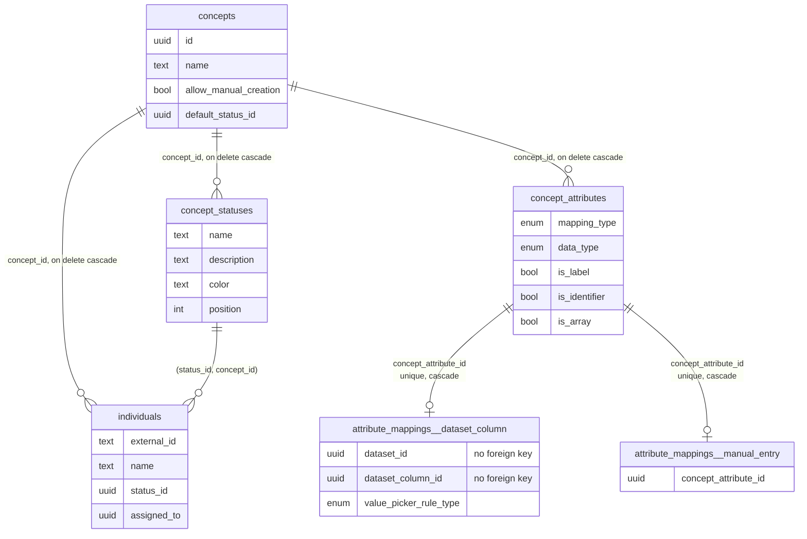

# Case Statuses 2: Data Model Implementation Plan

> **For agentic workers:** REQUIRED SUB-SKILL: Use superpowers:subagent-driven-development (recommended) or superpowers:executing-plans to implement this plan task-by-task. Steps use checkbox (`- [ ]`) syntax for tracking.

**Goal:** Store each case type's statuses in a `concept_statuses` table, give every record a `status_id` and every case type a `default_status_id`, backfill existing data, add the creation and status-set RPCs, and switch case-type creation to one atomic call that sends the default status set.

**Architecture:** Composite foreign keys on `(id, concept_id)` keep a record's status and a case type's default inside that case type. A `before insert` trigger fills a new record's status from its case type's default, so Sync keeps sending no status. A second trigger stops a Case Types editor (who may sync records) from changing a record's status unless they are also a Case Records editor. Creation becomes `rpc_concepts__create` (security invoker, so RLS applies), and status-set edits become `rpc_concept_statuses__save` (security definer, with its own role check). On the client, a new `ConceptStatus` model carries the palette and the pure set helpers that the screens in plan 3 build on.

**Tech Stack:** Postgres (Supabase declarative schema, pgTAP, migration upgrade tests), TypeScript, Zod, Vitest, Lingui.

**Spec:** `docs/superpowers/specs/2026-10-25-case-statuses-design.md` §4.5, §5, §6, §7, §11 (creation), §14 (ontology doc). **Overview and shared names:** `docs/superpowers/plans/2026-10-25-case-statuses.md`

**Prerequisite:** plan 1 (`2026-10-25-case-statuses-1-app-roles.md`) has landed: `public.app_type` has `case_types` and `case_records`, and the ontology tables' write policies use them.

---

## Required skills

- **`supabase-declarative-schema`** before Tasks 1 to 6 (it lives at `agent-skills/public-skills/skills/supabase-declarative-schema/SKILL.md`). Edit `supabase/schemas/`, run `pnpm db:reset` and then immediately `pnpm db:new-migration <name>`, and never hand-edit what it generates. The backfill in Task 3 is the one hand-written migration, because `db diff` never emits DML.
- **`ava-model-creation`** before Task 8.
- **`test-driven-development`** throughout.

## Database command rule

Every step that runs `pnpm db:reset`, `pnpm db:new-migration`, `pnpm test:db`, `supabase test db`, or the migration replay script starts with:

```bash
ava supabase status
```

Expected: the first line is green and names the `feat-statuses` project. If it is yellow or names `avandar`, stop and run `ava supabase switch`. Never pass `--linked` or `--db-url` to `supabase test db`.

## Migration order (do not deviate)

| Order | Migration | Kind | Contents |
| --- | --- | --- | --- |
| 1 | `<ts>_add_concept_statuses.sql` | generated | `concept_statuses` with policies, grants, indexes, trigger; nullable `concepts.default_status_id` and its deferred foreign key |
| 2 | `<ts>_add_individuals_status_id.sql` | generated | nullable `individuals.status_id`, its composite foreign key and index, the default-status and status-change triggers |
| 3 | `<ts>_backfill_case_statuses.sql` | hand-written | statuses for every existing case type, defaults, record statuses, rename of attributes called "status" |
| 4 | `<ts>_require_case_statuses.sql` | generated | `not null` on both columns, drop `individuals.status`, `concept_attributes__name_not_reserved` |
| 5 | `<ts>_add_rpc_concepts__create.sql` | generated | `rpc_concepts__create` |
| 6 | `<ts>_add_rpc_concept_statuses__save.sql` | generated | `rpc_concept_statuses__save` |

The backfill has to run after the columns exist and before they are required, which is why the structural change is split around it.

**Known gap inside this plan:** from Task 4 until Task 15, creating a case type in the app fails, because the database requires a default status that the client only starts sending in Task 15. Do not stop between them.

## File map

| File | Responsibility |
| --- | --- |
| `supabase/schemas/11.concept_statuses.sql` (new) | The table, its policies, grants, indexes, trigger, and the deferred foreign key from `concepts.default_status_id` |
| `supabase/schemas/10.concepts.sql` | `default_status_id` column |
| `supabase/schemas/20.individuals.sql` | `status_id` column, composite foreign key, index, two triggers; drops `status` |
| `supabase/schemas/20.concept_attributes.sql` | `concept_attributes__name_not_reserved` check, updated trigger comment |
| `supabase/schemas/50.rpc_concepts__create.sql` (new) | Atomic case-type creation |
| `supabase/schemas/50.rpc_concept_statuses__save.sql` (new) | Atomic status-set replacement |
| `supabase/tests/database/concept_statuses__integrity.test.sql` (new) | Column checks, name uniqueness, default ownership, cascade |
| `supabase/tests/database/permissions/rls_concept_statuses.test.sql` (new) | RLS for the new table |
| `supabase/tests/database/individuals__status.test.sql` (new) | Record status foreign key, default fill, status-change guard |
| `supabase/tests/database/rpc_concepts__create.test.sql` (new) | Creation RPC |
| `supabase/tests/database/rpc_concept_statuses__save.test.sql` (new) | Save RPC |
| `supabase/migration-upgrade-tests/case_statuses_backfill.{prelude,assertions}.sql` (new) | Replays the backfill on pre-status data |
| `scripts/test-dashboard-publishing-migrations.sh` | Runs that replay |
| `shared/models/ontology/ConceptStatus/` (new) | `ConceptStatus.ts`, `ConceptStatus.types.ts`, `ConceptStatusParsers.ts`, `ConceptStatusModule/ConceptStatusModule.ts` and tests |
| `shared/models/ontology/Concept/`, `shared/models/ontology/Individual/` | `defaultStatusId`, `statusId` |
| `src/clients/ontology/ConceptStatusClient.ts` (new) | CRUD, `getRecordCounts`, `saveStatusSet` |
| `src/clients/ontology/ConceptClient.ts` | `create` |
| `src/views/OntologyDesignerApp/makeDefaultStatusDrafts/` (new) | The translated default status set |
| `src/views/OntologyDesignerApp/ConceptCreatorView/conceptFormTypes.ts`, `index.tsx` | Form values carry statuses; reserved field names rejected |
| `src/views/OntologyDesignerApp/createdCaseTypeToFormValues/createdCaseTypeToFormValues.ts` | Chat path carries the default set |
| `src/views/OntologyDesignerApp/insertConceptFromFormValues/insertConceptFromFormValues.ts` | One `ConceptClient.create` call; no rollback |
| `apps/desktop/sync/syncable-tables.ts`, `apps/desktop/migrations/` | Desktop mirror |
| `docs/ontology-architecture.md` | Data model, authoring path, per-case state, limitations |

---

## Task 1: `concept_statuses` and `concepts.default_status_id`

**Files:**
- Create: `supabase/schemas/11.concept_statuses.sql`
- Modify: `supabase/schemas/10.concepts.sql:2-21` (column list)
- Create: `supabase/tests/database/concept_statuses__integrity.test.sql`
- Create: `supabase/tests/database/permissions/rls_concept_statuses.test.sql`
- Create: `supabase/migrations/<ts>_add_concept_statuses.sql` (generated)

- [ ] **Step 1: Check the Supabase switch**

Run: `ava supabase status`
Expected: green first line naming `feat-statuses`.

- [ ] **Step 2: Write the failing integrity test**

Create `supabase/tests/database/concept_statuses__integrity.test.sql`:

```sql
\set ON_ERROR_STOP on

/**
 * Integrity rules on `concept_statuses` that hold for every caller: colors
 * are lowercase `#rrggbb`, names are trimmed, non-blank, and unique per case
 * type ignoring case, a case type's default status belongs to that case
 * type, and statuses are deleted with their case type.
 */
begin;

set search_path to extensions, public;

insert into auth.users (id, email, aud, role)
values (
  'a6000001-0000-4000-8000-000000000001'::uuid,
  'statuses_integrity@test.dev',
  'authenticated',
  'authenticated'
)
on conflict (id) do nothing;

insert into public.workspaces (id, owner_id, name, slug)
values (
  'a6001001-0000-4000-8000-000000000001'::uuid,
  'a6000001-0000-4000-8000-000000000001'::uuid,
  'statuses integrity ws',
  'statuses-integrity-ws'
)
on conflict (id) do nothing;

-- Two case types, each defaulting to its own Active status.
insert into public.concepts (
  id,
  owner_id,
  workspace_id,
  name,
  allow_manual_creation,
  default_status_id
)
values
  (
    'a6002001-0000-4000-8000-000000000001'::uuid,
    'a6000001-0000-4000-8000-000000000001'::uuid,
    'a6001001-0000-4000-8000-000000000001'::uuid,
    'integrity case type a',
    true,
    'a6003001-0000-4000-8000-000000000001'::uuid
  ),
  (
    'a6002002-0000-4000-8000-000000000002'::uuid,
    'a6000001-0000-4000-8000-000000000001'::uuid,
    'a6001001-0000-4000-8000-000000000001'::uuid,
    'integrity case type b',
    true,
    'a6003002-0000-4000-8000-000000000002'::uuid
  );

insert into public.concept_statuses (
  id,
  workspace_id,
  concept_id,
  name,
  description,
  color,
  position
)
values
  (
    'a6003001-0000-4000-8000-000000000001'::uuid,
    'a6001001-0000-4000-8000-000000000001'::uuid,
    'a6002001-0000-4000-8000-000000000001'::uuid,
    'Active',
    'Open and being worked on.',
    '#40c057',
    0
  ),
  (
    'a6003002-0000-4000-8000-000000000002'::uuid,
    'a6001001-0000-4000-8000-000000000001'::uuid,
    'a6002002-0000-4000-8000-000000000002'::uuid,
    'Active',
    null,
    '#40c057',
    0
  );

select plan (8);

-- 1. Colors are stored lowercase, so lookups never need to normalize them.
select throws_ok (
  $t1$
  insert into public.concept_statuses (workspace_id, concept_id, name, color, position)
  values ('a6001001-0000-4000-8000-000000000001'::uuid, 'a6002001-0000-4000-8000-000000000001'::uuid, 'Upper', '#40C057', 1);
  $t1$,
  '23514',
  null,
  'an uppercase hex color is rejected'
);

-- 2.
select throws_ok (
  $t2$
  insert into public.concept_statuses (workspace_id, concept_id, name, color, position)
  values ('a6001001-0000-4000-8000-000000000001'::uuid, 'a6002001-0000-4000-8000-000000000001'::uuid, 'Named color', 'green', 1);
  $t2$,
  '23514',
  null,
  'a color name instead of a hex color is rejected'
);

-- 3.
select throws_ok (
  $t3$
  insert into public.concept_statuses (workspace_id, concept_id, name, color, position)
  values ('a6001001-0000-4000-8000-000000000001'::uuid, 'a6002001-0000-4000-8000-000000000001'::uuid, '   ', '#637c95', 1);
  $t3$,
  '23514',
  null,
  'a blank status name is rejected'
);

-- 4.
select throws_ok (
  $t4$
  insert into public.concept_statuses (workspace_id, concept_id, name, color, position)
  values ('a6001001-0000-4000-8000-000000000001'::uuid, 'a6002001-0000-4000-8000-000000000001'::uuid, ' Closed', '#637c95', 1);
  $t4$,
  '23514',
  null,
  'an untrimmed status name is rejected'
);

-- 5. Data Explorer filters and chat match on the name, so case matters here.
select throws_ok (
  $t5$
  insert into public.concept_statuses (workspace_id, concept_id, name, color, position)
  values ('a6001001-0000-4000-8000-000000000001'::uuid, 'a6002001-0000-4000-8000-000000000001'::uuid, 'ACTIVE', '#637c95', 1);
  $t5$,
  '23505',
  null,
  'two statuses of one case type cannot differ only in case'
);

-- 6.
select lives_ok (
  $t6$
  insert into public.concept_statuses (workspace_id, concept_id, name, color, position)
  values
    ('a6001001-0000-4000-8000-000000000001'::uuid, 'a6002001-0000-4000-8000-000000000001'::uuid, 'Closed', '#637c95', 1),
    ('a6001001-0000-4000-8000-000000000001'::uuid, 'a6002002-0000-4000-8000-000000000002'::uuid, 'Closed', '#637c95', 1);
  $t6$,
  'two case types can each have a status with the same name'
);

-- 7. The foreign key is deferred, so force the check inside the assertion.
select throws_ok (
  $t7$
  update public.concepts
  set default_status_id = 'a6003002-0000-4000-8000-000000000002'::uuid
  where id = 'a6002001-0000-4000-8000-000000000001'::uuid;
  set constraints all immediate;
  $t7$,
  '23503',
  null,
  'a case type cannot default to another case type''s status'
);

-- 8.
delete from public.concepts
where id = 'a6002001-0000-4000-8000-000000000001'::uuid;

select is (
  (
    select count(*)::int
    from public.concept_statuses
    where concept_id = 'a6002001-0000-4000-8000-000000000001'::uuid
  ),
  0,
  'deleting a case type deletes its statuses'
);

select * from finish ();

rollback;
```

- [ ] **Step 3: Write the failing RLS test**

Create `supabase/tests/database/permissions/rls_concept_statuses.test.sql`:

```sql
\set ON_ERROR_STOP on

/**
 * RLS for `concept_statuses`. Any workspace member reads a case type's
 * statuses. Only a Case Types editor writes them, only inside their own
 * workspace, and only for a case type of that same workspace. `anon` cannot
 * reach the table.
 */
begin;

set search_path to extensions, public;

insert into auth.users (id, email, aud, role)
values
  ('a7000001-0000-4000-8000-000000000001'::uuid, 'statuses_rls_owner@test.dev', 'authenticated', 'authenticated'),
  ('a7000002-0000-4000-8000-000000000002'::uuid, 'statuses_rls_editor@test.dev', 'authenticated', 'authenticated'),
  ('a7000003-0000-4000-8000-000000000003'::uuid, 'statuses_rls_viewer@test.dev', 'authenticated', 'authenticated'),
  ('a7000004-0000-4000-8000-000000000004'::uuid, 'statuses_rls_outsider@test.dev', 'authenticated', 'authenticated')
on conflict (id) do nothing;

insert into public.workspaces (id, owner_id, name, slug)
values
  ('a7001001-0000-4000-8000-000000000001'::uuid, 'a7000001-0000-4000-8000-000000000001'::uuid, 'statuses rls ws a', 'statuses-rls-ws-a'),
  ('a7001002-0000-4000-8000-000000000002'::uuid, 'a7000004-0000-4000-8000-000000000004'::uuid, 'statuses rls ws b', 'statuses-rls-ws-b')
on conflict (id) do nothing;

-- Custom role groups, so the editor and the viewer each hold exactly one
-- Case Types role and nothing from the built-in groups.
insert into public.role_groups (id, workspace_id, name, is_builtin)
values
  ('a7003001-0000-4000-8000-000000000001'::uuid, 'a7001001-0000-4000-8000-000000000001'::uuid, 'Status editors', false),
  ('a7003002-0000-4000-8000-000000000002'::uuid, 'a7001001-0000-4000-8000-000000000001'::uuid, 'Status viewers', false);

insert into public.role_group_app_roles (role_group_id, app, role)
values
  ('a7003001-0000-4000-8000-000000000001'::uuid, 'case_types', 'editor'),
  ('a7003002-0000-4000-8000-000000000002'::uuid, 'case_types', 'viewer');

insert into public.workspace_memberships (id, workspace_id, user_id, role_group_id)
values
  ('a7002001-0000-4000-8000-000000000001'::uuid, 'a7001001-0000-4000-8000-000000000001'::uuid, 'a7000001-0000-4000-8000-000000000001'::uuid, null),
  ('a7002002-0000-4000-8000-000000000002'::uuid, 'a7001001-0000-4000-8000-000000000001'::uuid, 'a7000002-0000-4000-8000-000000000002'::uuid, 'a7003001-0000-4000-8000-000000000001'::uuid),
  ('a7002003-0000-4000-8000-000000000003'::uuid, 'a7001001-0000-4000-8000-000000000001'::uuid, 'a7000003-0000-4000-8000-000000000003'::uuid, 'a7003002-0000-4000-8000-000000000002'::uuid),
  ('a7002004-0000-4000-8000-000000000004'::uuid, 'a7001002-0000-4000-8000-000000000002'::uuid, 'a7000004-0000-4000-8000-000000000004'::uuid, null)
on conflict (id) do nothing;

-- Case type statuses. Keep this block in one place: every concept insert in
-- these tests names its default status.
insert into public.concepts (id, owner_id, workspace_id, name, allow_manual_creation, default_status_id)
values
  ('a7004001-0000-4000-8000-000000000001'::uuid, 'a7000001-0000-4000-8000-000000000001'::uuid, 'a7001001-0000-4000-8000-000000000001'::uuid, 'statuses rls case type a', true, 'a7005001-0000-4000-8000-000000000001'::uuid),
  ('a7004002-0000-4000-8000-000000000002'::uuid, 'a7000004-0000-4000-8000-000000000004'::uuid, 'a7001002-0000-4000-8000-000000000002'::uuid, 'statuses rls case type b', true, 'a7005002-0000-4000-8000-000000000002'::uuid);

insert into public.concept_statuses (id, workspace_id, concept_id, name, color, position)
values
  ('a7005001-0000-4000-8000-000000000001'::uuid, 'a7001001-0000-4000-8000-000000000001'::uuid, 'a7004001-0000-4000-8000-000000000001'::uuid, 'Active', '#40c057', 0),
  ('a7005002-0000-4000-8000-000000000002'::uuid, 'a7001002-0000-4000-8000-000000000002'::uuid, 'a7004002-0000-4000-8000-000000000002'::uuid, 'Active', '#40c057', 0),
  ('a7005003-0000-4000-8000-000000000003'::uuid, 'a7001001-0000-4000-8000-000000000001'::uuid, 'a7004001-0000-4000-8000-000000000001'::uuid, 'Inactive', '#637c95', 1);

select plan (12);

-- 1.
select lives_ok (
  $t1$
  set local role authenticated;
  select set_config('request.jwt.claims', '{"sub":"a7000003-0000-4000-8000-000000000003","role":"authenticated"}', true);
  do $chk$
  begin
    if (
      select count(*)::int from public.concept_statuses s
      where s.concept_id = 'a7004001-0000-4000-8000-000000000001'::uuid
    ) <> 2 then
      raise exception 'a viewer cannot read their case type''s statuses';
    end if;
  end $chk$;
  $t1$,
  'a Case Types viewer reads their case type''s statuses'
);

reset role;

-- 2. The cross-tenant boundary.
select lives_ok (
  $t2$
  set local role authenticated;
  select set_config('request.jwt.claims', '{"sub":"a7000004-0000-4000-8000-000000000004","role":"authenticated"}', true);
  do $chk$
  begin
    if (
      select count(*)::int from public.concept_statuses s
      where s.workspace_id = 'a7001001-0000-4000-8000-000000000001'::uuid
    ) <> 0 then
      raise exception 'an outsider read another workspace''s statuses';
    end if;
  end $chk$;
  $t2$,
  'a user outside the workspace reads no statuses'
);

reset role;

-- 3.
select throws_ok (
  $t3$
  set local role authenticated;
  select set_config('request.jwt.claims', '{"sub":"a7000003-0000-4000-8000-000000000003","role":"authenticated"}', true);
  insert into public.concept_statuses (workspace_id, concept_id, name, color, position)
  values ('a7001001-0000-4000-8000-000000000001'::uuid, 'a7004001-0000-4000-8000-000000000001'::uuid, 'Viewer status', '#228be6', 2);
  $t3$,
  '42501',
  null,
  'a Case Types viewer cannot add a status'
);

-- 4.
select lives_ok (
  $t4$
  set local role authenticated;
  select set_config('request.jwt.claims', '{"sub":"a7000002-0000-4000-8000-000000000002","role":"authenticated"}', true);
  insert into public.concept_statuses (id, workspace_id, concept_id, name, color, position)
  values ('a7005004-0000-4000-8000-000000000004'::uuid, 'a7001001-0000-4000-8000-000000000001'::uuid, 'a7004001-0000-4000-8000-000000000001'::uuid, 'Escalated', '#fd7e14', 2);
  reset role;
  do $chk$
  begin
    if not exists (
      select 1 from public.concept_statuses
      where id = 'a7005004-0000-4000-8000-000000000004'::uuid
    ) then
      raise exception 'the editor''s status was not inserted';
    end if;
  end $chk$;
  $t4$,
  'a Case Types editor adds a status'
);

reset role;

-- 5. UPDATE has a `using`, so an editor's update reaches the row.
select lives_ok (
  $t5$
  set local role authenticated;
  select set_config('request.jwt.claims', '{"sub":"a7000002-0000-4000-8000-000000000002","role":"authenticated"}', true);
  update public.concept_statuses
  set name = 'Dormant'
  where id = 'a7005003-0000-4000-8000-000000000003'::uuid;
  reset role;
  do $chk$
  begin
    if (
      select name from public.concept_statuses
      where id = 'a7005003-0000-4000-8000-000000000003'::uuid
    ) <> 'Dormant' then
      raise exception 'the editor''s rename did not reach the row';
    end if;
  end $chk$;
  $t5$,
  'a Case Types editor renames a status'
);

reset role;

-- 6. `with check` on UPDATE.
select throws_ok (
  $t6$
  set local role authenticated;
  select set_config('request.jwt.claims', '{"sub":"a7000002-0000-4000-8000-000000000002","role":"authenticated"}', true);
  update public.concept_statuses
  set workspace_id = 'a7001002-0000-4000-8000-000000000002'::uuid
  where id = 'a7005003-0000-4000-8000-000000000003'::uuid;
  $t6$,
  '42501',
  null,
  'a Case Types editor cannot move a status into another workspace'
);

-- 7.
select lives_ok (
  $t7$
  set local role authenticated;
  select set_config('request.jwt.claims', '{"sub":"a7000003-0000-4000-8000-000000000003","role":"authenticated"}', true);
  update public.concept_statuses
  set name = 'Viewer rename'
  where id = 'a7005001-0000-4000-8000-000000000001'::uuid;
  reset role;
  do $chk$
  begin
    if (
      select name from public.concept_statuses
      where id = 'a7005001-0000-4000-8000-000000000001'::uuid
    ) <> 'Active' then
      raise exception 'a viewer renamed a status';
    end if;
  end $chk$;
  $t7$,
  'a Case Types viewer cannot rename a status'
);

reset role;

-- 8.
select throws_ok (
  $t8$
  set local role authenticated;
  select set_config('request.jwt.claims', '{"sub":"a7000004-0000-4000-8000-000000000004","role":"authenticated"}', true);
  insert into public.concept_statuses (workspace_id, concept_id, name, color, position)
  values ('a7001001-0000-4000-8000-000000000001'::uuid, 'a7004001-0000-4000-8000-000000000001'::uuid, 'Smuggled', '#fa5252', 3);
  $t8$,
  '42501',
  null,
  'an outsider cannot add a status to another workspace'
);

-- 9. The status's workspace has to be its case type's workspace.
select throws_ok (
  $t9$
  set local role authenticated;
  select set_config('request.jwt.claims', '{"sub":"a7000002-0000-4000-8000-000000000002","role":"authenticated"}', true);
  insert into public.concept_statuses (workspace_id, concept_id, name, color, position)
  values ('a7001001-0000-4000-8000-000000000001'::uuid, 'a7004002-0000-4000-8000-000000000002'::uuid, 'Cross tenant', '#fa5252', 3);
  $t9$,
  '42501',
  null,
  'an editor cannot attach a status to another workspace''s case type'
);

-- 10.
select lives_ok (
  $t10$
  set local role authenticated;
  select set_config('request.jwt.claims', '{"sub":"a7000003-0000-4000-8000-000000000003","role":"authenticated"}', true);
  delete from public.concept_statuses
  where id = 'a7005004-0000-4000-8000-000000000004'::uuid;
  reset role;
  do $chk$
  begin
    if not exists (
      select 1 from public.concept_statuses
      where id = 'a7005004-0000-4000-8000-000000000004'::uuid
    ) then
      raise exception 'a viewer deleted a status';
    end if;
  end $chk$;
  $t10$,
  'a Case Types viewer cannot delete a status'
);

reset role;

-- 11.
select lives_ok (
  $t11$
  set local role authenticated;
  select set_config('request.jwt.claims', '{"sub":"a7000002-0000-4000-8000-000000000002","role":"authenticated"}', true);
  delete from public.concept_statuses
  where id = 'a7005004-0000-4000-8000-000000000004'::uuid;
  reset role;
  do $chk$
  begin
    if exists (
      select 1 from public.concept_statuses
      where id = 'a7005004-0000-4000-8000-000000000004'::uuid
    ) then
      raise exception 'the editor''s delete did not reach the row';
    end if;
  end $chk$;
  $t11$,
  'a Case Types editor deletes an unused status'
);

reset role;

-- 12.
select throws_ok (
  $t12$
  set local role anon;
  select count(*)::int from public.concept_statuses;
  $t12$,
  '42501',
  null,
  'anon cannot select concept_statuses'
);

select * from finish ();

rollback;
```

- [ ] **Step 4: Run both tests and watch them fail**

Run:

```bash
ava supabase status
supabase test db supabase/tests/database/concept_statuses__integrity.test.sql supabase/tests/database/permissions/rls_concept_statuses.test.sql
```

Expected: FAIL. Both files stop at the seed with `column "default_status_id" of relation "concepts" does not exist`.

- [ ] **Step 5: Add `default_status_id` to `concepts`**

In `supabase/schemas/10.concepts.sql`, replace the last column of the table:

```sql
  -- Whether users can manually create individuals of this concept.
  allow_manual_creation boolean not null
);
```

with:

```sql
  -- Whether users can manually create individuals of this concept.
  allow_manual_creation boolean not null,
  -- Status new records of this case type start in. Its foreign key is
  -- declared in `11.concept_statuses.sql`, which defines the target table.
  default_status_id uuid
);
```

The column stays nullable until Task 4, after the backfill.

- [ ] **Step 6: Create the table file**

Create `supabase/schemas/11.concept_statuses.sql`:

```sql
/**
 * One status a case type's records can be in, such as Active or Confirmed.
 * Each case type owns an ordered set and names one of them as the default
 * for new records in `concepts.default_status_id`.
 *
 * `individuals.status_id` and `concepts.default_status_id` both reference
 * `(id, concept_id)`, so a record or a case type can only point at a status
 * of its own case type.
 */
create table public.concept_statuses (
  -- Primary key. The client generates it when it builds a new status.
  id uuid primary key default gen_random_uuid(),
  -- Workspace this status belongs to. Always its case type's workspace.
  workspace_id uuid not null references public.workspaces (id) on update cascade on delete cascade,
  -- Case type this status belongs to. Deleting the case type deletes it.
  concept_id uuid not null references public.concepts (id) on update cascade on delete cascade,
  -- Display name, trimmed. Unique per case type, ignoring case.
  name text not null,
  -- What the status means, shown to the people working the records.
  description text,
  -- Display color as lowercase `#rrggbb`.
  color text not null,
  -- Display order within the case type, ascending. Not unique, so a reorder
  -- never trips a constraint partway through a statement.
  position integer not null,
  created_at timestamptz not null default now(),
  updated_at timestamptz not null default now(),
  constraint concept_statuses__name_trimmed_not_blank check (
    name = btrim(name) and
    name <> ''
  ),
  constraint concept_statuses__color_hex check (color ~ '^#[0-9a-f]{6}$'),
  -- The target of the composite foreign keys from `individuals` and
  -- `concepts`.
  constraint concept_statuses__id_concept_id_unique unique (id, concept_id)
);

-- Enable row level security
alter table public.concept_statuses enable row level security;

-- Data API privileges.
grant
select
,
  insert,
update,
delete on table public.concept_statuses to authenticated,
service_role;

-- Reads follow workspace membership, like every other ontology table.
create policy "User can SELECT concept_statuses in their workspace" on public.concept_statuses for
select
  to authenticated using (
    public.concept_statuses.workspace_id = any (
      array(
        select
          public.util__get_auth_user_workspaces ()
      )
    )
  );

-- Writes need Case Types editor. The status's workspace must also be its
-- case type's workspace, so nobody can attach a status to a case type in a
-- workspace they cannot see.
create policy "Case Types editors can INSERT concept_statuses" on public.concept_statuses for insert to authenticated
with
  check (
    public.util__auth_user_meets_min_app_role (
      public.concept_statuses.workspace_id,
      'case_types'::public.app_type,
      'editor'::public.role_level
    ) and
    public.concept_statuses.workspace_id = (
      select
        c.workspace_id
      from
        public.concepts c
      where
        c.id = public.concept_statuses.concept_id
    )
  );

create policy "Case Types editors can UPDATE concept_statuses" on public.concept_statuses
for update
  to authenticated using (
    public.util__auth_user_meets_min_app_role (
      public.concept_statuses.workspace_id,
      'case_types'::public.app_type,
      'editor'::public.role_level
    )
  )
with
  check (
    public.util__auth_user_meets_min_app_role (
      public.concept_statuses.workspace_id,
      'case_types'::public.app_type,
      'editor'::public.role_level
    ) and
    public.concept_statuses.workspace_id = (
      select
        c.workspace_id
      from
        public.concepts c
      where
        c.id = public.concept_statuses.concept_id
    )
  );

create policy "Case Types editors can DELETE concept_statuses" on public.concept_statuses for delete to authenticated using (
  public.util__auth_user_meets_min_app_role (
    public.concept_statuses.workspace_id,
    'case_types'::public.app_type,
    'editor'::public.role_level
  )
);

create trigger tr_concept_statuses__set_updated_at before
update on public.concept_statuses for each row
execute function public.util__set_updated_at ();

-- Data Explorer filters and chat match statuses by name, so two statuses of
-- one case type may not differ only in case.
create unique index concept_statuses__concept_id_lower_name_unique on public.concept_statuses (concept_id, lower(name));

create index idx_concept_statuses__concept_id_position on public.concept_statuses (concept_id, position);

-- Declared here rather than in `10.concepts.sql` because it references this
-- table. Deferred so a case type and its statuses can be inserted in one
-- transaction.
alter table public.concepts
add constraint concepts__default_status_fkey foreign key (default_status_id, id) references public.concept_statuses (id, concept_id) deferrable initially deferred;
```

Run `pnpm format` so `prettier-plugin-sql` normalizes both schema files.

- [ ] **Step 7: Generate the migration**

```bash
ava supabase status
pnpm db:reset
pnpm db:new-migration add_concept_statuses
```

Expected: a new `supabase/migrations/<ts>_add_concept_statuses.sql` that creates `concept_statuses`, adds `concepts.default_status_id`, the four policies, the trigger, both indexes, the check and unique constraints, `concepts__default_status_fkey ... deferrable initially deferred`, and the appended `revoke all ... grant` block for the table. Open it. Stop and fix `supabase/schemas/` if it contains any `drop` you did not cause, or touches any other table.

- [ ] **Step 8: Run the tests and watch them pass**

```bash
ava supabase status
supabase test db supabase/tests/database/concept_statuses__integrity.test.sql supabase/tests/database/permissions/rls_concept_statuses.test.sql supabase/tests/database/permissions/exact_data_api_grants.test.sql
```

Expected: PASS, 8 + 12 + 5 assertions. `exact_data_api_grants` needs no edit: it derives the expected grants for every public table that is not on its exception lists, and `concept_statuses` takes the standard four verbs.

- [ ] **Step 9: Commit**

```bash
git add supabase/schemas/10.concepts.sql supabase/schemas/11.concept_statuses.sql supabase/migrations/*_add_concept_statuses.sql supabase/tests/database/concept_statuses__integrity.test.sql supabase/tests/database/permissions/rls_concept_statuses.test.sql
git commit -m "feat(case-statuses): add concept_statuses and a default status per case type"
```

---

## Task 2: `individuals.status_id` and its triggers

**Files:**
- Modify: `supabase/schemas/20.individuals.sql`
- Create: `supabase/tests/database/individuals__status.test.sql`
- Create: `supabase/migrations/<ts>_add_individuals_status_id.sql` (generated)

- [ ] **Step 1: Check the Supabase switch**

Run: `ava supabase status`
Expected: green, `feat-statuses`.

- [ ] **Step 2: Write the failing test**

Create `supabase/tests/database/individuals__status.test.sql`:

```sql
\set ON_ERROR_STOP on

/**
 * A record's status: it starts in its case type's default when an insert
 * names none, it can only be a status of its own case type, and a status
 * that records use cannot be deleted. Changing it needs Case Records editor.
 * A Case Types editor can still sync records (insert them without a status,
 * rename them) without being able to change a status.
 */
begin;

set search_path to extensions, public;

insert into auth.users (id, email, aud, role)
values
  ('a8000001-0000-4000-8000-000000000001'::uuid, 'status_guard_owner@test.dev', 'authenticated', 'authenticated'),
  ('a8000002-0000-4000-8000-000000000002'::uuid, 'status_guard_types@test.dev', 'authenticated', 'authenticated'),
  ('a8000003-0000-4000-8000-000000000003'::uuid, 'status_guard_records@test.dev', 'authenticated', 'authenticated')
on conflict (id) do nothing;

insert into public.workspaces (id, owner_id, name, slug)
values ('a8001001-0000-4000-8000-000000000001'::uuid, 'a8000001-0000-4000-8000-000000000001'::uuid, 'status guard ws', 'status-guard-ws')
on conflict (id) do nothing;

insert into public.role_groups (id, workspace_id, name, is_builtin)
values
  ('a8003001-0000-4000-8000-000000000001'::uuid, 'a8001001-0000-4000-8000-000000000001'::uuid, 'Case types only', false),
  ('a8003002-0000-4000-8000-000000000002'::uuid, 'a8001001-0000-4000-8000-000000000001'::uuid, 'Case records only', false);

insert into public.role_group_app_roles (role_group_id, app, role)
values
  ('a8003001-0000-4000-8000-000000000001'::uuid, 'case_types', 'editor'),
  ('a8003002-0000-4000-8000-000000000002'::uuid, 'case_records', 'editor');

insert into public.workspace_memberships (id, workspace_id, user_id, role_group_id)
values
  ('a8002001-0000-4000-8000-000000000001'::uuid, 'a8001001-0000-4000-8000-000000000001'::uuid, 'a8000001-0000-4000-8000-000000000001'::uuid, null),
  ('a8002002-0000-4000-8000-000000000002'::uuid, 'a8001001-0000-4000-8000-000000000001'::uuid, 'a8000002-0000-4000-8000-000000000002'::uuid, 'a8003001-0000-4000-8000-000000000001'::uuid),
  ('a8002003-0000-4000-8000-000000000003'::uuid, 'a8001001-0000-4000-8000-000000000001'::uuid, 'a8000003-0000-4000-8000-000000000003'::uuid, 'a8003002-0000-4000-8000-000000000002'::uuid)
on conflict (id) do nothing;

insert into public.concepts (id, owner_id, workspace_id, name, allow_manual_creation, default_status_id)
values
  ('a8004001-0000-4000-8000-000000000001'::uuid, 'a8000001-0000-4000-8000-000000000001'::uuid, 'a8001001-0000-4000-8000-000000000001'::uuid, 'status guard case type a', true, 'a8005001-0000-4000-8000-000000000001'::uuid),
  ('a8004002-0000-4000-8000-000000000002'::uuid, 'a8000001-0000-4000-8000-000000000001'::uuid, 'a8001001-0000-4000-8000-000000000001'::uuid, 'status guard case type b', true, 'a8005003-0000-4000-8000-000000000003'::uuid);

insert into public.concept_statuses (id, workspace_id, concept_id, name, color, position)
values
  ('a8005001-0000-4000-8000-000000000001'::uuid, 'a8001001-0000-4000-8000-000000000001'::uuid, 'a8004001-0000-4000-8000-000000000001'::uuid, 'Active', '#40c057', 0),
  ('a8005002-0000-4000-8000-000000000002'::uuid, 'a8001001-0000-4000-8000-000000000001'::uuid, 'a8004001-0000-4000-8000-000000000001'::uuid, 'Closed', '#fa5252', 1),
  ('a8005003-0000-4000-8000-000000000003'::uuid, 'a8001001-0000-4000-8000-000000000001'::uuid, 'a8004002-0000-4000-8000-000000000002'::uuid, 'Active', '#40c057', 0);

-- Inserted without a status, the way Sync inserts records.
insert into public.individuals (id, workspace_id, concept_id, external_id, name)
values ('a8006001-0000-4000-8000-000000000001'::uuid, 'a8001001-0000-4000-8000-000000000001'::uuid, 'a8004001-0000-4000-8000-000000000001'::uuid, 'ext-1', 'Record one');

select plan (9);

-- 1.
select is (
  (select status_id from public.individuals where id = 'a8006001-0000-4000-8000-000000000001'::uuid),
  'a8005001-0000-4000-8000-000000000001'::uuid,
  'a record inserted without a status starts in its case type''s default'
);

-- 2.
select throws_ok (
  $t2$
  insert into public.individuals (workspace_id, concept_id, external_id, name, status_id)
  values ('a8001001-0000-4000-8000-000000000001'::uuid, 'a8004001-0000-4000-8000-000000000001'::uuid, 'ext-2', 'Record two', 'a8005003-0000-4000-8000-000000000003'::uuid);
  $t2$,
  '23503',
  null,
  'a record cannot hold another case type''s status'
);

-- 3.
select throws_ok (
  $t3$
  delete from public.concept_statuses
  where id = 'a8005001-0000-4000-8000-000000000001'::uuid;
  $t3$,
  '23503',
  null,
  'a status that records use cannot be deleted'
);

-- 4.
select lives_ok (
  $t4$
  set local role authenticated;
  select set_config('request.jwt.claims', '{"sub":"a8000002-0000-4000-8000-000000000002","role":"authenticated"}', true);
  insert into public.individuals (workspace_id, concept_id, external_id, name, missing_from_source_at)
  values ('a8001001-0000-4000-8000-000000000001'::uuid, 'a8004001-0000-4000-8000-000000000001'::uuid, 'ext-3', 'Record three', null);
  reset role;
  do $chk$
  begin
    if (
      select status_id from public.individuals
      where concept_id = 'a8004001-0000-4000-8000-000000000001'::uuid and external_id = 'ext-3'
    ) is distinct from 'a8005001-0000-4000-8000-000000000001'::uuid then
      raise exception 'a synced record did not start in the default status';
    end if;
  end $chk$;
  $t4$,
  'a Case Types editor syncs in a record, which starts in the default status'
);

reset role;

-- 5.
select lives_ok (
  $t5$
  set local role authenticated;
  select set_config('request.jwt.claims', '{"sub":"a8000002-0000-4000-8000-000000000002","role":"authenticated"}', true);
  update public.individuals
  set name = 'Record one renamed'
  where id = 'a8006001-0000-4000-8000-000000000001'::uuid;
  reset role;
  do $chk$
  begin
    if (
      select name from public.individuals
      where id = 'a8006001-0000-4000-8000-000000000001'::uuid
    ) <> 'Record one renamed' then
      raise exception 'the sync rename did not reach the row';
    end if;
  end $chk$;
  $t5$,
  'a Case Types editor renames a record during sync'
);

reset role;

-- 6.
select throws_ok (
  $t6$
  set local role authenticated;
  select set_config('request.jwt.claims', '{"sub":"a8000002-0000-4000-8000-000000000002","role":"authenticated"}', true);
  update public.individuals
  set status_id = 'a8005002-0000-4000-8000-000000000002'::uuid
  where id = 'a8006001-0000-4000-8000-000000000001'::uuid;
  $t6$,
  '42501',
  null,
  'a Case Types editor without Case Records editor cannot change a record''s status'
);

-- 7.
select throws_ok (
  $t7$
  set local role authenticated;
  select set_config('request.jwt.claims', '{"sub":"a8000002-0000-4000-8000-000000000002","role":"authenticated"}', true);
  insert into public.individuals (workspace_id, concept_id, external_id, name, status_id)
  values ('a8001001-0000-4000-8000-000000000001'::uuid, 'a8004001-0000-4000-8000-000000000001'::uuid, 'ext-4', 'Record four', 'a8005002-0000-4000-8000-000000000002'::uuid);
  $t7$,
  '42501',
  null,
  'a Case Types editor without Case Records editor cannot insert a record in a non-default status'
);

-- 8.
select lives_ok (
  $t8$
  set local role authenticated;
  select set_config('request.jwt.claims', '{"sub":"a8000003-0000-4000-8000-000000000003","role":"authenticated"}', true);
  update public.individuals
  set status_id = 'a8005002-0000-4000-8000-000000000002'::uuid
  where id = 'a8006001-0000-4000-8000-000000000001'::uuid;
  reset role;
  do $chk$
  begin
    if (
      select status_id from public.individuals
      where id = 'a8006001-0000-4000-8000-000000000001'::uuid
    ) is distinct from 'a8005002-0000-4000-8000-000000000002'::uuid then
      raise exception 'the Case Records editor''s status change did not land';
    end if;
  end $chk$;
  $t8$,
  'a Case Records editor changes a record''s status'
);

reset role;

-- 9. `service_role` is trusted, like every backend writer.
select lives_ok (
  $t9$
  set local role service_role;
  update public.individuals
  set status_id = 'a8005001-0000-4000-8000-000000000001'::uuid
  where id = 'a8006001-0000-4000-8000-000000000001'::uuid;
  reset role;
  do $chk$
  begin
    if (
      select status_id from public.individuals
      where id = 'a8006001-0000-4000-8000-000000000001'::uuid
    ) is distinct from 'a8005001-0000-4000-8000-000000000001'::uuid then
      raise exception 'the service role''s status change did not land';
    end if;
  end $chk$;
  $t9$,
  'the service role changes a record''s status'
);

reset role;

select * from finish ();

rollback;
```

- [ ] **Step 3: Run it and watch it fail**

```bash
ava supabase status
supabase test db supabase/tests/database/individuals__status.test.sql
```

Expected: FAIL, assertion 1 errors with `column "status_id" does not exist`.

- [ ] **Step 4: Add the column, foreign key, and index**

In `supabase/schemas/20.individuals.sql`, replace:

```sql
  missing_from_source_at timestamptz,
  -- Unique constraint to ensure one external_id per concept
  constraint individuals__concept_external_id_unique unique (concept_id, external_id)
);
```

with:

```sql
  missing_from_source_at timestamptz,
  -- Status of this record: one of its case type's statuses. Filled with the
  -- case type's default when an insert names none.
  status_id uuid,
  -- Unique constraint to ensure one external_id per concept
  constraint individuals__concept_external_id_unique unique (concept_id, external_id),
  -- Keeps the status inside the record's own case type. `no action` rather
  -- than `restrict`: deleting a case type cascades to its statuses and its
  -- records in one statement, and `no action` is checked at the end of that
  -- statement, when the records are gone too.
  constraint individuals__status_fkey foreign key (status_id, concept_id) references public.concept_statuses (id, concept_id)
);
```

At the end of the file, add:

```sql
-- Serves the records list's status filter and the status foreign key's
-- check when a status is deleted.
create index idx_individuals__concept_id_status_id on public.individuals (concept_id, status_id);
```

- [ ] **Step 5: Add the two triggers**

Append to `supabase/schemas/20.individuals.sql`:

```sql
/**
 * Fills a new record's status with its case type's default when the insert
 * names none. Sync never sends a status, so every synced record starts in
 * the default.
 */
create or replace function public.individuals__set_default_status () returns trigger language plpgsql
set
  search_path = '' as $$
begin
  if new.status_id is null then
    select c.default_status_id
    into new.status_id
    from public.concepts c
    where c.id = new.concept_id;
  end if;
  return new;
end;
$$;

-- Trigger-only. The trigger machinery does not consult EXECUTE, so no
-- Data API role needs a grant for the trigger to fire.
revoke
execute on function public.individuals__set_default_status ()
from
  public,
  anon,
  authenticated,
  service_role;

create trigger tr_individuals__set_default_status before insert on public.individuals for each row
execute function public.individuals__set_default_status ();

/**
 * Refuses a status change by a signed-in user who is not a Case Records
 * editor in the record's workspace. RLS lets Case Types editors insert and
 * update records so they can sync them, and a policy cannot single out one
 * column, so this trigger guards `status_id`.
 *
 * An insert that names no status, or the case type's default, passes. Only
 * Data API requests (`current_user = 'authenticated'`) are checked: SECURITY
 * DEFINER functions such as `rpc_concept_statuses__save` run as their owner
 * and check roles themselves, and `service_role` is trusted.
 */
create or replace function public.individuals__check_status_change () returns trigger language plpgsql
set
  search_path = '' as $$
begin
  if current_user <> 'authenticated' then
    return new;
  end if;

  if tg_op = 'UPDATE' and new.status_id is not distinct from old.status_id then
    return new;
  end if;

  if tg_op = 'INSERT' and (
    new.status_id is null or
    new.status_id = (
      select c.default_status_id
      from public.concepts c
      where c.id = new.concept_id
    )
  ) then
    return new;
  end if;

  if not public.util__auth_user_meets_min_app_role (
    new.workspace_id,
    'case_records'::public.app_type,
    'editor'::public.role_level
  ) then
    raise exception 'Only Case Records editors can change a record''s status'
      using errcode = '42501', hint = 'case_records_editor_required';
  end if;

  return new;
end;
$$;

-- Trigger-only. The trigger machinery does not consult EXECUTE, so no
-- Data API role needs a grant for the trigger to fire.
revoke
execute on function public.individuals__check_status_change ()
from
  public,
  anon,
  authenticated,
  service_role;

-- Fires before `tr_individuals__set_default_status` (triggers fire in name
-- order), so an insert that names no status is checked before the default
-- fills it in.
create trigger tr_individuals__check_status_change before insert or
update of status_id on public.individuals for each row
execute function public.individuals__check_status_change ();
```

Run `pnpm format`.

- [ ] **Step 6: Generate the migration**

```bash
ava supabase status
pnpm db:reset
pnpm db:new-migration add_individuals_status_id
```

Expected: a new `<ts>_add_individuals_status_id.sql` that adds `individuals.status_id`, `individuals__status_fkey`, the index, both functions with their `revoke`s, and both triggers. Nothing else.

- [ ] **Step 7: Run the tests and watch them pass**

```bash
ava supabase status
supabase test db supabase/tests/database/individuals__status.test.sql supabase/tests/database/individuals__sync_upsert_contract.test.sql supabase/tests/database/permissions/rls_individuals.test.sql
```

Expected: PASS for all three. The sync contract still passes because its upsert names no status and the `status` text column still exists until Task 4.

- [ ] **Step 8: Commit**

```bash
git add supabase/schemas/20.individuals.sql supabase/migrations/*_add_individuals_status_id.sql supabase/tests/database/individuals__status.test.sql
git commit -m "feat(case-statuses): give records a status of their own case type"
```

---

## Task 3: Backfill statuses for existing case types

**Files:**
- Create: `supabase/migrations/<ts>_backfill_case_statuses.sql` (hand-written DML)
- Create: `supabase/migration-upgrade-tests/case_statuses_backfill.prelude.sql`
- Create: `supabase/migration-upgrade-tests/case_statuses_backfill.assertions.sql`
- Modify: `scripts/test-dashboard-publishing-migrations.sh` (append one replay)

Spec §5.7. Production holds 4 case types and 16 records, all `active`, so the migration's work there is small, but the replay test covers mixed case, extra values, blanks, a case type with no records, and an attribute named "Status".

- [ ] **Step 1: Create the empty migration**

```bash
supabase migration new backfill_case_statuses
```

Note the created path, `supabase/migrations/<ts>_backfill_case_statuses.sql`. Leave it empty for now.

- [ ] **Step 2: Write the replay prelude**

Create `supabase/migration-upgrade-tests/case_statuses_backfill.prelude.sql`:

```sql
-- Case types and records the way they looked before per-case-type statuses:
-- records carry a free-text `status`, case types have no statuses, and one
-- attribute is named "Status". A later migration requires both status
-- columns, drops `individuals.status`, and reserves the attribute name, so
-- those are lifted first and the backfill replays against the shape it was
-- written for. Every fixture id starts with `ab`.
begin;

alter table public.individuals
add column if not exists status text not null default 'active';

alter table public.individuals
alter column status_id
drop not null;

alter table public.concepts
alter column default_status_id
drop not null;

alter table public.concept_attributes
drop constraint if exists concept_attributes__name_not_reserved;

insert into auth.users (id, email, aud, role)
values ('ab000001-0000-4000-8000-000000000001'::uuid, 'statuses_backfill@test.dev', 'authenticated', 'authenticated')
on conflict (id) do nothing;

insert into public.workspaces (id, owner_id, name, slug)
values ('ab001001-0000-4000-8000-000000000001'::uuid, 'ab000001-0000-4000-8000-000000000001'::uuid, 'statuses backfill ws', 'statuses-backfill-ws')
on conflict (id) do nothing;

-- One case type whose records use statuses beyond Active, in mixed case and
-- with stray whitespace, and one with no records at all.
insert into public.concepts (id, owner_id, workspace_id, name, allow_manual_creation)
values
  ('ab002001-0000-4000-8000-000000000001'::uuid, 'ab000001-0000-4000-8000-000000000001'::uuid, 'ab001001-0000-4000-8000-000000000001'::uuid, 'backfill case type with records', true),
  ('ab002002-0000-4000-8000-000000000002'::uuid, 'ab000001-0000-4000-8000-000000000001'::uuid, 'ab001001-0000-4000-8000-000000000001'::uuid, 'backfill case type without records', true);

-- "Name" is each case type's label. "Status" collides with the built-in
-- status column.
insert into public.concept_attributes (
  id, workspace_id, concept_id, name, data_type, mapping_type,
  is_label, is_identifier, is_array, allow_manual_edit
)
values
  ('ab003001-0000-4000-8000-000000000001'::uuid, 'ab001001-0000-4000-8000-000000000001'::uuid, 'ab002001-0000-4000-8000-000000000001'::uuid, 'Name', 'varchar', 'manual_entry', true, false, false, false),
  ('ab003002-0000-4000-8000-000000000002'::uuid, 'ab001001-0000-4000-8000-000000000001'::uuid, 'ab002001-0000-4000-8000-000000000001'::uuid, 'Status', 'varchar', 'manual_entry', false, false, false, false),
  ('ab003003-0000-4000-8000-000000000003'::uuid, 'ab001001-0000-4000-8000-000000000001'::uuid, 'ab002002-0000-4000-8000-000000000002'::uuid, 'Name', 'varchar', 'manual_entry', true, false, false, false);

insert into public.individuals (id, workspace_id, concept_id, external_id, name, status)
values
  ('ab004001-0000-4000-8000-000000000001'::uuid, 'ab001001-0000-4000-8000-000000000001'::uuid, 'ab002001-0000-4000-8000-000000000001'::uuid, 'ext-1', 'Record one', 'active'),
  ('ab004002-0000-4000-8000-000000000002'::uuid, 'ab001001-0000-4000-8000-000000000001'::uuid, 'ab002001-0000-4000-8000-000000000001'::uuid, 'ext-2', 'Record two', 'Closed'),
  ('ab004003-0000-4000-8000-000000000003'::uuid, 'ab001001-0000-4000-8000-000000000001'::uuid, 'ab002001-0000-4000-8000-000000000001'::uuid, 'ext-3', 'Record three', 'closed'),
  ('ab004004-0000-4000-8000-000000000004'::uuid, 'ab001001-0000-4000-8000-000000000001'::uuid, 'ab002001-0000-4000-8000-000000000001'::uuid, 'ext-4', 'Record four', ' escalated '),
  ('ab004005-0000-4000-8000-000000000005'::uuid, 'ab001001-0000-4000-8000-000000000001'::uuid, 'ab002001-0000-4000-8000-000000000001'::uuid, 'ext-5', 'Record five', 'INACTIVE'),
  ('ab004006-0000-4000-8000-000000000006'::uuid, 'ab001001-0000-4000-8000-000000000001'::uuid, 'ab002001-0000-4000-8000-000000000001'::uuid, 'ext-6', 'Record six', '');
```

- [ ] **Step 3: Write the replay assertions**

Create `supabase/migration-upgrade-tests/case_statuses_backfill.assertions.sql`:

```sql
-- Verify every fixture case type got Active and Inactive, record-only values
-- became statuses with their first letter capitalized, both case types
-- default to Active, every record maps to the status matching its old text
-- (blank maps to the default), and the "Status" attribute was renamed.
do $$
begin
  if (
    select array_agg(cs.name order by cs.position)
    from public.concept_statuses cs
    where cs.concept_id = 'ab002001-0000-4000-8000-000000000001'::uuid
  ) is distinct from array['Active', 'Inactive', 'Closed', 'Escalated'] then
    raise exception 'the case type with records did not get Active, Inactive, Closed, and Escalated, in that order';
  end if;

  if (
    select array_agg(cs.name order by cs.position)
    from public.concept_statuses cs
    where cs.concept_id = 'ab002002-0000-4000-8000-000000000002'::uuid
  ) is distinct from array['Active', 'Inactive'] then
    raise exception 'the case type without records did not get exactly Active and Inactive';
  end if;

  if (
    select array_agg(cs.color order by cs.position)
    from public.concept_statuses cs
    where cs.concept_id = 'ab002001-0000-4000-8000-000000000001'::uuid
  ) is distinct from array['#40c057', '#637c95', '#637c95', '#637c95'] then
    raise exception 'Active is not green, or another status is not neutral';
  end if;

  if exists (
    select 1
    from public.concepts c
    left join public.concept_statuses cs on cs.id = c.default_status_id
    where
      c.id in (
        'ab002001-0000-4000-8000-000000000001'::uuid,
        'ab002002-0000-4000-8000-000000000002'::uuid
      ) and
      cs.name is distinct from 'Active'
  ) then
    raise exception 'a case type does not default to its Active status';
  end if;

  if exists (
    select 1
    from (
      values
        ('ab004001-0000-4000-8000-000000000001'::uuid, 'Active'),
        ('ab004002-0000-4000-8000-000000000002'::uuid, 'Closed'),
        ('ab004003-0000-4000-8000-000000000003'::uuid, 'Closed'),
        ('ab004004-0000-4000-8000-000000000004'::uuid, 'Escalated'),
        ('ab004005-0000-4000-8000-000000000005'::uuid, 'Inactive'),
        ('ab004006-0000-4000-8000-000000000006'::uuid, 'Active')
    ) as expected (record_id, status_name)
    left join public.individuals i on i.id = expected.record_id
    left join public.concept_statuses cs on cs.id = i.status_id
    where cs.name is distinct from expected.status_name
  ) then
    raise exception 'a record does not hold the status matching its old text';
  end if;

  if (
    select name from public.concept_attributes
    where id = 'ab003002-0000-4000-8000-000000000002'::uuid
  ) is distinct from 'Status (attribute)' then
    raise exception 'the attribute named Status was not renamed';
  end if;
end;
$$;

rollback;
```

- [ ] **Step 4: Register the replay**

Append to `scripts/test-dashboard-publishing-migrations.sh`, replacing `<ts>` with the timestamp from Step 1:

```bash

# Case statuses backfill: give every existing case type Active, Inactive,
# and its records' other status values, then point each record at its status.
run_migration_replay \
  "$repo_root/supabase/migration-upgrade-tests/case_statuses_backfill.prelude.sql" \
  "$repo_root/supabase/migrations/<ts>_backfill_case_statuses.sql" \
  "$repo_root/supabase/migration-upgrade-tests/case_statuses_backfill.assertions.sql"
```

- [ ] **Step 5: Run the replay and watch it fail**

```bash
ava supabase status
./scripts/test-dashboard-publishing-migrations.sh
```

Expected: FAIL with `the case type with records did not get Active, Inactive, Closed, and Escalated, in that order` (the migration is still empty).

- [ ] **Step 6: Write the backfill**

Put this in `supabase/migrations/<ts>_backfill_case_statuses.sql`:

```sql
-- Gives every case type that predates per-case-type statuses its status set,
-- points every record at the status matching its old free-text `status`, and
-- renames attributes that collide with the built-in `status` column.
--
-- Hand-written because `db diff` never emits DML. It runs after the
-- migration that adds the nullable status columns and before the one that
-- requires them. Every step skips rows it already handled, so a re-run
-- changes nothing.
-- Every case type starts with Active, its default, and Inactive.
insert into
  public.concept_statuses (
    workspace_id,
    concept_id,
    name,
    description,
    color,
    position
  )
select
  c.workspace_id,
  c.id,
  defaults.name,
  defaults.description,
  defaults.color,
  defaults.position
from
  public.concepts c
  cross join (
    values
      ('Active', 'Open and being worked on.', '#40c057', 0),
      ('Inactive', 'No longer being worked on.', '#637c95', 1)
  ) as defaults (name, description, color, position)
where
  not exists (
    select
      1
    from
      public.concept_statuses cs
    where
      cs.concept_id = c.id
  );

-- Each other value a case type's records use becomes a neutral status after
-- Inactive, named with its first letter capitalized.
insert into
  public.concept_statuses (
    workspace_id,
    concept_id,
    name,
    color,
    position
  )
select
  extra.workspace_id,
  extra.concept_id,
  extra.name,
  '#637c95',
  1 + row_number() over (
    partition by
      extra.concept_id
    order by
      extra.name
  )
from
  (
    select distinct
      on (i.concept_id, lower(btrim(i.status))) c.workspace_id,
      i.concept_id,
      upper(left(btrim(i.status), 1)) || substr(btrim(i.status), 2) as name
    from
      public.individuals i
      join public.concepts c on c.id = i.concept_id
    where
      btrim(i.status) <> '' and
      lower(btrim(i.status)) not in ('active', 'inactive')
    order by
      i.concept_id,
      lower(btrim(i.status)),
      i.status
  ) as extra
where
  not exists (
    select
      1
    from
      public.concept_statuses cs
    where
      cs.concept_id = extra.concept_id and
      lower(cs.name) = lower(extra.name)
  );

-- Active is every existing case type's default.
update public.concepts c
set
  default_status_id = cs.id
from
  public.concept_statuses cs
where
  cs.concept_id = c.id and
  cs.name = 'Active' and
  c.default_status_id is null;

-- Each record takes the status whose name matches its old text, ignoring
-- case and surrounding whitespace. A blank status takes the default.
update public.individuals i
set
  status_id = coalesce(
    (
      select
        cs.id
      from
        public.concept_statuses cs
      where
        cs.concept_id = i.concept_id and
        lower(cs.name) = lower(btrim(i.status))
    ),
    c.default_status_id
  )
from
  public.concepts c
where
  c.id = i.concept_id and
  i.status_id is null;

-- The Data Explorer gives every case type a built-in `status` column, so an
-- attribute with that name would collide with it.
update public.concept_attributes
set
  name = btrim(name) || ' (attribute)'
where
  lower(btrim(name)) = 'status';
```

Run `pnpm format`. Formatting may re-indent the SQL. Do not change the statements.

- [ ] **Step 7: Apply and run the replay again**

```bash
ava supabase status
pnpm db:reset
./scripts/test-dashboard-publishing-migrations.sh
```

Expected: the reset applies migrations 1 to 3 cleanly, and every replay in the script passes, including the new one.

- [ ] **Step 8: Commit**

```bash
git add supabase/migrations/*_backfill_case_statuses.sql supabase/migration-upgrade-tests/case_statuses_backfill.prelude.sql supabase/migration-upgrade-tests/case_statuses_backfill.assertions.sql scripts/test-dashboard-publishing-migrations.sh
git commit -m "feat(case-statuses): backfill statuses for existing case types and records"
```

---

## Task 4: Require statuses, drop the old column, reserve the attribute name

**Files:**
- Modify: `supabase/schemas/10.concepts.sql`, `supabase/schemas/20.individuals.sql`, `supabase/schemas/20.concept_attributes.sql`
- Modify: `supabase/tests/database/concept_statuses__integrity.test.sql`
- Modify: `supabase/tests/database/individuals__sync_upsert_contract.test.sql`
- Modify: `supabase/tests/database/permissions/rls_concepts.test.sql`, `rls_concept_attributes.test.sql`, `rls_attribute_mappings__dataset_column.test.sql`, `rls_attribute_mappings__manual_entry.test.sql`, `rls_individuals.test.sql`
- Create: `supabase/migrations/<ts>_require_case_statuses.sql` (generated)

- [ ] **Step 1: Check the Supabase switch**

Run: `ava supabase status`
Expected: green, `feat-statuses`.

- [ ] **Step 2: Add the failing assertions**

In `supabase/tests/database/concept_statuses__integrity.test.sql`, change `select plan (8);` to `select plan (10);`, and insert these two assertions directly above the `-- 8.` comment (they use case type b, which assertion 8 leaves alone):

```sql
-- 9. Every case type needs a default status.
select throws_ok (
  $t9$
  insert into public.concepts (owner_id, workspace_id, name, allow_manual_creation)
  values ('a6000001-0000-4000-8000-000000000001'::uuid, 'a6001001-0000-4000-8000-000000000001'::uuid, 'no default case type', true);
  $t9$,
  '23502',
  null,
  'a case type without a default status is rejected'
);

-- 10. The built-in `status` column owns the name, in any case and spacing.
select throws_ok (
  $t10$
  insert into public.concept_attributes (
    workspace_id, concept_id, name, data_type, mapping_type,
    is_label, is_identifier, is_array, allow_manual_edit
  )
  values (
    'a6001001-0000-4000-8000-000000000001'::uuid,
    'a6002002-0000-4000-8000-000000000002'::uuid,
    ' Status ',
    'varchar',
    'manual_entry',
    true,
    false,
    false,
    false
  );
  $t10$,
  '23514',
  null,
  'an attribute cannot be named status'
);
```

- [ ] **Step 3: Run it and watch it fail**

```bash
ava supabase status
supabase test db supabase/tests/database/concept_statuses__integrity.test.sql
```

Expected: FAIL on assertions 9 and 10 (`threw no exception`).

- [ ] **Step 4: Make the columns required and add the check**

In `supabase/schemas/10.concepts.sql`, change `default_status_id uuid` to `default_status_id uuid not null`.

In `supabase/schemas/20.individuals.sql`, delete these two lines:

```sql
  -- Status of the individual
  status text not null default 'active',
```

and change `status_id uuid,` to `status_id uuid not null,`.

In `supabase/schemas/20.concept_attributes.sql`, replace:

```sql
  is_array boolean not null,
  allow_manual_edit boolean not null
);
```

with:

```sql
  is_array boolean not null,
  allow_manual_edit boolean not null,
  -- The Data Explorer gives every case type a built-in `status` column, and
  -- DuckDB identifiers ignore case, so no attribute may take that name.
  constraint concept_attributes__name_not_reserved check (lower(btrim(name)) <> 'status')
);
```

Run `pnpm format`.

- [ ] **Step 5: Generate the migration**

```bash
ava supabase status
pnpm db:reset
pnpm db:new-migration require_case_statuses
```

Expected: a new `<ts>_require_case_statuses.sql` containing `alter column default_status_id set not null`, `alter column status_id set not null`, `drop column status`, and `add constraint concept_attributes__name_not_reserved`. Nothing else.

- [ ] **Step 6: Give every test-seeded case type a default status**

Plan 1 rewrote the five RLS files so each seeds its case types in one block headed `-- Case types the tests below read and write.` Every `insert into public.concepts` under `supabase/tests/` now needs `default_status_id`. Make these exact edits.

`supabase/tests/database/permissions/rls_concepts.test.sql`, seed block: add `default_status_id` to the column list, with `'f100c001-0000-4000-8000-000000000001'::uuid`, `'f100c002-0000-4000-8000-000000000002'::uuid`, and `'f100c003-0000-4000-8000-000000000003'::uuid` as the values for `f100a001`, `f100a002`, and `f100a003`. Directly after that insert, add:

```sql
insert into public.concept_statuses (id, workspace_id, concept_id, name, color, position)
values
  ('f100c001-0000-4000-8000-000000000001'::uuid, 'f1001001-0000-4000-8000-000000000001'::uuid, 'f100a001-0000-4000-8000-000000000001'::uuid, 'Active', '#40c057', 0),
  ('f100c002-0000-4000-8000-000000000002'::uuid, 'f1001001-0000-4000-8000-000000000001'::uuid, 'f100a002-0000-4000-8000-000000000002'::uuid, 'Active', '#40c057', 0),
  ('f100c003-0000-4000-8000-000000000003'::uuid, 'f1001001-0000-4000-8000-000000000001'::uuid, 'f100a003-0000-4000-8000-000000000003'::uuid, 'Active', '#40c057', 0)
on conflict (id) do nothing;
```

In the same file, three tests insert a case type:

- Test 3 (the outsider's `smuggled concept`) and test 8 (the viewer's `viewer concept`) expect `42501`. Add `default_status_id` to each insert, with `'f100c011-0000-4000-8000-000000000011'::uuid` and `'f100c012-0000-4000-8000-000000000012'::uuid`, so they still fail on RLS rather than on a missing column.
- Test 9 (the editor's `editor concept`) expects success. Add `default_status_id` with `'f100c013-0000-4000-8000-000000000013'::uuid`, and directly after that insert, inside the same `$t9$` string:

```sql
  insert into public.concept_statuses (id, workspace_id, concept_id, name, color, position)
  values ('f100c013-0000-4000-8000-000000000013'::uuid, 'f1001001-0000-4000-8000-000000000001'::uuid, 'f100b003-0000-4000-8000-000000000003'::uuid, 'Active', '#40c057', 0);
```

`supabase/tests/database/permissions/rls_concept_attributes.test.sql`: the `host concept` insert gains `default_status_id` = `'f200c003-0000-4000-8000-000000000003'::uuid`, followed by:

```sql
insert into public.concept_statuses (id, workspace_id, concept_id, name, color, position)
values ('f200c003-0000-4000-8000-000000000003'::uuid, 'f2001001-0000-4000-8000-000000000001'::uuid, 'f200b003-0000-4000-8000-000000000003'::uuid, 'Active', '#40c057', 0)
on conflict (id) do nothing;
```

`supabase/tests/database/permissions/rls_attribute_mappings__dataset_column.test.sql`: the same, with concept `f500b003-0000-4000-8000-000000000003`, workspace `f5001001-0000-4000-8000-000000000001`, and status `f500c003-0000-4000-8000-000000000003`.

`supabase/tests/database/permissions/rls_attribute_mappings__manual_entry.test.sql`: the same, with concept `f600b003-0000-4000-8000-000000000003`, workspace `f6001001-0000-4000-8000-000000000001`, and status `f600c003-0000-4000-8000-000000000003`.

`supabase/tests/database/permissions/rls_individuals.test.sql`: the same, with concept `f300b003-0000-4000-8000-000000000003`, workspace `f3001001-0000-4000-8000-000000000001`, and status `f300c003-0000-4000-8000-000000000003`. Plan 1 already dropped `status` from this file's individuals inserts.

Then confirm nothing was missed:

```bash
grep -rn "into public.concepts" supabase/tests/database | grep -v "default_status_id"
grep -rn "status," supabase/tests/database/permissions/rls_individuals.test.sql
```

Expected: no output from either. If the first prints a line, give that insert a `default_status_id` with a fresh uuid and, when it is expected to succeed, insert the matching `concept_statuses` row in the same statement block.

- [ ] **Step 7: Move the sync contract test to `status_id`**

In `supabase/tests/database/individuals__sync_upsert_contract.test.sql`:

1. In the docstring, change "never includes `id`, `status`, or `assigned_to`" to "never includes `id`, `status_id`, or `assigned_to`".
2. Replace the concept insert with:

```sql
insert into public.concepts (id, owner_id, workspace_id, name, allow_manual_creation, default_status_id)
values ('b4002001-0000-4000-8000-000000000001'::uuid, 'b4000001-0000-4000-8000-000000000001'::uuid, 'b4001001-0000-4000-8000-000000000001'::uuid, 'sync contract concept', true, 'b4005001-0000-4000-8000-000000000001'::uuid)
on conflict (id) do nothing;

insert into public.concept_statuses (id, workspace_id, concept_id, name, color, position)
values
  ('b4005001-0000-4000-8000-000000000001'::uuid, 'b4001001-0000-4000-8000-000000000001'::uuid, 'b4002001-0000-4000-8000-000000000001'::uuid, 'Active', '#40c057', 0),
  ('b4005002-0000-4000-8000-000000000002'::uuid, 'b4001001-0000-4000-8000-000000000001'::uuid, 'b4002001-0000-4000-8000-000000000001'::uuid, 'Confirmed', '#fa5252', 1)
on conflict (id) do nothing;
```

3. In the individual seed, replace the `status` column with `status_id` and the value `'confirmed'` with `'b4005002-0000-4000-8000-000000000002'::uuid`.
4. Replace the second assertion with:

```sql
select is(
  (select status_id from public.individuals where external_id = 'ext-sync-contract-1'),
  'b4005002-0000-4000-8000-000000000002'::uuid,
  'the upsert leaves an existing status untouched'
);
```

- [ ] **Step 8: Run the whole database suite**

```bash
ava supabase status
pnpm test:db
```

Expected: PASS for every pgTAP file, the privilege reconcile, and every migration replay, including `case_statuses_backfill`.

- [ ] **Step 9: Commit**

```bash
git add supabase/schemas/10.concepts.sql supabase/schemas/20.individuals.sql supabase/schemas/20.concept_attributes.sql supabase/migrations/*_require_case_statuses.sql supabase/tests/database
git commit -m "feat(case-statuses): require a status on every case type and record"
```

---

## Task 5: `rpc_concepts__create`

**Files:**
- Create: `supabase/schemas/50.rpc_concepts__create.sql`
- Modify: `supabase/schemas/20.concept_attributes.sql` (the comment above `tr_concept_attributes__validate_label_and_identifiers`)
- Create: `supabase/tests/database/rpc_concepts__create.test.sql`
- Create: `supabase/migrations/<ts>_add_rpc_concepts__create.sql` (generated)
- Modify: `tests/e2e/helpers/insertE2ECaseType.ts` (plan 1's seeding helper)

A case type and its default status reference each other, so they can only be created in one transaction. Two PostgREST requests cannot do that, which is why E2E seeding moves onto this RPC too. A service-role caller has no signed-in user, so the RPC takes `owner_id` from the payload only in that case.

- [ ] **Step 1: Check the Supabase switch**

Run: `ava supabase status`
Expected: green, `feat-statuses`.

- [ ] **Step 2: Write the failing test**

Create `supabase/tests/database/rpc_concepts__create.test.sql`:

```sql
\set ON_ERROR_STOP on

/**
 * `rpc_concepts__create` writes a case type with its statuses, attributes,
 * and mappings in one transaction. It runs as the caller, so RLS decides who
 * may create one, and any failure leaves nothing behind.
 */
begin;

set search_path to extensions, public;

insert into auth.users (id, email, aud, role)
values
  ('ac000001-0000-4000-8000-000000000001'::uuid, 'create_rpc_owner@test.dev', 'authenticated', 'authenticated'),
  ('ac000002-0000-4000-8000-000000000002'::uuid, 'create_rpc_editor@test.dev', 'authenticated', 'authenticated'),
  ('ac000003-0000-4000-8000-000000000003'::uuid, 'create_rpc_viewer@test.dev', 'authenticated', 'authenticated')
on conflict (id) do nothing;

insert into public.workspaces (id, owner_id, name, slug)
values ('ac001001-0000-4000-8000-000000000001'::uuid, 'ac000001-0000-4000-8000-000000000001'::uuid, 'create rpc ws', 'create-rpc-ws')
on conflict (id) do nothing;

insert into public.role_groups (id, workspace_id, name, is_builtin)
values
  ('ac003001-0000-4000-8000-000000000001'::uuid, 'ac001001-0000-4000-8000-000000000001'::uuid, 'Case type creators', false),
  ('ac003002-0000-4000-8000-000000000002'::uuid, 'ac001001-0000-4000-8000-000000000001'::uuid, 'Case type readers', false);

insert into public.role_group_app_roles (role_group_id, app, role)
values
  ('ac003001-0000-4000-8000-000000000001'::uuid, 'case_types', 'editor'),
  ('ac003002-0000-4000-8000-000000000002'::uuid, 'case_types', 'viewer');

insert into public.workspace_memberships (id, workspace_id, user_id, role_group_id)
values
  ('ac002001-0000-4000-8000-000000000001'::uuid, 'ac001001-0000-4000-8000-000000000001'::uuid, 'ac000001-0000-4000-8000-000000000001'::uuid, null),
  ('ac002002-0000-4000-8000-000000000002'::uuid, 'ac001001-0000-4000-8000-000000000001'::uuid, 'ac000002-0000-4000-8000-000000000002'::uuid, 'ac003001-0000-4000-8000-000000000001'::uuid),
  ('ac002003-0000-4000-8000-000000000003'::uuid, 'ac001001-0000-4000-8000-000000000001'::uuid, 'ac000003-0000-4000-8000-000000000003'::uuid, 'ac003002-0000-4000-8000-000000000002'::uuid)
on conflict (id) do nothing;

-- An existing case type whose status the last assertion tries to borrow.
insert into public.concepts (id, owner_id, workspace_id, name, allow_manual_creation, default_status_id)
values ('ac004009-0000-4000-8000-000000000009'::uuid, 'ac000001-0000-4000-8000-000000000001'::uuid, 'ac001001-0000-4000-8000-000000000001'::uuid, 'existing case type', true, 'ac005009-0000-4000-8000-000000000009'::uuid);

insert into public.concept_statuses (id, workspace_id, concept_id, name, color, position)
values ('ac005009-0000-4000-8000-000000000009'::uuid, 'ac001001-0000-4000-8000-000000000001'::uuid, 'ac004009-0000-4000-8000-000000000009'::uuid, 'Active', '#40c057', 0);

select plan (15);

-- 1.
select lives_ok (
  $t1$
  set local role authenticated;
  select set_config('request.jwt.claims', '{"sub":"ac000002-0000-4000-8000-000000000002","role":"authenticated"}', true);
  select public.rpc_concepts__create (
    '{"id":"ac004001-0000-4000-8000-000000000001","workspace_id":"ac001001-0000-4000-8000-000000000001","owner_id":"ac000001-0000-4000-8000-000000000001","name":"Created case type","description":null,"allow_manual_creation":true,"default_status_id":"ac005001-0000-4000-8000-000000000001"}'::jsonb,
    '[{"id":"ac006001-0000-4000-8000-000000000001","name":"Name","description":null,"data_type":"varchar","mapping_type":"manual_entry","is_label":true,"is_identifier":false,"is_array":false,"allow_manual_edit":true}]'::jsonb,
    '[]'::jsonb,
    '[{"concept_attribute_id":"ac006001-0000-4000-8000-000000000001"}]'::jsonb,
    '[{"id":"ac005001-0000-4000-8000-000000000001","name":"Active","description":"Open and being worked on.","color":"#40c057","position":0},{"id":"ac005002-0000-4000-8000-000000000002","name":"Inactive","description":null,"color":"#637c95","position":1}]'::jsonb
  );
  $t1$,
  'a Case Types editor creates a case type'
);

reset role;

-- 2.
select is (
  (select default_status_id from public.concepts where id = 'ac004001-0000-4000-8000-000000000001'::uuid),
  'ac005001-0000-4000-8000-000000000001'::uuid,
  'the new case type defaults to the status its payload named'
);

-- 3.
select is (
  (
    select array_agg(name order by position)
    from public.concept_statuses
    where concept_id = 'ac004001-0000-4000-8000-000000000001'::uuid
  ),
  array['Active', 'Inactive'],
  'the new case type has its payload''s statuses, in order'
);

-- 4.
select is (
  (select count(*)::int from public.concept_attributes where concept_id = 'ac004001-0000-4000-8000-000000000001'::uuid),
  1,
  'the new case type has its attribute'
);

-- 5.
select is (
  (select count(*)::int from public.attribute_mappings__manual_entry where concept_attribute_id = 'ac006001-0000-4000-8000-000000000001'::uuid),
  1,
  'the new attribute has its mapping'
);

-- 6. The payload named the workspace owner, and the signed-in caller wins.
select is (
  (select owner_id from public.concepts where id = 'ac004001-0000-4000-8000-000000000001'::uuid),
  'ac000002-0000-4000-8000-000000000002'::uuid,
  'a signed-in caller owns the new case type, whatever owner the payload names'
);

-- 7. No label attribute: the label trigger raises after the statuses landed.
select throws_ok (
  $t7$
  set local role authenticated;
  select set_config('request.jwt.claims', '{"sub":"ac000002-0000-4000-8000-000000000002","role":"authenticated"}', true);
  select public.rpc_concepts__create (
    '{"id":"ac004002-0000-4000-8000-000000000002","workspace_id":"ac001001-0000-4000-8000-000000000001","name":"No label","description":null,"allow_manual_creation":true,"default_status_id":"ac005003-0000-4000-8000-000000000003"}'::jsonb,
    '[{"id":"ac006002-0000-4000-8000-000000000002","name":"Name","description":null,"data_type":"varchar","mapping_type":"manual_entry","is_label":false,"is_identifier":false,"is_array":false,"allow_manual_edit":true}]'::jsonb,
    '[]'::jsonb,
    '[{"concept_attribute_id":"ac006002-0000-4000-8000-000000000002"}]'::jsonb,
    '[{"id":"ac005003-0000-4000-8000-000000000003","name":"Active","description":null,"color":"#40c057","position":0}]'::jsonb
  );
  $t7$,
  'P0001',
  'There must be exactly one label attribute per concept',
  'a case type without a label attribute is refused'
);

-- 8.
select is (
  (select count(*)::int from public.concepts where id = 'ac004002-0000-4000-8000-000000000002'::uuid),
  0,
  'a refused attribute leaves no case type behind'
);

-- 9. The mapping names an attribute that is not in the payload.
select throws_ok (
  $t9$
  set local role authenticated;
  select set_config('request.jwt.claims', '{"sub":"ac000002-0000-4000-8000-000000000002","role":"authenticated"}', true);
  select public.rpc_concepts__create (
    '{"id":"ac004003-0000-4000-8000-000000000003","workspace_id":"ac001001-0000-4000-8000-000000000001","name":"Bad mapping","description":null,"allow_manual_creation":true,"default_status_id":"ac005004-0000-4000-8000-000000000004"}'::jsonb,
    '[{"id":"ac006003-0000-4000-8000-000000000003","name":"Name","description":null,"data_type":"varchar","mapping_type":"dataset_column","is_label":true,"is_identifier":true,"is_array":false,"allow_manual_edit":false}]'::jsonb,
    '[{"concept_attribute_id":"ac006099-0000-4000-8000-000000000099","value_picker_rule_type":"most_frequent","dataset_id":"ac007001-0000-4000-8000-000000000001","dataset_column_id":"ac008001-0000-4000-8000-000000000001"}]'::jsonb,
    '[]'::jsonb,
    '[{"id":"ac005004-0000-4000-8000-000000000004","name":"Active","description":null,"color":"#40c057","position":0}]'::jsonb
  );
  $t9$,
  '23503',
  null,
  'a mapping for an unknown attribute is refused'
);

-- 10.
select is (
  (select count(*)::int from public.concepts where id = 'ac004003-0000-4000-8000-000000000003'::uuid),
  0,
  'a refused mapping leaves no case type behind'
);

-- 11.
select throws_ok (
  $t11$
  set local role authenticated;
  select set_config('request.jwt.claims', '{"sub":"ac000003-0000-4000-8000-000000000003","role":"authenticated"}', true);
  select public.rpc_concepts__create (
    '{"id":"ac004004-0000-4000-8000-000000000004","workspace_id":"ac001001-0000-4000-8000-000000000001","name":"Viewer case type","description":null,"allow_manual_creation":true,"default_status_id":"ac005005-0000-4000-8000-000000000005"}'::jsonb,
    '[{"id":"ac006004-0000-4000-8000-000000000004","name":"Name","description":null,"data_type":"varchar","mapping_type":"manual_entry","is_label":true,"is_identifier":false,"is_array":false,"allow_manual_edit":true}]'::jsonb,
    '[]'::jsonb,
    '[{"concept_attribute_id":"ac006004-0000-4000-8000-000000000004"}]'::jsonb,
    '[{"id":"ac005005-0000-4000-8000-000000000005","name":"Active","description":null,"color":"#40c057","position":0}]'::jsonb
  );
  $t11$,
  '42501',
  null,
  'a Case Types viewer cannot create a case type'
);

-- 12.
select is (
  (select count(*)::int from public.concepts where id = 'ac004004-0000-4000-8000-000000000004'::uuid),
  0,
  'a refused viewer leaves no case type behind'
);

-- 13. The default's foreign key is deferred, so force it inside the assertion.
select throws_ok (
  $t13$
  set local role authenticated;
  select set_config('request.jwt.claims', '{"sub":"ac000002-0000-4000-8000-000000000002","role":"authenticated"}', true);
  select public.rpc_concepts__create (
    '{"id":"ac004005-0000-4000-8000-000000000005","workspace_id":"ac001001-0000-4000-8000-000000000001","name":"Borrowed default","description":null,"allow_manual_creation":true,"default_status_id":"ac005009-0000-4000-8000-000000000009"}'::jsonb,
    '[{"id":"ac006005-0000-4000-8000-000000000005","name":"Name","description":null,"data_type":"varchar","mapping_type":"manual_entry","is_label":true,"is_identifier":false,"is_array":false,"allow_manual_edit":true}]'::jsonb,
    '[]'::jsonb,
    '[{"concept_attribute_id":"ac006005-0000-4000-8000-000000000005"}]'::jsonb,
    '[{"id":"ac005006-0000-4000-8000-000000000006","name":"Active","description":null,"color":"#40c057","position":0}]'::jsonb
  );
  set constraints all immediate;
  $t13$,
  '23503',
  null,
  'a case type cannot default to a status of another case type'
);

-- 14. A service-role caller, such as E2E seeding, has no signed-in user.
select lives_ok (
  $t14$
  set local role service_role;
  select public.rpc_concepts__create (
    '{"id":"ac004006-0000-4000-8000-000000000006","workspace_id":"ac001001-0000-4000-8000-000000000001","owner_id":"ac000001-0000-4000-8000-000000000001","name":"Seeded case type","description":null,"allow_manual_creation":false,"default_status_id":"ac005007-0000-4000-8000-000000000007"}'::jsonb,
    '[]'::jsonb,
    '[]'::jsonb,
    '[]'::jsonb,
    '[{"id":"ac005007-0000-4000-8000-000000000007","name":"Active","description":null,"color":"#40c057","position":0}]'::jsonb
  );
  $t14$,
  'the service role creates a case type'
);

reset role;

-- 15.
select is (
  (select owner_id from public.concepts where id = 'ac004006-0000-4000-8000-000000000006'::uuid),
  'ac000001-0000-4000-8000-000000000001'::uuid,
  'a service-role caller sets the owner from the payload'
);

select * from finish ();

rollback;
```

- [ ] **Step 3: Run it and watch it fail**

```bash
ava supabase status
supabase test db supabase/tests/database/rpc_concepts__create.test.sql
```

Expected: FAIL, assertion 1 reports `function public.rpc_concepts__create(jsonb, jsonb, jsonb, jsonb, jsonb) does not exist`.

- [ ] **Step 4: Write the RPC**

Create `supabase/schemas/50.rpc_concepts__create.sql`:

```sql
/**
 * Creates a case type with its statuses, attributes, and attribute mappings
 * in one transaction, and returns its id. Nothing is written if any part
 * fails.
 *
 * SECURITY INVOKER, so every insert passes through the caller's RLS: a
 * caller who is not a Case Types editor in the workspace fails on the first
 * insert. Each payload is a database row shape built by the client's model
 * parsers. Child rows take the case type's id and workspace from the
 * inserted case type, never from their own payloads.
 *
 * A signed-in caller always owns the new case type. `owner_id` in the
 * payload is read only when there is no signed-in user, which is the
 * service role seeding a workspace.
 *
 * @param p_concept The `concepts` row, including `id` and
 *   `default_status_id`.
 * @param p_attributes The `concept_attributes` rows, each with its `id`.
 * @param p_dataset_column_mappings The `attribute_mappings__dataset_column`
 *   rows.
 * @param p_manual_entry_mappings The `attribute_mappings__manual_entry` rows.
 * @param p_statuses The `concept_statuses` rows. `default_status_id` must be
 *   one of them, which the deferred foreign key checks at commit.
 * @returns The new case type's id.
 */
create or replace function public.rpc_concepts__create (
  p_concept jsonb,
  p_attributes jsonb,
  p_dataset_column_mappings jsonb,
  p_manual_entry_mappings jsonb,
  p_statuses jsonb
) returns uuid language plpgsql
set
  search_path = '' as $$
declare
  v_concept_id uuid;
  v_workspace_id uuid;
begin
  insert into public.concepts (
    id,
    owner_id,
    workspace_id,
    name,
    description,
    allow_manual_creation,
    default_status_id
  )
  select
    c.id,
    coalesce(auth.uid (), c.owner_id),
    c.workspace_id,
    c.name,
    c.description,
    c.allow_manual_creation,
    c.default_status_id
  from jsonb_to_record(p_concept) as c (
    id uuid,
    owner_id uuid,
    workspace_id uuid,
    name text,
    description text,
    allow_manual_creation boolean,
    default_status_id uuid
  )
  returning id, workspace_id into v_concept_id, v_workspace_id;

  insert into public.concept_statuses (
    id,
    workspace_id,
    concept_id,
    name,
    description,
    color,
    position
  )
  select
    s.id,
    v_workspace_id,
    v_concept_id,
    s.name,
    s.description,
    s.color,
    s.position
  from jsonb_to_recordset(p_statuses) as s (
    id uuid,
    name text,
    description text,
    color text,
    position integer
  );

  -- One statement, so the label trigger counts every attribute at once.
  insert into public.concept_attributes (
    id,
    workspace_id,
    concept_id,
    name,
    description,
    data_type,
    mapping_type,
    is_label,
    is_identifier,
    is_array,
    allow_manual_edit
  )
  select
    a.id,
    v_workspace_id,
    v_concept_id,
    a.name,
    a.description,
    a.data_type,
    a.mapping_type,
    a.is_label,
    a.is_identifier,
    a.is_array,
    a.allow_manual_edit
  from jsonb_to_recordset(p_attributes) as a (
    id uuid,
    name text,
    description text,
    data_type public.datasets__ava_data_type,
    mapping_type public.concept_attributes__mapping_type,
    is_label boolean,
    is_identifier boolean,
    is_array boolean,
    allow_manual_edit boolean
  );

  insert into public.attribute_mappings__dataset_column (
    workspace_id,
    concept_attribute_id,
    value_picker_rule_type,
    dataset_id,
    dataset_column_id
  )
  select
    v_workspace_id,
    m.concept_attribute_id,
    m.value_picker_rule_type,
    m.dataset_id,
    m.dataset_column_id
  from jsonb_to_recordset(p_dataset_column_mappings) as m (
    concept_attribute_id uuid,
    value_picker_rule_type public.attribute_mappings__value_picker_rule_type,
    dataset_id uuid,
    dataset_column_id uuid
  );

  insert into public.attribute_mappings__manual_entry (
    workspace_id,
    concept_attribute_id
  )
  select
    v_workspace_id,
    m.concept_attribute_id
  from jsonb_to_recordset(p_manual_entry_mappings) as m (
    concept_attribute_id uuid
  );

  return v_concept_id;
end;
$$;

revoke
execute on function public.rpc_concepts__create (jsonb, jsonb, jsonb, jsonb, jsonb)
from
  public,
  anon,
  authenticated,
  service_role;

-- RLS on each table decides whether a signed-in call succeeds. The service
-- role seeds case types for E2E setup, which cannot insert a case type and
-- its default status in two separate requests.
grant
execute on function public.rpc_concepts__create (jsonb, jsonb, jsonb, jsonb, jsonb) to authenticated,
service_role;
```

In `supabase/schemas/20.concept_attributes.sql`, replace the comment above `create trigger tr_concept_attributes__validate_label_and_identifiers`:

```sql
-- Deliberately `after insert or update`. A concept's attributes are inserted in
-- bulk after the concept row itself, so a `before` trigger would count zero
-- attributes and raise. The cost is that a failure here has to be undone by the
-- caller: the frontend rolls the partial write back with DELETE requests.
```

with:

```sql
-- Deliberately `after insert or update`. A concept's attributes are inserted in
-- bulk after the concept row itself, so a `before` trigger would count zero
-- attributes and raise. `rpc_concepts__create` writes the concept and its
-- attributes in one transaction, so a failure here leaves nothing behind.
```

Run `pnpm format`.

- [ ] **Step 5: Generate the migration**

```bash
ava supabase status
pnpm db:reset
pnpm db:new-migration add_rpc_concepts__create
```

Expected: a new `<ts>_add_rpc_concepts__create.sql` with the function, its `revoke`, and its `grant` to `authenticated` and `service_role`. The comment change produces nothing.

- [ ] **Step 6: Run the test and watch it pass**

```bash
ava supabase status
supabase test db supabase/tests/database/rpc_concepts__create.test.sql
```

Expected: PASS, 15 assertions.

- [ ] **Step 7: Seed E2E case types through the RPC**

In `tests/e2e/helpers/insertE2ECaseType.ts` (created by plan 1), add `import { randomUUID } from "node:crypto";` and replace the `concepts` insert in `insertE2ECaseType`, from `const { data: caseType, error: caseTypeError } =` through `return caseType;`, with:

```ts
  // A case type and its default status reference each other, so they are
  // created together in one transaction.
  const caseTypeId = randomUUID();
  const activeStatusId = randomUUID();
  const { error: caseTypeError } = await options.supabaseAdminClient.rpc(
    "rpc_concepts__create",
    {
      p_concept: {
        id: caseTypeId,
        workspace_id: options.workspaceId,
        owner_id: workspaceRow.owner_id,
        name: options.name,
        description: null,
        allow_manual_creation: false,
        default_status_id: activeStatusId,
      },
      p_statuses: [
        {
          id: activeStatusId,
          name: "Active",
          description: null,
          color: "#40c057",
          position: 0,
        },
        {
          id: randomUUID(),
          name: "Inactive",
          description: null,
          color: "#637c95",
          position: 1,
        },
      ],
      p_attributes: [],
      p_dataset_column_mappings: [],
      p_manual_entry_mappings: [],
    },
  );

  if (caseTypeError) {
    throw new Error(
      `[e2e] case type insert failed: ${caseTypeError.message}`,
    );
  }

  return { id: caseTypeId, name: options.name };
```

`deleteE2ECaseTypes` needs no change: deleting the case type cascades to its statuses. The helper's first E2E run is in Task 17.

- [ ] **Step 8: Commit**

```bash
pnpm format
git add supabase/schemas/50.rpc_concepts__create.sql supabase/schemas/20.concept_attributes.sql supabase/migrations/*_add_rpc_concepts__create.sql supabase/tests/database/rpc_concepts__create.test.sql tests/e2e/helpers/insertE2ECaseType.ts
git commit -m "feat(case-statuses): create a case type and its statuses in one transaction"
```

---

## Task 6: `rpc_concept_statuses__save`

**Files:**
- Create: `supabase/schemas/50.rpc_concept_statuses__save.sql`
- Create: `supabase/tests/database/rpc_concept_statuses__save.test.sql`
- Create: `supabase/migrations/<ts>_add_rpc_concept_statuses__save.sql` (generated)

- [ ] **Step 1: Check the Supabase switch**

Run: `ava supabase status`
Expected: green, `feat-statuses`.

- [ ] **Step 2: Write the failing test**

The client maps the RPC's `hint` to copy, so the refusals assert the hint itself. `pg_temp.error_hint` runs a statement and returns the hint it raised, or `no error`.

Create `supabase/tests/database/rpc_concept_statuses__save.test.sql`:

```sql
\set ON_ERROR_STOP on

/**
 * `rpc_concept_statuses__save` replaces a case type's statuses in one
 * transaction. Refusals raise a stable `hint` and change nothing. A Case
 * Types editor who holds no Case Records role can still move records off a
 * removed status, because the function checks roles itself.
 */
begin;

set search_path to extensions, public;

create function pg_temp.error_hint (p_sql text) returns text language plpgsql as $$
declare
  v_hint text;
begin
  execute p_sql;
  return 'no error';
exception
  when others then
    get stacked diagnostics v_hint = pg_exception_hint;
    return v_hint;
end;
$$;

insert into auth.users (id, email, aud, role)
values
  ('a9000001-0000-4000-8000-000000000001'::uuid, 'save_rpc_owner@test.dev', 'authenticated', 'authenticated'),
  ('a9000002-0000-4000-8000-000000000002'::uuid, 'save_rpc_editor@test.dev', 'authenticated', 'authenticated'),
  ('a9000003-0000-4000-8000-000000000003'::uuid, 'save_rpc_viewer@test.dev', 'authenticated', 'authenticated'),
  ('a9000004-0000-4000-8000-000000000004'::uuid, 'save_rpc_outsider@test.dev', 'authenticated', 'authenticated')
on conflict (id) do nothing;

insert into public.workspaces (id, owner_id, name, slug)
values
  ('a9001001-0000-4000-8000-000000000001'::uuid, 'a9000001-0000-4000-8000-000000000001'::uuid, 'save rpc ws a', 'save-rpc-ws-a'),
  ('a9001002-0000-4000-8000-000000000002'::uuid, 'a9000004-0000-4000-8000-000000000004'::uuid, 'save rpc ws b', 'save-rpc-ws-b')
on conflict (id) do nothing;

-- The editor holds Case Types editor and no Case Records role at all.
insert into public.role_groups (id, workspace_id, name, is_builtin)
values
  ('a9003001-0000-4000-8000-000000000001'::uuid, 'a9001001-0000-4000-8000-000000000001'::uuid, 'Status set editors', false),
  ('a9003002-0000-4000-8000-000000000002'::uuid, 'a9001001-0000-4000-8000-000000000001'::uuid, 'Status set viewers', false);

insert into public.role_group_app_roles (role_group_id, app, role)
values
  ('a9003001-0000-4000-8000-000000000001'::uuid, 'case_types', 'editor'),
  ('a9003002-0000-4000-8000-000000000002'::uuid, 'case_types', 'viewer');

insert into public.workspace_memberships (id, workspace_id, user_id, role_group_id)
values
  ('a9002001-0000-4000-8000-000000000001'::uuid, 'a9001001-0000-4000-8000-000000000001'::uuid, 'a9000001-0000-4000-8000-000000000001'::uuid, null),
  ('a9002002-0000-4000-8000-000000000002'::uuid, 'a9001001-0000-4000-8000-000000000001'::uuid, 'a9000002-0000-4000-8000-000000000002'::uuid, 'a9003001-0000-4000-8000-000000000001'::uuid),
  ('a9002003-0000-4000-8000-000000000003'::uuid, 'a9001001-0000-4000-8000-000000000001'::uuid, 'a9000003-0000-4000-8000-000000000003'::uuid, 'a9003002-0000-4000-8000-000000000002'::uuid),
  ('a9002004-0000-4000-8000-000000000004'::uuid, 'a9001002-0000-4000-8000-000000000002'::uuid, 'a9000004-0000-4000-8000-000000000004'::uuid, null)
on conflict (id) do nothing;

insert into public.concepts (id, owner_id, workspace_id, name, allow_manual_creation, default_status_id)
values
  ('a9004001-0000-4000-8000-000000000001'::uuid, 'a9000001-0000-4000-8000-000000000001'::uuid, 'a9001001-0000-4000-8000-000000000001'::uuid, 'save rpc case type', true, 'a9005001-0000-4000-8000-000000000001'::uuid),
  ('a9004002-0000-4000-8000-000000000002'::uuid, 'a9000004-0000-4000-8000-000000000004'::uuid, 'a9001002-0000-4000-8000-000000000002'::uuid, 'other workspace case type', true, 'a9005004-0000-4000-8000-000000000004'::uuid);

insert into public.concept_statuses (id, workspace_id, concept_id, name, description, color, position)
values
  ('a9005001-0000-4000-8000-000000000001'::uuid, 'a9001001-0000-4000-8000-000000000001'::uuid, 'a9004001-0000-4000-8000-000000000001'::uuid, 'Active', 'Open.', '#40c057', 0),
  ('a9005002-0000-4000-8000-000000000002'::uuid, 'a9001001-0000-4000-8000-000000000001'::uuid, 'a9004001-0000-4000-8000-000000000001'::uuid, 'Inactive', null, '#637c95', 1),
  ('a9005003-0000-4000-8000-000000000003'::uuid, 'a9001001-0000-4000-8000-000000000001'::uuid, 'a9004001-0000-4000-8000-000000000001'::uuid, 'Closed', null, '#fa5252', 2),
  ('a9005004-0000-4000-8000-000000000004'::uuid, 'a9001002-0000-4000-8000-000000000002'::uuid, 'a9004002-0000-4000-8000-000000000002'::uuid, 'Active', null, '#40c057', 0);

-- Record one is Active and record two is Closed.
insert into public.individuals (id, workspace_id, concept_id, external_id, name, status_id)
values
  ('a9006001-0000-4000-8000-000000000001'::uuid, 'a9001001-0000-4000-8000-000000000001'::uuid, 'a9004001-0000-4000-8000-000000000001'::uuid, 'ext-1', 'Record one', 'a9005001-0000-4000-8000-000000000001'::uuid),
  ('a9006002-0000-4000-8000-000000000002'::uuid, 'a9001001-0000-4000-8000-000000000001'::uuid, 'a9004001-0000-4000-8000-000000000001'::uuid, 'ext-2', 'Record two', 'a9005003-0000-4000-8000-000000000003'::uuid);

select plan (23);

-- Refusals. None of them changes anything.

-- 1.
select is (
  pg_temp.error_hint ($s$
    set local role authenticated;
    select set_config('request.jwt.claims', '{"sub":"a9000003-0000-4000-8000-000000000003","role":"authenticated"}', true);
    select public.rpc_concept_statuses__save (
      'a9004001-0000-4000-8000-000000000001'::uuid,
      '[{"id":"a9005001-0000-4000-8000-000000000001","name":"Active","description":"Open.","color":"#40c057","position":0},{"id":"a9005002-0000-4000-8000-000000000002","name":"Inactive","description":null,"color":"#637c95","position":1},{"id":"a9005003-0000-4000-8000-000000000003","name":"Closed","description":null,"color":"#fa5252","position":2}]'::jsonb,
      'a9005001-0000-4000-8000-000000000001'::uuid,
      '{}'::jsonb
    );
  $s$),
  'case_types_editor_required',
  'a Case Types viewer cannot save statuses'
);

reset role;

-- 2.
select is (
  pg_temp.error_hint ($s$
    set local role authenticated;
    select set_config('request.jwt.claims', '{"sub":"a9000004-0000-4000-8000-000000000004","role":"authenticated"}', true);
    select public.rpc_concept_statuses__save (
      'a9004001-0000-4000-8000-000000000001'::uuid,
      '[{"id":"a9005001-0000-4000-8000-000000000001","name":"Active","description":"Open.","color":"#40c057","position":0}]'::jsonb,
      'a9005001-0000-4000-8000-000000000001'::uuid,
      '{}'::jsonb
    );
  $s$),
  'case_types_editor_required',
  'a user outside the workspace cannot save statuses'
);

reset role;

-- 3.
select is (
  pg_temp.error_hint ($s$
    set local role authenticated;
    select set_config('request.jwt.claims', '{"sub":"a9000002-0000-4000-8000-000000000002","role":"authenticated"}', true);
    select public.rpc_concept_statuses__save (
      'a9004001-0000-4000-8000-000000000001'::uuid,
      '[]'::jsonb,
      'a9005001-0000-4000-8000-000000000001'::uuid,
      '{}'::jsonb
    );
  $s$),
  'status_set_empty',
  'an empty status set is refused'
);

reset role;

-- 4.
select is (
  pg_temp.error_hint ($s$
    set local role authenticated;
    select set_config('request.jwt.claims', '{"sub":"a9000002-0000-4000-8000-000000000002","role":"authenticated"}', true);
    select public.rpc_concept_statuses__save (
      'a9004001-0000-4000-8000-000000000001'::uuid,
      '[{"id":"a9005001-0000-4000-8000-000000000001","name":"   ","description":null,"color":"#40c057","position":0},{"id":"a9005002-0000-4000-8000-000000000002","name":"Inactive","description":null,"color":"#637c95","position":1},{"id":"a9005003-0000-4000-8000-000000000003","name":"Closed","description":null,"color":"#fa5252","position":2}]'::jsonb,
      'a9005001-0000-4000-8000-000000000001'::uuid,
      '{}'::jsonb
    );
  $s$),
  'status_name_required',
  'a blank status name is refused'
);

reset role;

-- 5.
select is (
  pg_temp.error_hint ($s$
    set local role authenticated;
    select set_config('request.jwt.claims', '{"sub":"a9000002-0000-4000-8000-000000000002","role":"authenticated"}', true);
    select public.rpc_concept_statuses__save (
      'a9004001-0000-4000-8000-000000000001'::uuid,
      '[{"id":"a9005001-0000-4000-8000-000000000001","name":"Active","description":null,"color":"#40c057","position":0},{"id":"a9005002-0000-4000-8000-000000000002","name":" active","description":null,"color":"#637c95","position":1},{"id":"a9005003-0000-4000-8000-000000000003","name":"Closed","description":null,"color":"#fa5252","position":2}]'::jsonb,
      'a9005001-0000-4000-8000-000000000001'::uuid,
      '{}'::jsonb
    );
  $s$),
  'status_names_not_unique',
  'two statuses differing only in case and spacing are refused'
);

reset role;

-- 6.
select is (
  pg_temp.error_hint ($s$
    set local role authenticated;
    select set_config('request.jwt.claims', '{"sub":"a9000002-0000-4000-8000-000000000002","role":"authenticated"}', true);
    select public.rpc_concept_statuses__save (
      'a9004001-0000-4000-8000-000000000001'::uuid,
      '[{"id":"a9005001-0000-4000-8000-000000000001","name":"Active","description":null,"color":"#ZZZZZZ","position":0},{"id":"a9005002-0000-4000-8000-000000000002","name":"Inactive","description":null,"color":"#637c95","position":1},{"id":"a9005003-0000-4000-8000-000000000003","name":"Closed","description":null,"color":"#fa5252","position":2}]'::jsonb,
      'a9005001-0000-4000-8000-000000000001'::uuid,
      '{}'::jsonb
    );
  $s$),
  'status_color_invalid',
  'a color that is not lowercase hex is refused'
);

reset role;

-- 7.
select is (
  pg_temp.error_hint ($s$
    set local role authenticated;
    select set_config('request.jwt.claims', '{"sub":"a9000002-0000-4000-8000-000000000002","role":"authenticated"}', true);
    select public.rpc_concept_statuses__save (
      'a9004001-0000-4000-8000-000000000001'::uuid,
      '[{"id":"a9005001-0000-4000-8000-000000000001","name":"Active","description":null,"color":"#40c057","position":0},{"id":"a9005002-0000-4000-8000-000000000002","name":"Inactive","description":null,"color":"#637c95","position":1},{"id":"a9005003-0000-4000-8000-000000000003","name":"Closed","description":null,"color":"#fa5252","position":2},{"id":"a9005004-0000-4000-8000-000000000004","name":"Borrowed","description":null,"color":"#228be6","position":3}]'::jsonb,
      'a9005001-0000-4000-8000-000000000001'::uuid,
      '{}'::jsonb
    );
  $s$),
  'status_not_in_case_type',
  'a status of another case type is refused'
);

reset role;

-- 8. Active is the default and is not in the set.
select is (
  pg_temp.error_hint ($s$
    set local role authenticated;
    select set_config('request.jwt.claims', '{"sub":"a9000002-0000-4000-8000-000000000002","role":"authenticated"}', true);
    select public.rpc_concept_statuses__save (
      'a9004001-0000-4000-8000-000000000001'::uuid,
      '[{"id":"a9005002-0000-4000-8000-000000000002","name":"Inactive","description":null,"color":"#637c95","position":0},{"id":"a9005003-0000-4000-8000-000000000003","name":"Closed","description":null,"color":"#fa5252","position":1}]'::jsonb,
      'a9005001-0000-4000-8000-000000000001'::uuid,
      '{"a9005001-0000-4000-8000-000000000001":"a9005002-0000-4000-8000-000000000002"}'::jsonb
    );
  $s$),
  'status_default_not_in_set',
  'removing the default status without choosing a new default is refused'
);

reset role;

-- 9. Record two is Closed.
select is (
  pg_temp.error_hint ($s$
    set local role authenticated;
    select set_config('request.jwt.claims', '{"sub":"a9000002-0000-4000-8000-000000000002","role":"authenticated"}', true);
    select public.rpc_concept_statuses__save (
      'a9004001-0000-4000-8000-000000000001'::uuid,
      '[{"id":"a9005001-0000-4000-8000-000000000001","name":"Active","description":null,"color":"#40c057","position":0},{"id":"a9005002-0000-4000-8000-000000000002","name":"Inactive","description":null,"color":"#637c95","position":1}]'::jsonb,
      'a9005001-0000-4000-8000-000000000001'::uuid,
      '{}'::jsonb
    );
  $s$),
  'status_replacement_required',
  'removing a status that records use without a replacement is refused'
);

reset role;

-- 10.
select is (
  pg_temp.error_hint ($s$
    set local role authenticated;
    select set_config('request.jwt.claims', '{"sub":"a9000002-0000-4000-8000-000000000002","role":"authenticated"}', true);
    select public.rpc_concept_statuses__save (
      'a9004001-0000-4000-8000-000000000001'::uuid,
      '[{"id":"a9005001-0000-4000-8000-000000000001","name":"Active","description":null,"color":"#40c057","position":0},{"id":"a9005002-0000-4000-8000-000000000002","name":"Inactive","description":null,"color":"#637c95","position":1}]'::jsonb,
      'a9005001-0000-4000-8000-000000000001'::uuid,
      '{"a9005003-0000-4000-8000-000000000003":"a9005003-0000-4000-8000-000000000003"}'::jsonb
    );
  $s$),
  'status_replacement_not_in_set',
  'moving records to a status that is being removed is refused'
);

reset role;

-- 11.
select is (
  (
    select array_agg(name order by position)
    from public.concept_statuses
    where concept_id = 'a9004001-0000-4000-8000-000000000001'::uuid
  ),
  array['Active', 'Inactive', 'Closed'],
  'refused saves change nothing'
);

-- Saves that succeed, in sequence. Each builds on the one before.

-- 12.
select lives_ok (
  $s$
  set local role authenticated;
  select set_config('request.jwt.claims', '{"sub":"a9000002-0000-4000-8000-000000000002","role":"authenticated"}', true);
  select public.rpc_concept_statuses__save (
    'a9004001-0000-4000-8000-000000000001'::uuid,
    '[{"id":"a9005002-0000-4000-8000-000000000002","name":"Inactive","description":null,"color":"#637c95","position":0},{"id":"a9005001-0000-4000-8000-000000000001","name":"Active","description":"Open.","color":"#40c057","position":1},{"id":"a9005003-0000-4000-8000-000000000003","name":"Closed","description":null,"color":"#fa5252","position":2}]'::jsonb,
    'a9005001-0000-4000-8000-000000000001'::uuid,
    '{}'::jsonb
  );
  $s$,
  'a Case Types editor reorders statuses'
);

reset role;

-- 13.
select is (
  (
    select array_agg(name order by position)
    from public.concept_statuses
    where concept_id = 'a9004001-0000-4000-8000-000000000001'::uuid
  ),
  array['Inactive', 'Active', 'Closed'],
  'a reorder saves the new positions'
);

-- 14. Swapping two names would trip the unique name index without staging.
select lives_ok (
  $s$
  set local role authenticated;
  select set_config('request.jwt.claims', '{"sub":"a9000002-0000-4000-8000-000000000002","role":"authenticated"}', true);
  select public.rpc_concept_statuses__save (
    'a9004001-0000-4000-8000-000000000001'::uuid,
    '[{"id":"a9005002-0000-4000-8000-000000000002","name":"Active","description":null,"color":"#637c95","position":0},{"id":"a9005001-0000-4000-8000-000000000001","name":"Inactive","description":"Open.","color":"#40c057","position":1},{"id":"a9005003-0000-4000-8000-000000000003","name":"Closed","description":null,"color":"#fa5252","position":2}]'::jsonb,
    'a9005001-0000-4000-8000-000000000001'::uuid,
    '{}'::jsonb
  );
  $s$,
  'a Case Types editor swaps two statuses'' names'
);

reset role;

-- 15.
select is (
  array[
    (select name from public.concept_statuses where id = 'a9005001-0000-4000-8000-000000000001'::uuid),
    (select name from public.concept_statuses where id = 'a9005002-0000-4000-8000-000000000002'::uuid)
  ],
  array['Inactive', 'Active'],
  'a name swap keeps each status''s id'
);

-- 16.
select lives_ok (
  $s$
  set local role authenticated;
  select set_config('request.jwt.claims', '{"sub":"a9000002-0000-4000-8000-000000000002","role":"authenticated"}', true);
  select public.rpc_concept_statuses__save (
    'a9004001-0000-4000-8000-000000000001'::uuid,
    '[{"id":"a9005002-0000-4000-8000-000000000002","name":"Active","description":null,"color":"#637c95","position":0},{"id":"a9005001-0000-4000-8000-000000000001","name":"Inactive","description":"Open.","color":"#40c057","position":1},{"id":"a9005003-0000-4000-8000-000000000003","name":"Closed","description":null,"color":"#fa5252","position":2}]'::jsonb,
    'a9005002-0000-4000-8000-000000000002'::uuid,
    '{}'::jsonb
  );
  $s$,
  'a Case Types editor changes the default status'
);

reset role;

-- 17.
select is (
  (select default_status_id from public.concepts where id = 'a9004001-0000-4000-8000-000000000001'::uuid),
  'a9005002-0000-4000-8000-000000000002'::uuid,
  'the case type defaults to the newly chosen status'
);

-- 18. The editor holds no Case Records role, and the records still move.
select lives_ok (
  $s$
  set local role authenticated;
  select set_config('request.jwt.claims', '{"sub":"a9000002-0000-4000-8000-000000000002","role":"authenticated"}', true);
  select public.rpc_concept_statuses__save (
    'a9004001-0000-4000-8000-000000000001'::uuid,
    '[{"id":"a9005002-0000-4000-8000-000000000002","name":"Active","description":null,"color":"#637c95","position":0},{"id":"a9005001-0000-4000-8000-000000000001","name":"Inactive","description":"Open.","color":"#40c057","position":1}]'::jsonb,
    'a9005002-0000-4000-8000-000000000002'::uuid,
    '{"a9005003-0000-4000-8000-000000000003":"a9005001-0000-4000-8000-000000000001"}'::jsonb
  );
  $s$,
  'a Case Types editor removes a status in use by choosing a replacement'
);

reset role;

-- 19.
select is (
  (select status_id from public.individuals where id = 'a9006002-0000-4000-8000-000000000002'::uuid),
  'a9005001-0000-4000-8000-000000000001'::uuid,
  'records on the removed status move to its replacement'
);

-- 20.
select is (
  (select count(*)::int from public.concept_statuses where id = 'a9005003-0000-4000-8000-000000000003'::uuid),
  0,
  'the removed status is deleted'
);

-- 21. A new status takes the name of a status removed in the same save.
select lives_ok (
  $s$
  set local role authenticated;
  select set_config('request.jwt.claims', '{"sub":"a9000002-0000-4000-8000-000000000002","role":"authenticated"}', true);
  select public.rpc_concept_statuses__save (
    'a9004001-0000-4000-8000-000000000001'::uuid,
    '[{"id":"a9005002-0000-4000-8000-000000000002","name":"Active","description":null,"color":"#637c95","position":0},{"id":"a9005005-0000-4000-8000-000000000005","name":"Inactive","description":null,"color":"#637c95","position":1}]'::jsonb,
    'a9005002-0000-4000-8000-000000000002'::uuid,
    '{"a9005001-0000-4000-8000-000000000001":"a9005002-0000-4000-8000-000000000002"}'::jsonb
  );
  $s$,
  'a new status reuses the name of a status removed in the same save'
);

reset role;

-- 22.
select is (
  (select name from public.concept_statuses where id = 'a9005005-0000-4000-8000-000000000005'::uuid),
  'Inactive',
  'the new status holds the reused name'
);

-- 23.
select is (
  array[
    (select status_id from public.individuals where id = 'a9006001-0000-4000-8000-000000000001'::uuid),
    (select status_id from public.individuals where id = 'a9006002-0000-4000-8000-000000000002'::uuid)
  ],
  array['a9005002-0000-4000-8000-000000000002'::uuid, 'a9005002-0000-4000-8000-000000000002'::uuid],
  'both records moved to the replacement of the removed status'
);

select * from finish ();

rollback;
```

- [ ] **Step 3: Run it and watch it fail**

```bash
ava supabase status
supabase test db supabase/tests/database/rpc_concept_statuses__save.test.sql
```

Expected: FAIL. Assertions 1 to 10 return a null hint (the "function does not exist" error has none) and assertion 12 onward fail.

- [ ] **Step 4: Write the RPC**

Create `supabase/schemas/50.rpc_concept_statuses__save.sql`:

```sql
/**
 * Replaces a case type's statuses with `p_statuses` in one transaction,
 * moving records off removed statuses first.
 *
 * SECURITY DEFINER because it moves records between statuses for a Case
 * Types editor who may not be a Case Records editor, which
 * `tr_individuals__check_status_change` would otherwise refuse. It checks
 * Case Types editor itself, against the case type's own workspace, before it
 * reads or writes anything else. Every refusal raises with a stable `hint`
 * that the client maps to copy.
 *
 * @param p_concept_id The case type whose statuses are replaced.
 * @param p_statuses The full desired set, as an array of
 *   `{ id, name, description, color, position }`. New ids are inserted,
 *   saved ids are updated, and saved statuses missing from the array are
 *   deleted.
 * @param p_default_status_id The status new records start in. Must be in
 *   `p_statuses`.
 * @param p_replacements `{ "<removed id>": "<replacement id>" }`. Required
 *   for every removed status that records still use.
 */
create or replace function public.rpc_concept_statuses__save (
  p_concept_id uuid,
  p_statuses jsonb,
  p_default_status_id uuid,
  p_replacements jsonb
) returns void language plpgsql security definer
set
  search_path = '' as $$
declare
  v_workspace_id uuid;
  v_replacements jsonb := coalesce(p_replacements, '{}'::jsonb);
begin
  -- Locks the case type, so two saves of its statuses run one at a time.
  select c.workspace_id
  into v_workspace_id
  from public.concepts c
  where c.id = p_concept_id
  for update;

  -- A missing case type and a forbidden one raise the same error, so the
  -- function cannot be used to probe for case type ids.
  if v_workspace_id is null or not public.util__auth_user_meets_min_app_role (
    v_workspace_id,
    'case_types'::public.app_type,
    'editor'::public.role_level
  ) then
    raise exception 'Only Case Types editors can change a case type''s statuses'
      using errcode = '42501', hint = 'case_types_editor_required';
  end if;

  if case
    when jsonb_typeof(p_statuses) = 'array' then jsonb_array_length(p_statuses) = 0
    else true
  end then
    raise exception 'A case type needs at least one status'
      using errcode = '23514', hint = 'status_set_empty';
  end if;

  if exists (
    select 1
    from jsonb_to_recordset(p_statuses) as s (name text)
    where coalesce(btrim(s.name), '') = ''
  ) then
    raise exception 'Every status needs a name'
      using errcode = '23514', hint = 'status_name_required';
  end if;

  if exists (
    select 1
    from jsonb_to_recordset(p_statuses) as s (name text)
    group by lower(btrim(s.name))
    having count(*) > 1
  ) then
    raise exception 'Two statuses of one case type cannot share a name'
      using errcode = '23505', hint = 'status_names_not_unique';
  end if;

  if exists (
    select 1
    from jsonb_to_recordset(p_statuses) as s (color text)
    where s.color is null or s.color !~ '^#[0-9a-f]{6}$'
  ) then
    raise exception 'Status colors must be lowercase #rrggbb'
      using errcode = '23514', hint = 'status_color_invalid';
  end if;

  if exists (
    select 1
    from jsonb_to_recordset(p_statuses) as s (id uuid)
    left join public.concept_statuses cs on cs.id = s.id
    where s.id is null or cs.concept_id <> p_concept_id
  ) then
    raise exception 'Every status must be new or belong to this case type'
      using errcode = '23514', hint = 'status_not_in_case_type';
  end if;

  if not exists (
    select 1
    from jsonb_to_recordset(p_statuses) as s (id uuid)
    where s.id = p_default_status_id
  ) then
    raise exception 'The default status must be one of the case type''s statuses'
      using errcode = '23514', hint = 'status_default_not_in_set';
  end if;

  if exists (
    select 1
    from jsonb_each_text(v_replacements) as r (removed_id, replacement_id)
    where not exists (
      select 1
      from jsonb_to_recordset(p_statuses) as s (id uuid)
      where s.id::text = r.replacement_id
    )
  ) then
    raise exception 'Records can only move to a status that is being kept'
      using errcode = '23514', hint = 'status_replacement_not_in_set';
  end if;

  if exists (
    select 1
    from public.concept_statuses cs
    where
      cs.concept_id = p_concept_id and
      not exists (
        select 1
        from jsonb_to_recordset(p_statuses) as s (id uuid)
        where s.id = cs.id
      ) and
      exists (
        select 1
        from public.individuals i
        where i.concept_id = p_concept_id and i.status_id = cs.id
      ) and
      v_replacements ->> cs.id::text is null
  ) then
    raise exception 'Records still use a removed status. Choose where they move.'
      using errcode = '23514', hint = 'status_replacement_required';
  end if;

  -- Park every saved name under a unique placeholder first, so a save that
  -- swaps two names, or gives a new status a removed status's name, never
  -- meets the unique name index partway through.
  update public.concept_statuses cs
  set name = '~' || cs.id::text
  where cs.concept_id = p_concept_id;

  insert into public.concept_statuses (
    id,
    workspace_id,
    concept_id,
    name,
    description,
    color,
    position
  )
  select
    s.id,
    v_workspace_id,
    p_concept_id,
    btrim(s.name),
    nullif(btrim(s.description), ''),
    s.color,
    s.position
  from jsonb_to_recordset(p_statuses) as s (
    id uuid,
    name text,
    description text,
    color text,
    position integer
  )
  on conflict (id) do update
  set
    name = excluded.name,
    description = excluded.description,
    color = excluded.color,
    position = excluded.position;

  update public.concepts
  set default_status_id = p_default_status_id
  where id = p_concept_id;

  -- Runs as the function owner, so `tr_individuals__check_status_change`
  -- lets these updates through for a Case Types editor.
  update public.individuals i
  set status_id = (v_replacements ->> i.status_id::text)::uuid
  where
    i.concept_id = p_concept_id and
    not exists (
      select 1
      from jsonb_to_recordset(p_statuses) as s (id uuid)
      where s.id = i.status_id
    );

  delete from public.concept_statuses cs
  where
    cs.concept_id = p_concept_id and
    not exists (
      select 1
      from jsonb_to_recordset(p_statuses) as s (id uuid)
      where s.id = cs.id
    );
end;
$$;

revoke
execute on function public.rpc_concept_statuses__save (uuid, jsonb, uuid, jsonb)
from
  public,
  anon,
  authenticated,
  service_role;

-- `authenticated` only. The function checks Case Types editor itself.
grant
execute on function public.rpc_concept_statuses__save (uuid, jsonb, uuid, jsonb) to authenticated;
```

Run `pnpm format`.

- [ ] **Step 5: Generate the migration**

```bash
ava supabase status
pnpm db:reset
pnpm db:new-migration add_rpc_concept_statuses__save
```

Expected: a new `<ts>_add_rpc_concept_statuses__save.sql` with the function, its `revoke`, and its `grant`. Nothing else.

- [ ] **Step 6: Run the test and watch it pass**

```bash
ava supabase status
supabase test db supabase/tests/database/rpc_concept_statuses__save.test.sql
```

Expected: PASS, 23 assertions.

- [ ] **Step 7: Run the whole database suite**

```bash
ava supabase status
pnpm test:db
```

Expected: PASS everywhere. `reconcile-privileges` finds both new functions revoked in their own files.

- [ ] **Step 8: Commit**

```bash
git add supabase/schemas/50.rpc_concept_statuses__save.sql supabase/migrations/*_add_rpc_concept_statuses__save.sql supabase/tests/database/rpc_concept_statuses__save.test.sql
git commit -m "feat(case-statuses): save a case type's status set in one transaction"
```

---

## Task 7: Database types and the desktop mirror

**Files:**
- Modify: `shared/types/database.types.ts` (generated)
- Modify: `apps/desktop/sync/syncable-tables.ts:18-22, 32-53`
- Create: `apps/desktop/migrations/<ts>_*.gen.sql` (generated, one per new migration)

`pnpm type-check` fails from this task until Task 12, because `IndividualParsers` still describes a `status` column the types no longer have. Unit tests do not type-check, so the TDD loops in Tasks 8 to 11 still run.

- [ ] **Step 1: Regenerate the database types**

```bash
ava supabase status
pnpm db:gen-types
```

Expected: `shared/types/database.types.ts` gains the `concept_statuses` table, `concepts.default_status_id`, `individuals.status_id`, both RPCs under `Functions`, and loses `individuals.status`. Never hand-edit this file.

- [ ] **Step 2: List the table for the desktop mirror**

In `apps/desktop/sync/syncable-tables.ts`, change the doc comment line

```ts
 *     catalog listings, dashboards, concepts + their attributes + attribute
 *     mappings, individuals, user profile, plus `workspaces` and
```

to

```ts
 *     catalog listings, dashboards, concepts + their statuses, attributes,
 *     and attribute mappings, individuals, user profile, plus `workspaces` and
```

and in `ACTIVE_TABLES`, insert `"concept_statuses",` directly after `"concepts",`.

- [ ] **Step 3: Generate the SQLite migrations**

```bash
pnpm desktop:sqlite:gen-migrations
pnpm desktop:sqlite:check-migrations
```

Expected: six new `apps/desktop/migrations/<ts>_*.gen.sql` files, one per migration from Tasks 1 to 6, and the check reports no drift for them. The generator prints `needs hand-edit` warnings for the `add constraint` and `alter column` statements. Leave them recorded in each file's header, as earlier migrations do: the desktop app is pre-release, and its mirror does not need the database's constraints.

- [ ] **Step 4: Commit**

```bash
git add shared/types/database.types.ts apps/desktop/sync/syncable-tables.ts apps/desktop/migrations
git commit -m "chore(case-statuses): regenerate database types and the desktop mirror"
```

---

## Task 8: The `ConceptStatus` model

**Files:**
- Create: `shared/models/ontology/ConceptStatus/ConceptStatus.types.ts`
- Create: `shared/models/ontology/ConceptStatus/ConceptStatusParsers.ts`
- Create: `shared/models/ontology/ConceptStatus/ConceptStatus.ts`
- Test: `shared/models/ontology/ConceptStatus/ConceptStatusParsers.test.ts`

- [ ] **Step 1: Write the failing test**

Create `shared/models/ontology/ConceptStatus/ConceptStatusParsers.test.ts`:

```ts
import { describe, expect, it } from "vitest";
import { ConceptStatusParsers } from "$/models/ontology/ConceptStatus/ConceptStatus.ts";
import type { ConceptStatus } from "$/models/ontology/ConceptStatus/ConceptStatus.ts";

const DB_ROW: ConceptStatus.T<"DBRead"> = {
  color: "#40c057",
  concept_id: "00000000-0000-4000-8000-000000000002",
  created_at: "2026-10-25T00:00:00.000Z",
  description: null,
  id: "00000000-0000-4000-8000-000000000001",
  name: "Active",
  position: 0,
  updated_at: "2026-10-25T00:00:00.000Z",
  workspace_id: "00000000-0000-4000-8000-000000000003",
};

describe("ConceptStatusParsers", () => {
  it("reads a database row into a camel-cased ConceptStatus model", () => {
    const status = ConceptStatusParsers.fromDBReadToModelRead(DB_ROW);

    expect(status).toMatchObject({
      __type: "ConceptStatus",
      conceptId: DB_ROW.concept_id,
      workspaceId: DB_ROW.workspace_id,
      position: 0,
    });
  });

  it("reads a null description as undefined", () => {
    const status = ConceptStatusParsers.fromDBReadToModelRead(DB_ROW);

    expect(status.description).toBeUndefined();
  });

  it("writes an undefined description as null so an update can clear it", () => {
    const dbUpdate = ConceptStatusParsers.fromModelUpdateToDBUpdate({
      description: undefined,
    });

    expect(dbUpdate).toEqual({ description: null });
  });
});
```

- [ ] **Step 2: Run it and watch it fail**

Run: `pnpm test:frontend ConceptStatusParsers`
Expected: FAIL, `Failed to resolve import "$/models/ontology/ConceptStatus/ConceptStatus.ts"`.

- [ ] **Step 3: Scaffold the model**

Load the `ava-model-creation` skill, then run:

```bash
ava new model ConceptStatus --models-dir ontology --supabase-table concept_statuses
```

It writes `shared/models/ontology/ConceptStatus/`. Replace each generated file with the contents in Steps 4 to 6, and delete any other file it generated there.

- [ ] **Step 4: Write the types**

`shared/models/ontology/ConceptStatus/ConceptStatus.types.ts`:

```ts
import type { ConceptId } from "$/models/ontology/Concept/Concept.types.ts";
import type { SupabaseCrudModelSpec } from "$/models/SupabaseCrudModelSpec.ts";
import type { Workspace } from "$/models/Workspace/Workspace.ts";
import type { Model } from "@avandar/models";
import type { UUID } from "@avandar/utils";
import type { SetOptional } from "type-fest";

type ModelType = "ConceptStatus";
export type ConceptStatusId = UUID<ModelType>;

/**
 * One status a case type's records can be in. Each case type owns an ordered
 * set and names one of them as the default for new records.
 */
type ConceptStatusRead = Model.Base<
  ModelType,
  {
    /** Unique identifier for this status */
    id: ConceptStatusId;

    /** Workspace this status belongs to */
    workspaceId: Workspace.Id;

    /** Case type this status belongs to */
    conceptId: ConceptId;

    /** Display name, unique per case type ignoring case */
    name: string;

    /** What the status means, shown to the people working the records */
    description: string | undefined;

    /** Display color as lowercase `#rrggbb` */
    color: string;

    /** Display order within the case type, ascending */
    position: number;

    /** Timestamp when this status was created */
    createdAt: string;

    /** Timestamp when this status was last updated */
    updatedAt: string;
  }
>;

type ConceptStatusInsert = SetOptional<
  ConceptStatusRead,
  "id" | "description" | "createdAt" | "updatedAt"
>;

type ConceptStatusUpdate = Partial<ConceptStatusInsert>;

/**
 * CRUD type definitions for the ConceptStatus model.
 */
export type ConceptStatusModel = SupabaseCrudModelSpec<
  {
    tableName: "concept_statuses";
    modelName: "ConceptStatus";
    modelPrimaryKeyType: ConceptStatusId;
    modelTypes: {
      Read: ConceptStatusRead;
      Insert: ConceptStatusInsert;
      Update: ConceptStatusUpdate;
    };
  },
  {
    dbTablePrimaryKey: "id";
  }
>;

/** The palette swatch a status color comes from. */
export type ConceptStatusColorKey =
  | "neutral"
  | "green"
  | "blue"
  | "teal"
  | "yellow"
  | "orange"
  | "red"
  | "grape";

/**
 * A status while someone edits a status set, before it is saved. Its
 * position is its index in the set.
 */
export type ConceptStatusDraft = {
  id: ConceptStatusId;
  name: string;
  description: string;
  color: string;
};

/** A status set being edited, with the status new records start in. */
export type ConceptStatusSetValue = {
  statuses: readonly ConceptStatusDraft[];
  defaultStatusId: ConceptStatusId | undefined;
};

/** One reason a status set cannot be saved yet. */
export type ConceptStatusSetIssue =
  | { type: "empty_set" }
  | { type: "name_required"; statusId: ConceptStatusId }
  | { type: "name_not_unique"; statusId: ConceptStatusId }
  | { type: "default_required" }
  | { type: "replacement_required"; statusId: ConceptStatusId };

/** The arguments of `rpc_concept_statuses__save`, in model shape. */
export type ConceptStatusSavePayload = {
  conceptId: ConceptId;
  statuses: Array<{
    id: ConceptStatusId;
    name: string;
    description: string | undefined;
    color: string;
    position: number;
  }>;
  defaultStatusId: ConceptStatusId;
  replacements: Partial<Record<ConceptStatusId, ConceptStatusId>>;
};

/** The stable `hint` values `rpc_concept_statuses__save` raises with. */
export type ConceptStatusSaveErrorHint =
  | "case_types_editor_required"
  | "status_set_empty"
  | "status_name_required"
  | "status_names_not_unique"
  | "status_color_invalid"
  | "status_not_in_case_type"
  | "status_default_not_in_set"
  | "status_replacement_required"
  | "status_replacement_not_in_set";
```

- [ ] **Step 5: Write the parsers**

`shared/models/ontology/ConceptStatus/ConceptStatusParsers.ts`:

```ts
import { makeParserRegistry } from "@avandar/clients";
import { Model } from "@avandar/models";
import {
  camelCaseKeysDeep,
  excludeNullsExceptInProps,
  nullsToUndefinedDeep,
  pipe,
  snakeCaseKeysDeep,
  undefinedsToNullsDeep,
} from "@avandar/utils";
import { z } from "zod";
import type { ConceptId } from "$/models/ontology/Concept/Concept.types.ts";
import type {
  ConceptStatusId,
  ConceptStatusModel,
} from "$/models/ontology/ConceptStatus/ConceptStatus.types.ts";
import type { Workspace } from "$/models/Workspace/Workspace.ts";
import type { Expect } from "@avandar/utils";
import type { ZodSchemaEqualsTypes } from "@utils/zod/index.ts";

const DBReadSchema = z.object({
  color: z.string(),
  concept_id: z.uuid(),
  created_at: z.iso.datetime({ offset: true }),
  description: z.string().nullable(),
  id: z.uuid(),
  name: z.string(),
  position: z.number().int(),
  updated_at: z.iso.datetime({ offset: true }),
  workspace_id: z.uuid(),
});

export const ConceptStatusParsers =
  makeParserRegistry<ConceptStatusModel>().build({
    modelName: "ConceptStatus",
    DBReadSchema,
    fromDBReadToModelRead: pipe(
      camelCaseKeysDeep,
      nullsToUndefinedDeep,
      (obj): ConceptStatusModel["Read"] => {
        return Model.make("ConceptStatus", {
          ...obj,
          id: obj.id as ConceptStatusId,
          conceptId: obj.conceptId as ConceptId,
          workspaceId: obj.workspaceId as Workspace.Id,
        });
      },
    ),
    fromModelInsertToDBInsert: pipe(
      snakeCaseKeysDeep,
      undefinedsToNullsDeep,
      excludeNullsExceptInProps("description"),
    ),
    fromModelUpdateToDBUpdate: pipe(
      snakeCaseKeysDeep,
      undefinedsToNullsDeep,
      excludeNullsExceptInProps("description"),
    ),
  });

/**
 * Do not remove these tests!
 */
type CrudTypes = ConceptStatusModel;
// eslint-disable-next-line @typescript-eslint/ban-ts-comment
// @ts-ignore Type tests - this variable is intentionally not used
type ZodConsistencyTests = [
  // Check that the DBReadSchema is consistent with the DBRead type.
  Expect<
    ZodSchemaEqualsTypes<
      typeof DBReadSchema,
      { input: CrudTypes["DBRead"]; output: CrudTypes["DBRead"] }
    >
  >,
];
```

- [ ] **Step 6: Write the model entry**

`shared/models/ontology/ConceptStatus/ConceptStatus.ts`:

```ts
/* eslint-disable @typescript-eslint/no-namespace */
import type {
  ConceptStatusColorKey,
  ConceptStatusDraft,
  ConceptStatusId,
  ConceptStatusModel,
  ConceptStatusSaveErrorHint,
  ConceptStatusSavePayload,
  ConceptStatusSetIssue,
  ConceptStatusSetValue,
} from "$/models/ontology/ConceptStatus/ConceptStatus.types.ts";

export { ConceptStatusParsers } from "$/models/ontology/ConceptStatus/ConceptStatusParsers.ts";

export namespace ConceptStatus {
  export type T<K extends keyof ConceptStatusModel = "Read"> =
    ConceptStatusModel[K];
  export type Id = ConceptStatusId;
  export type ColorKey = ConceptStatusColorKey;
  export type Draft = ConceptStatusDraft;
  export type SetValue = ConceptStatusSetValue;
  export type SetIssue = ConceptStatusSetIssue;
  export type SavePayload = ConceptStatusSavePayload;
  export type SaveErrorHint = ConceptStatusSaveErrorHint;
}
```

- [ ] **Step 7: Run the test and watch it pass**

Run: `pnpm test:frontend ConceptStatusParsers`
Expected: PASS, 3 tests.

- [ ] **Step 8: Commit**

```bash
pnpm format
git add shared/models/ontology/ConceptStatus
git commit -m "feat(case-statuses): add the ConceptStatus model"
```

---

## Task 9: Palette, ordering, and reserved-name helpers

**Files:**
- Create: `shared/models/ontology/ConceptStatus/ConceptStatusModule/ConceptStatusModule.ts`
- Modify: `shared/models/ontology/ConceptStatus/ConceptStatus.ts`
- Test: `shared/models/ontology/ConceptStatus/ConceptStatusModule/ConceptStatusModule.test.ts`

- [ ] **Step 1: Write the failing test**

Create `shared/models/ontology/ConceptStatus/ConceptStatusModule/ConceptStatusModule.test.ts`:

```ts
import { Model } from "@avandar/models";
import { describe, expect, it } from "vitest";
import { uuid } from "$/lib/uuid.ts";
import { ConceptStatus } from "$/models/ontology/ConceptStatus/ConceptStatus.ts";
import type { Concept } from "$/models/ontology/Concept/Concept.ts";
import type { Workspace } from "$/models/Workspace/Workspace.ts";

const CONCEPT_ID = uuid<Concept.Id>();
const WORKSPACE_ID = uuid<Workspace.Id>();

function _makeSavedStatus(options: {
  name: string;
  position: number;
  description?: string;
}): ConceptStatus.T {
  return Model.make("ConceptStatus", {
    id: uuid<ConceptStatus.Id>(),
    workspaceId: WORKSPACE_ID,
    conceptId: CONCEPT_ID,
    name: options.name,
    description: options.description,
    color: "#637c95",
    position: options.position,
    createdAt: "2026-10-25T00:00:00.000Z",
    updatedAt: "2026-10-25T00:00:00.000Z",
  });
}

function _makeDraft(name: string): ConceptStatus.Draft {
  return {
    id: uuid<ConceptStatus.Id>(),
    name,
    description: "",
    color: "#637c95",
  };
}

describe("ConceptStatus.getNextFreeColor", () => {
  it("returns the first palette color the set does not use", () => {
    expect(ConceptStatus.getNextFreeColor(["#637c95", "#40c057"])).toBe(
      "#228be6",
    );
  });

  it("matches used colors regardless of case", () => {
    expect(ConceptStatus.getNextFreeColor(["#637C95"])).toBe("#40c057");
  });

  it("wraps around the palette once every color is used", () => {
    const allColors = ConceptStatus.PALETTE.map((entry) => {
      return entry.hex;
    });

    expect(ConceptStatus.getNextFreeColor(allColors)).toBe("#637c95");
  });
});

describe("ConceptStatus.getColorKey", () => {
  it("names the palette swatch of a hex color, ignoring case", () => {
    expect(ConceptStatus.getColorKey("#40C057")).toBe("green");
  });

  it("returns undefined for a color outside the palette", () => {
    expect(ConceptStatus.getColorKey("#123456")).toBeUndefined();
  });
});

describe("ConceptStatus.sortByPosition", () => {
  it("orders by position and breaks ties by name", () => {
    const sorted = ConceptStatus.sortByPosition([
      { position: 1, name: "B" },
      { position: 0, name: "Z" },
      { position: 1, name: "A" },
    ]);

    expect(
      sorted.map((status) => {
        return status.name;
      }),
    ).toEqual(["Z", "A", "B"]);
  });
});

describe("ConceptStatus.toDrafts", () => {
  it("returns saved statuses as drafts in position order with blank descriptions", () => {
    const inactive = _makeSavedStatus({ name: "Inactive", position: 1 });
    const active = _makeSavedStatus({
      name: "Active",
      position: 0,
      description: "Open.",
    });

    expect(ConceptStatus.toDrafts([inactive, active])).toEqual([
      {
        id: active.id,
        name: "Active",
        description: "Open.",
        color: "#637c95",
      },
      { id: inactive.id, name: "Inactive", description: "", color: "#637c95" },
    ]);
  });
});

describe("ConceptStatus.getRemovedStatusIds", () => {
  it("lists saved statuses that are no longer in the set", () => {
    const kept = _makeDraft("Kept");
    const removed = _makeDraft("Removed");

    expect(
      ConceptStatus.getRemovedStatusIds({
        savedStatusIds: [kept.id, removed.id],
        statuses: [kept, _makeDraft("New")],
      }),
    ).toEqual([removed.id]);
  });
});

describe("ConceptStatus.isReservedAttributeName", () => {
  it("reserves status in any case and spacing", () => {
    expect(ConceptStatus.isReservedAttributeName(" Status ")).toBe(true);
    expect(ConceptStatus.isReservedAttributeName("STATUS")).toBe(true);
  });

  it("allows names that only contain the word status", () => {
    expect(ConceptStatus.isReservedAttributeName("Status (attribute)")).toBe(
      false,
    );
    expect(ConceptStatus.isReservedAttributeName("statuses")).toBe(false);
  });
});

describe("ConceptStatus.toNonReservedAttributeName", () => {
  it("renames a reserved name the way the backfill migration does", () => {
    expect(ConceptStatus.toNonReservedAttributeName(" Status ")).toBe(
      "Status (attribute)",
    );
  });

  it("leaves any other name unchanged", () => {
    expect(ConceptStatus.toNonReservedAttributeName("Region")).toBe("Region");
  });
});
```

- [ ] **Step 2: Run it and watch it fail**

Run: `pnpm test:frontend ConceptStatusModule`
Expected: FAIL with a `TypeError` on the first `ConceptStatus.` call, because `ConceptStatus.ts` has no value export yet.

- [ ] **Step 3: Write the module**

Create `shared/models/ontology/ConceptStatus/ConceptStatusModule/ConceptStatusModule.ts`:

```ts
import { assertIsDefined } from "@avandar/utils";
import type {
  ConceptStatusColorKey,
  ConceptStatusDraft,
  ConceptStatusId,
  ConceptStatusModel,
} from "$/models/ontology/ConceptStatus/ConceptStatus.types.ts";

/**
 * The swatches a status color comes from, in the order new statuses take
 * them. `neutral` comes from the `neutral` ramp because DESIGN.md bans stock
 * gray. The other seven are the categorical chart swatches.
 */
const PALETTE: ReadonlyArray<{ key: ConceptStatusColorKey; hex: string }> = [
  { key: "neutral", hex: "#637c95" },
  { key: "green", hex: "#40c057" },
  { key: "blue", hex: "#228be6" },
  { key: "teal", hex: "#12b886" },
  { key: "yellow", hex: "#fab005" },
  { key: "orange", hex: "#fd7e14" },
  { key: "red", hex: "#fa5252" },
  { key: "grape", hex: "#be4bdb" },
];

/** The attribute name the built-in `status` column owns. */
const RESERVED_ATTRIBUTE_NAME = "status";

/**
 * The first palette color not in `usedColors`, ignoring case. Once every
 * color is used it wraps around the palette.
 */
function getNextFreeColor(usedColors: readonly string[]): string {
  const usedHexes = new Set(
    usedColors.map((color) => {
      return color.toLowerCase();
    }),
  );
  const nextEntry =
    PALETTE.find((entry) => {
      return !usedHexes.has(entry.hex);
    }) ?? PALETTE[usedColors.length % PALETTE.length];
  assertIsDefined(nextEntry, "The status palette is empty");
  return nextEntry.hex;
}

/** The palette swatch of a hex color, ignoring case, if it has one. */
function getColorKey(hex: string): ConceptStatusColorKey | undefined {
  const normalizedHex = hex.toLowerCase();
  return PALETTE.find((entry) => {
    return entry.hex === normalizedHex;
  })?.key;
}

/** Statuses in display order: ascending position, then name. */
function sortByPosition<S extends { position: number; name: string }>(
  statuses: readonly S[],
): S[] {
  return [...statuses].sort((statusA, statusB) => {
    return (
      statusA.position - statusB.position ||
      statusA.name.localeCompare(statusB.name)
    );
  });
}

/** Saved statuses as editable drafts, in display order. */
function toDrafts(
  statuses: ReadonlyArray<ConceptStatusModel["Read"]>,
): ConceptStatusDraft[] {
  return sortByPosition(statuses).map((status) => {
    return {
      id: status.id,
      name: status.name,
      description: status.description ?? "",
      color: status.color,
    };
  });
}

/** Ids of saved statuses that are no longer in the edited set. */
function getRemovedStatusIds(options: {
  savedStatusIds: readonly ConceptStatusId[];
  statuses: readonly ConceptStatusDraft[];
}): ConceptStatusId[] {
  const keptIds = new Set(
    options.statuses.map((status) => {
      return status.id;
    }),
  );
  return options.savedStatusIds.filter((statusId) => {
    return !keptIds.has(statusId);
  });
}

/**
 * Whether an attribute name collides with the built-in `status` column,
 * ignoring case and surrounding whitespace.
 */
function isReservedAttributeName(name: string): boolean {
  return name.trim().toLowerCase() === RESERVED_ATTRIBUTE_NAME;
}

/**
 * Renames a reserved attribute name to `<name> (attribute)`, the rename the
 * status backfill migration applied. Any other name is returned unchanged.
 */
function toNonReservedAttributeName(name: string): string {
  return isReservedAttributeName(name) ? `${name.trim()} (attribute)` : name;
}

/**
 * Pure helpers for a case type's status set: the color palette, display
 * order, validation, and turning an edited set into the save RPC's payload.
 */
export const ConceptStatusModule = {
  PALETTE,
  getNextFreeColor,
  getColorKey,
  sortByPosition,
  toDrafts,
  getRemovedStatusIds,
  isReservedAttributeName,
  toNonReservedAttributeName,
};
```

- [ ] **Step 4: Export the module from the model entry**

In `shared/models/ontology/ConceptStatus/ConceptStatus.ts`, change the first line to

```ts
/* eslint-disable @typescript-eslint/no-namespace,import-x/export */
```

and add below the `ConceptStatusParsers` export:

```ts
export { ConceptStatusModule as ConceptStatus } from "$/models/ontology/ConceptStatus/ConceptStatusModule/ConceptStatusModule.ts";
```

- [ ] **Step 5: Run the test and watch it pass**

Run: `pnpm test:frontend ConceptStatusModule`
Expected: PASS, 12 tests.

- [ ] **Step 6: Commit**

```bash
pnpm format
git add shared/models/ontology/ConceptStatus
git commit -m "feat(case-statuses): add the status palette and ordering helpers"
```

---

## Task 10: Set validation, the save payload, and error hints

**Files:**
- Modify: `shared/models/ontology/ConceptStatus/ConceptStatusModule/ConceptStatusModule.ts`
- Test: `shared/models/ontology/ConceptStatus/ConceptStatusModule/ConceptStatusModule.test.ts`

- [ ] **Step 1: Write the failing tests**

Append to `ConceptStatusModule.test.ts`:

```ts
describe("ConceptStatus.findSetIssues", () => {
  it("reports an empty set and nothing else", () => {
    expect(
      ConceptStatus.findSetIssues({
        value: { statuses: [], defaultStatusId: undefined },
      }),
    ).toEqual([{ type: "empty_set" }]);
  });

  it("flags a blank name on its own row", () => {
    const blank = _makeDraft("   ");

    expect(
      ConceptStatus.findSetIssues({
        value: { statuses: [blank], defaultStatusId: blank.id },
      }),
    ).toEqual([{ type: "name_required", statusId: blank.id }]);
  });

  it("flags both rows when two names differ only in case and spacing", () => {
    const active = _makeDraft("Active");
    const duplicate = _makeDraft(" active ");

    expect(
      ConceptStatus.findSetIssues({
        value: { statuses: [active, duplicate], defaultStatusId: active.id },
      }),
    ).toEqual([
      { type: "name_not_unique", statusId: active.id },
      { type: "name_not_unique", statusId: duplicate.id },
    ]);
  });

  it("requires a default that is in the set", () => {
    const active = _makeDraft("Active");

    expect(
      ConceptStatus.findSetIssues({
        value: {
          statuses: [active],
          defaultStatusId: uuid<ConceptStatus.Id>(),
        },
      }),
    ).toEqual([{ type: "default_required" }]);
  });

  it("requires a replacement for a removed status that still has records", () => {
    const kept = _makeDraft("Kept");
    const removedId = uuid<ConceptStatus.Id>();

    expect(
      ConceptStatus.findSetIssues({
        value: { statuses: [kept], defaultStatusId: kept.id },
        savedStatusIds: [kept.id, removedId],
        recordCounts: { [removedId]: 3 },
        replacements: {},
      }),
    ).toEqual([{ type: "replacement_required", statusId: removedId }]);
  });

  it("does not require a replacement for a removed status with no records", () => {
    const kept = _makeDraft("Kept");
    const removedId = uuid<ConceptStatus.Id>();

    expect(
      ConceptStatus.findSetIssues({
        value: { statuses: [kept], defaultStatusId: kept.id },
        savedStatusIds: [kept.id, removedId],
        recordCounts: { [removedId]: 0 },
      }),
    ).toEqual([]);
  });

  it("rejects a replacement that is itself being removed", () => {
    const kept = _makeDraft("Kept");
    const removedId = uuid<ConceptStatus.Id>();
    const alsoRemovedId = uuid<ConceptStatus.Id>();

    expect(
      ConceptStatus.findSetIssues({
        value: { statuses: [kept], defaultStatusId: kept.id },
        savedStatusIds: [kept.id, removedId, alsoRemovedId],
        recordCounts: { [removedId]: 2 },
        replacements: { [removedId]: alsoRemovedId },
      }),
    ).toEqual([{ type: "replacement_required", statusId: removedId }]);
  });
});

describe("ConceptStatus.buildSavePayload", () => {
  it("numbers positions by order, trims names, and drops blank descriptions", () => {
    const closed = { ..._makeDraft(" Closed "), description: "  " };
    const active = { ..._makeDraft("Active"), description: "Open." };

    const payload = ConceptStatus.buildSavePayload({
      conceptId: CONCEPT_ID,
      value: { statuses: [closed, active], defaultStatusId: active.id },
      savedStatusIds: [],
      replacements: {},
    });

    expect(payload.statuses).toEqual([
      {
        id: closed.id,
        name: "Closed",
        description: undefined,
        color: "#637c95",
        position: 0,
      },
      {
        id: active.id,
        name: "Active",
        description: "Open.",
        color: "#637c95",
        position: 1,
      },
    ]);
    expect(payload.defaultStatusId).toBe(active.id);
  });

  it("keeps replacements only for statuses that are being removed", () => {
    const kept = _makeDraft("Kept");
    const other = _makeDraft("Other");
    const removedId = uuid<ConceptStatus.Id>();

    const payload = ConceptStatus.buildSavePayload({
      conceptId: CONCEPT_ID,
      value: { statuses: [kept, other], defaultStatusId: kept.id },
      savedStatusIds: [kept.id, other.id, removedId],
      replacements: { [removedId]: kept.id, [other.id]: kept.id },
    });

    expect(payload.replacements).toEqual({ [removedId]: kept.id });
  });

  it("throws when the set has no default status", () => {
    expect(() => {
      return ConceptStatus.buildSavePayload({
        conceptId: CONCEPT_ID,
        value: { statuses: [_makeDraft("Active")], defaultStatusId: undefined },
        savedStatusIds: [],
        replacements: {},
      });
    }).toThrow();
  });
});

describe("ConceptStatus.toSaveErrorHint", () => {
  it("reads a known hint off a thrown database error", () => {
    expect(
      ConceptStatus.toSaveErrorHint({
        code: "23514",
        message: "Records still use a removed status. Choose where they move.",
        hint: "status_replacement_required",
      }),
    ).toBe("status_replacement_required");
  });

  it("ignores a hint the save RPC does not raise", () => {
    expect(
      ConceptStatus.toSaveErrorHint({ hint: "something_else" }),
    ).toBeUndefined();
  });

  it("ignores a thrown value that is not an object", () => {
    expect(ConceptStatus.toSaveErrorHint("boom")).toBeUndefined();
  });
});
```

- [ ] **Step 2: Run them and watch them fail**

Run: `pnpm test:frontend ConceptStatusModule`
Expected: FAIL, `ConceptStatus.findSetIssues is not a function` (and the same for `buildSavePayload` and `toSaveErrorHint`). The 12 tests from Task 9 still pass.

- [ ] **Step 3: Implement the three helpers**

In `ConceptStatusModule.ts`, extend the type import:

```ts
import type { ConceptId } from "$/models/ontology/Concept/Concept.types.ts";
import type {
  ConceptStatusColorKey,
  ConceptStatusDraft,
  ConceptStatusId,
  ConceptStatusModel,
  ConceptStatusSaveErrorHint,
  ConceptStatusSavePayload,
  ConceptStatusSetIssue,
  ConceptStatusSetValue,
} from "$/models/ontology/ConceptStatus/ConceptStatus.types.ts";
```

Add below `RESERVED_ATTRIBUTE_NAME`:

```ts
const SAVE_ERROR_HINTS: readonly ConceptStatusSaveErrorHint[] = [
  "case_types_editor_required",
  "status_set_empty",
  "status_name_required",
  "status_names_not_unique",
  "status_color_invalid",
  "status_not_in_case_type",
  "status_default_not_in_set",
  "status_replacement_required",
  "status_replacement_not_in_set",
];

type Replacements = Readonly<Partial<Record<ConceptStatusId, ConceptStatusId>>>;
```

Add below `toNonReservedAttributeName`:

```ts
function _toNameKey(name: string): string {
  return name.trim().toLowerCase();
}

function _findNameIssues(
  statuses: readonly ConceptStatusDraft[],
): ConceptStatusSetIssue[] {
  const countsByName = new Map<string, number>();
  statuses.forEach((status) => {
    const nameKey = _toNameKey(status.name);
    countsByName.set(nameKey, (countsByName.get(nameKey) ?? 0) + 1);
  });
  return statuses.flatMap((status): ConceptStatusSetIssue[] => {
    const nameKey = _toNameKey(status.name);
    if (nameKey === "") {
      return [{ type: "name_required", statusId: status.id }];
    }
    if ((countsByName.get(nameKey) ?? 0) > 1) {
      return [{ type: "name_not_unique", statusId: status.id }];
    }
    return [];
  });
}

function _findReplacementIssues(options: {
  statuses: readonly ConceptStatusDraft[];
  savedStatusIds: readonly ConceptStatusId[];
  recordCounts: Readonly<Partial<Record<ConceptStatusId, number>>>;
  replacements: Replacements;
}): ConceptStatusSetIssue[] {
  const keptIds = new Set(
    options.statuses.map((status) => {
      return status.id;
    }),
  );
  return getRemovedStatusIds(options)
    .filter((statusId) => {
      const replacementId = options.replacements[statusId];
      const hasRecords = (options.recordCounts[statusId] ?? 0) > 0;
      return (
        hasRecords &&
        (replacementId === undefined || !keptIds.has(replacementId))
      );
    })
    .map((statusId): ConceptStatusSetIssue => {
      return { type: "replacement_required", statusId };
    });
}

/**
 * Every reason the edited status set cannot be saved yet, in display order.
 * Empty when it can be saved. Record counts, saved ids, and replacements
 * only apply when editing a saved set.
 */
function findSetIssues(options: {
  value: ConceptStatusSetValue;
  recordCounts?: Readonly<Partial<Record<ConceptStatusId, number>>>;
  savedStatusIds?: readonly ConceptStatusId[];
  replacements?: Replacements;
}): ConceptStatusSetIssue[] {
  const {
    value,
    recordCounts = {},
    savedStatusIds = [],
    replacements = {},
  } = options;
  if (value.statuses.length === 0) {
    return [{ type: "empty_set" }];
  }
  const hasDefault = value.statuses.some((status) => {
    return status.id === value.defaultStatusId;
  });
  return [
    ..._findNameIssues(value.statuses),
    ...(hasDefault ? [] : [{ type: "default_required" } as const]),
    ..._findReplacementIssues({
      statuses: value.statuses,
      savedStatusIds,
      recordCounts,
      replacements,
    }),
  ];
}

/**
 * The save RPC's payload for an edited status set: positions follow the
 * set's order, names are trimmed, blank descriptions are dropped, and only
 * removed statuses keep a replacement.
 *
 * @throws When the set has no default status. Check `findSetIssues` first.
 */
function buildSavePayload(options: {
  conceptId: ConceptId;
  value: ConceptStatusSetValue;
  savedStatusIds: readonly ConceptStatusId[];
  replacements: Replacements;
}): ConceptStatusSavePayload {
  const { conceptId, value, savedStatusIds, replacements } = options;
  assertIsDefined(
    value.defaultStatusId,
    "A status set needs a default status before it can be saved",
  );
  const removedReplacements: Partial<Record<ConceptStatusId, ConceptStatusId>> =
    {};
  getRemovedStatusIds({ savedStatusIds, statuses: value.statuses }).forEach(
    (statusId) => {
      const replacementId = replacements[statusId];
      if (replacementId) {
        removedReplacements[statusId] = replacementId;
      }
    },
  );
  return {
    conceptId,
    statuses: value.statuses.map((status, index) => {
      return {
        id: status.id,
        name: status.name.trim(),
        description: status.description.trim() || undefined,
        color: status.color,
        position: index,
      };
    }),
    defaultStatusId: value.defaultStatusId,
    replacements: removedReplacements,
  };
}

/**
 * The save RPC's `hint` on a thrown database error, when it is one the
 * client knows how to explain.
 */
function toSaveErrorHint(
  error: unknown,
): ConceptStatusSaveErrorHint | undefined {
  if (typeof error !== "object" || error === null || !("hint" in error)) {
    return undefined;
  }
  const { hint } = error;
  return SAVE_ERROR_HINTS.find((knownHint) => {
    return knownHint === hint;
  });
}
```

Add the three to the `ConceptStatusModule` object, after `toNonReservedAttributeName`:

```ts
  findSetIssues,
  buildSavePayload,
  toSaveErrorHint,
```

- [ ] **Step 4: Run them and watch them pass**

Run: `pnpm test:frontend ConceptStatusModule`
Expected: PASS, 25 tests.

- [ ] **Step 5: Commit**

```bash
pnpm format
git add shared/models/ontology/ConceptStatus/ConceptStatusModule
git commit -m "feat(case-statuses): validate status sets and build the save payload"
```

---

## Task 11: The default status set

**Files:**
- Create: `src/views/OntologyDesignerApp/makeDefaultStatusDrafts/makeDefaultStatusDrafts.ts`
- Test: `src/views/OntologyDesignerApp/makeDefaultStatusDrafts/makeDefaultStatusDrafts.test.ts`

- [ ] **Step 1: Write the failing test**

Create `src/views/OntologyDesignerApp/makeDefaultStatusDrafts/makeDefaultStatusDrafts.test.ts`:

```ts
import { describe, expect, it } from "vitest";
import { makeDefaultStatusDrafts } from "./makeDefaultStatusDrafts";

describe("makeDefaultStatusDrafts", () => {
  it("starts with Active as the default, then Inactive", () => {
    const { statuses, defaultStatusId } = makeDefaultStatusDrafts();

    expect(
      statuses.map((status) => {
        return [status.name, status.color];
      }),
    ).toEqual([
      ["Active", "#40c057"],
      ["Inactive", "#637c95"],
    ]);
    expect(defaultStatusId).toBe(statuses[0]?.id);
  });

  it("describes each status for the people working the records", () => {
    const { statuses } = makeDefaultStatusDrafts();

    expect(
      statuses.map((status) => {
        return status.description;
      }),
    ).toEqual(["Open and being worked on.", "No longer being worked on."]);
  });

  it("gives every new case type its own status ids", () => {
    const first = makeDefaultStatusDrafts();
    const second = makeDefaultStatusDrafts();

    expect(second.defaultStatusId).not.toBe(first.defaultStatusId);
  });
});
```

- [ ] **Step 2: Run it and watch it fail**

Run: `pnpm test:frontend makeDefaultStatusDrafts`
Expected: FAIL, `Failed to resolve import "./makeDefaultStatusDrafts"`.

- [ ] **Step 3: Implement it**

Create `src/views/OntologyDesignerApp/makeDefaultStatusDrafts/makeDefaultStatusDrafts.ts`:

```ts
import { assertIsDefined } from "@avandar/utils";
import { t } from "@lingui/core/macro";
import { uuid } from "$/lib/uuid";
import { ConceptStatus } from "$/models/ontology/ConceptStatus/ConceptStatus";

function _paletteHex(colorKey: ConceptStatus.ColorKey): string {
  const entry = ConceptStatus.PALETTE.find((paletteEntry) => {
    return paletteEntry.key === colorKey;
  });
  assertIsDefined(entry, `The status palette has no ${colorKey} swatch`);
  return entry.hex;
}

/**
 * The status set every new case type starts with: Active, the default, then
 * Inactive. Names and descriptions are translated into the creator's
 * language when the set is built, and stored as data from then on.
 */
export function makeDefaultStatusDrafts(): {
  statuses: ConceptStatus.Draft[];
  defaultStatusId: ConceptStatus.Id;
} {
  const activeStatusId = uuid<ConceptStatus.Id>();
  return {
    statuses: [
      {
        id: activeStatusId,
        name: t`Active`,
        description: t`Open and being worked on.`,
        color: _paletteHex("green"),
      },
      {
        id: uuid<ConceptStatus.Id>(),
        name: t`Inactive`,
        description: t`No longer being worked on.`,
        color: _paletteHex("neutral"),
      },
    ],
    defaultStatusId: activeStatusId,
  };
}
```

`t` from `@lingui/core/macro` reads the active locale at call time, the pattern `src/config/AppLinks/AppLinks.tsx` uses outside components. The Vitest setup activates `en`, so the test sees the source strings.

- [ ] **Step 4: Run it and watch it pass**

Run: `pnpm test:frontend makeDefaultStatusDrafts`
Expected: PASS, 3 tests.

- [ ] **Step 5: Commit**

```bash
pnpm format
git add src/views/OntologyDesignerApp/makeDefaultStatusDrafts
git commit -m "feat(case-statuses): build the default status set for new case types"
```

---

## Task 12: Case types and records carry statuses

**Files:**
- Modify: `shared/models/ontology/Concept/Concept.types.ts`, `shared/models/ontology/Concept/ConceptParsers.ts`
- Modify: `shared/models/ontology/Individual/Individual.types.ts`, `shared/models/ontology/Individual/IndividualParsers.ts`
- Modify: `src/views/OntologyDesignerApp/ConceptCreatorView/conceptFormTypes.ts`
- Modify: `src/views/OntologyDesignerApp/createdCaseTypeToFormValues/createdCaseTypeToFormValues.ts`
- Modify: `src/clients/queries/runStructuredQuery/runStructuredQuery.test.ts:60-71`
- Modify: `src/views/OntologyDesignerApp/ConceptMetaView/generateIndividuals/generateIndividuals.test.ts:151-160, 304-318`
- Modify: `src/views/OntologyDesignerApp/insertConceptFromFormValues/insertConceptFromFormValues.test.ts:70-110`
- Modify: `src/views/OntologyDesignerApp/ConceptMetaView/CaseTypeActions.test.tsx`, `src/views/IndividualManagerApp/EditCaseTypeButton.test.tsx` (plan 1's fixtures)
- Test: `shared/models/ontology/Concept/ConceptParsers.test.ts`, `shared/models/ontology/Individual/IndividualParsers.test.ts`, `src/views/OntologyDesignerApp/ConceptCreatorView/conceptFormTypes.test.ts`, `src/views/OntologyDesignerApp/createdCaseTypeToFormValues/createdCaseTypeToFormValues.test.ts`

- [ ] **Step 1: Write the failing parser tests**

Create `shared/models/ontology/Concept/ConceptParsers.test.ts`:

```ts
import { describe, expect, it } from "vitest";
import { ConceptParsers } from "$/models/ontology/Concept/Concept.ts";
import type { Concept } from "$/models/ontology/Concept/Concept.ts";

describe("ConceptParsers", () => {
  it("reads default_status_id into defaultStatusId", () => {
    const dbRow: Concept.T<"DBRead"> = {
      allow_manual_creation: false,
      created_at: "2026-10-25T00:00:00.000Z",
      default_status_id: "00000000-0000-4000-8000-000000000004",
      description: null,
      id: "00000000-0000-4000-8000-000000000001",
      name: "Cholera case",
      owner_id: "00000000-0000-4000-8000-000000000002",
      updated_at: "2026-10-25T00:00:00.000Z",
      workspace_id: "00000000-0000-4000-8000-000000000003",
    };

    expect(ConceptParsers.fromDBReadToModelRead(dbRow).defaultStatusId).toBe(
      "00000000-0000-4000-8000-000000000004",
    );
  });
});
```

Create `shared/models/ontology/Individual/IndividualParsers.test.ts`:

```ts
import { describe, expect, it } from "vitest";
import { IndividualParsers } from "$/models/ontology/Individual/Individual.ts";
import type { Concept } from "$/models/ontology/Concept/Concept.ts";
import type { Individual } from "$/models/ontology/Individual/Individual.ts";
import type { Workspace } from "$/models/Workspace/Workspace.ts";

describe("IndividualParsers", () => {
  it("reads status_id into statusId", () => {
    const dbRow: Individual.T<"DBRead"> = {
      assigned_to: null,
      concept_id: "00000000-0000-4000-8000-000000000002",
      created_at: "2026-10-25T00:00:00.000Z",
      external_id: "ext-1",
      id: "00000000-0000-4000-8000-000000000001",
      missing_from_source_at: null,
      name: "Record one",
      status_id: "00000000-0000-4000-8000-000000000004",
      updated_at: "2026-10-25T00:00:00.000Z",
      workspace_id: "00000000-0000-4000-8000-000000000003",
    };

    expect(IndividualParsers.fromDBReadToModelRead(dbRow).statusId).toBe(
      "00000000-0000-4000-8000-000000000004",
    );
  });

  it("sends no status_id when the caller names no status, so the default applies", () => {
    const dbInsert = IndividualParsers.fromModelInsertToDBInsert({
      workspaceId: "00000000-0000-4000-8000-000000000003" as Workspace.Id,
      conceptId: "00000000-0000-4000-8000-000000000002" as Concept.Id,
      externalId: "ext-1",
      name: "Record one",
    });

    expect(dbInsert).not.toHaveProperty("status_id");
  });
});
```

- [ ] **Step 2: Write the failing form-value tests**

Create `src/views/OntologyDesignerApp/ConceptCreatorView/conceptFormTypes.test.ts`:

```ts
import { describe, expect, it } from "vitest";
import { getDefaultConceptFormValues } from "./conceptFormTypes";

describe("getDefaultConceptFormValues", () => {
  it("starts a new case type with Active as its default status, then Inactive", () => {
    const formValues = getDefaultConceptFormValues();

    expect(
      formValues.statuses.map((status) => {
        return status.name;
      }),
    ).toEqual(["Active", "Inactive"]);
    expect(formValues.defaultStatusId).toBe(formValues.statuses[0]?.id);
  });
});
```

In `src/views/OntologyDesignerApp/createdCaseTypeToFormValues/createdCaseTypeToFormValues.test.ts`, first replace every `"Status"` string literal (capital S) with `"Case status"`. There are six: the fixture attribute name and five assertions. The column fixture `name: "status"` stays, so the existing tests keep testing what they did. Then append inside the `describe` block:

```ts
  it("starts a chat-created case type with the default status set", () => {
    const formValues = createdCaseTypeToFormValues({
      caseType: _covidCase(),
      workspaceId: WORKSPACE_ID,
      columns: COLUMNS,
    });

    expect(
      formValues.statuses.map((status) => {
        return status.name;
      }),
    ).toEqual(["Active", "Inactive"]);
    expect(formValues.defaultStatusId).toBe(formValues.statuses[0]?.id);
  });

  it("renames a field called status so it does not collide with the built-in status", () => {
    const formValues = createdCaseTypeToFormValues({
      caseType: _covidCase({
        attributes: [
          {
            name: "Status",
            kind: "dataset_column",
            datasetId: DATASET_ID,
            columnId: STATUS_COLUMN_ID,
            isLabel: true,
          },
          { name: "status", kind: "manual_entry" },
        ],
      }),
      workspaceId: WORKSPACE_ID,
      columns: COLUMNS,
    });

    expect(
      formValues.attributes
        .map((attribute) => {
          return attribute.name;
        })
        .filter((name) => {
          return name.toLowerCase().startsWith("status");
        }),
    ).toEqual(["Status (attribute)", "status (attribute)"]);
  });
```

- [ ] **Step 3: Run them and watch them fail**

Run: `pnpm test:frontend ConceptParsers IndividualParsers conceptFormTypes createdCaseTypeToFormValues`
Expected: FAIL. The parser tests fail Zod validation on `default_status_id` and `status_id` (or return `undefined`), `formValues.statuses` is `undefined`, and the rename test finds `Status` and `status`.

- [ ] **Step 4: Give `Concept` its default status**

In `shared/models/ontology/Concept/Concept.types.ts`, add the import

```ts
import type { ConceptStatusId } from "$/models/ontology/ConceptStatus/ConceptStatus.types.ts";
```

and add to `ConceptRead`'s properties, after `allowManualCreation`:

```ts
    /** Status new records of this concept start in */
    defaultStatusId: ConceptStatusId;
```

In `shared/models/ontology/Concept/ConceptParsers.ts`, add the import

```ts
import type { ConceptStatusId } from "$/models/ontology/ConceptStatus/ConceptStatus.types.ts";
```

add `default_status_id: z.string().uuid(),` to `DBReadSchema` after `allow_manual_creation`, and add `defaultStatusId: obj.defaultStatusId as ConceptStatusId,` to the object passed to `Model.make` in `fromDBReadToModelRead`.

- [ ] **Step 5: Give `Individual` a status id**

In `shared/models/ontology/Individual/Individual.types.ts`, add the import

```ts
import type { ConceptStatusId } from "$/models/ontology/ConceptStatus/ConceptStatus.types.ts";
```

replace `status: string;` in `IndividualRead` with `statusId: ConceptStatusId;`, and in the `Insert` type's `SetOptional` key list replace `| "status"` with `| "statusId"`.

In `shared/models/ontology/Individual/IndividualParsers.ts`, add the import

```ts
import type { ConceptStatusId } from "$/models/ontology/ConceptStatus/ConceptStatus.types.ts";
```

replace `status: z.string(),` with `status_id: z.uuid(),`, and add `statusId: obj.statusId as ConceptStatusId,` to the returned object in `fromDBReadToModelRead`.

- [ ] **Step 6: Carry statuses in the form values**

In `src/views/OntologyDesignerApp/ConceptCreatorView/conceptFormTypes.ts`:

Add the imports:

```ts
import { ConceptStatus } from "$/models/ontology/ConceptStatus/ConceptStatus";
import { makeDefaultStatusDrafts } from "@/views/OntologyDesignerApp/makeDefaultStatusDrafts/makeDefaultStatusDrafts";
```

Add to `ConceptFormValues`, after `manualEntryAttributes`:

```ts
  /**
   * The case type's statuses, in display order. `defaultStatusId`, from the
   * concept insert type, names the one new records start in.
   */
  statuses: readonly ConceptStatus.Draft[];
```

Replace `getDefaultConceptFormValues` with:

```ts
export function getDefaultConceptFormValues(): ConceptFormValues {
  const conceptId: ConceptId = uuid();
  const { statuses, defaultStatusId } = makeDefaultStatusDrafts();

  return Model.make("Concept", {
    id: conceptId,
    labelAttributeId: undefined,
    name: "",
    description: "",
    sourceDatasets: [],
    allowManualCreation: false,
    datasetColumnAttributes: [],
    manualEntryAttributes: [],
    statuses,
    defaultStatusId,
  });
}
```

In `makeDefaultDatasetColumnAttribute`, change `name,` in the `Model.make("ConceptAttribute", ...)` call to:

```ts
    // A field takes its column's name, and the form has no input to rename
    // it, so a column called "status" is renamed here rather than rejected.
    name: ConceptStatus.toNonReservedAttributeName(name),
```

- [ ] **Step 7: Carry statuses through the chat path**

In `src/views/OntologyDesignerApp/createdCaseTypeToFormValues/createdCaseTypeToFormValues.ts`:

Add the imports:

```ts
import { ConceptStatus } from "$/models/ontology/ConceptStatus/ConceptStatus";
import { makeDefaultStatusDrafts } from "@/views/OntologyDesignerApp/makeDefaultStatusDrafts/makeDefaultStatusDrafts";
```

In `_makeMappedAttribute`, change `name: options.name,` to `name: ConceptStatus.toNonReservedAttributeName(options.name),`.

In `_attributesFromCaseType`, change the manual-entry branch's `name: attribute.name,` to `name: ConceptStatus.toNonReservedAttributeName(attribute.name),`.

In `createdCaseTypeToFormValues`, add `const { statuses, defaultStatusId } = makeDefaultStatusDrafts();` before the `return`, and add `statuses,` and `defaultStatusId,` to the object passed to `Model.make("Concept", ...)`, after `manualEntryAttributes`.

- [ ] **Step 8: Fix the remaining fixtures the compiler names**

`src/clients/queries/runStructuredQuery/runStructuredQuery.test.ts`: add `import type { ConceptStatus } from "$/models/ontology/ConceptStatus/ConceptStatus";` and add `defaultStatusId: uuid<ConceptStatus.Id>(),` to `_createConcept`'s `Model.make("Concept", ...)` object, after `allowManualCreation`.

`src/views/OntologyDesignerApp/ConceptMetaView/generateIndividuals/generateIndividuals.test.ts`: add the same import, and add `defaultStatusId: uuid<ConceptStatus.Id>(),` after `allowManualCreation: false,` in `_makeConcept`. In the test `never includes id, status, assigned_to, created_at, or updated_at in an upsert payload`, rename it to `never includes id, status_id, assigned_to, created_at, or updated_at in an upsert payload` and replace `expect(row).not.toHaveProperty("status");` with `expect(row).not.toHaveProperty("status_id");`. In the two existing-individual fixtures (`status: "active",`), replace the line with `statusId: uuid<ConceptStatus.Id>(),`.

`src/views/OntologyDesignerApp/ConceptMetaView/CaseTypeActions.test.tsx` and `src/views/IndividualManagerApp/EditCaseTypeButton.test.tsx` (both created by plan 1): add `import type { ConceptStatus } from "$/models/ontology/ConceptStatus/ConceptStatus";` (and `import { uuid } from "$/lib/uuid";` if the file lacks it), and add `defaultStatusId: uuid<ConceptStatus.Id>(),` to each `Model.make("Concept", ...)` fixture.

`src/views/OntologyDesignerApp/insertConceptFromFormValues/insertConceptFromFormValues.test.ts`: add

```ts
import type { ConceptStatus } from "$/models/ontology/ConceptStatus/ConceptStatus";

const STATUS_ID = uuid<ConceptStatus.Id>();
```

next to the other ids, and add to `_makeFormValues()`'s returned object, after `manualEntryAttributes: [],`:

```ts
    defaultStatusId: STATUS_ID,
    statuses: [
      { id: STATUS_ID, name: " Active ", description: "", color: "#40c057" },
    ],
```

- [ ] **Step 9: Run the tests and the type check**

Run: `pnpm test:frontend ConceptParsers IndividualParsers conceptFormTypes createdCaseTypeToFormValues generateIndividuals runStructuredQuery`
Expected: PASS.

Run: `pnpm type-check`
Expected: PASS. If it names another file that builds a `Concept.T` or an `Individual.T` by hand, add `defaultStatusId` or replace `status` with `statusId` there the same way, and list the file in the commit message body.

- [ ] **Step 10: Commit**

```bash
pnpm format
git add shared/models/ontology/Concept shared/models/ontology/Individual src/views/OntologyDesignerApp/ConceptMetaView/CaseTypeActions.test.tsx src/views/IndividualManagerApp/EditCaseTypeButton.test.tsx src/views/OntologyDesignerApp/ConceptCreatorView/conceptFormTypes.ts src/views/OntologyDesignerApp/ConceptCreatorView/conceptFormTypes.test.ts src/views/OntologyDesignerApp/createdCaseTypeToFormValues src/clients/queries/runStructuredQuery/runStructuredQuery.test.ts src/views/OntologyDesignerApp/ConceptMetaView/generateIndividuals/generateIndividuals.test.ts src/views/OntologyDesignerApp/insertConceptFromFormValues/insertConceptFromFormValues.test.ts
git commit -m "feat(case-statuses): carry statuses on case types, records, and new case type forms"
```

---

## Task 13: `ConceptStatusClient`

**Files:**
- Create: `src/clients/ontology/ConceptStatusClient.ts`
- Test: `src/clients/ontology/ConceptStatusClient.test.ts`

- [ ] **Step 1: Write the failing test**

Create `src/clients/ontology/ConceptStatusClient.test.ts`:

```ts
import { beforeEach, describe, expect, it, vi } from "vitest";
import { uuid } from "$/lib/uuid";
import type { Concept } from "$/models/ontology/Concept/Concept";
import type { ConceptStatus } from "$/models/ontology/ConceptStatus/ConceptStatus";

const { fromMock, rpcMock } = vi.hoisted(() => {
  return { fromMock: vi.fn(), rpcMock: vi.fn() };
});

vi.mock("$/db/supabase/AvaSupabase", () => {
  return {
    AvaSupabase: {
      db: () => {
        return { from: fromMock, rpc: rpcMock };
      },
    },
  };
});

const { ConceptStatusClient } = await import("./ConceptStatusClient");

const CONCEPT_ID = uuid<Concept.Id>();
const ACTIVE_ID = uuid<ConceptStatus.Id>();
const CLOSED_ID = uuid<ConceptStatus.Id>();

function _createStatusIdsQuery(statusIds: readonly string[]): {
  select: ReturnType<typeof vi.fn>;
  eq: ReturnType<typeof vi.fn>;
  throwOnError: ReturnType<typeof vi.fn>;
} {
  const query = {
    select: vi.fn(() => {
      return query;
    }),
    eq: vi.fn(() => {
      return query;
    }),
    throwOnError: vi.fn(() => {
      return Promise.resolve({
        data: statusIds.map((id) => {
          return { id };
        }),
      });
    }),
  };
  return query;
}

function _createCountQuery(
  countsByStatusId: Readonly<Record<string, number>>,
): {
  select: ReturnType<typeof vi.fn>;
  eq: ReturnType<typeof vi.fn>;
  throwOnError: ReturnType<typeof vi.fn>;
} {
  let statusId = "";
  const query = {
    select: vi.fn(() => {
      return query;
    }),
    eq: vi.fn((column: string, value: string) => {
      if (column === "status_id") {
        statusId = value;
      }
      return query;
    }),
    throwOnError: vi.fn(() => {
      return Promise.resolve({ count: countsByStatusId[statusId] ?? 0 });
    }),
  };
  return query;
}

describe("ConceptStatusClient", () => {
  beforeEach(() => {
    vi.clearAllMocks();
  });

  it("counts each status's records, including statuses with none", async () => {
    fromMock.mockImplementation((tableName: string) => {
      return tableName === "concept_statuses"
        ? _createStatusIdsQuery([ACTIVE_ID, CLOSED_ID])
        : _createCountQuery({ [ACTIVE_ID]: 3 });
    });

    const recordCounts = await ConceptStatusClient.getRecordCounts({
      conceptId: CONCEPT_ID,
    });

    expect(recordCounts).toEqual({ [ACTIVE_ID]: 3, [CLOSED_ID]: 0 });
  });

  it("sends a status set to the save RPC under its parameter names", async () => {
    rpcMock.mockReturnValue({
      throwOnError: () => {
        return Promise.resolve({ data: null });
      },
    });
    const payload: ConceptStatus.SavePayload = {
      conceptId: CONCEPT_ID,
      statuses: [
        {
          id: ACTIVE_ID,
          name: "Active",
          description: undefined,
          color: "#40c057",
          position: 0,
        },
      ],
      defaultStatusId: ACTIVE_ID,
      replacements: { [CLOSED_ID]: ACTIVE_ID },
    };

    await ConceptStatusClient.saveStatusSet(payload);

    expect(rpcMock).toHaveBeenCalledWith("rpc_concept_statuses__save", {
      p_concept_id: CONCEPT_ID,
      p_statuses: payload.statuses,
      p_default_status_id: ACTIVE_ID,
      p_replacements: { [CLOSED_ID]: ACTIVE_ID },
    });
  });
});
```

- [ ] **Step 2: Run it and watch it fail**

Run: `pnpm test:frontend ConceptStatusClient`
Expected: FAIL, `Failed to resolve import "./ConceptStatusClient"`.

- [ ] **Step 3: Write the client**

Create `src/clients/ontology/ConceptStatusClient.ts`:

```ts
import { ConceptStatusParsers } from "$/models/ontology/ConceptStatus/ConceptStatus";
import { createRdbCrudClient } from "$/RdbCrudClient/createRdbCrudClient";
import { createUsableServiceClient } from "@/utils/createUsableServiceClient";
import type { Concept } from "$/models/ontology/Concept/Concept";
import type { ConceptStatus } from "$/models/ontology/ConceptStatus/ConceptStatus";

/**
 * Reads a case type's statuses and saves its status set. A set is saved
 * whole through `saveStatusSet`, never row by row, so renames, removals, and
 * the default change land together.
 */
export const ConceptStatusClient = createUsableServiceClient(
  createRdbCrudClient({
    modelName: "ConceptStatus",
    tableName: "concept_statuses",
    dbTablePrimaryKey: "id",
    parsers: ConceptStatusParsers,
    queries: ({ clientLogger, dbClient }) => {
      return {
        /** Counts each status's records in one case type, by status id. */
        getRecordCounts: async (params: {
          conceptId: Concept.Id;
        }): Promise<Partial<Record<ConceptStatus.Id, number>>> => {
          const logger = clientLogger.appendName("getRecordCounts");
          logger.log("Counting records per status", params);
          const { data: statuses } = await dbClient
            .from("concept_statuses")
            .select("id")
            .eq("concept_id", params.conceptId)
            .throwOnError();
          const counts = await Promise.all(
            statuses.map(async (status) => {
              const { count } = await dbClient
                .from("individuals")
                .select("id", { count: "exact", head: true })
                .eq("concept_id", params.conceptId)
                .eq("status_id", status.id)
                .throwOnError();
              return { statusId: status.id as ConceptStatus.Id, count };
            }),
          );
          const recordCounts: Partial<Record<ConceptStatus.Id, number>> = {};
          counts.forEach(({ statusId, count }) => {
            recordCounts[statusId] = count ?? 0;
          });
          return recordCounts;
        },
      };
    },
    mutations: ({ clientLogger, dbClient }) => {
      return {
        /**
         * Replaces a case type's statuses in one transaction. A refusal
         * rejects with the RPC's `hint`; read it with
         * `ConceptStatus.toSaveErrorHint`.
         */
        saveStatusSet: async (
          payload: ConceptStatus.SavePayload,
        ): Promise<void> => {
          const logger = clientLogger.appendName("saveStatusSet");
          logger.log("Saving status set", payload);
          await dbClient
            .rpc("rpc_concept_statuses__save", {
              p_concept_id: payload.conceptId,
              p_statuses: payload.statuses,
              p_default_status_id: payload.defaultStatusId,
              p_replacements: payload.replacements,
            })
            .throwOnError();
        },
      };
    },
  }),
  {
    queryFns: ["getRecordCounts"],
    mutationFns: ["saveStatusSet"],
  },
);
```

- [ ] **Step 4: Run it and watch it pass**

Run: `pnpm test:frontend ConceptStatusClient`
Expected: PASS, 2 tests.

- [ ] **Step 5: Type-check and commit**

Run: `pnpm type-check`
Expected: PASS.

```bash
pnpm format
git add src/clients/ontology/ConceptStatusClient.ts src/clients/ontology/ConceptStatusClient.test.ts
git commit -m "feat(case-statuses): add ConceptStatusClient with record counts and set saves"
```

---

## Task 14: `ConceptClient.create`

**Files:**
- Modify: `src/clients/ontology/ConceptClient.ts`
- Test: `src/clients/ontology/ConceptClient.test.ts`

- [ ] **Step 1: Write the failing test**

Create `src/clients/ontology/ConceptClient.test.ts`:

```ts
import { Model } from "@avandar/models";
import { describe, expect, it, vi } from "vitest";
import { uuid } from "$/lib/uuid";
import type { DatasetId } from "$/models/datasets/Dataset/Dataset.types";
import type { DatasetColumnId } from "$/models/datasets/DatasetColumn/DatasetColumn.types";
import type { AttributeMapping } from "$/models/ontology/AttributeMapping/AttributeMapping.types";
import type { Concept } from "$/models/ontology/Concept/Concept";
import type { ConceptAttribute } from "$/models/ontology/ConceptAttribute/ConceptAttribute";
import type { ConceptStatus } from "$/models/ontology/ConceptStatus/ConceptStatus";
import type { Workspace } from "$/models/Workspace/Workspace";

const { rpcMock } = vi.hoisted(() => {
  return { rpcMock: vi.fn() };
});

vi.mock("$/db/supabase/AvaSupabase", () => {
  return {
    AvaSupabase: {
      db: () => {
        return { rpc: rpcMock };
      },
    },
  };
});

const { ConceptClient } = await import("./ConceptClient");

const WORKSPACE_ID = uuid<Workspace.Id>();
const CONCEPT_ID = uuid<Concept.Id>();
const STATUS_ID = uuid<ConceptStatus.Id>();
const LABEL_ATTRIBUTE_ID = uuid<ConceptAttribute.Id>();
const KEY_ATTRIBUTE_ID = uuid<ConceptAttribute.Id>();
const DATASET_ID = uuid<DatasetId>();
const COLUMN_ID = uuid<DatasetColumnId>();

function _makeAttribute(options: {
  id: ConceptAttribute.Id;
  mappingType: "manual_entry" | "dataset_column";
  isLabel: boolean;
}): ConceptAttribute.T<"Insert"> {
  return Model.make("ConceptAttribute", {
    id: options.id,
    workspaceId: WORKSPACE_ID,
    conceptId: CONCEPT_ID,
    name: options.isLabel ? "Name" : "Key",
    description: undefined,
    dataType: "varchar",
    mappingType: options.mappingType,
    isIdentifier: !options.isLabel,
    isLabel: options.isLabel,
    allowManualEdit: false,
    isArray: false,
  });
}

describe("ConceptClient.create", () => {
  it("sends the case type, its statuses, attributes, and each mapping kind as database rows", async () => {
    rpcMock.mockReturnValue({
      throwOnError: () => {
        return Promise.resolve({ data: CONCEPT_ID });
      },
    });
    // The form's extra fields ride along and must be stripped.
    const concept = Model.make("Concept", {
      id: CONCEPT_ID,
      workspaceId: WORKSPACE_ID,
      name: "Cholera case",
      description: undefined,
      allowManualCreation: false,
      defaultStatusId: STATUS_ID,
      labelAttributeId: LABEL_ATTRIBUTE_ID,
    });
    const mappings: Array<AttributeMapping<"Insert">> = [
      {
        type: "manual_entry",
        conceptAttributeId: LABEL_ATTRIBUTE_ID,
        workspaceId: WORKSPACE_ID,
      },
      {
        type: "dataset_column",
        conceptAttributeId: KEY_ATTRIBUTE_ID,
        workspaceId: WORKSPACE_ID,
        valuePickerRuleType: "most_frequent",
        datasetId: DATASET_ID,
        datasetColumnId: COLUMN_ID,
      },
    ];

    const conceptId = await ConceptClient.create({
      concept,
      statuses: [
        Model.make("ConceptStatus", {
          id: STATUS_ID,
          workspaceId: WORKSPACE_ID,
          conceptId: CONCEPT_ID,
          name: "Active",
          description: undefined,
          color: "#40c057",
          position: 0,
        }),
      ],
      attributes: [
        _makeAttribute({
          id: LABEL_ATTRIBUTE_ID,
          mappingType: "manual_entry",
          isLabel: true,
        }),
        _makeAttribute({
          id: KEY_ATTRIBUTE_ID,
          mappingType: "dataset_column",
          isLabel: false,
        }),
      ],
      mappings,
    });

    expect(conceptId).toBe(CONCEPT_ID);
    const [rpcName, args] = rpcMock.mock.calls[0]!;
    expect(rpcName).toBe("rpc_concepts__create");
    expect(args.p_concept).toMatchObject({
      id: CONCEPT_ID,
      default_status_id: STATUS_ID,
    });
    expect(args.p_concept).not.toHaveProperty("label_attribute_id");
    expect(args.p_statuses).toEqual([
      expect.objectContaining({
        id: STATUS_ID,
        concept_id: CONCEPT_ID,
        name: "Active",
        description: null,
        position: 0,
      }),
    ]);
    expect(args.p_attributes).toHaveLength(2);
    expect(args.p_manual_entry_mappings).toEqual([
      { concept_attribute_id: LABEL_ATTRIBUTE_ID, workspace_id: WORKSPACE_ID },
    ]);
    expect(args.p_dataset_column_mappings).toEqual([
      expect.objectContaining({
        concept_attribute_id: KEY_ATTRIBUTE_ID,
        dataset_id: DATASET_ID,
        dataset_column_id: COLUMN_ID,
        value_picker_rule_type: "most_frequent",
      }),
    ]);
  });
});
```

- [ ] **Step 2: Run it and watch it fail**

Run: `pnpm test:frontend ConceptClient`
Expected: FAIL, `ConceptClient.create is not a function`.

- [ ] **Step 3: Add `create`**

Replace `src/clients/ontology/ConceptClient.ts` with:

```ts
import { DatasetColumnMappingParsers } from "$/models/ontology/AttributeMapping/DatasetColumnMapping/DatasetColumnMappingParsers";
import { ManualEntryMappingParsers } from "$/models/ontology/AttributeMapping/ManualEntryMapping/ManualEntryMappingParsers";
import { ConceptParsers } from "$/models/ontology/Concept/ConceptParsers";
import { ConceptAttributeParsers } from "$/models/ontology/ConceptAttribute/ConceptAttributeParsers";
import { ConceptStatusParsers } from "$/models/ontology/ConceptStatus/ConceptStatus";
import { createRdbCrudClient } from "$/RdbCrudClient/createRdbCrudClient";
import { createUsableServiceClient } from "@/utils/createUsableServiceClient";
import type { AttributeMapping } from "$/models/ontology/AttributeMapping/AttributeMapping.types";
import type { Concept } from "$/models/ontology/Concept/Concept";
import type { ConceptAttribute } from "$/models/ontology/ConceptAttribute/ConceptAttribute";
import type { ConceptStatus } from "$/models/ontology/ConceptStatus/ConceptStatus";

function _isDatasetColumnMapping(
  mapping: AttributeMapping<"Insert">,
): mapping is AttributeMapping<"Insert", "dataset_column"> {
  return mapping.type === "dataset_column";
}

function _isManualEntryMapping(
  mapping: AttributeMapping<"Insert">,
): mapping is AttributeMapping<"Insert", "manual_entry"> {
  return mapping.type === "manual_entry";
}

/**
 * Reads and writes case types. A new case type is created through `create`,
 * which writes it with its statuses, attributes, and mappings at once.
 */
export const ConceptClient = createUsableServiceClient(
  createRdbCrudClient({
    modelName: "Concept",
    tableName: "concepts",
    dbTablePrimaryKey: "id",
    parsers: ConceptParsers,
    mutations: ({ clientLogger, dbClient, parsers }) => {
      return {
        /**
         * Creates a case type with its statuses, attributes, and mappings in
         * one transaction, and returns its id. Nothing is written if any
         * part fails.
         */
        create: async (params: {
          concept: Concept.T<"Insert">;
          statuses: ReadonlyArray<ConceptStatus.T<"Insert">>;
          attributes: ReadonlyArray<ConceptAttribute.T<"Insert">>;
          mappings: ReadonlyArray<AttributeMapping<"Insert">>;
        }): Promise<Concept.Id> => {
          const logger = clientLogger.appendName("create");
          logger.log("Creating case type", params);
          const { data: conceptId } = await dbClient
            .rpc("rpc_concepts__create", {
              p_concept: parsers.fromModelInsertToDBInsert(params.concept),
              p_statuses: params.statuses.map((status) => {
                return ConceptStatusParsers.fromModelInsertToDBInsert(status);
              }),
              p_attributes: params.attributes.map((attribute) => {
                return ConceptAttributeParsers.fromModelInsertToDBInsert(
                  attribute,
                );
              }),
              p_dataset_column_mappings: params.mappings
                .filter(_isDatasetColumnMapping)
                .map((mapping) => {
                  return DatasetColumnMappingParsers.fromModelInsertToDBInsert(
                    mapping,
                  );
                }),
              p_manual_entry_mappings: params.mappings
                .filter(_isManualEntryMapping)
                .map((mapping) => {
                  return ManualEntryMappingParsers.fromModelInsertToDBInsert(
                    mapping,
                  );
                }),
            })
            .throwOnError();
          return conceptId as Concept.Id;
        },
      };
    },
  }),
  {
    mutationFns: ["create"],
  },
);
```

- [ ] **Step 4: Run it and watch it pass**

Run: `pnpm test:frontend ConceptClient`
Expected: PASS.

- [ ] **Step 5: Type-check and commit**

Run: `pnpm type-check`
Expected: PASS.

```bash
pnpm format
git add src/clients/ontology/ConceptClient.ts src/clients/ontology/ConceptClient.test.ts
git commit -m "feat(case-statuses): create case types through rpc_concepts__create"
```

---

## Task 15: One creation call, no rollback

**Files:**
- Modify: `src/views/OntologyDesignerApp/insertConceptFromFormValues/insertConceptFromFormValues.ts`
- Modify: `src/views/OntologyDesignerApp/insertConceptFromFormValues/insertConceptFromFormValues.test.ts`
- Modify: `src/views/OntologyDesignerApp/ConceptCreatorView/useSubmitConceptCreatorForm.ts`
- Modify: `src/views/OntologyDesignerApp/applyCreatedCaseTypes/applyCreatedCaseTypes.ts`

- [ ] **Step 1: Point the test's mocks at `ConceptClient.create`**

In `insertConceptFromFormValues.test.ts`:

1. Replace the hoisted mocks with:

```ts
const {
  conceptCreateMock,
  conceptGetByIdMock,
  attributeGetAllMock,
  getAllAttributeMappingsMock,
  datasetGetAllMock,
  generateIndividualsMock,
} = vi.hoisted(() => {
  return {
    conceptCreateMock: vi.fn(),
    conceptGetByIdMock: vi.fn(),
    attributeGetAllMock: vi.fn(),
    getAllAttributeMappingsMock: vi.fn(),
    datasetGetAllMock: vi.fn(),
    generateIndividualsMock: vi.fn(),
  };
});
```

2. Replace the `ConceptClient` mock with:

```ts
vi.mock("@/clients/ontology/ConceptClient", () => {
  return {
    ConceptClient: {
      create: conceptCreateMock,
      getById: conceptGetByIdMock,
    },
  };
});
```

3. In the `ConceptAttributeClient` mock, delete `bulkInsert: attributeBulkInsertMock,`. Delete the whole `vi.mock("@/clients/ontology/AttributeMappingClient", ...)` block.

4. Replace the first three lines of `beforeEach` (the `conceptInsertMock`, `attributeBulkInsertMock`, and `mappingBulkInsertMock` setup) with:

```ts
    conceptCreateMock.mockResolvedValue(CONCEPT_ID);
    conceptGetByIdMock.mockResolvedValue({
      id: CONCEPT_ID,
      workspaceId: WORKSPACE_ID,
      name: "Facility",
    });
```

5. Append inside the `describe` block:

```ts
  it("creates the case type with its trimmed statuses, attributes, and mappings in one call", async () => {
    generateIndividualsMock.mockResolvedValue(undefined);

    await insertConceptFromFormValues(_makeFormValues());

    expect(conceptCreateMock).toHaveBeenCalledTimes(1);
    expect(conceptCreateMock).toHaveBeenCalledWith(
      expect.objectContaining({
        concept: expect.objectContaining({
          id: CONCEPT_ID,
          workspaceId: WORKSPACE_ID,
          defaultStatusId: STATUS_ID,
        }),
        statuses: [
          expect.objectContaining({
            id: STATUS_ID,
            conceptId: CONCEPT_ID,
            workspaceId: WORKSPACE_ID,
            name: "Active",
            description: undefined,
            position: 0,
          }),
        ],
        attributes: [
          expect.objectContaining({
            id: ATTRIBUTE_ID,
            workspaceId: WORKSPACE_ID,
          }),
        ],
        mappings: [
          {
            type: "manual_entry",
            conceptAttributeId: ATTRIBUTE_ID,
            workspaceId: WORKSPACE_ID,
          },
        ],
      }),
    );
  });

  it("rejects without syncing when the case type cannot be created", async () => {
    conceptCreateMock.mockRejectedValue(new Error("refused"));

    await expect(
      insertConceptFromFormValues(_makeFormValues()),
    ).rejects.toThrow("refused");
    expect(generateIndividualsMock).not.toHaveBeenCalled();
  });
```

- [ ] **Step 2: Run it and watch it fail**

Run: `pnpm test:frontend insertConceptFromFormValues`
Expected: FAIL. The new tests see `conceptCreateMock` never called, and the background-sync tests fail because `ConceptClient.insert` is no longer mocked.

- [ ] **Step 3: Rewrite the insert**

In `insertConceptFromFormValues.ts`:

Replace the imports with:

```ts
import { Model } from "@avandar/models";
import {
  assertIsDefined,
  isDefined,
  prop,
  propEq,
  where,
} from "@avandar/utils";
import { match } from "ts-pattern";
import { DatasetClient } from "@/clients/datasets/DatasetClient/DatasetClient";
import { ConceptAttributeClient } from "@/clients/ontology/ConceptAttributeClient";
import { ConceptClient } from "@/clients/ontology/ConceptClient";
import { hasPropKeys } from "@/lib/utils/guards/guards";
import { Logger } from "@/utils/Logger";
import {
  generateIndividuals,
  getAttributesWithMapping,
} from "@/views/OntologyDesignerApp/ConceptMetaView/generateIndividuals/generateIndividuals";
import type { AttributeMapping } from "$/models/ontology/AttributeMapping/AttributeMapping.types";
import type { Concept } from "$/models/ontology/Concept/Concept";
import type { BuildableConcept } from "$/models/ontology/Concept/Concept.types";
import type { ConceptStatus } from "$/models/ontology/ConceptStatus/ConceptStatus";
import type { Workspace } from "$/models/Workspace/Workspace";
import type { ConceptFormSubmitValues } from "@/views/OntologyDesignerApp/ConceptCreatorView/conceptFormTypes";
```

Keep `_mappingsFromAttributes` as it is. Add below it:

```ts
/** The form's status drafts as insert rows, numbered by their order. */
function _statusesFromFormValues(
  conceptFormValues: ConceptFormSubmitValues,
  workspaceId: Workspace.Id,
): Array<ConceptStatus.T<"Insert">> {
  return conceptFormValues.statuses.map((status, index) => {
    return Model.make("ConceptStatus", {
      id: status.id,
      workspaceId,
      conceptId: conceptFormValues.id,
      name: status.name.trim(),
      description: status.description.trim() || undefined,
      color: status.color,
      position: index,
    });
  });
}
```

Replace `_getFullConcept`'s signature and first lines so it fetches the concept by id:

```ts
/**
 * Fetches a freshly created concept with its attributes and mappings, in the
 * shape `generateIndividuals` needs. Mirrors `useHydratedConcept`, as a plain
 * async function rather than a hook, since there is no component here to
 * call a hook from.
 */
async function _getFullConcept(
  conceptId: Concept.Id,
): Promise<BuildableConcept> {
  const concept = await ConceptClient.getById({ id: conceptId });
  assertIsDefined(concept, `Concept ${conceptId} was not found after creation`);
  const conceptAttributes = await ConceptAttributeClient.getAll(
    where("concept_id", "eq", conceptId),
  );
```

Leave the rest of `_getFullConcept` unchanged.

Replace `_syncNewConceptInBackground`, `insertConceptFromFormValues`, and `rollbackConceptFormInsert` with:

```ts
/** Fires the new concept's first sync in the background; never throws. */
function _syncNewConceptInBackground(conceptId: Concept.Id): void {
  _getFullConcept(conceptId)
    .then((fullConcept) => {
      return generateIndividuals(fullConcept);
    })
    .catch((error: unknown) => {
      Logger.error(error, {
        msg: "Failed to auto-sync records for a newly created concept",
        conceptId,
      });
    });
}

/**
 * Persists a concept with its statuses, attributes, and mappings in one
 * transaction, then triggers its first sync in the background. If creation
 * fails, nothing was written.
 */
export async function insertConceptFromFormValues(
  conceptFormValues: ConceptFormSubmitValues,
): Promise<void> {
  const workspaceId = conceptFormValues.workspaceId;
  if (!workspaceId) {
    throw new Error("Concept insert requires a workspace id");
  }
  const { attributes } = conceptFormValues;
  const conceptId = await ConceptClient.create({
    concept: { ...conceptFormValues, workspaceId },
    statuses: _statusesFromFormValues(conceptFormValues, workspaceId),
    attributes: attributes.map((attribute) => {
      return { ...attribute, workspaceId };
    }),
    mappings: _mappingsFromAttributes(attributes, workspaceId),
  });

  _syncNewConceptInBackground(conceptId);
}
```

`prop` is still used by `_getFullConcept`. If ESLint reports it unused, drop it from the import.

- [ ] **Step 4: Drop the rollback from both callers**

Replace `src/views/OntologyDesignerApp/ConceptCreatorView/useSubmitConceptCreatorForm.ts` with:

```ts
import { useMutation, UseMutationResultTuple } from "@avandar/query-hooks";
import { ConceptClient } from "@/clients/ontology/ConceptClient";
import { ConceptStatusClient } from "@/clients/ontology/ConceptStatusClient";
import { useCurrentWorkspace } from "@/hooks/workspaces/useCurrentWorkspace";
import { insertConceptFromFormValues } from "@/views/OntologyDesignerApp/insertConceptFromFormValues/insertConceptFromFormValues";
import type { ConceptFormSubmitValues } from "@/views/OntologyDesignerApp/ConceptCreatorView/conceptFormTypes";

export function useSubmitConceptCreatorForm(): UseMutationResultTuple<
  void,
  ConceptFormSubmitValues
> {
  const workspaceId = useCurrentWorkspace().id;

  return useMutation({
    mutationFn: async (conceptFormValues: ConceptFormSubmitValues) => {
      await insertConceptFromFormValues({
        ...conceptFormValues,
        workspaceId,
      });
    },

    queriesToInvalidate: [
      ConceptClient.QueryKeys.getAll(),
      ConceptStatusClient.QueryKeys.getAll(),
    ],
  });
}
```

In `src/views/OntologyDesignerApp/applyCreatedCaseTypes/applyCreatedCaseTypes.ts`, replace the import of `insertConceptFromFormValues` and `rollbackConceptFormInsert` with

```ts
import { insertConceptFromFormValues } from "@/views/OntologyDesignerApp/insertConceptFromFormValues/insertConceptFromFormValues";
```

add `import { ConceptStatusClient } from "@/clients/ontology/ConceptStatusClient";`, replace the `try { ... } catch { ... }` block inside the loop with `await insertConceptFromFormValues(formValues);`, and replace the closing invalidation with:

```ts
  await Promise.all([
    AvaQueryClient.invalidateQueries({
      queryKey: ConceptClient.QueryKeys.getAll(),
    }),
    AvaQueryClient.invalidateQueries({
      queryKey: ConceptStatusClient.QueryKeys.getAll(),
    }),
  ]);
```

- [ ] **Step 5: Run the tests and the checks**

Run: `pnpm test:frontend insertConceptFromFormValues`
Expected: PASS, 4 tests.

Run: `grep -rn "rollbackConceptFormInsert" src`
Expected: no output.

Run: `pnpm type-check && pnpm lint`
Expected: PASS.

- [ ] **Step 6: Commit**

```bash
pnpm format
git add src/views/OntologyDesignerApp/insertConceptFromFormValues src/views/OntologyDesignerApp/ConceptCreatorView/useSubmitConceptCreatorForm.ts src/views/OntologyDesignerApp/applyCreatedCaseTypes/applyCreatedCaseTypes.ts
git commit -m "feat(case-statuses): create a case type in one call and drop the client rollback"
```

---

## Task 16: The create form rejects a field typed as "status"

**Files:**
- Modify: `src/views/OntologyDesignerApp/ConceptCreatorView/index.tsx` (the `validate` option of `useForm`)

Dataset-column fields are renamed in Task 12 because the form has no input for their names. A manual-entry field's name is typed by the user, so the form rejects "status" there instead. The rule itself is unit-tested in Task 9. This task wires it to the field, and Task 17 checks it in the running app.

- [ ] **Step 1: Add the validation rule**

In `src/views/OntologyDesignerApp/ConceptCreatorView/index.tsx`, add the import

```ts
import { ConceptStatus } from "$/models/ontology/ConceptStatus/ConceptStatus";
```

and replace the `validate` option of `useForm` with:

```ts
    validate: {
      labelAttributeId: isNotEmpty(t`Title field is required`),
      sourceDatasets: {
        primaryKeyColumnId: isNotEmpty(t`ID field is required`),
      },
      manualEntryAttributes: {
        name: (name: string) => {
          return ConceptStatus.isReservedAttributeName(name)
            ? t`Every case type already has a status. Choose another name.`
            : null;
        },
      },
    },
```

- [ ] **Step 2: Type-check and lint**

Run: `pnpm type-check && pnpm lint`
Expected: PASS.

- [ ] **Step 3: Commit**

```bash
pnpm format
git add src/views/OntologyDesignerApp/ConceptCreatorView/index.tsx
git commit -m "feat(case-statuses): reject a case type field named status"
```

---

## Task 17: Translations and full verification

**Files:**
- Modify: `src/i18n/locales/*/messages.po`, `src/i18n/locales/*/messages.ts` (generated)

- [ ] **Step 1: Extract and compile the catalogs**

```bash
pnpm i18n:extract
pnpm i18n:compile
```

Expected: `src/i18n/locales/en/messages.po` gains `Active`, `Inactive`, `Open and being worked on.`, `No longer being worked on.`, and `Every case type already has a status. Choose another name.`, with `#:` references to `makeDefaultStatusDrafts.ts` and `ConceptCreatorView/index.tsx`.

- [ ] **Step 2: Run every automated suite this plan touches**

```bash
ava supabase status
pnpm test:db
pnpm test:frontend
pnpm test:executed
pnpm type-check
pnpm lint
pnpm desktop:sqlite:check-migrations
```

Expected: all PASS. `test:executed` covers the DuckDB fixtures that build `Concept.T` and `Individual.T` values.

- [ ] **Step 3: Create a case type in the running app**

Run `pnpm dev` and, in a headless browser (Playwright MCP), sign in with `TEST_USER_EMAIL` and `TEST_USER_PASSWORD` from `seed/SeedData.ts` and open the `TEST_WORKSPACE_SLUG` workspace. If it has no dataset, import a small CSV through Data Sources first. Open the Case Manager, create a case type from that dataset, and save a screenshot to `.temp/feat-statuses/case-type-created.png`.

Then confirm the statuses landed:

```bash
psql "$(supabase status -o json | jq -er '.DB_URL')" -c "
  select c.name as case_type, s.name as status, s.position, s.id = c.default_status_id as is_default
  from public.concepts c
  join public.concept_statuses s on s.concept_id = c.id
  order by c.created_at desc, s.position
  limit 2;"
```

Expected: two rows for the new case type, `Active` at position 0 with `is_default = t`, and `Inactive` at position 1.

In the create form, add a manual-entry field named `Status` and submit. Expected: the field shows "Every case type already has a status. Choose another name." and nothing is created. Screenshot to `.temp/feat-statuses/reserved-field-name.png`.

- [ ] **Step 4: Commit the catalogs**

```bash
git add src/i18n/locales
git commit -m "chore(case-statuses): extract and compile translations"
```

---

## Task 18: Update the ontology architecture doc

**Files:**
- Modify: `docs/ontology-architecture.md` (sections 4, 5, 10, 11, 12, 13, 16)

Plan 3 owns section 9 and section 13's list item 5. Plan 4 owns the QETL and chat parts. Make exactly these edits.

- [ ] **Step 1: Section 4, the diagram**

Replace the `erDiagram` block with:

````markdown

````

Add this sentence to the end of the italic caption below it: `` `concepts.default_status_id` points back at one of the case type's own statuses.``

- [ ] **Step 2: Section 4, the table**

Change the `concepts` row's Notes to: `` `allow_manual_creation` is stored; nothing reads it yet. `default_status_id` is the status new records start in ``.

Insert after the `concepts` row:

```markdown
| `concept_statuses` | A status a case type's records can be in | Name unique per case type ignoring case; `color` is lowercase `#rrggbb`; `position` orders the set; `unique (id, concept_id)` is the target of both status foreign keys |
```

Change the `individuals` row's Notes to: `` `unique (concept_id, external_id)`; `name` is `not null`; `status_id` and `assigned_to` are the only per-case state ``.

- [ ] **Step 3: Section 4, RLS and integrity**

Replace the paragraph that starts `**RLS model.**` with:

```markdown
**RLS model.** Reads on all six tables test workspace membership
(`workspace_id = any(array(select util__get_auth_user_workspaces()))`), so the
Data Explorer and chat can query any case type in the workspace. Writes test
app roles through `util__auth_user_meets_min_app_role` (see
[permissions-architecture.md](permissions-architecture.md)): a Case Types
editor writes case types, attributes, mappings, and statuses, and a Case Types
admin deletes case types. Records accept inserts and updates from a Case Types
editor (who syncs them) or a Case Records editor, and deletes from a Case
Records admin. `tr_individuals__check_status_change` narrows that for one
column: only a Case Records editor may change a record's status. `anon` has no
grant.
```

Replace the paragraph that starts `**(as of 2026-10-09)** The \`UPDATE\` policies` with:

```markdown
Every `UPDATE` policy on these tables has both `using` and `with check`.
```

In **Database-enforced integrity**, change the first bullet to `- Concept delete cascades to statuses, attributes, mappings and individuals.` and add after the label-trigger bullet:

```markdown
- A record's status and a case type's default status belong to that case
  type: both reference `concept_statuses (id, concept_id)`. The default's
  foreign key is deferred, so a case type and its statuses can be inserted in
  one transaction.
- A status that records use cannot be deleted, and neither can a case type's
  default. `rpc_concept_statuses__save` moves records to a replacement first.
- A new record without a status takes its case type's default
  (`tr_individuals__set_default_status`). Sync never sends a status.
- No attribute may be named `status` (`concept_attributes__name_not_reserved`),
  because the Data Explorer gives every case type a built-in `status` column.
```

- [ ] **Step 4: Section 5, the authoring path**

In the flowchart, replace the `I[...]` node with

```text
  I["insertConceptFromFormValues:<br/>one call to rpc_concepts__create,<br/>which writes the concept,<br/>its statuses, attributes,<br/>and mappings in one<br/>transaction"]
```

and delete the `R[...]` node line and the `I -- "any of the three<br/>writes throws" --> R` edge. Replace the italic caption below the `Where:` list with:

```markdown
_Three entry points share one writer. The database writes the whole case type
or nothing, so a failed or abandoned creation leaves no partial case type._
```

Replace section 5.1, heading included, with:

```markdown
### 5.1 The shared insert: one transaction

- `ConceptClient.create` calls `rpc_concepts__create` once, with the concept,
  its statuses, its attributes, and one array per mapping kind. The RPC
  inserts them in that order inside one transaction.
- The RPC is `SECURITY INVOKER`, so each insert passes the caller's RLS. A
  caller without Case Types editor fails on the first insert, and nothing is
  written.
- The client builds each payload with the model parsers (`makeParserRegistry`
  strips each to the table's columns), so the whole form object can be passed
  as the concept. Child rows take the case type's id and workspace from the
  inserted concept.
- New case types start with Active (the default) and Inactive, built by
  `makeDefaultStatusDrafts` in the creator's language. A field named after a
  dataset column called `status` is renamed `status (attribute)`.
```

- [ ] **Step 5: Sections 10, 11, and 12**

In section 10's table:

- Replace the `TBox writes go concept, attributes, mappings` row with `| TBox writes go concept, statuses, attributes, mappings, in one transaction | \`rpc_concepts__create\` | The label trigger relies on attributes arriving in one statement |`.
- Replace the `Every policy tests workspace membership` row with `| Reads test workspace membership; writes test Case Types or Case Records roles | Policies in the six schema files; pgTAP files in \`supabase/tests/database/permissions/\` | A new ontology table follows the same split |`.
- Change the `Concept delete removes its whole subtree` row's Notes to `Individuals and statuses included`.
- Add after that row: `| A record's status is one of its own case type's statuses | \`individuals__status_fkey\` | \`concepts__default_status_fkey\` has the same shape for the default |`.

In section 11's table, replace the `Compensating action` row with `| Single-transaction RPC | \`rpc_concepts__create\`, \`rpc_concept_statuses__save\` | The save RPC is \`SECURITY DEFINER\` and checks Case Types editor itself, because it moves records |`.

In section 12's table, replace row 17 with `| 17 | \`insertConceptFromFormValues.ts\`, \`supabase/schemas/50.rpc_concepts__create.sql\`, and \`ConceptClient.create\` | \`_mappingsFromAttributes\` arm, plus a parameter and an insert for the new mapping table | Compile for the arm; **Silent** for the RPC (the new kind's mappings are never written) |`.

- [ ] **Step 6: Sections 13 and 16**

In section 13's flowchart, change `A["A column on individuals<br/>(status and<br/>assigned_to today)"]` to `A["A column on individuals<br/>(status_id and<br/>assigned_to today)"]`. Add to the end of the italic caption: `Statuses take the column placement: \`individuals.status_id\`, which Sync never sends and the default trigger fills on insert.`

Replace list item 8 with:

```markdown
8. **Permissions**: writes need Case Types or Case Records roles (section 4).
   A capability that some writers must not change, like status, needs its own
   guard, the way `tr_individuals__check_status_change` guards `status_id`.
   Assignment needs a principal model (see
   [permissions-architecture.md](permissions-architecture.md)).
```

In section 16's table, delete the `UPDATE policies without using on four tables` row. In the `Not built:` sentence, replace `status sets,` with `status change history,`.

- [ ] **Step 7: Commit**

```bash
git add docs/ontology-architecture.md
git commit -m "docs(case-statuses): describe statuses in the ontology architecture"
```

---

## Verification checklist

- [ ] `ava supabase status` reads green for `feat-statuses` before every database command, and nothing ran against production.
- [ ] The six migrations exist in the order of the table at the top. Only `<ts>_backfill_case_statuses.sql` is hand-written.
- [ ] `pnpm test:db` passes, including `concept_statuses__integrity`, `rls_concept_statuses`, `individuals__status`, `rpc_concepts__create`, `rpc_concept_statuses__save`, the updated RLS and sync contract tests, and the `case_statuses_backfill` replay.
- [ ] `pnpm test:frontend`, `pnpm test:executed`, `pnpm type-check`, and `pnpm lint` pass.
- [ ] `pnpm desktop:sqlite:check-migrations` reports no drift for the new files.
- [ ] `grep -rn "rollbackConceptFormInsert\|individuals.status\b" src shared supabase/schemas` prints nothing.
- [ ] A case type created in the app has Active (default) and Inactive, and a manual field named "status" is refused.
- [ ] `shared/types/database.types.ts` was regenerated, not edited.
- [ ] `git status` shows only `supabase/config.toml` modified.
