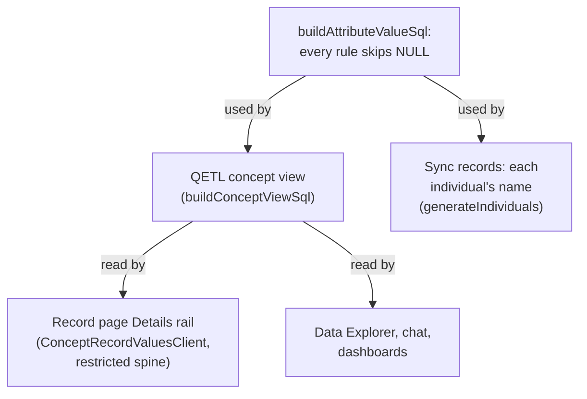
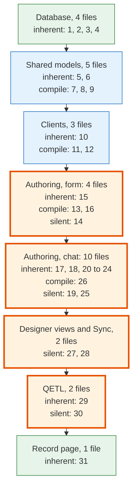

# Joined Cases 1: Record Page Reads the Concept View Implementation Plan

> **For agentic workers:** REQUIRED SUB-SKILL: Use superpowers:subagent-driven-development (recommended) or superpowers:executing-plans to implement this plan task-by-task. Steps use checkbox (`- [ ]`) syntax for tracking.

**Goal:** Make the concept view the only code that turns mappings into field values, with every rule ignoring NULL and every identifier quoted, and move the record page onto it through a spine restricted to the requested records.

**Architecture:** `buildAttributeValueSql` replaces `getSQLSelectOfMapping` and the view's list selector, and serves the view and Sync's name. A `conceptSpineRestrictions` option travels from `WorkspaceQuerySession.runQuery` through the mediator to the concept planner, which then reads only the named individuals into the spine. `ConceptRecordValuesClient.getConceptRecordValues` runs `SELECT * FROM "concept_<id>"` with that restriction and maps each column back to its field through the new `attributeId` on `ConceptAttributeColumn`. The record page reads it through a new `useRecordFields` hook, shows "No value" and a load-failure callout, and the legacy readers (`AttributeAssertionClient`, `_runConceptQuery`, `ConceptWrapper`) are deleted.

**Tech Stack:** TypeScript, React, Mantine, TanStack Query, Lingui, DuckDB (QETL; `@duckdb/node-api` for executed tests), `apache-arrow`, Vitest, Playwright.

**Spec:** `docs/superpowers/specs/2026-11-06-joined-cases-1-record-page-concept-view-design.md`. Section numbers (§) below refer to it. **Umbrella:** `docs/superpowers/specs/2026-11-06-joined-cases-design.md`. **Overview and ground rules:** `docs/superpowers/plans/2026-11-06-joined-cases.md`.

**Prerequisite:** none. This is plan 1 of 7, on branch `feat/joined-cases` (overview plan, "Where the work happens").

---

## Required skills

- **`test-driven-development`** throughout.
- **`playwright-best-practices`** before Task 16.
- No task creates a new surface, so `impeccable` is not loaded (overview ground rule 9). Task 10 restyles one existing rail state.

## Conventions for every task

- Overview ground rules 1 to 12 apply. This plan changes no schema and runs no database command except the E2E specs in Tasks 16 and 17, which need the branch's local stack: run `ava supabase status` first and confirm it names `feat-joined-cases`.
- Before each commit run `pnpm exec oxfmt <every .ts/.tsx file the task touched>`. It sorts imports the repository's way. Import blocks in this plan follow that order, but the formatter is the authority.
- Every commit message ends with the session's `Co-Authored-By` trailer (ground rule 4). Stage by path only.
- Unit tests: `pnpm test:frontend <path>`. Executed DuckDB tests: `pnpm test:executed <path>`.

## File map

| File | Responsibility |
| --- | --- |
| `src/clients/qetl/QueryMediator/conceptRelation/buildAttributeValueSql/buildAttributeValueSql.ts` (new) | Every value rule, the NULL rule, quoted identifiers |
| `src/clients/DuckDbClient/duckDbSqlText.ts` | `getEntityKeyComparisonSql` quotes identifiers |
| `src/clients/qetl/QueryMediator/conceptRelation/buildConceptViewSql/buildConceptViewSql.ts` | `attributeId` on `ConceptAttributeColumn`; every dataset column through `buildAttributeValueSql` |
| `src/clients/qetl/QueryMediator/conceptRelation/makeConceptAttributeColumnsFromMetadata.ts` | Sets `attributeId`; reserves `external_id` |
| `src/clients/qetl/QueryMediator/conceptRelation/conceptRelation.types.ts` | `ConceptSpineRestriction` |
| `src/clients/qetl/QueryMediator/conceptRelation/getConceptAttributeColumnsFromConceptId.ts` (new) | The column read the planner and the client share |
| `src/clients/qetl/QueryMediator/conceptRelation/getIndividualsByExternalIds/` (new) | Reads named records in batches |
| `src/clients/qetl/QueryMediator/conceptRelation/getConceptRelationPlansFromSql/getConceptRelationPlansFromSql.ts` | Validates restrictions; restricted spines |
| `src/clients/qetl/QueryMediator/QueryMediator.types.ts`, `QueryMediator.ts`, `queryRunner.ts` | Thread `conceptSpineRestrictions` to the planner |
| `src/clients/qetl/WorkspaceQuerySession/WorkspaceQuerySession.ts` | Accepts and passes `conceptSpineRestrictions` |
| `src/clients/DuckDbClient/duckDbArrowResults/duckDbArrowResults.ts` (moved) | Lists convert to plain arrays |
| `src/clients/ontology/ConceptRecordValuesClient/` (new) | `getConceptRecordValues`, `ConceptRecordValues`, `makeConceptRecordValuesFromRows` |
| `src/views/DataManagerApp/DatasetMetaView/invalidateDatasetRowQueries/invalidateDatasetRowQueries.ts` (moved) | A dataset refresh invalidates record values |
| `src/views/IndividualManagerApp/SingleIndividualView/CaseDetailsRail.tsx` | "No value", `sourceNames`, load failure |
| `src/views/IndividualManagerApp/SingleIndividualView/useRecordFields/` (new) | The record page's fields and load state; `makeCaseDetailsRowsFromAttributes` |
| `src/views/IndividualManagerApp/SingleIndividualView/index.tsx` | Uses `useRecordFields` |
| `src/views/OntologyDesignerApp/ConceptMetaView/generateIndividuals/generateIndividuals.ts` | Name through `buildAttributeValueSql` |
| `src/clients/queries/runStructuredQuery/runStructuredQueryWithMetadata.ts` | No `_runConceptQuery` |
| `src/clients/qetl/wrappers/createDefaultRegistry.ts` | No concept wrapper |
| `tests/e2e/record-page-field-values.spec.ts` (new) | The record page end to end |
| Deleted | `src/clients/ontology/AttributeAssertionClient/`, `shared/models/ontology/AttributeAssertion/`, `src/clients/qetl/wrappers/ConceptWrapper/`, `SingleIndividualView/useHydratedIndividual.ts` |
| `docs/ontology-architecture.md`, `docs/qetl-architecture.md`, `docs/description-logic-nomenclature.md` | Describe the end state |

---

## Task 1: `buildAttributeValueSql`

**Files:**
- Create: `src/clients/qetl/QueryMediator/conceptRelation/buildAttributeValueSql/buildAttributeValueSql.ts`
- Create: `src/clients/qetl/QueryMediator/conceptRelation/buildAttributeValueSql/buildAttributeValueSql.executed.test.ts`
- Modify: `src/clients/DuckDbClient/duckDbSqlText.ts:1-2,117-130`

- [ ] **Step 1: Write the failing executed test**

Create `src/clients/qetl/QueryMediator/conceptRelation/buildAttributeValueSql/buildAttributeValueSql.executed.test.ts`:

```ts
import { tmpdir } from "node:os";
import { join } from "node:path";
import { describe, expect, it } from "vitest";
/**
 * Executed tests for the SQL that turns one dataset-column mapping into one
 * value per record.
 *
 * Every case runs the emitted subquery against a real DuckDB over a real
 * parquet file. The fixture holds NULLs and ties on purpose: a rule that is
 * right only without them is not right. The key column and one value column
 * have a double quote in their names, so every case also proves that the
 * identifiers are quoted.
 */
import { getRowNumberedViewName } from "@/clients/DuckDbClient/duckDbSqlText";
import { buildAttributeValueSql } from "@/clients/qetl/QueryMediator/conceptRelation/buildAttributeValueSql/buildAttributeValueSql";
import { withDuckDb } from "../../../../../../tests/integration/queries/executedDuckDb";
import type { AttributeValueSqlOptions } from "@/clients/qetl/QueryMediator/conceptRelation/buildAttributeValueSql/buildAttributeValueSql";
import type { DuckDBConnection } from "@duckdb/node-api";

const DATASET_ID = "aaaaaaaa-1111-4111-8111-aaaaaaaaaaaa";
const SPINE = "records";

/** Every option a case does not override: `first` over `region`. */
const BASE_OPTIONS: AttributeValueSqlOptions = {
  selectColumnName: "region",
  primaryKeyColumnName: 'case "id"',
  datasetId: DATASET_ID,
  valuePickerRuleType: "first",
  isArray: false,
  outputColumnName: "value",
  externalIdsTable: SPINE,
  externalIdColumn: "external_id",
};

/**
 * One dataset and a spine of five records. In file order:
 *
 * - `p1`: a NULL region first, then North and South, so `first` must read
 *   past the NULL, and North and South tie under `most_frequent`.
 * - `p2`: two NULL regions and one East, so NULL is the most common cell.
 * - `p3`: only NULLs.
 * - `p4`: West then East, a tie that breaks by value.
 * - `p5`: no rows at all.
 */
async function _seed(connection: DuckDBConnection): Promise<void> {
  const path = join(tmpdir(), "ava-attribute-value.parquet");
  await connection.run(`
    COPY (
      SELECT * FROM (VALUES
        ('p1', CAST(NULL AS VARCHAR), CAST(NULL AS INTEGER), CAST(NULL AS VARCHAR)),
        ('p1', 'North', 2, 'Al'),
        ('p1', 'South', 4, NULL),
        ('p2', NULL, NULL, NULL),
        ('p2', NULL, NULL, NULL),
        ('p2', 'East', 1, NULL),
        ('p3', NULL, NULL, NULL),
        ('p4', 'West', 3, NULL),
        ('p4', 'East', 5, NULL)
      ) AS t("case ""id""", region, dose, "nick ""name""")
    ) TO '${path}' (FORMAT parquet)
  `);
  await connection.run(`
    CREATE VIEW "${DATASET_ID}" AS SELECT * FROM read_parquet('${path}');
    CREATE VIEW "${getRowNumberedViewName(DATASET_ID)}" AS
      SELECT * FROM read_parquet('${path}', file_row_number = true);
    CREATE TABLE ${SPINE} AS
      SELECT * FROM (VALUES ('p1'), ('p2'), ('p3'), ('p4'), ('p5'))
        AS t(external_id);
  `);
}

/** DuckDB returns big integers as bigint and lists as array-likes. */
function _normalize(value: unknown): unknown {
  if (typeof value === "bigint") {
    return Number(value);
  }
  if (value !== null && typeof value === "object" && "items" in value) {
    return (value as { items: unknown[] }).items;
  }
  return value;
}

/**
 * Emits one subquery per named column, runs them over the spine, and returns
 * each record's values keyed by column name.
 */
async function _readRecords(
  columns: Readonly<Record<string, Readonly<Partial<AttributeValueSqlOptions>>>>,
): Promise<Record<string, Record<string, unknown>>> {
  const selectors = Object.entries(columns).map(
    ([outputColumnName, overrides]) => {
      return buildAttributeValueSql({
        ...BASE_OPTIONS,
        ...overrides,
        outputColumnName,
      });
    },
  );
  return await withDuckDb(async (connection) => {
    await _seed(connection);
    const reader = await connection.runAndReadAll(
      `SELECT external_id, ${selectors.join(", ")} FROM ${SPINE} ORDER BY external_id`,
    );
    return Object.fromEntries(
      reader.getRowObjects().map((row) => {
        const { external_id: externalId, ...values } = row;
        return [
          String(externalId),
          Object.fromEntries(
            Object.entries(values).map(([name, value]) => {
              return [name, _normalize(value)];
            }),
          ),
        ];
      }),
    );
  });
}

/** One column of `_readRecords`' result, keyed by record. */
function _getColumn(
  records: Readonly<Record<string, Record<string, unknown>>>,
  columnName: string,
): Record<string, unknown> {
  return Object.fromEntries(
    Object.entries(records).map(([externalId, values]) => {
      return [externalId, values[columnName]];
    }),
  );
}

describe("buildAttributeValueSql", () => {
  it("returns the first non-NULL value in file order under first", async () => {
    const records = await _readRecords({ region: {} });

    expect(_getColumn(records, "region")).toEqual({
      p1: "North",
      p2: "East",
      p3: null,
      p4: "West",
      p5: null,
    });
  });

  it("ignores NULL under most_frequent even when NULL is the most common cell", async () => {
    const records = await _readRecords({
      region: { valuePickerRuleType: "most_frequent" },
    });

    expect(records.p2?.region).toBe("East");
  });

  it("breaks a most_frequent tie by value", async () => {
    const records = await _readRecords({
      region: { valuePickerRuleType: "most_frequent" },
    });

    expect([records.p1?.region, records.p4?.region]).toEqual([
      "North",
      "East",
    ]);
  });

  it("keeps every non-NULL value in file order as a list, and an empty list when there is none", async () => {
    const records = await _readRecords({ regions: { isArray: true } });

    expect(_getColumn(records, "regions")).toEqual({
      p1: ["North", "South"],
      p2: ["East"],
      p3: [],
      p4: ["West", "East"],
      p5: [],
    });
  });

  it("ignores NULL in sum, avg, count, max, and min", async () => {
    const records = await _readRecords({
      sum: { selectColumnName: "dose", valuePickerRuleType: "sum" },
      avg: { selectColumnName: "dose", valuePickerRuleType: "avg" },
      count: { selectColumnName: "dose", valuePickerRuleType: "count" },
      max: { selectColumnName: "dose", valuePickerRuleType: "max" },
      min: { selectColumnName: "dose", valuePickerRuleType: "min" },
    });

    expect(records.p1).toEqual({ sum: 6, avg: 3, count: 2, max: 4, min: 2 });
  });

  it("reads a value column whose name contains a double quote", async () => {
    const records = await _readRecords({
      nickname: { selectColumnName: 'nick "name"' },
    });

    expect(records.p1?.nickname).toBe("Al");
  });
});
```

- [ ] **Step 2: Run it to verify it fails**

Run: `pnpm test:executed src/clients/qetl/QueryMediator/conceptRelation/buildAttributeValueSql`
Expected: FAIL. The suite cannot import `buildAttributeValueSql/buildAttributeValueSql` (`Failed to resolve import`).

- [ ] **Step 3: Quote the key comparison**

In `src/clients/DuckDbClient/duckDbSqlText.ts`, add the import under the existing `@avandar/utils` import:

```ts
import { objectEntries, objectKeys, prop } from "@avandar/utils";
import { quoteSqlIdentifier } from "@avandar/utils/sql";
```

Replace the body of `getEntityKeyComparisonSql` (lines 125-129):

```ts
): string {
  return (
    `CAST("${options.externalIdsTable}"."${options.externalIdColumn}" AS VARCHAR)` +
    ` = CAST(dataset."${options.primaryKeyColumnName}" AS VARCHAR)`
  );
}
```

with:

```ts
): string {
  // Quoted rather than wrapped in bare double quotes, so a key column whose
  // name contains `"` still compiles.
  const outerKey = `${quoteSqlIdentifier(options.externalIdsTable)}.${quoteSqlIdentifier(options.externalIdColumn)}`;
  const datasetKey = `dataset.${quoteSqlIdentifier(options.primaryKeyColumnName)}`;
  return `CAST(${outerKey} AS VARCHAR) = CAST(${datasetKey} AS VARCHAR)`;
}
```

- [ ] **Step 4: Write `buildAttributeValueSql`**

Create `src/clients/qetl/QueryMediator/conceptRelation/buildAttributeValueSql/buildAttributeValueSql.ts`:

```ts
import { quoteSqlIdentifier } from "@avandar/utils/sql";
import { match } from "ts-pattern";
import {
  getEntityKeyComparisonSql,
  getRowNumberedViewName,
} from "@/clients/DuckDbClient/duckDbSqlText";
import type { DatasetColumnMapping } from "$/models/ontology/AttributeMapping/DatasetColumnMapping/DatasetColumnMapping.types";

/**
 * The alias every subquery reads its dataset rows under. It must stay
 * `dataset`, the alias `getEntityKeyComparisonSql` qualifies the key with.
 */
const DATASET_ALIAS = "dataset";

/**
 * What one attribute's value is read from, and the outer table of record keys
 * it is read for. The concept view passes one per dataset-backed attribute,
 * for example, and Sync passes its label's, so both read values identically.
 */
export type AttributeValueSqlOptions = {
  /** The dataset column that holds the value. */
  selectColumnName: string;
  /** The dataset column that holds each row's record key. */
  primaryKeyColumnName: string;
  datasetId: string;
  /** How one record's rows reduce to one value. Unused for a list. */
  valuePickerRuleType: DatasetColumnMapping["valuePickerRuleType"];
  /** Keep every value, as a list, instead of reducing them to one. */
  isArray: boolean;
  /** The name of the column the subquery emits. */
  outputColumnName: string;
  /** The outer table, by name or alias, holding one row per record key. */
  externalIdsTable: string;
  /** That table's record key column. */
  externalIdColumn: string;
};

/** The quoted pieces every rule's subquery is assembled from. */
type ValueSqlParts = {
  /** The value column, qualified with the dataset alias. */
  value: string;
  /** The key match and the NULL rule, for a `WHERE`. */
  rowFilter: string;
  /** The dataset's public view. */
  datasetView: string;
  /** The dataset's `ava_rows_` view, which exposes `file_row_number`. */
  rowsView: string;
};

/** The `SELECT` that reduces one record's non-NULL rows to its value. */
function _buildReducedValueSql(
  options: Readonly<{
    parts: ValueSqlParts;
    valuePickerRuleType: DatasetColumnMapping["valuePickerRuleType"];
  }>,
): string {
  const { value, rowFilter, datasetView, rowsView } = options.parts;
  const aggregateSql = (aggregate: string): string => {
    return `SELECT CAST(${aggregate}(${value}) AS DOUBLE) FROM ${datasetView} ${DATASET_ALIAS} WHERE ${rowFilter}`;
  };
  return match(options.valuePickerRuleType)
    .with("first", () => {
      // `file_row_number` is unique within a file, so this is a total order.
      // Do not use `row_number() OVER ()`: parallel scan order is unstable.
      return `SELECT ${value} FROM ${rowsView} ${DATASET_ALIAS} WHERE ${rowFilter} ORDER BY ${DATASET_ALIAS}.file_row_number LIMIT 1`;
    })
    .with("most_frequent", () => {
      // The value tie-break makes a tie on COUNT(*) deterministic.
      return `SELECT ${value} FROM ${datasetView} ${DATASET_ALIAS} WHERE ${rowFilter} GROUP BY ${value} ORDER BY COUNT(*) DESC, ${value} LIMIT 1`;
    })
    .with("sum", () => {
      return aggregateSql("SUM");
    })
    .with("avg", () => {
      return aggregateSql("AVG");
    })
    .with("count", () => {
      return aggregateSql("COUNT");
    })
    .with("max", () => {
      return aggregateSql("MAX");
    })
    .with("min", () => {
      return aggregateSql("MIN");
    })
    .exhaustive();
}

/**
 * Builds the correlated subquery that reads one attribute's value for the
 * outer row's record key, aliased to `outputColumnName`.
 *
 * Every rule reads only non-NULL cells, because NULL means "no value". Use it
 * wherever a dataset-column mapping becomes a value, for example a column of
 * a concept's view or the name Sync stages for each record.
 */
export function buildAttributeValueSql(
  options: Readonly<AttributeValueSqlOptions>,
): string {
  // Qualified, so a value column named like an outer column (`status`) can
  // never bind to the outer row.
  const value = `${DATASET_ALIAS}.${quoteSqlIdentifier(options.selectColumnName)}`;
  const keyComparison = getEntityKeyComparisonSql({
    externalIdsTable: options.externalIdsTable,
    externalIdColumn: options.externalIdColumn,
    primaryKeyColumnName: options.primaryKeyColumnName,
  });
  const parts: ValueSqlParts = {
    value,
    // The aggregates skip NULL on their own. `first`, `most_frequent`, and
    // lists need the filter, and applying it to every rule keeps the rule in
    // one place.
    rowFilter: `${keyComparison} AND ${value} IS NOT NULL`,
    datasetView: quoteSqlIdentifier(options.datasetId),
    rowsView: quoteSqlIdentifier(getRowNumberedViewName(options.datasetId)),
  };
  // `list()` over no rows is NULL. A record with no values gets an empty
  // list, which reads as "none" rather than "unknown".
  const body = options.isArray
    ? `SELECT COALESCE(list(${value} ORDER BY ${DATASET_ALIAS}.file_row_number), []) FROM ${parts.rowsView} ${DATASET_ALIAS} WHERE ${parts.rowFilter}`
    : _buildReducedValueSql({
        parts,
        valuePickerRuleType: options.valuePickerRuleType,
      });
  return `(${body}) AS ${quoteSqlIdentifier(options.outputColumnName)}`;
}
```

- [ ] **Step 5: Run it to verify it passes**

Run: `pnpm test:executed src/clients/qetl/QueryMediator/conceptRelation/buildAttributeValueSql`
Expected: PASS, 6 tests.

- [ ] **Step 6: Run the other concept relation executed tests**

The quoted key comparison is also used by the view today.

Run: `pnpm test:executed src/clients/qetl/QueryMediator/conceptRelation`
Expected: PASS, every suite.

- [ ] **Step 7: Commit**

```bash
git add src/clients/qetl/QueryMediator/conceptRelation/buildAttributeValueSql src/clients/DuckDbClient/duckDbSqlText.ts
git commit -m "feat(joined-cases): read attribute values with one NULL-ignoring rule function"
```

---

## Task 2: `attributeId` on every view column, and `external_id` reserved

**Files:**
- Modify: `src/clients/qetl/QueryMediator/conceptRelation/buildConceptViewSql/buildConceptViewSql.ts:8-40`
- Modify: `src/clients/qetl/QueryMediator/conceptRelation/makeConceptAttributeColumnsFromMetadata.ts:8-9,161-171,224-235,282-286`
- Test: `src/clients/qetl/QueryMediator/conceptRelation/__tests__/conceptAttributeColumns.integration.executed.test.ts`
- Modify (fixtures): `src/clients/qetl/QueryMediator/conceptRelation/buildConceptViewSql/buildConceptViewSql.executed.test.ts`, `src/clients/qetl/QueryMediator/__tests__/QueryMediator.concepts.test.ts`, `src/clients/qetl/QueryMediator/getNeededColumnsFromQuery/getNeededColumnsFromQuery.test.ts`

- [ ] **Step 1: Write the failing tests**

In `conceptAttributeColumns.integration.executed.test.ts`, add these two tests after `"suffixes a duplicate attribute name instead of emitting it twice"`:

```ts
  // A reader maps a view column back to its attribute. Two attributes can
  // share a name, so mapping by name would hand one attribute's value to the
  // other once the second is suffixed.
  it("names each column's attribute by id, through a duplicate-name suffix", () => {
    const duplicate = _attribute({
      name: "age",
      id: "attr-age-2" as ConceptAttribute.Id,
    });
    const metadata = _metadata({
      attributes: [PERSON_ID, AGE, duplicate],
      mappings: [PERSON_ID_MAPPING, AGE_MAPPING],
    });
    metadata.mappings.push({
      ...AGE_MAPPING.mapping,
      id: "map-age-2" as DatasetColumnMapping["id"],
      conceptAttributeId: duplicate.id,
    });

    const { attributeColumns } =
      makeConceptAttributeColumnsFromMetadata(metadata);

    expect(
      attributeColumns.map((column) => {
        return [column.attributeName, column.attributeId];
      }),
    ).toEqual([
      ["age", AGE.id],
      ["age_2", duplicate.id],
      ["person_id", PERSON_ID.id],
    ]);
  });

  // `external_id` is the view's record key, read from the spine, and a common
  // key column name. An attribute of that name is suffixed rather than
  // dropped, so it still has a column.
  it("suffixes an attribute named external_id so the record key keeps its name", async () => {
    const keyAttribute = _attribute({ name: "external_id", isIdentifier: true });
    const keyMapping = _mapping({
      attributeName: "external_id",
      datasetId: DATASET_A,
      columnName: "person_id",
    });

    const rows = await _queryConcept(
      _metadata({
        attributes: [keyAttribute, AGE],
        mappings: [keyMapping, AGE_MAPPING],
      }),
    );

    expect(rows[0]).toEqual({
      external_id: "101",
      status: "Active",
      age: 41,
      external_id_2: 101,
    });
  });
```

- [ ] **Step 2: Run them to verify they fail**

Run: `pnpm test:executed src/clients/qetl/QueryMediator/conceptRelation/__tests__/conceptAttributeColumns.integration.executed.test.ts`
Expected: FAIL. The first reports `[["age", undefined], ...]`; the second's row has no `external_id_2` key.

- [ ] **Step 3: Add `attributeId` to the column type**

In `buildConceptViewSql.ts`, add the import after the `DatasetColumnMapping` type import:

```ts
import type { DatasetColumnMapping } from "$/models/ontology/AttributeMapping/DatasetColumnMapping/DatasetColumnMapping.types";
import type { ConceptAttribute } from "$/models/ontology/ConceptAttribute/ConceptAttribute";
```

Replace the `ConceptAttributeColumn` type (lines 16-40) with:

```ts
/** One column of the concept relation, already resolved to what it reads. */
export type ConceptAttributeColumn =
  | {
      kind: "dataset_column";
      /**
       * The attribute this column holds. It survives a renamed column, so a
       * reader of the view maps a column back to its attribute by this.
       */
      attributeId: ConceptAttribute.Id;
      /** The relation's column name, which is the attribute's name. */
      attributeName: string;
      /** The contributing dataset's column this attribute reads. */
      selectColumnName: string;
      datasetId: string;
      /** The dataset column mapped to the concept's identifier attribute. */
      primaryKeyColumnName: string;
      valuePickerRuleType: DatasetColumnMapping["valuePickerRuleType"];
      isArray: boolean;
    }
  | {
      /**
       * An attribute with no dataset contribution to read, which today means a
       * manual-entry mapping. It becomes a typed NULL so the relation's schema
       * is stable whether or not a value exists, rather than the column
       * vanishing and breaking a saved query.
       */
      kind: "unmapped";
      /** The attribute this column holds, as on the other arm. */
      attributeId: ConceptAttribute.Id;
      attributeName: string;
      duckDbDataType: DuckDbDataType;
    };
```

- [ ] **Step 4: Set `attributeId` and reserve `external_id`**

In `makeConceptAttributeColumnsFromMetadata.ts`, add this constant after the `PrimaryKeyColumnNameByDatasetId` type (line 11):

```ts
/**
 * The view's record key column, which `buildConceptViewSql` reads from the
 * spine.
 */
const RECORD_KEY_COLUMN_NAME = "external_id";
```

In `_buildUnmappedColumn`, replace:

```ts
  return {
    kind: "unmapped",
    attributeName: attribute.name,
```

with:

```ts
  return {
    kind: "unmapped",
    attributeId: attribute.id,
    attributeName: attribute.name,
```

In `_buildAttributeColumn`, replace:

```ts
    column: {
      kind: "dataset_column",
      attributeName: attribute.name,
```

with:

```ts
    column: {
      kind: "dataset_column",
      attributeId: attribute.id,
      attributeName: attribute.name,
```

In `makeConceptAttributeColumnsFromMetadata`, replace:

```ts
  // Seeded with the built-in status column's name, which the view reads from
  // the spine, so an attribute of that name is suffixed rather than dropped.
  // The `concept_attributes__name_not_reserved` check keeps such attributes
  // out of the database; this guards rows that predate it.
  const takenNames = new Set<string>([ConceptStatusColumn.COLUMN_NAME]);
```

with:

```ts
  // Seeded with the two columns the view reads from the spine, the record key
  // and the status, so an attribute of either name is suffixed rather than
  // dropped and keeps a column of its own. The
  // `concept_attributes__name_not_reserved` check keeps `status` out of the
  // database; nothing reserves `external_id`, a common key column name.
  const takenNames = new Set<string>([
    RECORD_KEY_COLUMN_NAME,
    ConceptStatusColumn.COLUMN_NAME,
  ]);
```

- [ ] **Step 5: Give every column fixture its attribute id**

In `conceptAttributeColumns.integration.executed.test.ts`, replace the expectation in `"emits a manual-entry attribute as a column that reads no dataset"`:

```ts
    expect(columns.attributeColumns).toEqual([
      { kind: "unmapped", attributeName: "note", duckDbDataType: "VARCHAR" },
    ]);
```

with:

```ts
    expect(columns.attributeColumns).toEqual([
      {
        kind: "unmapped",
        attributeId: NOTE.id,
        attributeName: "note",
        duckDbDataType: "VARCHAR",
      },
    ]);
```

In `buildConceptViewSql.executed.test.ts`, add the type import beside the existing `ConceptAttributeColumn` import:

```ts
import type { ConceptAttribute } from "$/models/ontology/ConceptAttribute/ConceptAttribute";
```

and add an `attributeId` line as the second property of each fixture: `AGE` gets `attributeId: "attr-age" as ConceptAttribute.Id,`, `REGION` gets `attributeId: "attr-region" as ConceptAttribute.Id,`, `TAGS` gets `attributeId: "attr-tags" as ConceptAttribute.Id,`, and `NOTE` gets `attributeId: "attr-note" as ConceptAttribute.Id,`. In `"keeps the spine's status when an attribute column is named status"`, replace:

```ts
      { kind: "unmapped", attributeName: "status", duckDbDataType: "VARCHAR" },
```

with:

```ts
      {
        kind: "unmapped",
        attributeId: "attr-status" as ConceptAttribute.Id,
        attributeName: "status",
        duckDbDataType: "VARCHAR",
      },
```

In both `QueryMediator/__tests__/QueryMediator.concepts.test.ts` and `getNeededColumnsFromQuery/getNeededColumnsFromQuery.test.ts`, add the type import:

```ts
import type { ConceptAttribute } from "$/models/ontology/ConceptAttribute/ConceptAttribute";
```

and in `CONCEPT_PLAN.attributeColumns[0]` add, after `kind: "dataset_column",`:

```ts
      attributeId: "attr-age" as ConceptAttribute.Id,
```

- [ ] **Step 6: Run the tests and the type check**

Run: `pnpm test:executed src/clients/qetl/QueryMediator/conceptRelation`
Expected: PASS, every suite, including the two new tests.

Run: `pnpm test:frontend src/clients/qetl/QueryMediator`
Expected: PASS.

Run: `pnpm type-check`
Expected: no errors.

- [ ] **Step 7: Commit**

```bash
git add src/clients/qetl/QueryMediator/conceptRelation/buildConceptViewSql src/clients/qetl/QueryMediator/conceptRelation/makeConceptAttributeColumnsFromMetadata.ts src/clients/qetl/QueryMediator/conceptRelation/__tests__/conceptAttributeColumns.integration.executed.test.ts src/clients/qetl/QueryMediator/__tests__/QueryMediator.concepts.test.ts src/clients/qetl/QueryMediator/getNeededColumnsFromQuery/getNeededColumnsFromQuery.test.ts
git commit -m "feat(joined-cases): carry each attribute's id on its concept view column"
```

---

## Task 3: The view and Sync read values through `buildAttributeValueSql`

**Files:**
- Modify: `src/clients/qetl/QueryMediator/conceptRelation/buildConceptViewSql/buildConceptViewSql.ts` (whole file)
- Test: `src/clients/qetl/QueryMediator/conceptRelation/buildConceptViewSql/buildConceptViewSql.executed.test.ts`
- Modify: `src/views/OntologyDesignerApp/ConceptMetaView/generateIndividuals/generateIndividuals.ts:19,300-308`

- [ ] **Step 1: Write the failing view tests**

In `buildConceptViewSql.executed.test.ts`, add a third dataset id after `DATASET_B`:

```ts
const DATASET_C = "dddddddd-4444-4444-8444-dddddddddddd";
```

Replace `_seed` (and its docstring) with:

```ts
/**
 * Builds the fixture world: three contributing datasets as parquet, each with
 * its `ava_rows_` view, plus the spine.
 *
 * `p1` has two rows in dataset A, so `first` has something to be wrong about.
 * `p2` has two equally frequent regions in dataset B, so `most_frequent` has a
 * tie to break. `p3` is in the spine and in no dataset, which is the
 * missing-contribution case. Dataset C holds NULLs: `p1`'s first nickname is
 * NULL, and `p2` has two NULL nicknames and one real one.
 */
async function _seed(connection: DuckDBConnection): Promise<void> {
  const pathA = join(tmpdir(), "ava-concept-a.parquet");
  const pathB = join(tmpdir(), "ava-concept-b.parquet");
  const pathC = join(tmpdir(), "ava-concept-c.parquet");

  await connection.run(`
    COPY (
      SELECT * FROM (VALUES
        ('p1', 41, 'blue'),
        ('p1', 42, 'green'),
        ('p2', 50, 'red')
      ) AS t(person_id, age_years, tag)
    ) TO '${pathA}' (FORMAT parquet)
  `);
  await connection.run(`
    COPY (
      SELECT * FROM (VALUES
        ('p1', 'North'),
        ('p2', 'South'),
        ('p2', 'East')
      ) AS t(hh_id, region_name)
    ) TO '${pathB}' (FORMAT parquet)
  `);
  await connection.run(`
    COPY (
      SELECT * FROM (VALUES
        ('p1', CAST(NULL AS VARCHAR)),
        ('p1', 'Ada'),
        ('p2', NULL),
        ('p2', NULL),
        ('p2', 'Bo')
      ) AS t(person_id, nickname)
    ) TO '${pathC}' (FORMAT parquet)
  `);

  // Both views per dataset, exactly as production has them. Only `first` and
  // lists read the row-numbered view; `most_frequent` and the aggregates read
  // the dataset's public view, which does not expose `file_row_number` and
  // does not need to. A fixture with only one of the two hides that
  // distinction.
  await connection.run(`
    CREATE VIEW "${DATASET_A}" AS SELECT * FROM read_parquet('${pathA}');
    CREATE VIEW "${DATASET_B}" AS SELECT * FROM read_parquet('${pathB}');
    CREATE VIEW "${DATASET_C}" AS SELECT * FROM read_parquet('${pathC}');
    CREATE VIEW "${getRowNumberedViewName(DATASET_A)}" AS
      SELECT * FROM read_parquet('${pathA}', file_row_number = true);
    CREATE VIEW "${getRowNumberedViewName(DATASET_B)}" AS
      SELECT * FROM read_parquet('${pathB}', file_row_number = true);
    CREATE VIEW "${getRowNumberedViewName(DATASET_C)}" AS
      SELECT * FROM read_parquet('${pathC}', file_row_number = true);
    CREATE TABLE "${SPINE}" AS
      SELECT * FROM (VALUES
        ('p1', 'Suspected'),
        ('p2', 'Confirmed'),
        ('p3', 'Suspected')
      ) AS t(external_id, status);
  `);
}
```

Add a fixture after `NOTE`:

```ts
const NICKNAME: ConceptAttributeColumn = {
  kind: "dataset_column",
  attributeId: "attr-nickname" as ConceptAttribute.Id,
  attributeName: "nickname",
  selectColumnName: "nickname",
  datasetId: DATASET_C,
  primaryKeyColumnName: "person_id",
  valuePickerRuleType: "first",
  isArray: false,
};
```

Add these tests at the end of the `describe`:

```ts
  // NULL means "no value". `p1`'s first nickname is NULL, so `first` has to
  // read past it rather than report that `p1` has none.
  it("reads the first non-NULL value rather than a leading NULL", async () => {
    const rows = await _queryView([NICKNAME]);

    expect(rows[0]).toEqual({
      external_id: "p1",
      status: "Suspected",
      nickname: "Ada",
    });
  });

  // `p2` has two NULL nicknames and one `Bo`. Counting NULL as a value would
  // make NULL the most frequent.
  it("ignores NULL under most_frequent even when it is the most common cell", async () => {
    const rows = await _queryView([
      { ...NICKNAME, valuePickerRuleType: "most_frequent" },
    ]);

    expect(rows[1]).toEqual({
      external_id: "p2",
      status: "Confirmed",
      nickname: "Bo",
    });
  });

  it("leaves NULL values out of a list column", async () => {
    const rows = await _queryView([
      { ...NICKNAME, attributeName: "nicknames", isArray: true },
    ]);

    expect(
      rows.map((row) => {
        return row.nicknames;
      }),
    ).toEqual([["Ada"], ["Bo"], []]);
  });
```

- [ ] **Step 2: Run them to verify they fail**

Run: `pnpm test:executed src/clients/qetl/QueryMediator/conceptRelation/buildConceptViewSql`
Expected: FAIL on the three new tests: `nickname` is `null` for `p1` and for `p2`, and the lists are `[null, "Ada"]`, `[null, null, "Bo"]`, `[]`.

- [ ] **Step 3: Route every dataset column through `buildAttributeValueSql`**

Replace `src/clients/qetl/QueryMediator/conceptRelation/buildConceptViewSql/buildConceptViewSql.ts` with:

```ts
import { quoteSqlIdentifier } from "@avandar/utils/sql";
import { ConceptStatusColumn } from "$/models/queries/ConceptStatusColumn/ConceptStatusColumn";
import { buildAttributeValueSql } from "@/clients/qetl/QueryMediator/conceptRelation/buildAttributeValueSql/buildAttributeValueSql";
import type { DuckDbDataType } from "$/models/datasets/DatasetColumn/DuckDbDataTypes";
import type { DatasetColumnMapping } from "$/models/ontology/AttributeMapping/DatasetColumnMapping/DatasetColumnMapping.types";
import type { ConceptAttribute } from "$/models/ontology/ConceptAttribute/ConceptAttribute";

/** The spine's alias inside the view, and the columns it exposes. */
const SPINE_ALIAS = "individuals";
const EXTERNAL_ID_COLUMN = "external_id";
const STATUS_COLUMN = ConceptStatusColumn.COLUMN_NAME;

/** One column of the concept relation, already resolved to what it reads. */
export type ConceptAttributeColumn =
  | {
      kind: "dataset_column";
      /**
       * The attribute this column holds. It survives a renamed column, so a
       * reader of the view maps a column back to its attribute by this.
       */
      attributeId: ConceptAttribute.Id;
      /** The relation's column name, which is the attribute's name. */
      attributeName: string;
      /** The contributing dataset's column this attribute reads. */
      selectColumnName: string;
      datasetId: string;
      /** The dataset column mapped to the concept's identifier attribute. */
      primaryKeyColumnName: string;
      valuePickerRuleType: DatasetColumnMapping["valuePickerRuleType"];
      isArray: boolean;
    }
  | {
      /**
       * An attribute with no dataset contribution to read, which today means a
       * manual-entry mapping. It becomes a typed NULL so the relation's schema
       * is stable whether or not a value exists, rather than the column
       * vanishing and breaking a saved query.
       */
      kind: "unmapped";
      /** The attribute this column holds, as on the other arm. */
      attributeId: ConceptAttribute.Id;
      attributeName: string;
      duckDbDataType: DuckDbDataType;
    };

/**
 * Builds the `CREATE OR REPLACE VIEW` that makes one concept a queryable
 * relation.
 *
 * Three properties of the emitted shape are load-bearing:
 *
 * 1. **The `FROM` is the spine alone.** Every attribute is a correlated scalar
 *    subquery, so no join can multiply rows and the grain is the spine's grain
 *    by construction. Do not join the datasets instead: a record present in
 *    two datasets would come back once per dataset.
 * 2. **A missing contribution is a NULL, not a lost row.** A scalar subquery
 *    with no matching rows returns NULL, which is `LEFT JOIN` semantics without
 *    a `LEFT JOIN`. An individual no dataset contributes to still appears.
 * 3. **Columns are emitted in a stable order**, sorted by attribute name, so
 *    two runs over unchanged metadata produce byte-identical SQL. That is what
 *    lets the definition be hashed into a cache key later.
 *
 * A view rather than a materialized table, deliberately: a view is a
 * definition, so rebuilding it is nearly free and invalidation disappears
 * instead of needing a freshness rule of its own.
 */
export function buildConceptViewSql(
  options: Readonly<{
    viewName: string;
    spineTableName: string;
    attributeColumns: readonly ConceptAttributeColumn[];
  }>,
): string {
  const orderedColumns = [...options.attributeColumns].sort((left, right) => {
    return left.attributeName.localeCompare(right.attributeName);
  });

  const selectors = [
    // The spine's key is exposed as a column because it is the join key two
    // concepts share when their identifier attributes are named differently,
    // which the joined-concepts criterion needs.
    `${SPINE_ALIAS}.${quoteSqlIdentifier(EXTERNAL_ID_COLUMN)} AS ${quoteSqlIdentifier(EXTERNAL_ID_COLUMN)}`,
    // Every record's status name: the case type's built-in `status` column.
    `${SPINE_ALIAS}.${quoteSqlIdentifier(STATUS_COLUMN)} AS ${quoteSqlIdentifier(STATUS_COLUMN)}`,
    ...orderedColumns
      .filter((column) => {
        // An attribute already named `external_id` or `status` would collide
        // with a spine column above. The spine wins: a join depends on the
        // key, and every case type's status is that column.
        return (
          column.attributeName !== EXTERNAL_ID_COLUMN &&
          column.attributeName !== STATUS_COLUMN
        );
      })
      .map(_buildColumnSelector),
  ];

  return `CREATE OR REPLACE VIEW ${quoteSqlIdentifier(options.viewName)} AS
SELECT
${selectors.join(",\n")}
FROM ${quoteSqlIdentifier(options.spineTableName)} ${SPINE_ALIAS}`;
}

function _buildColumnSelector(column: ConceptAttributeColumn): string {
  if (column.kind === "unmapped") {
    return `CAST(NULL AS ${column.duckDbDataType}) AS ${quoteSqlIdentifier(column.attributeName)}`;
  }

  // Single values and lists alike: one function owns every value rule, so the
  // view and everything that reads it agree with Sync on every value.
  return buildAttributeValueSql({
    selectColumnName: column.selectColumnName,
    primaryKeyColumnName: column.primaryKeyColumnName,
    datasetId: column.datasetId,
    valuePickerRuleType: column.valuePickerRuleType,
    isArray: column.isArray,
    outputColumnName: column.attributeName,
    externalIdsTable: SPINE_ALIAS,
    externalIdColumn: EXTERNAL_ID_COLUMN,
  });
}
```

- [ ] **Step 4: Point Sync's name at the same function**

In `generateIndividuals.ts`, replace the import on line 19:

```ts
import { getSQLSelectOfMapping } from "@/clients/ontology/AttributeAssertionClient/getAttributeAssertions/getSQLSelectOfMapping";
```

with:

```ts
import { buildAttributeValueSql } from "@/clients/qetl/QueryMediator/conceptRelation/buildAttributeValueSql/buildAttributeValueSql";
```

and replace the `titleSelector` (lines 300-308):

```ts
      titleSelector: getSQLSelectOfMapping({
        selectColumnName: titleColumn.name,
        primaryKeyColumnName: titleDatasetPrimaryKeyColumn.name,
        datasetId: titleColumn.datasetId,
        ruleType: labelMapping.valuePickerRuleType,
        outputColumnName: "name",
        externalIdsTable: "external_ids",
        externalIdColumn: "external_id",
      }),
```

with:

```ts
      titleSelector: buildAttributeValueSql({
        selectColumnName: titleColumn.name,
        primaryKeyColumnName: titleDatasetPrimaryKeyColumn.name,
        datasetId: titleColumn.datasetId,
        valuePickerRuleType: labelMapping.valuePickerRuleType,
        isArray: false,
        outputColumnName: "name",
        externalIdsTable: "external_ids",
        externalIdColumn: "external_id",
      }),
```

- [ ] **Step 5: Run the tests**

Run: `pnpm test:executed src/clients/qetl/QueryMediator/conceptRelation`
Expected: PASS, every suite, including the analyzer verdict test (`datasetIds: [DATASET_A, DATASET_B]`).

Run: `pnpm test:executed tests/integration/queries/structuredQueryConcepts.executed.test.ts`
Expected: PASS.

Run: `pnpm test:frontend src/views/OntologyDesignerApp/ConceptMetaView/generateIndividuals src/clients/qetl/QueryMediator`
Expected: PASS.

`getSQLSelectOfMapping.ts` now has one importer, the legacy `getDatasetColumnAssertions.ts`. Task 15 deletes both.

- [ ] **Step 6: Commit**

```bash
git add src/clients/qetl/QueryMediator/conceptRelation/buildConceptViewSql src/views/OntologyDesignerApp/ConceptMetaView/generateIndividuals/generateIndividuals.ts
git commit -m "feat(joined-cases): build the concept view and Sync names from buildAttributeValueSql"
```

---

## Task 4: Read named records in batches

**Files:**
- Create: `src/clients/qetl/QueryMediator/conceptRelation/getIndividualsByExternalIds/getIndividualsByExternalIds.ts`
- Create: `src/clients/qetl/QueryMediator/conceptRelation/getIndividualsByExternalIds/getIndividualsByExternalIds.test.ts`

- [ ] **Step 1: Write the failing test**

Create `getIndividualsByExternalIds.test.ts`:

```ts
import { beforeEach, describe, expect, it, vi } from "vitest";
import { getIndividualsByExternalIds } from "@/clients/qetl/QueryMediator/conceptRelation/getIndividualsByExternalIds/getIndividualsByExternalIds";
import type { Concept } from "$/models/ontology/Concept/Concept";

const CONCEPT_ID = "cccccccc-3333-4333-8333-cccccccccccc" as Concept.Id;

const { individualGetAllMock } = vi.hoisted(() => {
  return { individualGetAllMock: vi.fn() };
});

vi.mock("@/clients/ontology/IndividualClient", () => {
  return { IndividualClient: { getAll: individualGetAllMock } };
});

/** The `where` of every Postgres read, in call order. */
function _getReadFilters(): unknown[] {
  return individualGetAllMock.mock.calls.map((call) => {
    return (call[0] as { where: unknown }).where;
  });
}

beforeEach(() => {
  vi.clearAllMocks();
  individualGetAllMock.mockResolvedValue([]);
});

describe("getIndividualsByExternalIds", () => {
  // The keys travel in the request URL, so one read names a bounded number.
  it("reads at most 50 keys per Postgres read", async () => {
    const externalIds = Array.from({ length: 120 }, (_, index) => {
      return `p${index}`;
    });

    await getIndividualsByExternalIds({ conceptId: CONCEPT_ID, externalIds });

    expect(
      _getReadFilters().map((filter) => {
        return (filter as { external_id: { in: string[] } }).external_id.in
          .length;
      }),
    ).toEqual([50, 50, 20]);
  });

  // postgrest-js does not escape `"` or `\` inside an `in` list, so such a
  // key could be read as a different one. An equality filter takes it
  // verbatim.
  it("reads a key holding a double quote or a backslash with an equality filter of its own", async () => {
    await getIndividualsByExternalIds({
      conceptId: CONCEPT_ID,
      externalIds: ["p1", '5" pipe', "a\\b"],
    });

    expect(_getReadFilters()).toEqual([
      { concept_id: { eq: CONCEPT_ID }, external_id: { in: ["p1"] } },
      { concept_id: { eq: CONCEPT_ID }, external_id: { eq: '5" pipe' } },
      { concept_id: { eq: CONCEPT_ID }, external_id: { eq: "a\\b" } },
    ]);
  });

  it("reads each key once when the caller names it twice", async () => {
    await getIndividualsByExternalIds({
      conceptId: CONCEPT_ID,
      externalIds: ["p1", "p1", "p2"],
    });

    expect(_getReadFilters()).toEqual([
      { concept_id: { eq: CONCEPT_ID }, external_id: { in: ["p1", "p2"] } },
    ]);
  });

  it("returns the records every read found", async () => {
    individualGetAllMock
      .mockResolvedValueOnce([{ externalId: "p1" }])
      .mockResolvedValueOnce([{ externalId: '5" pipe' }]);

    const records = await getIndividualsByExternalIds({
      conceptId: CONCEPT_ID,
      externalIds: ["p1", '5" pipe'],
    });

    expect(
      records.map((record) => {
        return record.externalId;
      }),
    ).toEqual(["p1", '5" pipe']);
  });

  it("reads nothing when no key is named", async () => {
    const records = await getIndividualsByExternalIds({
      conceptId: CONCEPT_ID,
      externalIds: [],
    });

    expect(records).toEqual([]);
    expect(individualGetAllMock).not.toHaveBeenCalled();
  });
});
```

- [ ] **Step 2: Run it to verify it fails**

Run: `pnpm test:frontend src/clients/qetl/QueryMediator/conceptRelation/getIndividualsByExternalIds`
Expected: FAIL, `Failed to resolve import` for the module.

- [ ] **Step 3: Write the function**

Create `getIndividualsByExternalIds.ts`:

```ts
import { IndividualClient } from "@/clients/ontology/IndividualClient";
import { partition } from "@/lib/utils/arrays/partition/partition";
import { removeDuplicates } from "@/lib/utils/arrays/removeDuplicates/removeDuplicates";
import type { Concept } from "$/models/ontology/Concept/Concept";
import type { Individual } from "$/models/ontology/Individual/Individual";

/**
 * How many record keys one Postgres read names. The keys travel in the
 * request URL as a PostgREST `in` list, so the bound keeps that URL short.
 */
export const MAX_EXTERNAL_IDS_PER_READ = 50;

/**
 * Whether a key can travel inside a PostgREST `in` list unchanged.
 *
 * `postgrest-js` wraps a list value in double quotes when it holds `,`, `(`,
 * or `)`, but never escapes a `"` or a `\` inside it, and PostgREST reads both
 * as list syntax. A key holding either is read with an equality filter
 * instead, whose value PostgREST takes verbatim.
 */
function _isListSafeExternalId(externalId: string): boolean {
  return !externalId.includes('"') && !externalId.includes("\\");
}

function _splitIntoBatches(externalIds: readonly string[]): string[][] {
  const batchCount = Math.ceil(externalIds.length / MAX_EXTERNAL_IDS_PER_READ);
  return Array.from({ length: batchCount }, (_, batchIndex) => {
    return externalIds.slice(
      batchIndex * MAX_EXTERNAL_IDS_PER_READ,
      (batchIndex + 1) * MAX_EXTERNAL_IDS_PER_READ,
    );
  });
}

/**
 * Reads the records of one concept whose keys are among `externalIds`. A key
 * that names no record is left out, and each key is read once.
 *
 * Use it when a caller needs a few records by key rather than a whole
 * concept, for example to build a spine restricted to the records one page
 * shows. Reads go through the CRUD client's filters, never through SQL text.
 */
export async function getIndividualsByExternalIds(
  options: Readonly<{
    conceptId: Concept.Id;
    externalIds: readonly string[];
  }>,
): Promise<Individual.T[]> {
  const [listSafeIds, otherIds] = partition(
    removeDuplicates(options.externalIds),
    _isListSafeExternalId,
  );
  const reads = [
    ..._splitIntoBatches(listSafeIds).map((batch) => {
      return IndividualClient.getAll({
        where: {
          concept_id: { eq: options.conceptId },
          external_id: { in: batch },
        },
      });
    }),
    ...otherIds.map((externalId) => {
      return IndividualClient.getAll({
        where: {
          concept_id: { eq: options.conceptId },
          external_id: { eq: externalId },
        },
      });
    }),
  ];
  return (await Promise.all(reads)).flat();
}
```

- [ ] **Step 4: Run it to verify it passes**

Run: `pnpm test:frontend src/clients/qetl/QueryMediator/conceptRelation/getIndividualsByExternalIds`
Expected: PASS, 5 tests.

- [ ] **Step 5: Commit**

```bash
git add src/clients/qetl/QueryMediator/conceptRelation/getIndividualsByExternalIds
git commit -m "feat(joined-cases): read a concept's records by key in bounded batches"
```

---

## Task 5: The planner honours spine restrictions

**Files:**
- Modify: `src/clients/qetl/QueryMediator/conceptRelation/conceptRelation.types.ts`
- Create: `src/clients/qetl/QueryMediator/conceptRelation/getConceptAttributeColumnsFromConceptId.ts`
- Modify: `src/clients/qetl/QueryMediator/conceptRelation/getConceptRelationPlansFromSql/getConceptRelationPlansFromSql.ts` (whole file)
- Test: `src/clients/qetl/QueryMediator/conceptRelation/getConceptRelationPlansFromSql/getConceptRelationPlansFromSql.test.ts`

- [ ] **Step 1: Write the failing tests**

Add to the end of the `describe` in `getConceptRelationPlansFromSql.test.ts`:

```ts
  // A record page asks for one record. Its spine must hold that record alone,
  // so the view computes one row instead of the whole case type.
  it("loads only the restricted records into the spine", async () => {
    const { getConceptRelationPlansFromSql } =
      await import("@/clients/qetl/QueryMediator/conceptRelation/getConceptRelationPlansFromSql/getConceptRelationPlansFromSql");
    individualGetAllMock.mockResolvedValue([
      { id: "ind-2", externalId: "p2", statusId: RULED_OUT_STATUS_ID },
    ]);

    const plans = await getConceptRelationPlansFromSql({
      rawSql: `SELECT * FROM "concept_${CONCEPT_ID}"`,
      allowlist: _permissiveAllowlist(),
      conceptSpineRestrictions: [{ conceptId: CONCEPT_ID, externalIds: ["p2"] }],
    });

    expect(individualGetAllMock).toHaveBeenCalledWith({
      where: { concept_id: { eq: CONCEPT_ID }, external_id: { in: ["p2"] } },
    });
    expect(plans[0]?.spineRows).toEqual([
      { externalId: "p2", statusName: "Ruled out" },
    ]);
  });

  // A restriction on a concept the statement does not read restricts
  // nothing, while its caller believes the records are narrowed.
  it("refuses a restriction on a concept the statement does not read", async () => {
    const { getConceptRelationPlansFromSql } =
      await import("@/clients/qetl/QueryMediator/conceptRelation/getConceptRelationPlansFromSql/getConceptRelationPlansFromSql");

    await expect(
      getConceptRelationPlansFromSql({
        rawSql: `SELECT * FROM "concept_${CONCEPT_ID}"`,
        allowlist: _permissiveAllowlist(),
        conceptSpineRestrictions: [
          { conceptId: OTHER_CONCEPT_ID, externalIds: ["p1"] },
        ],
      }),
    ).rejects.toThrow(/which this query does not read/);
    expect(conceptAttributeGetAllMock).not.toHaveBeenCalled();
  });

  it("refuses two restrictions on one concept", async () => {
    const { getConceptRelationPlansFromSql } =
      await import("@/clients/qetl/QueryMediator/conceptRelation/getConceptRelationPlansFromSql/getConceptRelationPlansFromSql");

    await expect(
      getConceptRelationPlansFromSql({
        rawSql: `SELECT * FROM "concept_${CONCEPT_ID}"`,
        allowlist: _permissiveAllowlist(),
        conceptSpineRestrictions: [
          { conceptId: CONCEPT_ID, externalIds: ["p1"] },
          { conceptId: CONCEPT_ID, externalIds: ["p2"] },
        ],
      }),
    ).rejects.toThrow(/more than one spine restriction/);
    expect(conceptAttributeGetAllMock).not.toHaveBeenCalled();
  });

  // One restriction costs one Postgres read per 50 keys, so it is bounded.
  it("refuses a restriction naming more records than one query may read", async () => {
    const { getConceptRelationPlansFromSql, MAX_RESTRICTED_EXTERNAL_IDS } =
      await import("@/clients/qetl/QueryMediator/conceptRelation/getConceptRelationPlansFromSql/getConceptRelationPlansFromSql");
    const externalIds = Array.from(
      { length: MAX_RESTRICTED_EXTERNAL_IDS + 1 },
      (_, index) => {
        return `p${index}`;
      },
    );

    await expect(
      getConceptRelationPlansFromSql({
        rawSql: `SELECT * FROM "concept_${CONCEPT_ID}"`,
        allowlist: _permissiveAllowlist(),
        conceptSpineRestrictions: [{ conceptId: CONCEPT_ID, externalIds }],
      }),
    ).rejects.toThrow(/at most 500 may be named/);
    expect(individualGetAllMock).not.toHaveBeenCalled();
  });
```

- [ ] **Step 2: Run them to verify they fail**

Run: `pnpm test:frontend src/clients/qetl/QueryMediator/conceptRelation/getConceptRelationPlansFromSql`
Expected: FAIL. The first test sees `getAll` called with `concept_id` only and two spine rows; the three refusals resolve instead of rejecting (and the last reads `MAX_RESTRICTED_EXTERNAL_IDS` as `undefined`).

- [ ] **Step 3: Add the restriction type**

In `conceptRelation.types.ts`, add the import:

```ts
import type { Concept } from "$/models/ontology/Concept/Concept";
```

and add after `ConceptSpineRow`:

```ts
/**
 * Narrows one concept's spine to the records with these keys, so a query over
 * its view computes values for those records only.
 *
 * Passed as data beside the SQL (`conceptSpineRestrictions` on
 * `WorkspaceQuerySession.runQuery`), never written into it, so a record key
 * reaches DuckDB only through the spine's CSV. Use it to read a few records'
 * values, for example the one record a record page shows. A key that names no
 * record of the concept yields no row.
 */
export type ConceptSpineRestriction = {
  conceptId: Concept.Id;
  externalIds: readonly string[];
};
```

- [ ] **Step 4: Move the column read into its own function**

Create `src/clients/qetl/QueryMediator/conceptRelation/getConceptAttributeColumnsFromConceptId.ts`:

```ts
import { makeIdLookupRecord, where } from "@avandar/utils";
import { DatasetColumnClient } from "@/clients/datasets/DatasetColumnClient";
import { ConceptAttributeClient } from "@/clients/ontology/ConceptAttributeClient";
import { makeConceptAttributeColumnsFromMetadata } from "@/clients/qetl/QueryMediator/conceptRelation/makeConceptAttributeColumnsFromMetadata";
import { removeDuplicates } from "@/lib/utils/arrays/removeDuplicates/removeDuplicates";
import type { DatasetColumn } from "$/models/datasets/DatasetColumn/DatasetColumn";
import type { AttributeMapping } from "$/models/ontology/AttributeMapping/AttributeMapping.types";
import type { Concept } from "$/models/ontology/Concept/Concept";
import type { ConceptAttributeColumns } from "@/clients/qetl/QueryMediator/conceptRelation/makeConceptAttributeColumnsFromMetadata";

/** Every dataset column the given mappings name. */
async function _getMappedDatasetColumns(
  mappings: readonly AttributeMapping[],
): Promise<DatasetColumn.T[]> {
  const datasetColumnIds = removeDuplicates(
    mappings.flatMap((mapping) => {
      return mapping.type === "dataset_column" ? [mapping.datasetColumnId] : [];
    }),
  );
  return datasetColumnIds.length === 0
    ? []
    : await DatasetColumnClient.getAll(where("id", "in", datasetColumnIds));
}

/**
 * Reads one concept's attributes, the mappings that populate them, and the
 * dataset columns those mappings name, and resolves them into the columns the
 * concept's view emits.
 *
 * Use it wherever code needs a concept view's columns, for example to plan
 * the view before a query, or to map a result column back to its attribute by
 * `attributeId` after one. Every caller names the columns identically,
 * because the naming is `makeConceptAttributeColumnsFromMetadata` over the
 * same rows.
 */
export async function getConceptAttributeColumnsFromConceptId(
  conceptId: Concept.Id,
): Promise<ConceptAttributeColumns> {
  const attributes = await ConceptAttributeClient.getAll(
    where("concept_id", "eq", conceptId),
  );
  const mappings = await ConceptAttributeClient.getAllAttributeMappings({
    attributes,
  });
  const datasetColumns = await _getMappedDatasetColumns(mappings);
  return makeConceptAttributeColumnsFromMetadata({
    attributes,
    mappings,
    datasetColumnsById: makeIdLookupRecord(datasetColumns, { key: "id" }),
  });
}
```

- [ ] **Step 5: Plan with restrictions**

Replace `getConceptRelationPlansFromSql.ts` with:

```ts
import { makeIdLookupRecord, prop, where } from "@avandar/utils";
import { ConceptStatusClient } from "@/clients/ontology/ConceptStatusClient";
import { IndividualClient } from "@/clients/ontology/IndividualClient";
import { getConceptAttributeColumnsFromConceptId } from "@/clients/qetl/QueryMediator/conceptRelation/getConceptAttributeColumnsFromConceptId";
import { getIndividualsByExternalIds } from "@/clients/qetl/QueryMediator/conceptRelation/getIndividualsByExternalIds/getIndividualsByExternalIds";
import { DuckDbSqlAnalyzer } from "@/lib/sql/DuckDbSqlAnalyzer/DuckDbSqlAnalyzer";
import { removeDuplicates } from "@/lib/utils/arrays/removeDuplicates/removeDuplicates";
import { Logger } from "@/utils/Logger";
import type { Dataset } from "$/models/datasets/Dataset/Dataset";
import type { Concept } from "$/models/ontology/Concept/Concept";
import type { ConceptRelationRef } from "$/models/relations/RelationRef/RelationRef.types";
import type {
  ConceptRelationPlan,
  ConceptSpineRestriction,
  ConceptSpineRow,
} from "@/clients/qetl/QueryMediator/conceptRelation/conceptRelation.types";

/**
 * The relations the caller is allowed to reach, supplied by the query session.
 *
 * This is the security seam, not a convenience. `assertWorkspaceMembership`
 * checks the **principal** and deliberately says nothing about the relations a
 * query names, so per-relation checking is a separate mechanism and this is now
 * part of it. Injected rather than read here because only the session knows
 * what its principal may reach: a workspace session answers with the
 * workspace's own ids, and a session with no ontology (the public snapshot
 * path) supplies no plan reader at all.
 */
export type ConceptRelationAllowlist = {
  /** Every concept id the caller may query. */
  getAllowedConceptIds: () => Promise<readonly Concept.Id[]>;
  /** Every dataset id the caller may load. */
  getAllowedDatasetIds: () => Promise<readonly Dataset.Id[]>;
};

/**
 * The most records one spine restriction may name. A restricted spine is read
 * from Postgres in batches of 50 keys, so this bounds one query to ten reads;
 * a caller needing more records reads the view unrestricted.
 */
export const MAX_RESTRICTED_EXTERNAL_IDS = 500;

/** The concept relations one statement names, without duplicates. */
function _getConceptRefsFromSql(rawSql: string): ConceptRelationRef[] {
  const analysis = DuckDbSqlAnalyzer.getDuckDbSqlAnalysisFromSql(rawSql);
  // Mutating SQL is fully accounted for: CREATE TABLE AS SELECT (individual
  // generation) reads datasets, not concept views, so there is nothing to
  // plan. Unanalyzable SQL still fails closed, because a missing list would
  // let a concept reference through unauthorized and unloaded.
  if (analysis.kind === "mutating") {
    return [];
  }
  if (analysis.kind !== "read") {
    throw new Error(
      `Cannot determine the concepts this query reads: ` +
        `Cannot safely analyze DuckDB SQL: ${analysis.reason}`,
    );
  }
  return removeDuplicates(
    analysis.relations.filter((relation): relation is ConceptRelationRef => {
      return relation.kind === "concept";
    }),
    { hashFn: prop("id") },
  );
}

/**
 * Checks the caller's spine restrictions against the concepts the statement
 * reads, and indexes them by concept.
 *
 * Every check fails closed, before any read. A restriction on a concept the
 * statement does not read would restrict nothing while its caller believes
 * the records are narrowed; two restrictions on one concept have no single
 * meaning; and an unbounded restriction would make one query an unbounded
 * number of Postgres reads.
 */
function _getRestrictionsByConceptId(
  options: Readonly<{
    conceptRefs: readonly ConceptRelationRef[];
    conceptSpineRestrictions: readonly ConceptSpineRestriction[];
  }>,
): Map<Concept.Id, ConceptSpineRestriction> {
  const namedConceptIds = new Set<string>(
    options.conceptRefs.map((ref) => {
      return ref.id;
    }),
  );
  const restrictionsByConceptId = new Map<
    Concept.Id,
    ConceptSpineRestriction
  >();
  options.conceptSpineRestrictions.forEach((restriction) => {
    const { conceptId, externalIds } = restriction;
    if (!namedConceptIds.has(conceptId)) {
      throw new Error(
        `A spine restriction names concept '${conceptId}', which this query ` +
          `does not read.`,
      );
    }
    if (restrictionsByConceptId.has(conceptId)) {
      throw new Error(
        `Concept '${conceptId}' has more than one spine restriction.`,
      );
    }
    if (externalIds.length > MAX_RESTRICTED_EXTERNAL_IDS) {
      throw new Error(
        `The spine restriction on concept '${conceptId}' names ` +
          `${externalIds.length} records; at most ` +
          `${MAX_RESTRICTED_EXTERNAL_IDS} may be named.`,
      );
    }
    restrictionsByConceptId.set(conceptId, restriction);
  });
  return restrictionsByConceptId;
}

/**
 * Rejects a concept the caller is not allowed to read.
 *
 * A throw rather than dropping the reference, which is what the dataset
 * allowlist does. Dropping is what dataset references have always done and
 * changing it would change existing behaviour, but a concept reference has
 * never resolved to anything, so nothing depends on it being silently ignored.
 * Failing loudly is also strictly safer here: a dropped reference means the
 * view is never rebuilt, and a stale view left in the shared DuckDB catalog by
 * another workspace's session would then answer the query.
 */
function _assertConceptsAllowed(
  options: Readonly<{
    conceptRefs: readonly ConceptRelationRef[];
    allowedConceptIds: readonly Concept.Id[];
  }>,
): void {
  const allowedIds = new Set<string>(options.allowedConceptIds);
  const deniedRef = options.conceptRefs.find((ref) => {
    return !allowedIds.has(ref.id);
  });
  if (deniedRef) {
    throw new Error(
      `Concept '${deniedRef.id}' does not belong to this workspace, so it ` +
        `cannot be queried here.`,
    );
  }
}

/**
 * Rejects a concept whose contributing datasets are not all reachable.
 *
 * Fail closed, per the expansion contract: a short contributor list would load
 * fewer relations than the query reads, so the view would bind against a
 * missing table, or worse, against one another workspace's session left behind.
 */
function _assertContributorsAllowed(
  options: Readonly<{
    ref: ConceptRelationRef;
    contributingDatasetIds: readonly Dataset.Id[];
    allowedDatasetIds: readonly Dataset.Id[];
  }>,
): void {
  const allowedIds = new Set<string>(options.allowedDatasetIds);
  const deniedIds = options.contributingDatasetIds.filter((datasetId) => {
    return !allowedIds.has(datasetId);
  });
  if (deniedIds.length > 0) {
    throw new Error(
      `Concept '${options.ref.id}' reads dataset(s) ${deniedIds.join(", ")} ` +
        `that are not reachable from this workspace, so it cannot be queried ` +
        `here.`,
    );
  }
}

/**
 * One concept's records as spine rows, each carrying its status name: every
 * record, or only those a restriction names.
 *
 * The statuses are read once and matched to records in memory. A record
 * whose status is not among them fails the query rather than loading a NULL
 * status: the composite foreign key on `individuals` rules that state out, so
 * it means the status set was saved between the two reads, and a retry sees
 * both agree.
 *
 * Both reads are plain reads, so a status renamed a moment ago shows in the
 * next query.
 */
async function _getSpineRows(
  options: Readonly<{
    conceptId: Concept.Id;
    restriction: ConceptSpineRestriction | undefined;
  }>,
): Promise<ConceptSpineRow[]> {
  const { conceptId, restriction } = options;
  const [individuals, statuses] = await Promise.all([
    restriction === undefined
      ? IndividualClient.getAll(where("concept_id", "eq", conceptId))
      : getIndividualsByExternalIds({
          conceptId,
          externalIds: restriction.externalIds,
        }),
    ConceptStatusClient.getAll(where("concept_id", "eq", conceptId)),
  ]);
  const statusesById = makeIdLookupRecord(statuses, { key: "id" });
  return individuals.map((individual) => {
    const status = statusesById[individual.statusId];
    if (!status) {
      throw new Error(
        `Record '${individual.id}' of concept '${conceptId}' has status ` +
          `'${individual.statusId}', which is not one of the concept's ` +
          `statuses. Run the query again.`,
      );
    }
    return { externalId: individual.externalId, statusName: status.name };
  });
}

/**
 * Reads one concept's ontology rows and records into a plan.
 *
 * The columns come from `getConceptAttributeColumnsFromConceptId`, the same
 * read `ConceptRecordValuesClient` uses to map result columns back to their
 * attributes, so the two agree on every column's name.
 */
async function _getConceptRelationPlan(
  options: Readonly<{
    ref: ConceptRelationRef;
    allowedDatasetIds: readonly Dataset.Id[];
    restriction: ConceptSpineRestriction | undefined;
  }>,
): Promise<ConceptRelationPlan> {
  const columns = await getConceptAttributeColumnsFromConceptId(
    options.ref.id,
  );

  columns.renamedColumns.forEach((renamed) => {
    Logger.warn(
      `Concept '${options.ref.id}' has two attributes named ` +
        `'${renamed.requestedName}'; emitting the later one as ` +
        `'${renamed.emittedName}'. Attribute id: ${renamed.attributeId}.`,
    );
  });

  _assertContributorsAllowed({
    ref: options.ref,
    contributingDatasetIds: columns.contributingDatasetIds,
    allowedDatasetIds: options.allowedDatasetIds,
  });

  return {
    ref: options.ref,
    contributingDatasetIds: columns.contributingDatasetIds,
    spineRows: await _getSpineRows({
      conceptId: options.ref.id,
      restriction: options.restriction,
    }),
    attributeColumns: columns.attributeColumns,
  };
}

/**
 * Plans every concept relation one statement names, or refuses the statement.
 *
 * Returns an empty list, with **no** read of any kind, for a statement that
 * names no concept. That matters: this runs on every query the mediator
 * executes, including the ones a dashboard fires per column summary, and a
 * cutover that added a Postgres read to dataset-only queries would be a
 * regression the old dispatch never had.
 *
 * `conceptSpineRestrictions` narrows a named concept's spine to the records it
 * lists, for example to read one record's values.
 */
export async function getConceptRelationPlansFromSql(
  options: Readonly<{
    rawSql: string;
    allowlist: ConceptRelationAllowlist;
    conceptSpineRestrictions?: readonly ConceptSpineRestriction[];
  }>,
): Promise<ConceptRelationPlan[]> {
  const conceptRefs = _getConceptRefsFromSql(options.rawSql);
  const restrictionsByConceptId = _getRestrictionsByConceptId({
    conceptRefs,
    conceptSpineRestrictions: options.conceptSpineRestrictions ?? [],
  });
  if (conceptRefs.length === 0) {
    return [];
  }

  _assertConceptsAllowed({
    conceptRefs,
    allowedConceptIds: await options.allowlist.getAllowedConceptIds(),
  });
  const allowedDatasetIds = await options.allowlist.getAllowedDatasetIds();

  // Sequential rather than concurrent: two concepts commonly share a
  // contributing dataset, so racing their reads would duplicate fetches.
  return await conceptRefs.reduce<Promise<ConceptRelationPlan[]>>(
    async (priorPlansPromise, ref) => {
      // react-doctor-disable-next-line
      const priorPlans = await priorPlansPromise;
      // react-doctor-disable-next-line
      const plan = await _getConceptRelationPlan({
        ref,
        allowedDatasetIds,
        restriction: restrictionsByConceptId.get(ref.id),
      });
      return priorPlans.concat(plan);
    },
    Promise.resolve([]),
  );
}
```

- [ ] **Step 6: Run the tests**

Run: `pnpm test:frontend src/clients/qetl/QueryMediator/conceptRelation`
Expected: PASS, including the four new tests and every existing planner test.

Run: `pnpm type-check`
Expected: no errors.

- [ ] **Step 7: Commit**

```bash
git add src/clients/qetl/QueryMediator/conceptRelation/conceptRelation.types.ts src/clients/qetl/QueryMediator/conceptRelation/getConceptAttributeColumnsFromConceptId.ts src/clients/qetl/QueryMediator/conceptRelation/getConceptRelationPlansFromSql
git commit -m "feat(joined-cases): restrict a concept's spine to the records a caller names"
```

---

## Task 6: Thread `conceptSpineRestrictions` from the session to the planner

**Files:**
- Modify: `src/clients/qetl/QueryMediator/QueryMediator.types.ts:92-104,139-160`
- Modify: `src/clients/qetl/QueryMediator/QueryMediator.ts:12-13,21-25,52-65`
- Modify: `src/clients/qetl/QueryMediator/queryRunner.ts:229-245`
- Modify: `src/clients/qetl/WorkspaceQuerySession/WorkspaceQuerySession.ts`
- Test: `src/clients/qetl/QueryMediator/__tests__/QueryMediator.concepts.test.ts`
- Test: `src/clients/qetl/WorkspaceQuerySession/WorkspaceQuerySession.membership.test.ts`

- [ ] **Step 1: Write the failing mediator tests**

Add to the end of the `describe` in `QueryMediator.concepts.test.ts`:

```ts
  // The restriction travels as data beside the SQL; only the planner can turn
  // it into a narrower spine.
  it("hands the caller's spine restrictions to the concept planner", async () => {
    const planConceptRelations = vi.fn(async () => {
      return [CONCEPT_PLAN];
    });
    const qetlClient = await _createQetlClient({
      getQueryDependencies: async () => {
        return [];
      },
      planConceptRelations,
    });
    const conceptSpineRestrictions = [
      { conceptId: CONCEPT_ID, externalIds: ["p1"] },
    ];

    await qetlClient.runQuery({
      rawSql: `SELECT * FROM "concept_${CONCEPT_ID}"`,
      conceptSpineRestrictions,
    });

    expect(planConceptRelations).toHaveBeenCalledWith({
      rawSql: `SELECT * FROM "concept_${CONCEPT_ID}"`,
      conceptSpineRestrictions,
    });
  });

  // A session with no planner cannot narrow a spine, and answering anyway
  // would hand the caller rows it asked to exclude.
  it("refuses spine restrictions in a session that cannot plan concepts", async () => {
    const qetlClient = await _createQetlClient({
      getQueryDependencies: async () => {
        return [DATASET_ID];
      },
    });

    await expect(
      qetlClient.runQuery({
        rawSql: `SELECT * FROM "${DATASET_ID}"`,
        conceptSpineRestrictions: [
          { conceptId: CONCEPT_ID, externalIds: ["p1"] },
        ],
      }),
    ).rejects.toThrow(/cannot restrict a concept's records/);
    expect(loadParquetMock).not.toHaveBeenCalled();
  });
```

- [ ] **Step 2: Write the failing session tests**

In `WorkspaceQuerySession.membership.test.ts`, add these type imports:

```ts
import type { Concept } from "$/models/ontology/Concept/Concept";
import type { ConceptSpineRestriction } from "@/clients/qetl/QueryMediator/conceptRelation/conceptRelation.types";
import type { QetlRunnerOptions } from "@/clients/qetl/QueryMediator/QueryMediator.types";
```

Replace the `vi.hoisted` block with:

```ts
const {
  fetchWorkspacesMock,
  getConceptRelationPlansFromSqlMock,
  getCurrentSessionMock,
  innerRunQueryMock,
  mediatorStateRef,
} = vi.hoisted(() => {
  return {
    fetchWorkspacesMock: vi.fn(),
    getConceptRelationPlansFromSqlMock: vi.fn(),
    getCurrentSessionMock: vi.fn(),
    innerRunQueryMock: vi.fn(),
    // The state the session builds its mediator with, so a test can call the
    // planner the session hands the mediator.
    mediatorStateRef: {
      current: undefined as
        | Pick<QetlRunnerOptions, "planConceptRelations">
        | undefined,
    },
  };
});
```

Replace the `QueryMediator` mock with these two mocks:

```ts
vi.mock("@/clients/qetl/QueryMediator/QueryMediator", () => {
  return {
    QueryMediatorFactory: {
      create: (
        _name: string,
        options: { state: Pick<QetlRunnerOptions, "planConceptRelations"> },
      ) => {
        mediatorStateRef.current = options.state;
        return { runQuery: innerRunQueryMock };
      },
    },
  };
});

vi.mock(
  "@/clients/qetl/QueryMediator/conceptRelation/getConceptRelationPlansFromSql/getConceptRelationPlansFromSql",
  () => {
    return {
      getConceptRelationPlansFromSql: getConceptRelationPlansFromSqlMock,
    };
  },
);
```

Add after the other constants:

```ts
const CONCEPT_ID = "77777777-7777-4777-8777-777777777777" as Concept.Id;
const RESTRICTIONS: readonly ConceptSpineRestriction[] = [
  { conceptId: CONCEPT_ID, externalIds: ["p1"] },
];
```

In `beforeEach`, add:

```ts
  getConceptRelationPlansFromSqlMock.mockResolvedValue([]);
```

Add to the end of the `describe`:

```ts
  it("passes a member's spine restrictions to the mediator", async () => {
    await WorkspaceQuerySession.runQuery({
      rawSql: `SELECT * FROM "concept_${CONCEPT_ID}"`,
      workspaceId: MEMBER_WORKSPACE_ID,
      conceptSpineRestrictions: RESTRICTIONS,
    });

    expect(innerRunQueryMock).toHaveBeenCalledWith(
      expect.objectContaining({ conceptSpineRestrictions: RESTRICTIONS }),
    );
  });

  it("plans concepts with the spine restrictions the mediator hands over", async () => {
    const rawSql = `SELECT * FROM "concept_${CONCEPT_ID}"`;
    await WorkspaceQuerySession.runQuery({
      rawSql,
      workspaceId: MEMBER_WORKSPACE_ID,
    });

    await mediatorStateRef.current?.planConceptRelations?.({
      rawSql,
      conceptSpineRestrictions: RESTRICTIONS,
    });

    expect(getConceptRelationPlansFromSqlMock).toHaveBeenCalledWith(
      expect.objectContaining({
        rawSql,
        conceptSpineRestrictions: RESTRICTIONS,
      }),
    );
  });
```

- [ ] **Step 3: Run them to verify they fail**

Run: `pnpm test:frontend src/clients/qetl/QueryMediator/__tests__/QueryMediator.concepts.test.ts src/clients/qetl/WorkspaceQuerySession/WorkspaceQuerySession.membership.test.ts`
Expected: FAIL on the four new tests. The planner is called with the SQL string, the restricted dataset query resolves, the session drops the option, and the session's planner passes the options object as `rawSql`.

- [ ] **Step 4: Widen the mediator types**

In `QueryMediator.types.ts`, change the conceptRelation type import to:

```ts
import type {
  ConceptRelationPlan,
  ConceptSpineRestriction,
} from "@/clients/qetl/QueryMediator/conceptRelation/conceptRelation.types";
```

Replace the `planConceptRelations` line in `QetlRunnerOptions` (line 104, keeping the docstring above it, with one paragraph added):

```ts
   * catalog.
   */
  planConceptRelations?: (rawSql: string) => Promise<ConceptRelationPlan[]>;
```

with:

```ts
   * catalog.
   *
   * `conceptSpineRestrictions` is the caller's, passed through unchanged:
   * empty unless the caller narrowed a concept to some of its records.
   */
  planConceptRelations?: (
    options: Readonly<{
      rawSql: string;
      conceptSpineRestrictions: readonly ConceptSpineRestriction[];
    }>,
  ) => Promise<ConceptRelationPlan[]>;
```

In `RunQetlQueryOptions`, add after `neededColumnsByDatasetId`:

```ts
  /**
   * Narrows the spine of each concept the statement names to the records
   * listed, so the query computes values for those records only. Travels as
   * data to the concept planner, never into the SQL.
   */
  conceptSpineRestrictions?: readonly ConceptSpineRestriction[];
```

In `QueryMediator.ts`, replace the two type imports:

```ts
import type { ConceptRelationPlan } from "@/clients/qetl/QueryMediator/conceptRelation/conceptRelation.types";
import type { NeededColumnsByDatasetId } from "@/clients/qetl/QueryMediator/QueryMediator.types";
```

with:

```ts
import type { ConceptSpineRestriction } from "@/clients/qetl/QueryMediator/conceptRelation/conceptRelation.types";
import type {
  NeededColumnsByDatasetId,
  QetlRunnerOptions,
} from "@/clients/qetl/QueryMediator/QueryMediator.types";
```

Replace:

```ts
    planConceptRelations?: (rawSql: string) => Promise<ConceptRelationPlan[]>;
```

with:

```ts
    planConceptRelations?: QetlRunnerOptions["planConceptRelations"];
```

and in both `runQuery` overloads add, after `neededColumnsByDatasetId?: NeededColumnsByDatasetId;`:

```ts
        conceptSpineRestrictions?: readonly ConceptSpineRestriction[];
```

- [ ] **Step 5: Hand the restrictions to the planner**

In `queryRunner.ts`, add this helper above `_runQuery`:

```ts
/**
 * Plans the concept relations a query names, with the caller's spine
 * restrictions. A session without a planner cannot narrow a spine, so it
 * refuses a restriction instead of answering unrestricted.
 */
async function _getConceptRelationPlans(
  options: Readonly<{
    runnerOptions: QetlRunnerOptions;
    queryOptions: RunQetlQueryOptions;
  }>,
): Promise<ConceptRelationPlan[]> {
  const { planConceptRelations } = options.runnerOptions;
  const conceptSpineRestrictions =
    options.queryOptions.conceptSpineRestrictions ?? [];
  if (planConceptRelations === undefined) {
    if (conceptSpineRestrictions.length > 0) {
      throw new Error(
        "This query session cannot plan concepts, so it cannot restrict a " +
          "concept's records.",
      );
    }
    return [];
  }
  return await planConceptRelations({
    rawSql: options.queryOptions.rawSql,
    conceptSpineRestrictions,
  });
}
```

In `_runQuery`, replace:

```ts
  const conceptRelations =
    (await options.runnerOptions.planConceptRelations?.(
      options.queryOptions.rawSql,
    )) ?? [];
```

with:

```ts
  const conceptRelations = await _getConceptRelationPlans(options);
```

- [ ] **Step 6: Accept and pass the restrictions in the workspace session**

In `WorkspaceQuerySession.ts`, add the type import:

```ts
import type { ConceptSpineRestriction } from "@/clients/qetl/QueryMediator/conceptRelation/conceptRelation.types";
```

In both overloads of `IWorkspaceQetlClient.runQuery`, add after `neededColumnsByDatasetId?: NeededColumnsByDatasetId;`:

```ts
          conceptSpineRestrictions?: readonly ConceptSpineRestriction[];
```

Replace the planner in `_createWorkspaceQetlClient`:

```ts
      planConceptRelations: async (rawSql) => {
        return await getConceptRelationPlansFromSql({
          rawSql,
          allowlist: {
```

with:

```ts
      planConceptRelations: async ({ rawSql, conceptSpineRestrictions }) => {
        return await getConceptRelationPlansFromSql({
          rawSql,
          conceptSpineRestrictions,
          allowlist: {
```

Replace the `runQuery` implementation in the module builder with:

```ts
      runQuery: async <RowObject extends UnknownRow = UnknownRow>({
        rawSql,
        workspaceId,
        returnType = "js",
        signal,
        neededColumnsByDatasetId,
        conceptSpineRestrictions,
      }: Readonly<{
        rawSql: string;
        workspaceId: Workspace.Id;
        returnType?: "js" | "parquet";
        signal?: AbortSignal;
        neededColumnsByDatasetId?: NeededColumnsByDatasetId;
        conceptSpineRestrictions?: readonly ConceptSpineRestriction[];
      }>): Promise<QueryResult.T<RowObject> | Blob> => {
        // The assertion owns the session read and hands back the principal it
        // verified, so a query costs one session read rather than two. That
        // read is a keychain IPC round trip on desktop, and column summaries
        // issue several queries per column.
        const userId = await assertWorkspaceMembership({ workspaceId });

        const client = await getClient({ workspaceId, userId });

        if (returnType === "parquet") {
          return await client.runQuery({
            rawSql,
            returnType: "parquet",
            signal,
            neededColumnsByDatasetId,
            conceptSpineRestrictions,
          });
        }

        return await client.runQuery<RowObject>({
          rawSql,
          returnType: "js",
          signal,
          neededColumnsByDatasetId,
          conceptSpineRestrictions,
        });
      },
```

- [ ] **Step 7: Run the tests and the type check**

Run: `pnpm test:frontend src/clients/qetl`
Expected: PASS, including the four new tests.

Run: `pnpm type-check`
Expected: no errors.

- [ ] **Step 8: Commit**

```bash
git add src/clients/qetl/QueryMediator/QueryMediator.types.ts src/clients/qetl/QueryMediator/QueryMediator.ts src/clients/qetl/QueryMediator/queryRunner.ts src/clients/qetl/QueryMediator/__tests__/QueryMediator.concepts.test.ts src/clients/qetl/WorkspaceQuerySession
git commit -m "feat(joined-cases): pass spine restrictions from a workspace query to the concept planner"
```

---

## Task 7: Lists reach JavaScript as plain arrays

This must land before Task 8. Today any non-empty list column throws during
result conversion, so once the record page reads `SELECT * FROM
"concept_<id>"`, a case type with a list field would fail its record page.
This is the only copy of the fix; the list-fields plan builds on it.

**Files:**
- Move: `src/clients/DuckDbClient/duckDbArrowResults.ts` to `src/clients/DuckDbClient/duckDbArrowResults/duckDbArrowResults.ts`
- Create: `src/clients/DuckDbClient/duckDbArrowResults/duckDbArrowResults.test.ts`
- Modify: `src/clients/DuckDbClient/duckDbRawQuery.ts:6`, `src/clients/DuckDbClient/duckDbStructuredQuery.ts:7`

- [ ] **Step 1: Move the module beside its coming test**

```bash
mkdir -p src/clients/DuckDbClient/duckDbArrowResults
git mv src/clients/DuckDbClient/duckDbArrowResults.ts src/clients/DuckDbClient/duckDbArrowResults/duckDbArrowResults.ts
```

In `duckDbRawQuery.ts` (line 6) and `duckDbStructuredQuery.ts` (line 7), replace:

```ts
import { arrowTableToJS } from "@/clients/DuckDbClient/duckDbArrowResults";
```

with:

```ts
import { arrowTableToJS } from "@/clients/DuckDbClient/duckDbArrowResults/duckDbArrowResults";
```

- [ ] **Step 2: Write the failing test**

Create `src/clients/DuckDbClient/duckDbArrowResults/duckDbArrowResults.test.ts`:

```ts
import * as arrow from "apache-arrow";
import { describe, expect, it } from "vitest";
import { arrowTableToJS } from "@/clients/DuckDbClient/duckDbArrowResults/duckDbArrowResults";

describe("arrowTableToJS", () => {
  // A list of text holds plain strings, which have no `toJSON`.
  it("returns a list of text as a plain array of strings", () => {
    const tags = arrow.vectorFromArray(
      [["blue", "green"], []],
      new arrow.List(new arrow.Field("item", new arrow.Utf8(), true)),
    );

    expect(arrowTableToJS(new arrow.Table({ tags })).data).toEqual([
      { tags: ["blue", "green"] },
      { tags: [] },
    ]);
  });

  it("returns a list of 64-bit integers as plain numbers", () => {
    const doses = arrow.vectorFromArray(
      [[1n, 2n]],
      new arrow.List(new arrow.Field("item", new arrow.Int64(), true)),
    );

    expect(arrowTableToJS(new arrow.Table({ doses })).data).toEqual([
      { doses: [1, 2] },
    ]);
  });
});
```

- [ ] **Step 3: Run it to verify it fails**

Run: `pnpm test:frontend src/clients/DuckDbClient/duckDbArrowResults`
Expected: FAIL with `TypeError: item.toJSON is not a function`.

- [ ] **Step 4: Convert list items one by one**

In `duckDbArrowResults.ts`, add above `_toJsValueFromArrowValue`:

```ts
/** Whether a list item converts itself, as a struct row does. */
function _hasToJson(item: unknown): item is { toJSON: () => unknown } {
  return (
    item !== null &&
    typeof item === "object" &&
    typeof (item as { toJSON?: unknown }).toJSON === "function"
  );
}
```

and replace:

```ts
  if (value instanceof arrow.Vector) {
    return value.toArray().map((item: Readonly<{ toJSON: () => unknown }>) => {
      return item.toJSON();
    });
  }
```

with:

```ts
  if (value instanceof arrow.Vector) {
    // `Array.from` rather than `toArray()`: a list of numbers comes back from
    // `toArray()` as a typed array, which can only hold numbers. A list of
    // text or numbers holds primitives with no `toJSON`; a struct row has one.
    return Array.from(value as Iterable<unknown>, (item) => {
      return _toJsValueFromArrowValue(
        item instanceof arrow.Vector || !_hasToJson(item)
          ? item
          : item.toJSON(),
      );
    });
  }
```

- [ ] **Step 5: Run the tests**

Run: `pnpm test:frontend src/clients/DuckDbClient`
Expected: PASS.

- [ ] **Step 6: Commit**

```bash
git add src/clients/DuckDbClient/duckDbArrowResults src/clients/DuckDbClient/duckDbArrowResults.ts src/clients/DuckDbClient/duckDbRawQuery.ts src/clients/DuckDbClient/duckDbStructuredQuery.ts
git commit -m "fix(joined-cases): return list columns from DuckDB as plain arrays"
```

---

## Task 8: `ConceptRecordValuesClient`

**Files:**
- Create: `src/clients/ontology/ConceptRecordValuesClient/ConceptRecordValuesClient.types.ts`
- Create: `src/clients/ontology/ConceptRecordValuesClient/makeConceptRecordValuesFromRows/makeConceptRecordValuesFromRows.ts`
- Create: `src/clients/ontology/ConceptRecordValuesClient/makeConceptRecordValuesFromRows/makeConceptRecordValuesFromRows.test.ts`
- Create: `src/clients/ontology/ConceptRecordValuesClient/ConceptRecordValuesClient.ts`
- Create: `src/clients/ontology/ConceptRecordValuesClient/ConceptRecordValuesClient.test.ts`

- [ ] **Step 1: Write the failing mapper test**

Create `makeConceptRecordValuesFromRows.test.ts`:

```ts
import { describe, expect, it } from "vitest";
import { makeConceptRecordValuesFromRows } from "@/clients/ontology/ConceptRecordValuesClient/makeConceptRecordValuesFromRows/makeConceptRecordValuesFromRows";
import type { ConceptAttribute } from "$/models/ontology/ConceptAttribute/ConceptAttribute";
import type { ConceptAttributeColumn } from "@/clients/qetl/QueryMediator/conceptRelation/buildConceptViewSql/buildConceptViewSql";

const AGE_ID = "attr-age" as ConceptAttribute.Id;
const SECOND_AGE_ID = "attr-age-2" as ConceptAttribute.Id;

/** Two attributes named `age`; the view emits the second as `age_2`. */
const COLUMNS: ConceptAttributeColumn[] = [
  {
    kind: "unmapped",
    attributeId: AGE_ID,
    attributeName: "age",
    duckDbDataType: "BIGINT",
  },
  {
    kind: "unmapped",
    attributeId: SECOND_AGE_ID,
    attributeName: "age_2",
    duckDbDataType: "BIGINT",
  },
];

describe("makeConceptRecordValuesFromRows", () => {
  it("keys each value by its attribute's id when two attributes share a name", () => {
    const records = makeConceptRecordValuesFromRows({
      rows: [{ external_id: "p1", status: "Active", age: 41, age_2: 7 }],
      attributeColumns: COLUMNS,
      externalIds: ["p1"],
    });

    expect(records).toEqual([
      {
        externalId: "p1",
        valuesByAttributeId: { [AGE_ID]: 41, [SECOND_AGE_ID]: 7 },
      },
    ]);
  });

  it("returns records in the requested order and leaves out keys with no record", () => {
    const records = makeConceptRecordValuesFromRows({
      rows: [
        { external_id: "p1", status: "Active", age: 41, age_2: 7 },
        { external_id: "p2", status: "Active", age: 50, age_2: 8 },
      ],
      attributeColumns: COLUMNS,
      externalIds: ["p2", "missing", "p1"],
    });

    expect(
      records.map((record) => {
        return record.externalId;
      }),
    ).toEqual(["p2", "p1"]);
  });

  it("leaves out an attribute whose column the row does not have", () => {
    const records = makeConceptRecordValuesFromRows({
      rows: [{ external_id: "p1", status: "Active", age: 41 }],
      attributeColumns: COLUMNS,
      externalIds: ["p1"],
    });

    expect(records[0]?.valuesByAttributeId).toEqual({ [AGE_ID]: 41 });
  });
});
```

- [ ] **Step 2: Write the failing client test**

Create `ConceptRecordValuesClient.test.ts`:

```ts
import { beforeEach, describe, expect, it, vi } from "vitest";
import { ConceptRecordValuesClient } from "@/clients/ontology/ConceptRecordValuesClient/ConceptRecordValuesClient";
import type { Concept } from "$/models/ontology/Concept/Concept";
import type { ConceptAttribute } from "$/models/ontology/ConceptAttribute/ConceptAttribute";
import type { Workspace } from "$/models/Workspace/Workspace";

const CONCEPT_ID = "cccccccc-3333-4333-8333-cccccccccccc" as Concept.Id;
const WORKSPACE_ID = "eeeeeeee-5555-4555-8555-eeeeeeeeeeee" as Workspace.Id;
const AGE_ID = "attr-age" as ConceptAttribute.Id;

const { runQueryMock, getConceptAttributeColumnsMock } = vi.hoisted(() => {
  return {
    runQueryMock: vi.fn(),
    getConceptAttributeColumnsMock: vi.fn(),
  };
});

vi.mock("@/clients/qetl/WorkspaceQuerySession/WorkspaceQuerySession", () => {
  return { WorkspaceQuerySession: { runQuery: runQueryMock } };
});

vi.mock(
  "@/clients/qetl/QueryMediator/conceptRelation/getConceptAttributeColumnsFromConceptId",
  () => {
    return {
      getConceptAttributeColumnsFromConceptId: getConceptAttributeColumnsMock,
    };
  },
);

beforeEach(() => {
  vi.clearAllMocks();
  getConceptAttributeColumnsMock.mockResolvedValue({
    attributeColumns: [
      {
        kind: "unmapped",
        attributeId: AGE_ID,
        attributeName: "age",
        duckDbDataType: "BIGINT",
      },
    ],
    contributingDatasetIds: [],
    renamedColumns: [],
  });
  runQueryMock.mockResolvedValue({
    data: [{ external_id: "p1", status: "Active", age: 41 }],
  });
});

describe("ConceptRecordValuesClient.getConceptRecordValues", () => {
  // The keys travel as a restriction, never in the SQL, and each once.
  it("reads the case type's view with its spine restricted to the requested records", async () => {
    await ConceptRecordValuesClient.getConceptRecordValues({
      workspaceId: WORKSPACE_ID,
      conceptId: CONCEPT_ID,
      externalIds: ["p1", "p2", "p1"],
    });

    expect(runQueryMock).toHaveBeenCalledWith({
      workspaceId: WORKSPACE_ID,
      rawSql: `SELECT * FROM "concept_${CONCEPT_ID}"`,
      conceptSpineRestrictions: [
        { conceptId: CONCEPT_ID, externalIds: ["p1", "p2"] },
      ],
    });
  });

  it("returns each record's values keyed by attribute id", async () => {
    const records = await ConceptRecordValuesClient.getConceptRecordValues({
      workspaceId: WORKSPACE_ID,
      conceptId: CONCEPT_ID,
      externalIds: ["p1"],
    });

    expect(records).toEqual([
      { externalId: "p1", valuesByAttributeId: { [AGE_ID]: 41 } },
    ]);
  });

  it("reads nothing when no record is requested", async () => {
    const records = await ConceptRecordValuesClient.getConceptRecordValues({
      workspaceId: WORKSPACE_ID,
      conceptId: CONCEPT_ID,
      externalIds: [],
    });

    expect(records).toEqual([]);
    expect(runQueryMock).not.toHaveBeenCalled();
    expect(getConceptAttributeColumnsMock).not.toHaveBeenCalled();
  });
});
```

- [ ] **Step 3: Run them to verify they fail**

Run: `pnpm test:frontend src/clients/ontology/ConceptRecordValuesClient`
Expected: FAIL, `Failed to resolve import` for both modules.

- [ ] **Step 4: Write the type and the mapper**

Create `ConceptRecordValuesClient.types.ts`:

```ts
import type { ConceptAttribute } from "$/models/ontology/ConceptAttribute/ConceptAttribute";

/**
 * One record's field values, as its case type's concept view computes them.
 *
 * `ConceptRecordValuesClient.getConceptRecordValues` returns one per requested
 * record, and a screen reads a field's value by the field's id, for example
 * the record page's Details rail. A field with no value holds `null`; a field
 * the view did not return has no key.
 */
export type ConceptRecordValues = {
  externalId: string;
  valuesByAttributeId: Partial<Record<ConceptAttribute.Id, unknown>>;
};
```

Create `makeConceptRecordValuesFromRows.ts`:

```ts
import { makeObjectFromEntries } from "@avandar/utils";
import type { UnknownRow } from "@/clients/DuckDbClient/DuckDbClient";
import type { ConceptRecordValues } from "@/clients/ontology/ConceptRecordValuesClient/ConceptRecordValuesClient.types";
import type { ConceptAttributeColumn } from "@/clients/qetl/QueryMediator/conceptRelation/buildConceptViewSql/buildConceptViewSql";

/** The view's record key column, read from the spine. */
const EXTERNAL_ID_COLUMN = "external_id";

/**
 * Turns rows of a concept's view into each record's values, keyed by the id of
 * the attribute each column holds. Used by
 * `ConceptRecordValuesClient.getConceptRecordValues`.
 *
 * Columns are matched through `attributeId`, never by name, because two
 * attributes can share a name and the view suffixes the later one. Records
 * come back in `externalIds` order, and a key with no row is left out.
 */
export function makeConceptRecordValuesFromRows(
  options: Readonly<{
    rows: readonly UnknownRow[];
    attributeColumns: readonly ConceptAttributeColumn[];
    externalIds: readonly string[];
  }>,
): ConceptRecordValues[] {
  const rowsByExternalId = new Map(
    options.rows.map((row) => {
      return [String(row[EXTERNAL_ID_COLUMN]), row] as const;
    }),
  );
  return options.externalIds.flatMap((externalId) => {
    const row = rowsByExternalId.get(externalId);
    if (row === undefined) {
      return [];
    }
    const valueEntries = options.attributeColumns
      .filter((column) => {
        return column.attributeName in row;
      })
      .map((column) => {
        return [column.attributeId, row[column.attributeName]] as const;
      });
    return [
      { externalId, valuesByAttributeId: makeObjectFromEntries(valueEntries) },
    ];
  });
}
```

- [ ] **Step 5: Write the client**

Create `ConceptRecordValuesClient.ts`:

```ts
import { createServiceClient } from "@avandar/clients";
import { withLogger } from "@avandar/logger";
import { withQueryHooks } from "@avandar/query-hooks";
import { quoteSqlIdentifier } from "@avandar/utils/sql";
import { RelationRef } from "$/models/relations/RelationRef/RelationRef";
import { makeConceptRecordValuesFromRows } from "@/clients/ontology/ConceptRecordValuesClient/makeConceptRecordValuesFromRows/makeConceptRecordValuesFromRows";
import { getConceptAttributeColumnsFromConceptId } from "@/clients/qetl/QueryMediator/conceptRelation/getConceptAttributeColumnsFromConceptId";
import { WorkspaceQuerySession } from "@/clients/qetl/WorkspaceQuerySession/WorkspaceQuerySession";
import { removeDuplicates } from "@/lib/utils/arrays/removeDuplicates/removeDuplicates";
import type { Concept } from "$/models/ontology/Concept/Concept";
import type { Workspace } from "$/models/Workspace/Workspace";
import type { ConceptRecordValues } from "@/clients/ontology/ConceptRecordValuesClient/ConceptRecordValuesClient.types";
import type { ServiceClient } from "@avandar/clients";
import type { WithLogger } from "@avandar/logger";
import type { WithQueryHooks } from "@avandar/query-hooks";

type ConceptRecordValuesClientQueries = {
  /**
   * Reads the field values of the given records of one case type from its
   * concept view, one entry per key that names a record, in request order.
   * Accepts at most 500 keys.
   */
  getConceptRecordValues: (params: {
    workspaceId: Workspace.Id;
    conceptId: Concept.Id;
    externalIds: readonly string[];
  }) => Promise<ConceptRecordValues[]>;
};

type IConceptRecordValuesClient = ServiceClient &
  ConceptRecordValuesClientQueries;

function _createConceptRecordValuesClient(): WithLogger<
  WithQueryHooks<
    IConceptRecordValuesClient,
    keyof ConceptRecordValuesClientQueries,
    never
  >
> {
  const baseClient = createServiceClient("ConceptRecordValuesClient");
  return withLogger(baseClient, (clientLogger) => {
    const queries: ConceptRecordValuesClientQueries = {
      getConceptRecordValues: async (params) => {
        const logger = clientLogger.appendName("getConceptRecordValues");
        const externalIds = removeDuplicates(params.externalIds);
        if (externalIds.length === 0) {
          return [];
        }
        const { attributeColumns } =
          await getConceptAttributeColumnsFromConceptId(params.conceptId);
        const viewName = RelationRef.toTableName({
          kind: "concept",
          id: params.conceptId,
        });
        const { data } = await WorkspaceQuerySession.runQuery({
          workspaceId: params.workspaceId,
          rawSql: `SELECT * FROM ${quoteSqlIdentifier(viewName)}`,
          // The keys travel as data. The planner reads only these records
          // into the spine, so the view computes their rows alone.
          conceptSpineRestrictions: [
            { conceptId: params.conceptId, externalIds },
          ],
        });
        logger.log("Read record values", {
          conceptId: params.conceptId,
          recordCount: data.length,
        });
        return makeConceptRecordValuesFromRows({
          rows: data,
          attributeColumns,
          externalIds,
        });
      },
    };

    return withQueryHooks(
      { ...baseClient, ...queries },
      { queryFns: ["getConceptRecordValues"], mutationFns: [] },
    );
  });
}

/**
 * Reads case type records' field values through the case type's concept
 * view, the one place values are computed. Use it wherever a screen shows a
 * record's fields, for example the record page's Details rail.
 */
export const ConceptRecordValuesClient = _createConceptRecordValuesClient();
```

- [ ] **Step 6: Run the tests**

Run: `pnpm test:frontend src/clients/ontology/ConceptRecordValuesClient`
Expected: PASS, 6 tests.

Run: `pnpm type-check`
Expected: no errors.

- [ ] **Step 7: Commit**

```bash
git add src/clients/ontology/ConceptRecordValuesClient
git commit -m "feat(joined-cases): read records' field values from the concept view"
```

---

## Task 9: A dataset refresh marks record values stale

**Files:**
- Move: `src/views/DataManagerApp/DatasetMetaView/invalidateDatasetRowQueries.ts` to `src/views/DataManagerApp/DatasetMetaView/invalidateDatasetRowQueries/invalidateDatasetRowQueries.ts`
- Create: `src/views/DataManagerApp/DatasetMetaView/invalidateDatasetRowQueries/invalidateDatasetRowQueries.test.ts`
- Modify: `src/views/DataManagerApp/DatasetMetaView/useRefreshGoogleSheetDataset.ts:14`, `src/views/DataManagerApp/DatasetMetaView/useRefreshPostgresTableDataset/useRefreshPostgresTableDataset.ts:9`

- [ ] **Step 1: Move the module beside its coming test**

```bash
mkdir -p src/views/DataManagerApp/DatasetMetaView/invalidateDatasetRowQueries
git mv src/views/DataManagerApp/DatasetMetaView/invalidateDatasetRowQueries.ts src/views/DataManagerApp/DatasetMetaView/invalidateDatasetRowQueries/invalidateDatasetRowQueries.ts
```

In both importers, replace:

```ts
import { invalidateDatasetRowQueries } from "@/views/DataManagerApp/DatasetMetaView/invalidateDatasetRowQueries";
```

with:

```ts
import { invalidateDatasetRowQueries } from "@/views/DataManagerApp/DatasetMetaView/invalidateDatasetRowQueries/invalidateDatasetRowQueries";
```

- [ ] **Step 2: Write the failing test**

Create `invalidateDatasetRowQueries.test.ts`:

```ts
import { QueryClient } from "@tanstack/react-query";
import { describe, expect, it } from "vitest";
import { ConceptRecordValuesClient } from "@/clients/ontology/ConceptRecordValuesClient/ConceptRecordValuesClient";
import { invalidateDatasetRowQueries } from "@/views/DataManagerApp/DatasetMetaView/invalidateDatasetRowQueries/invalidateDatasetRowQueries";
import type { Concept } from "$/models/ontology/Concept/Concept";
import type { Workspace } from "$/models/Workspace/Workspace";

describe("invalidateDatasetRowQueries", () => {
  // A record's field values are computed from dataset rows, so a refresh that
  // changed the rows changes what a record page shows.
  it("marks every case type's record values stale", async () => {
    const queryClient = new QueryClient();
    const recordValuesKey =
      ConceptRecordValuesClient.QueryKeys.getConceptRecordValues({
        workspaceId: "eeeeeeee-5555-4555-8555-eeeeeeeeeeee" as Workspace.Id,
        conceptId: "cccccccc-3333-4333-8333-cccccccccccc" as Concept.Id,
        externalIds: ["p1"],
      });
    queryClient.setQueryData(recordValuesKey, []);

    await invalidateDatasetRowQueries(queryClient);

    expect(queryClient.getQueryState(recordValuesKey)?.isInvalidated).toBe(
      true,
    );
  });
});
```

- [ ] **Step 3: Run it to verify it fails**

Run: `pnpm test:frontend src/views/DataManagerApp/DatasetMetaView/invalidateDatasetRowQueries`
Expected: FAIL, `expected false to be true`.

- [ ] **Step 4: Invalidate record values**

Replace `invalidateDatasetRowQueries.ts` with:

```ts
import { DatasetQueryClient } from "@/clients/datasets/DatasetQueryClient";
import { ConceptRecordValuesClient } from "@/clients/ontology/ConceptRecordValuesClient/ConceptRecordValuesClient";
import { isDataQueryKey } from "@/views/DataExplorerApp/useDataQuery/isDataQueryKey";
import type { QueryClient } from "@tanstack/react-query";

/**
 * Marks every query that shows a dataset's rows stale, so the ones on screen
 * re-run against the rows a refresh just acquired: the dataset page's
 * preview, metadata and column summaries, every data query, and every case
 * type record's field values. A data query's key names its SQL, and a record
 * value's key names its case type, not the datasets either reads, so all of
 * them are marked.
 */
export async function invalidateDatasetRowQueries(
  queryClient: QueryClient,
): Promise<void> {
  await Promise.all([
    queryClient.invalidateQueries({
      queryKey: [DatasetQueryClient.getClientName()],
    }),
    queryClient.invalidateQueries({
      predicate: (query) => {
        return isDataQueryKey(query.queryKey);
      },
    }),
    queryClient.invalidateQueries({
      queryKey: [ConceptRecordValuesClient.getClientName()],
    }),
  ]);
}
```

- [ ] **Step 5: Run the tests**

Run: `pnpm test:frontend src/views/DataManagerApp/DatasetMetaView`
Expected: PASS.

- [ ] **Step 6: Commit**

```bash
git add src/views/DataManagerApp/DatasetMetaView/invalidateDatasetRowQueries src/views/DataManagerApp/DatasetMetaView/invalidateDatasetRowQueries.ts src/views/DataManagerApp/DatasetMetaView/useRefreshGoogleSheetDataset.ts src/views/DataManagerApp/DatasetMetaView/useRefreshPostgresTableDataset/useRefreshPostgresTableDataset.ts
git commit -m "feat(joined-cases): refresh record values when a dataset refresh changes rows"
```

---

## Task 10: The rail shows "No value", every source, and a load failure

**Files:**
- Modify: `src/views/IndividualManagerApp/SingleIndividualView/CaseDetailsRail.tsx` (whole file)
- Test: `src/views/IndividualManagerApp/SingleIndividualView/CaseDetailsRail.test.tsx`
- Modify: `src/views/IndividualManagerApp/SingleIndividualView/index.tsx:74-81` (keeps compiling until Task 12)

- [ ] **Step 1: Write the failing tests**

Replace `CaseDetailsRail.test.tsx` with:

```tsx
import { describe, expect, it, vi } from "vitest";
import { uuid } from "$/lib/uuid";
import { fireEvent, render, screen } from "@/test-utils";
import { CaseDetailsRail } from "@/views/IndividualManagerApp/SingleIndividualView/CaseDetailsRail";
import type { ConceptAttribute } from "$/models/ontology/ConceptAttribute/ConceptAttribute";

/** Returns the tag names directly inside the rail's fact list. */
function getFactListChildTags(container: HTMLElement): string[] {
  const factList = container.querySelector("dl");
  return [...(factList?.children ?? [])].map((child) => {
    return child.tagName;
  });
}

describe("CaseDetailsRail", () => {
  it("lists each field with its value and every dataset it reads, and never shows internal ids", () => {
    render(
      <CaseDetailsRail
        attributes={[
          {
            id: uuid<ConceptAttribute.Id>(),
            name: "Borough",
            value: "Brooklyn",
            sourceNames: ["Lab results", "Measles line list"],
          },
          {
            id: uuid<ConceptAttribute.Id>(),
            name: "MMR status",
            value: "Unknown",
            sourceNames: [],
          },
        ]}
      />,
    );
    expect(screen.getByText("Borough")).toBeInTheDocument();
    expect(screen.getByText("Brooklyn")).toBeInTheDocument();
    expect(screen.getByText("Lab results")).toBeInTheDocument();
    expect(screen.getByText("Measles line list")).toBeInTheDocument();
    expect(
      screen.queryByText(/[0-9a-f]{8}-[0-9a-f]{4}/),
    ).not.toBeInTheDocument();
  });

  // A field with nothing to show must say so in words. Printing `null` reads
  // as a value.
  it("says a field has no value instead of printing null", () => {
    render(
      <CaseDetailsRail
        attributes={[
          {
            id: uuid<ConceptAttribute.Id>(),
            name: "Notes",
            value: null,
            sourceNames: [],
          },
        ]}
      />,
    );
    expect(screen.getByText("No value")).toBeInTheDocument();
    expect(screen.queryByText("null")).not.toBeInTheDocument();
  });

  it("says so when the record has no fields, outside the fact list", () => {
    const { container } = render(<CaseDetailsRail attributes={[]} />);
    expect(screen.getByText("No fields yet")).toBeInTheDocument();
    expect(screen.getByText("No fields yet").closest("dl")).toBeNull();
    expect(getFactListChildTags(container)).toEqual([]);
  });

  it("shows placeholder rows outside the fact list while fields load", () => {
    const { container } = render(<CaseDetailsRail attributes={undefined} />);
    expect(
      screen.getByRole("heading", { name: "Details" }),
    ).toBeInTheDocument();
    const skeletons = container.querySelectorAll(".mantine-Skeleton-root");
    expect(skeletons.length).toBeGreaterThan(0);
    for (const skeleton of skeletons) {
      expect(skeleton.closest("dl")).toBeNull();
    }
    expect(container.querySelector(".mantine-Loader-root")).toBeNull();
  });

  // A failed load must end the loading state. Placeholders that never resolve
  // read as "still loading" forever.
  it("replaces the placeholder rows with the load failure when fields fail to load", () => {
    const { container } = render(
      <CaseDetailsRail
        attributes={undefined}
        loadError={{ isRetrying: false, onRetry: vi.fn() }}
      />,
    );
    expect(
      screen.getByText("This record's fields failed to load"),
    ).toBeInTheDocument();
    expect(container.querySelectorAll(".mantine-Skeleton-root")).toHaveLength(
      0,
    );
  });

  it("tries the load again from the failure's button", () => {
    const onRetry = vi.fn();
    render(
      <CaseDetailsRail
        attributes={undefined}
        loadError={{ isRetrying: false, onRetry }}
      />,
    );
    fireEvent.click(screen.getByRole("button", { name: "Try again" }));
    expect(onRetry).toHaveBeenCalledTimes(1);
  });
});
```

- [ ] **Step 2: Run them to verify they fail**

Run: `pnpm test:frontend src/views/IndividualManagerApp/SingleIndividualView/CaseDetailsRail.test.tsx`
Expected: FAIL. "Lab results" and "Measles line list" are not rendered (the rail reads `sourceName`), `null` is printed, and no failure text or button exists.

- [ ] **Step 3: Rewrite the rail**

Replace `CaseDetailsRail.tsx` with:

```tsx
import { Callout } from "@avandar/ui";
import { isNullish, unknownToString } from "@avandar/utils";
import { Trans, useLingui } from "@lingui/react/macro";
import { Button, Skeleton, Text } from "@mantine/core";
import { IconAlertCircle } from "@tabler/icons-react";
import { AppViewRail } from "@/components/layouts/AppView/AppViewRail/AppViewRail";
import css from "@/views/IndividualManagerApp/SingleIndividualView/CaseDetailsRail.module.css";
import type { ConceptAttribute } from "$/models/ontology/ConceptAttribute/ConceptAttribute";
import type { ReactNode } from "react";

/** How many placeholder rows stand in for the fields while they load. */
const PLACEHOLDER_ROW_COUNT = 4;

/** One field of a case as the rail shows it. */
export type CaseDetailsRow = {
  /** The case type field this value belongs to. */
  id: ConceptAttribute.Id;
  name: string;
  /** The record's value, or `null` or `undefined` when it has none. */
  value: unknown;
  /** The names of the datasets the field reads, each on its own line. */
  sourceNames: string[];
};

/** A failed load of the case's fields, and how to try it again. */
export type CaseDetailsLoadError = {
  isRetrying: boolean;
  onRetry: () => void;
};

type Props = {
  /** The case's fields, or `undefined` while they load. */
  attributes: readonly CaseDetailsRow[] | undefined;

  /** Set when the fields failed to load. Replaces the placeholder rows. */
  loadError?: CaseDetailsLoadError;

  /** Further rail groups, shown under the case's fields. */
  children?: ReactNode;
};

/**
 * What stands in for the facts when there are none to list: the load failure,
 * placeholders, or the empty state. Rendered beside the fact list, never in
 * it, so the list only ever holds terms and values.
 */
function DetailsStatus({
  attributes,
  loadError,
}: {
  attributes: readonly CaseDetailsRow[] | undefined;
  loadError: CaseDetailsLoadError | undefined;
}): ReactNode {
  const { t } = useLingui();
  if (loadError) {
    return (
      <Callout
        title={t`This record's fields failed to load`}
        titleSize="sm"
        message={t`Try again in a moment, or reach out to support if it keeps happening.`}
        messageSize="sm"
        icon={<IconAlertCircle size={20} aria-hidden />}
      >
        <Button
          variant="default"
          size="compact-sm"
          loading={loadError.isRetrying}
          onClick={loadError.onRetry}
        >
          <Trans>Try again</Trans>
        </Button>
      </Callout>
    );
  }
  if (attributes === undefined) {
    return (
      <div className={css.placeholderRows} aria-hidden>
        {Array.from({ length: PLACEHOLDER_ROW_COUNT }, (_, index) => {
          return <Skeleton key={index} height={14} />;
        })}
      </div>
    );
  }
  if (attributes.length === 0) {
    return (
      <Text size="sm" c="dimmed">
        <Trans>No fields yet</Trans>
      </Text>
    );
  }
  return null;
}

/** The case's fields as reference material in the properties rail. */
export function CaseDetailsRail({
  attributes,
  loadError,
  children,
}: Props): ReactNode {
  return (
    <AppViewRail>
      <div className={css.details}>
        <AppViewRail.Group title={<Trans>Details</Trans>}>
          {attributes?.map((attribute) => {
            return (
              <AppViewRail.Fact key={attribute.id} label={attribute.name}>
                {isNullish(attribute.value) ? (
                  <Text span c="dimmed">
                    <Trans>No value</Trans>
                  </Text>
                ) : (
                  unknownToString(attribute.value)
                )}
                {attribute.sourceNames.map((sourceName) => {
                  return (
                    <Text key={sourceName} size="xs" c="dimmed">
                      {sourceName}
                    </Text>
                  );
                })}
              </AppViewRail.Fact>
            );
          })}
        </AppViewRail.Group>
        <DetailsStatus attributes={attributes} loadError={loadError} />
      </div>
      {children}
    </AppViewRail>
  );
}
```

- [ ] **Step 4: Keep the record page compiling**

`SingleIndividualView/index.tsx` still builds rows from the legacy hook until Task 12. In its `attributeRows` memo, replace:

```ts
        sourceName: assertion.sourceName,
```

with:

```ts
        sourceNames: assertion.sourceName ? [assertion.sourceName] : [],
```

- [ ] **Step 5: Run the tests, extract the copy**

Run: `pnpm test:frontend src/views/IndividualManagerApp/SingleIndividualView`
Expected: PASS.

Run: `pnpm i18n:extract && pnpm i18n:compile`
Expected: `src/i18n/locales/en/messages.po` gains "No value" and "This record's fields failed to load"; "Try again" and the support sentence gain a `CaseDetailsRail.tsx` reference.

- [ ] **Step 6: Commit**

```bash
git add src/views/IndividualManagerApp/SingleIndividualView/CaseDetailsRail.tsx src/views/IndividualManagerApp/SingleIndividualView/CaseDetailsRail.test.tsx src/views/IndividualManagerApp/SingleIndividualView/index.tsx src/i18n/locales
git commit -m "feat(joined-cases): show no value, every source, and a load failure in the record rail"
```

---

## Task 11: Rows from a field's values and mappings

**Files:**
- Create: `src/views/IndividualManagerApp/SingleIndividualView/useRecordFields/makeCaseDetailsRowsFromAttributes/makeCaseDetailsRowsFromAttributes.ts`
- Create: `src/views/IndividualManagerApp/SingleIndividualView/useRecordFields/makeCaseDetailsRowsFromAttributes/makeCaseDetailsRowsFromAttributes.test.ts`

- [ ] **Step 1: Write the failing test**

Create `makeCaseDetailsRowsFromAttributes.test.ts`:

```ts
import { Model } from "@avandar/models";
import { describe, expect, it } from "vitest";
import { uuid } from "$/lib/uuid";
import { makeCaseDetailsRowsFromAttributes } from "@/views/IndividualManagerApp/SingleIndividualView/useRecordFields/makeCaseDetailsRowsFromAttributes/makeCaseDetailsRowsFromAttributes";
import type { Dataset } from "$/models/datasets/Dataset/Dataset";
import type { DatasetColumn } from "$/models/datasets/DatasetColumn/DatasetColumn";
import type { AttributeMapping } from "$/models/ontology/AttributeMapping/AttributeMapping.types";
import type { DatasetColumnMapping } from "$/models/ontology/AttributeMapping/DatasetColumnMapping/DatasetColumnMapping.types";
import type { Concept } from "$/models/ontology/Concept/Concept";
import type { ConceptAttribute } from "$/models/ontology/ConceptAttribute/ConceptAttribute";
import type { User } from "$/models/User/User";
import type { UserProfile } from "$/models/User/UserProfile";
import type { Workspace } from "$/models/Workspace/Workspace";

const CONCEPT_ID = uuid<Concept.Id>();
const WORKSPACE_ID = uuid<Workspace.Id>();
const NOW = "2026-11-06T00:00:00.000Z";

function _makeAttribute(
  options: Readonly<{
    name: string;
    mappingType?: ConceptAttribute.T["mappingType"];
  }>,
): ConceptAttribute.T {
  return Model.make("ConceptAttribute", {
    id: uuid<ConceptAttribute.Id>(),
    conceptId: CONCEPT_ID,
    workspaceId: WORKSPACE_ID,
    name: options.name,
    description: undefined,
    createdAt: NOW,
    updatedAt: NOW,
    dataType: "varchar",
    mappingType: options.mappingType ?? "dataset_column",
    isLabel: false,
    isIdentifier: false,
    allowManualEdit: false,
    isArray: false,
  });
}

function _makeDataset(name: string): Dataset.T {
  return Model.make("Dataset", {
    id: uuid<Dataset.Id>(),
    createdAt: NOW,
    updatedAt: NOW,
    dateOfLastSync: undefined,
    description: undefined,
    isRestricted: false,
    name,
    sourceType: "csv_file",
    ownerId: uuid<User.Id>(),
    ownerProfileId: uuid<UserProfile.Id>(),
    workspaceId: WORKSPACE_ID,
  });
}

function _makeMapping(
  options: Readonly<{ attribute: ConceptAttribute.T; dataset: Dataset.T }>,
): AttributeMapping {
  return {
    id: uuid<DatasetColumnMapping["id"]>(),
    workspaceId: WORKSPACE_ID,
    type: "dataset_column",
    conceptAttributeId: options.attribute.id,
    valuePickerRuleType: "first",
    datasetId: options.dataset.id,
    datasetColumnId: uuid<DatasetColumn.Id>(),
    createdAt: NOW,
    updatedAt: NOW,
  };
}

describe("makeCaseDetailsRowsFromAttributes", () => {
  it("orders fields by name whatever order they arrive in", () => {
    const rows = makeCaseDetailsRowsFromAttributes({
      attributes: [
        _makeAttribute({ name: "zone" }),
        _makeAttribute({ name: "age" }),
        _makeAttribute({ name: "measles" }),
      ],
      valuesByAttributeId: {},
      mappings: [],
      datasets: [],
    });

    expect(
      rows.map((row) => {
        return row.name;
      }),
    ).toEqual(["age", "measles", "zone"]);
  });

  // Provenance belongs to the field's mappings, not to a value: a field may
  // read several datasets.
  it("names the dataset each of a field's mappings reads, and none for a manual-entry field", () => {
    const region = _makeAttribute({ name: "region" });
    const note = _makeAttribute({ name: "note", mappingType: "manual_entry" });
    const lineList = _makeDataset("Line list");

    const rows = makeCaseDetailsRowsFromAttributes({
      attributes: [region, note],
      valuesByAttributeId: {},
      mappings: [_makeMapping({ attribute: region, dataset: lineList })],
      datasets: [lineList],
    });

    expect(
      rows.map((row) => {
        return [row.name, row.sourceNames];
      }),
    ).toEqual([
      ["note", []],
      ["region", ["Line list"]],
    ]);
  });

  it("takes each field's value by the field's id", () => {
    const age = _makeAttribute({ name: "age" });
    const note = _makeAttribute({ name: "note", mappingType: "manual_entry" });
    const region = _makeAttribute({ name: "region" });

    const rows = makeCaseDetailsRowsFromAttributes({
      attributes: [age, note, region],
      valuesByAttributeId: { [age.id]: 41, [note.id]: null },
      mappings: [],
      datasets: [],
    });

    expect(
      rows.map((row) => {
        return row.value;
      }),
    ).toEqual([41, null, undefined]);
  });
});
```

- [ ] **Step 2: Run it to verify it fails**

Run: `pnpm test:frontend src/views/IndividualManagerApp/SingleIndividualView/useRecordFields`
Expected: FAIL, `Failed to resolve import`.

- [ ] **Step 3: Write the function**

Create `makeCaseDetailsRowsFromAttributes.ts`:

```ts
import { removeDuplicates } from "@/lib/utils/arrays/removeDuplicates/removeDuplicates";
import type { Dataset } from "$/models/datasets/Dataset/Dataset";
import type { AttributeMapping } from "$/models/ontology/AttributeMapping/AttributeMapping.types";
import type { ConceptAttribute } from "$/models/ontology/ConceptAttribute/ConceptAttribute";
import type { CaseDetailsRow } from "@/views/IndividualManagerApp/SingleIndividualView/CaseDetailsRail";

/** What one record's rail rows are built from. */
type CaseDetailsRowSources = {
  /** Every field of the record's case type. */
  attributes: readonly ConceptAttribute.T[];
  /** The record's values, keyed by field id. */
  valuesByAttributeId: Readonly<Partial<Record<ConceptAttribute.Id, unknown>>>;
  /** The mappings of those fields, for the datasets each reads. */
  mappings: readonly AttributeMapping[];
  /** The datasets those mappings name, for their names. */
  datasets: readonly Dataset.T[];
};

/** The names of the datasets one field's mappings read, in name order. */
function _getSourceNames(
  options: Readonly<{
    attributeId: ConceptAttribute.Id;
    mappings: readonly AttributeMapping[];
    datasetNamesById: ReadonlyMap<string, string>;
  }>,
): string[] {
  return removeDuplicates(
    options.mappings.flatMap((mapping) => {
      if (
        mapping.type !== "dataset_column" ||
        mapping.conceptAttributeId !== options.attributeId
      ) {
        return [];
      }
      const datasetName = options.datasetNamesById.get(mapping.datasetId);
      return datasetName === undefined ? [] : [datasetName];
    }),
  ).sort((left, right) => {
    return left.localeCompare(right);
  });
}

/**
 * Builds the record page's rail rows: one per field of the case type, ordered
 * by name and then id (the order of the view's columns), each with the
 * record's value and the datasets the field reads. Used by `useRecordFields`.
 */
export function makeCaseDetailsRowsFromAttributes(
  options: Readonly<CaseDetailsRowSources>,
): CaseDetailsRow[] {
  const datasetNamesById = new Map<string, string>(
    options.datasets.map((dataset) => {
      return [dataset.id, dataset.name];
    }),
  );
  return [...options.attributes]
    .sort((left, right) => {
      return (
        left.name.localeCompare(right.name) || left.id.localeCompare(right.id)
      );
    })
    .map((attribute) => {
      return {
        id: attribute.id,
        name: attribute.name,
        value: options.valuesByAttributeId[attribute.id],
        sourceNames: _getSourceNames({
          attributeId: attribute.id,
          mappings: options.mappings,
          datasetNamesById,
        }),
      };
    });
}
```

- [ ] **Step 4: Run it to verify it passes**

Run: `pnpm test:frontend src/views/IndividualManagerApp/SingleIndividualView/useRecordFields`
Expected: PASS, 3 tests.

- [ ] **Step 5: Commit**

```bash
git add src/views/IndividualManagerApp/SingleIndividualView/useRecordFields
git commit -m "feat(joined-cases): build record rail rows from field values and mappings"
```

---

## Task 12: The record page reads its fields through `useRecordFields`

**Files:**
- Create: `src/views/IndividualManagerApp/SingleIndividualView/useRecordFields/useRecordFields.ts`
- Create: `src/views/IndividualManagerApp/SingleIndividualView/useRecordFields/useRecordFields.test.ts`
- Modify: `src/views/IndividualManagerApp/SingleIndividualView/index.tsx` (whole file)
- Delete: `src/views/IndividualManagerApp/SingleIndividualView/useHydratedIndividual.ts`

- [ ] **Step 1: Write the failing hook test**

Create `useRecordFields.test.ts`:

```ts
import { Model } from "@avandar/models";
import { beforeEach, describe, expect, it, vi } from "vitest";
import { uuid } from "$/lib/uuid";
import { act, renderHook } from "@/test-utils";
import { useRecordFields } from "@/views/IndividualManagerApp/SingleIndividualView/useRecordFields/useRecordFields";
import type { Concept } from "$/models/ontology/Concept/Concept";
import type { ConceptAttribute } from "$/models/ontology/ConceptAttribute/ConceptAttribute";
import type { ConceptStatus } from "$/models/ontology/ConceptStatus/ConceptStatus";
import type { Individual } from "$/models/ontology/Individual/Individual";
import type { User } from "$/models/User/User";
import type { Workspace } from "$/models/Workspace/Workspace";
import type { RecordFields } from "@/views/IndividualManagerApp/SingleIndividualView/useRecordFields/useRecordFields";
import type { RenderHookResult } from "@testing-library/react";

/** The parts of a query result the hook reads. */
type QueryState = {
  isError: boolean;
  isRefetching: boolean;
  refetch: ReturnType<typeof vi.fn>;
};

const { attributesResultRef, valuesResultRef, useGetConceptRecordValuesMock } =
  vi.hoisted(() => {
    return {
      attributesResultRef: { current: [] as unknown[] },
      valuesResultRef: { current: [] as unknown[] },
      useGetConceptRecordValuesMock: vi.fn(),
    };
  });

vi.mock("@/clients/ontology/ConceptAttributeClient", () => {
  return {
    ConceptAttributeClient: {
      useGetAll: () => {
        return attributesResultRef.current;
      },
      useGetAllAttributeMappings: () => {
        return [[], false, {}];
      },
    },
  };
});

vi.mock("@/clients/datasets/DatasetClient/DatasetClient", () => {
  return {
    DatasetClient: {
      useGetAll: () => {
        return [[], false, {}];
      },
    },
  };
});

vi.mock(
  "@/clients/ontology/ConceptRecordValuesClient/ConceptRecordValuesClient",
  () => {
    return {
      ConceptRecordValuesClient: {
        useGetConceptRecordValues: useGetConceptRecordValuesMock,
      },
    };
  },
);

const WORKSPACE_ID = uuid<Workspace.Id>();
const NOW = "2026-11-06T00:00:00.000Z";

const CONCEPT = Model.make("Concept", {
  id: uuid<Concept.Id>(),
  workspaceId: WORKSPACE_ID,
  ownerId: uuid<User.Id>(),
  name: "Measles cases",
  description: undefined,
  createdAt: NOW,
  updatedAt: NOW,
  allowManualCreation: false,
  defaultStatusId: uuid<ConceptStatus.Id>(),
});

const RECORD: Individual.T = {
  assignedTo: undefined,
  conceptId: CONCEPT.id,
  createdAt: NOW,
  externalId: "CH-0001",
  id: uuid<Individual.Id>(),
  missingFromSourceAt: undefined,
  name: "Case 001",
  statusId: CONCEPT.defaultStatusId,
  updatedAt: NOW,
  workspaceId: WORKSPACE_ID,
};

const AGE = Model.make("ConceptAttribute", {
  id: uuid<ConceptAttribute.Id>(),
  conceptId: CONCEPT.id,
  workspaceId: WORKSPACE_ID,
  name: "age",
  description: undefined,
  createdAt: NOW,
  updatedAt: NOW,
  dataType: "bigint",
  mappingType: "dataset_column",
  isLabel: false,
  isIdentifier: false,
  allowManualEdit: false,
  isArray: false,
});

function _makeQueryState(isError: boolean): QueryState {
  return {
    isError,
    isRefetching: false,
    refetch: vi.fn(async () => {
      return undefined;
    }),
  };
}

function _renderRecordFields(): RenderHookResult<RecordFields, unknown> {
  return renderHook(() => {
    return useRecordFields({ concept: CONCEPT, individual: RECORD });
  });
}

beforeEach(() => {
  vi.clearAllMocks();
  attributesResultRef.current = [[AGE], false, _makeQueryState(false)];
  valuesResultRef.current = [undefined, true, _makeQueryState(false)];
  useGetConceptRecordValuesMock.mockImplementation(() => {
    return valuesResultRef.current;
  });
});

describe("useRecordFields", () => {
  // A failed read must end the loading state, or the rail shows placeholder
  // rows forever.
  it("reports a load error instead of loading forever when the values fail to load", () => {
    valuesResultRef.current = [undefined, false, _makeQueryState(true)];

    const { result } = _renderRecordFields();

    expect(result.current.isLoadError).toBe(true);
  });

  it("retries only the read that failed", () => {
    const attributesState = _makeQueryState(false);
    const valuesState = _makeQueryState(true);
    attributesResultRef.current = [[AGE], false, attributesState];
    valuesResultRef.current = [undefined, false, valuesState];
    const { result } = _renderRecordFields();

    act(() => {
      result.current.retry();
    });

    expect(valuesState.refetch).toHaveBeenCalledTimes(1);
    expect(attributesState.refetch).not.toHaveBeenCalled();
  });

  // A case type with no fields has nothing to compute, so it never starts a
  // DuckDB query.
  it("shows no fields without reading values when the case type has none", () => {
    attributesResultRef.current = [[], false, _makeQueryState(false)];

    const { result } = _renderRecordFields();

    expect(result.current.rows).toEqual([]);
    expect(useGetConceptRecordValuesMock).toHaveBeenCalledWith(
      expect.objectContaining({ useQueryOptions: { enabled: false } }),
    );
  });

  it("builds one row per field from the record's values", () => {
    valuesResultRef.current = [
      [{ externalId: "CH-0001", valuesByAttributeId: { [AGE.id]: 41 } }],
      false,
      _makeQueryState(false),
    ];

    const { result } = _renderRecordFields();

    expect(result.current.rows).toEqual([
      { id: AGE.id, name: "age", value: 41, sourceNames: [] },
    ]);
  });
});
```

- [ ] **Step 2: Run it to verify it fails**

Run: `pnpm test:frontend src/views/IndividualManagerApp/SingleIndividualView/useRecordFields/useRecordFields.test.ts`
Expected: FAIL, `Failed to resolve import` for `useRecordFields`.

- [ ] **Step 3: Write the hook**

Create `useRecordFields.ts`:

```ts
import { where } from "@avandar/utils";
import { useMemo } from "react";
import { DatasetClient } from "@/clients/datasets/DatasetClient/DatasetClient";
import { ConceptAttributeClient } from "@/clients/ontology/ConceptAttributeClient";
import { ConceptRecordValuesClient } from "@/clients/ontology/ConceptRecordValuesClient/ConceptRecordValuesClient";
import { removeDuplicates } from "@/lib/utils/arrays/removeDuplicates/removeDuplicates";
import { makeCaseDetailsRowsFromAttributes } from "@/views/IndividualManagerApp/SingleIndividualView/useRecordFields/makeCaseDetailsRowsFromAttributes/makeCaseDetailsRowsFromAttributes";
import type { Concept } from "$/models/ontology/Concept/Concept";
import type { Individual } from "$/models/ontology/Individual/Individual";
import type { CaseDetailsRow } from "@/views/IndividualManagerApp/SingleIndividualView/CaseDetailsRail";

/** A record's fields as the record page shows them, and their load state. */
export type RecordFields = {
  /** One row per field, in name order, or `undefined` while they load. */
  rows: CaseDetailsRow[] | undefined;
  /** Whether the fields or the record's values failed to load. */
  isLoadError: boolean;
  /** Whether a retry after a failure is in flight. */
  isRetrying: boolean;
  /** Reads again whichever of the two failed. */
  retry: () => void;
};

/**
 * Reads one record's fields for the record page: the case type's fields, the
 * record's values from the concept view, and each field's source datasets
 * from its mappings. Used by `SingleIndividualView` to fill `CaseDetailsRail`.
 */
export function useRecordFields(
  options: Readonly<{ concept: Concept.T; individual: Individual.T }>,
): RecordFields {
  const { concept, individual } = options;
  const [attributes, , attributesQuery] = ConceptAttributeClient.useGetAll(
    where("concept_id", "eq", concept.id),
  );
  const [mappings] = ConceptAttributeClient.useGetAllAttributeMappings({
    attributes,
  });
  const datasetIds = useMemo(() => {
    return removeDuplicates(
      (mappings ?? []).flatMap((mapping) => {
        return mapping.type === "dataset_column" ? [mapping.datasetId] : [];
      }),
    );
  }, [mappings]);
  const [datasets] = DatasetClient.useGetAll(where("id", "in", datasetIds));
  // A case type with no fields has nothing to compute, so it starts no
  // DuckDB query.
  const [recordValues, , valuesQuery] =
    ConceptRecordValuesClient.useGetConceptRecordValues({
      workspaceId: individual.workspaceId,
      conceptId: concept.id,
      externalIds: [individual.externalId],
      useQueryOptions: {
        enabled: attributes !== undefined && attributes.length > 0,
      },
    });

  const rows = useMemo(() => {
    if (attributes === undefined) {
      return undefined;
    }
    if (attributes.length === 0) {
      return [];
    }
    if (recordValues === undefined) {
      return undefined;
    }
    return makeCaseDetailsRowsFromAttributes({
      attributes,
      valuesByAttributeId: recordValues[0]?.valuesByAttributeId ?? {},
      mappings: mappings ?? [],
      datasets: datasets ?? [],
    });
  }, [attributes, recordValues, mappings, datasets]);

  return {
    rows,
    isLoadError: attributesQuery.isError || valuesQuery.isError,
    isRetrying: attributesQuery.isRefetching || valuesQuery.isRefetching,
    retry: () => {
      if (attributesQuery.isError) {
        void attributesQuery.refetch();
      }
      if (valuesQuery.isError) {
        void valuesQuery.refetch();
      }
    },
  };
}
```

- [ ] **Step 4: Run it to verify it passes**

Run: `pnpm test:frontend src/views/IndividualManagerApp/SingleIndividualView/useRecordFields`
Expected: PASS, 7 tests (this file and Task 11's).

- [ ] **Step 5: Switch the record page and delete the legacy hook**

Replace `src/views/IndividualManagerApp/SingleIndividualView/index.tsx` with:

```tsx
import { where } from "@avandar/utils";
import { useMemo } from "react";
import { ConceptStatus } from "$/models/ontology/ConceptStatus/ConceptStatus";
import { ConceptStatusClient } from "@/clients/ontology/ConceptStatusClient";
import { WorkspaceClient } from "@/clients/WorkspaceClient";
import { AppView } from "@/components/layouts/AppView/AppView";
import { AppViewBody } from "@/components/layouts/AppView/AppViewBody/AppViewBody";
import { AppViewHeader } from "@/components/layouts/AppView/AppViewHeader/AppViewHeader";
import { ALWAYS_REFETCH_ON_MOUNT } from "@/config/queryOptions.constants";
import { useHasPermission } from "@/hooks/permissions/useHasPermission/useHasPermission";
import { CaseActivityFeed } from "@/views/IndividualManagerApp/SingleIndividualView/CaseActivityFeed/CaseActivityFeed";
import { CaseDetailsRail } from "@/views/IndividualManagerApp/SingleIndividualView/CaseDetailsRail";
import { RecordFactsGroup } from "@/views/IndividualManagerApp/SingleIndividualView/RecordFactsGroup/RecordFactsGroup";
import { RecordStatusControl } from "@/views/IndividualManagerApp/SingleIndividualView/RecordStatusControl/RecordStatusControl";
import css from "@/views/IndividualManagerApp/SingleIndividualView/SingleIndividualView.module.css";
import { useRecordFields } from "@/views/IndividualManagerApp/SingleIndividualView/useRecordFields/useRecordFields";
import { useRecordStatusChange } from "@/views/IndividualManagerApp/SingleIndividualView/useRecordStatusChange/useRecordStatusChange";
import type { Concept } from "$/models/ontology/Concept/Concept";
import type { Individual } from "$/models/ontology/Individual/Individual";
import type { UserProfile } from "$/models/User/UserProfile";

/** Stands in for the members until they load, one array for every render. */
const EMPTY_MEMBERS: readonly UserProfile.WithRole[] = [];

type Props = {
  concept: Concept.T;
  individual: Individual.T;

  /** A comment to scroll to and highlight, from a copied comment link. */
  highlightedCommentId: string | undefined;
};

/**
 * A case's record page: its name, status, and case type in the header band,
 * its activity feed and composer in the content column, and its fields and
 * record facts in the properties rail.
 *
 * The fields are read through the case type's concept view, so they show the
 * values the Data Explorer and chat see. The status control is a menu for a
 * Case Records editor and a badge for everyone else. A change saves at once
 * and refreshes every view that shows the record's status, this page's loader
 * included.
 */
export function SingleIndividualView({
  concept,
  individual,
  highlightedCommentId,
}: Props): JSX.Element {
  const recordFields = useRecordFields({ concept, individual });
  const [members, isLoadingMembers] = WorkspaceClient.useGetUsersForWorkspace({
    workspaceId: individual.workspaceId,
    useQueryOptions: ALWAYS_REFETCH_ON_MOUNT,
  });
  const [statuses] = ConceptStatusClient.useGetAll(
    where("concept_id", "eq", concept.id),
  );
  const canChangeStatus = useHasPermission("case_records__can_edit_record");
  const { displayedStatusId, isSaving, changeStatus } =
    useRecordStatusChange(individual);
  const sortedStatuses = useMemo(() => {
    return statuses ? ConceptStatus.sortByPosition(statuses) : undefined;
  }, [statuses]);

  return (
    <AppView>
      <AppViewHeader
        title={individual.name}
        titleAccessory={
          sortedStatuses ? (
            <RecordStatusControl
              statuses={sortedStatuses}
              currentStatusId={displayedStatusId}
              canEdit={canChangeStatus}
              isSaving={isSaving}
              onChange={changeStatus}
            />
          ) : null
        }
        facts={[concept.name]}
      />
      {
        // The body's own padding would leave a gap under the composer, which
        // docks to the bottom of the scroller. This view pays the same gutter
        // itself, minus the bottom.
      }
      <AppViewBody
        noPadding
        rail={
          <CaseDetailsRail
            attributes={recordFields.rows}
            loadError={
              recordFields.isLoadError
                ? {
                    isRetrying: recordFields.isRetrying,
                    onRetry: recordFields.retry,
                  }
                : undefined
            }
          >
            <RecordFactsGroup individual={individual} />
          </CaseDetailsRail>
        }
      >
        <div className={css.content}>
          <CaseActivityFeed
            workspaceId={individual.workspaceId}
            individualId={individual.id}
            members={isLoadingMembers ? undefined : (members ?? EMPTY_MEMBERS)}
            highlightedCommentId={highlightedCommentId}
          />
        </div>
      </AppViewBody>
    </AppView>
  );
}
```

Then:

```bash
git rm src/views/IndividualManagerApp/SingleIndividualView/useHydratedIndividual.ts
```

- [ ] **Step 6: Run the tests, the type check, and the catalogs**

Run: `pnpm test:frontend src/views/IndividualManagerApp`
Expected: PASS.

Run: `pnpm type-check`
Expected: no errors.

Run: `pnpm i18n:extract && pnpm i18n:compile`
Expected: "Loading case" and the record page's "Loading..." lose their `index.tsx` reference.

- [ ] **Step 7: Commit**

```bash
git add src/views/IndividualManagerApp/SingleIndividualView/useRecordFields src/views/IndividualManagerApp/SingleIndividualView/index.tsx src/views/IndividualManagerApp/SingleIndividualView/useHydratedIndividual.ts src/i18n/locales
git commit -m "feat(joined-cases): read the record page's fields from the concept view"
```

---

## Task 13: An out-of-sync case type query runs as SQL

**Files:**
- Modify: `src/clients/queries/runStructuredQuery/runStructuredQueryWithMetadata.ts:1-14,134-208`
- Test: `src/clients/queries/runStructuredQuery/runStructuredQuery.test.ts`

- [ ] **Step 1: Replace the legacy tests with failing ones**

In `runStructuredQuery.test.ts`:

1. Delete the import line `import { prop, sortObjList } from "@avandar/utils";`.
2. In `vi.hoisted`, delete `getConceptExtensionMock` from the destructuring and from the returned object.
3. Delete the `vi.mock("@/clients/ontology/AttributeAssertionClient/AttributeAssertionClient", ...)` block.
4. In `beforeEach`, delete `getConceptExtensionMock.mockReset();`.
5. Replace the two tests `"remaps attribute assertions from attribute ids to attribute names"` and `"leaves the status column out of the legacy attribute read"` with:

```ts
  // A form out of sync with its SQL still compiles to SQL, for a case type as
  // for a dataset, so filters, grouping, sorting, and status all apply.
  it("runs an out-of-sync case type query as SQL over the case type's view", async () => {
    const concept = _createConcept();
    const ageColumn = QueryColumn.makeFromConceptAttribute(
      _createConceptAttribute(concept.id, "age"),
    );
    runQueryMock.mockResolvedValue({
      id: uuid(),
      data: [],
      columns: [],
      numRows: 0,
    });

    await runStructuredQuery({
      auth: "workspace",
      workspaceId,
      query: {
        ...StructuredQuery.makeEmpty(),
        dataSource: concept,
        queryColumns: [ageColumn],
      },
      rawSql: undefined,
      isStructuredQueryInSync: false,
    });

    expect(runQueryMock).toHaveBeenCalledWith(
      expect.objectContaining({
        rawSql: expect.stringContaining(`"concept_${concept.id}"`),
      }),
    );
  });

  it("selects the status column in an out-of-sync case type query", async () => {
    const concept = _createConcept();
    runQueryMock.mockResolvedValue({
      id: uuid(),
      data: [],
      columns: [],
      numRows: 0,
    });

    await runStructuredQuery({
      auth: "workspace",
      workspaceId,
      query: {
        ...StructuredQuery.makeEmpty(),
        dataSource: concept,
        queryColumns: [
          QueryColumn.makeFromConceptAttribute(
            _createConceptAttribute(concept.id, "age"),
          ),
          QueryColumn.makeFromConceptStatusColumn(
            ConceptStatusColumn.fromConceptId(concept.id),
          ),
        ],
      },
      rawSql: undefined,
      isStructuredQueryInSync: false,
    });

    const { rawSql } = runQueryMock.mock.calls[0]![0] as { rawSql: string };
    expect(rawSql).toContain('"status"');
  });
```

- [ ] **Step 2: Run them to verify they fail**

Run: `pnpm test:frontend src/clients/queries/runStructuredQuery`
Expected: FAIL. The case type branch calls the real `AttributeAssertionClient.getConceptExtension`, which reaches Postgres or throws, and `runQueryMock` is never called with the view's SQL.

- [ ] **Step 3: Compile every source the same way**

In `runStructuredQueryWithMetadata.ts`:

Delete these imports:

```ts
import { Model } from "@avandar/models";
import { AttributeAssertionClient } from "@/clients/ontology/AttributeAssertionClient/AttributeAssertionClient";
import { buildConceptQueryResult } from "@/clients/qetl/wrappers/ConceptWrapper/buildConceptQueryResult";
import type { Concept } from "$/models/ontology/Concept/Concept";
```

Replace `_runSourceQuery` and `_runConceptQuery` (lines 134-208) with:

```ts
/**
 * Runs a structured query against its data source. A dataset and a case type
 * both compile to SQL: a case type's SQL names its `concept_<id>` view, which
 * QETL builds inside the query's lease.
 */
async function _runSourceQuery({
  workspaceId,
  dataSource,
  executionQuery,
  sortedQueryColumns,
}: {
  workspaceId: Workspace.Id;
  dataSource: QueryDataSource.T | undefined;
  executionQuery: StructuredQuery.Partial;
  sortedQueryColumns: SortedQueryColumns;
}): Promise<QueryResult.T<UnknownRow>> {
  if (!dataSource || sortedQueryColumns.length === 0) {
    return QueryResult.makeEmpty();
  }

  const executionQueryWithSource = {
    ...executionQuery,
    dataSource,
  } as StructuredQuery.T;

  return await WorkspaceQuerySession.runQuery({
    rawSql: StructuredQuery.toRawDuckDbQuery(executionQueryWithSource),
    workspaceId,
  });
}
```

- [ ] **Step 4: Run the tests**

Run: `pnpm test:frontend src/clients/queries src/views/GisApp/layers/useMapLayersData`
Expected: PASS.

Run: `pnpm type-check`
Expected: no errors.

- [ ] **Step 5: Commit**

```bash
git add src/clients/queries/runStructuredQuery
git commit -m "refactor(joined-cases): run out-of-sync case type queries as SQL over the view"
```

---

## Task 14: Remove the unused concept wrapper

**Files:**
- Delete: `src/clients/qetl/wrappers/ConceptWrapper/` (`ConceptWrapper.ts`, `ConceptWrapper.test.ts`, `buildConceptQueryResult.ts`)
- Modify: `src/clients/qetl/wrappers/createDefaultRegistry.ts:5,210-216,244`
- Test: `src/clients/qetl/wrappers/createDefaultRegistry.test.ts`

- [ ] **Step 1: Write the failing registry test**

Replace `createDefaultRegistry.test.ts` with:

```ts
import { describe, expect, it, vi } from "vitest";
import { createDefaultRegistry } from "@/clients/qetl/wrappers/createDefaultRegistry";
import type { Dataset } from "$/models/datasets/Dataset/Dataset";
import type { Concept } from "$/models/ontology/Concept/Concept";
import type { RelationRef } from "$/models/relations/RelationRef/RelationRef";

const DATASET_REF = {
  kind: "dataset",
  id: "0f2c9f3e-1111-4222-8333-a1b2c3d4e5f6" as Dataset.Id,
} satisfies RelationRef.T;

const CONCEPT_REF = {
  kind: "concept",
  id: "9a8b7c6d-2222-4333-8444-f6e5d4c3b2a1" as Concept.Id,
} satisfies RelationRef.T;

function _createRegistry() {
  return createDefaultRegistry({
    runParquetQuery: vi.fn(),
  });
}

describe("createDefaultRegistry", () => {
  // This is the test that matters most in this file. The registry validates at
  // construction and throws when a wrapper declares a capability it does not
  // implement, so assembling the real wrapper set is the only thing that
  // proves the declarations and the implementations agree. Every wrapper's own
  // suite passed while this combination threw.
  it("assembles the real wrapper set without violating an invariant", () => {
    expect(_createRegistry).not.toThrow();
  });

  it("resolves a dataset relation to the dataset wrapper", () => {
    const wrapper = _createRegistry().resolve(DATASET_REF);

    expect(wrapper?.name).toBe("dataset");
  });

  // A concept is planned and built inside the query's lease, never acquired,
  // so no wrapper claims it.
  it("leaves a concept relation to the concept planner", () => {
    expect(_createRegistry().resolve(CONCEPT_REF)).toBeUndefined();
  });

  it("registers only the dataset wrapper", () => {
    const names = _createRegistry()
      .wrappers()
      .map((wrapper) => {
        return wrapper.name;
      });

    expect(names).toEqual(["dataset"]);
  });

  // The dataset composite acquires, because all of its source types are
  // acquire-only.
  it("declares acquisition for datasets", () => {
    const dataset = _createRegistry().resolve(DATASET_REF);

    expect(dataset?.acquire).toBeInstanceOf(Function);
    expect(dataset?.pushDown).toBeUndefined();
  });

  it("partitions a mixed batch, leaving the concept unresolved", () => {
    const { resolved, unresolved } = _createRegistry().resolveAll([
      DATASET_REF,
      CONCEPT_REF,
    ]);

    const names = resolved.map((relation) => {
      return relation.wrapper.name;
    });

    expect(names).toEqual(["dataset"]);
    expect(unresolved).toEqual([CONCEPT_REF]);
  });
});
```

- [ ] **Step 2: Run it to verify it fails**

Run: `pnpm test:frontend src/clients/qetl/wrappers/createDefaultRegistry.test.ts`
Expected: FAIL. The concept resolves to `"concept"`, and the names are `["dataset", "concept"]`.

- [ ] **Step 3: Drop the wrapper from the registry**

In `createDefaultRegistry.ts`, delete:

```ts
import { createConceptWrapper } from "@/clients/qetl/wrappers/ConceptWrapper/ConceptWrapper";
```

Replace the docstring of `createDefaultRegistry`:

```ts
/**
 * The wrappers the application runs with, one registry per query session.
 *
 * Two wrappers are registered because there are two relation kinds. The six
 * dataset source types sit behind one composite, so the registry's
 * one-wrapper-per-kind invariant holds without collapsing their behaviour.
 */
```

with:

```ts
/**
 * The wrappers the application runs with, one registry per query session.
 *
 * One wrapper is registered: the dataset composite, behind which the dataset
 * source types sit, so the registry's one-wrapper-per-kind invariant holds
 * without collapsing their behaviour. No wrapper claims the `concept` kind:
 * the concept planner builds a concept's view inside the query's lease, so a
 * concept is never acquired.
 */
```

and delete the `createConceptWrapper(),` line from the `createRelationRegistry([...])` list.

Then:

```bash
git rm -r src/clients/qetl/wrappers/ConceptWrapper
```

- [ ] **Step 4: Run the tests**

Run: `pnpm test:frontend src/clients/qetl`
Expected: PASS.

Run: `pnpm type-check`
Expected: no errors.

- [ ] **Step 5: Commit**

```bash
git add src/clients/qetl/wrappers/createDefaultRegistry.ts src/clients/qetl/wrappers/createDefaultRegistry.test.ts src/clients/qetl/wrappers/ConceptWrapper
git commit -m "refactor(joined-cases): remove the concept wrapper no query path resolves"
```

---

## Task 15: Delete the legacy value reader and its model

**Files:**
- Delete: `src/clients/ontology/AttributeAssertionClient/` (four files), `shared/models/ontology/AttributeAssertion/` (two files)
- Modify: `src/clients/queries/runColumnSchemaQuery/runColumnSchemaQuery.test.ts:25-30`, `src/views/GisApp/layers/useMapLayersData/useMapLayersData.test.ts:62-69`
- Modify (comments only): `src/clients/qetl/QueryMediator/conceptRelation/loadConceptSpine/loadConceptSpine.ts:109-112,129-132`, `src/clients/qetl/QueryMediator/conceptRelation/toCsvRows/toCsvRows.ts:20-26`, `src/clients/qetl/QueryMediator/conceptRelation/makeConceptAttributeColumnsFromMetadata.ts:173-182,268-270`, `src/clients/qetl/QueryMediator/conceptRelation/__tests__/conceptAttributeColumns.integration.executed.test.ts:443-444`

- [ ] **Step 1: Confirm nothing outside the legacy code still imports it**

Run: `rg -n "AttributeAssertionClient|models/ontology/AttributeAssertion|getSQLSelectOfMapping" src shared tests apps supabase`
Expected: hits only inside `src/clients/ontology/AttributeAssertionClient/`, inside `shared/models/ontology/AttributeAssertion/`, the two test mocks listed above, and comments in `loadConceptSpine.ts`, `toCsvRows.ts`, `makeConceptAttributeColumnsFromMetadata.ts`, and the integration test. Any other hit means an earlier task is incomplete; stop and finish it.

- [ ] **Step 2: Delete the code**

```bash
git rm -r src/clients/ontology/AttributeAssertionClient shared/models/ontology/AttributeAssertion
```

- [ ] **Step 3: Remove the dead mocks**

In `runColumnSchemaQuery.test.ts`, delete:

```ts
vi.mock(
  "@/clients/ontology/AttributeAssertionClient/AttributeAssertionClient",
  () => {
    return { AttributeAssertionClient: {} };
  },
);
```

In `useMapLayersData.test.ts`, delete:

```ts
vi.mock(
  "@/clients/ontology/AttributeAssertionClient/AttributeAssertionClient",
  () => {
    return {
      AttributeAssertionClient: { getConceptExtension: vi.fn() },
    };
  },
);
```

- [ ] **Step 4: Rewrite the comments that cite deleted code**

In `loadConceptSpine.ts`, replace:

```ts
 * The rows travel as CSV text rather than as a `VALUES` list because
 * `external_id` is user data: inlining it would mean escaping user text into
 * SQL, duplicating the one injection surface the codebase already has
 * (`AttributeAssertionClient`'s `WHERE "<pk>" = '<externalId>'`).
```

with:

```ts
 * The rows travel as CSV text rather than as a `VALUES` list because
 * `external_id` is user data: inlining it would mean escaping user text into
 * SQL, which no concept SQL does.
```

and replace:

```ts
 * Reloading the whole spine on every query is right at demo scale (thousands of
 * individuals) and becomes the dominant cost in the tens of thousands. Caching
 * it belongs to the relation cache, keyed on the concept plus the
 * `modified-time` freshness signal `ConceptWrapper` already declares.
```

with:

```ts
 * Reloading the whole spine on every query is right at demo scale (thousands of
 * individuals) and becomes the dominant cost in the tens of thousands. Caching
 * it belongs to the relation cache, keyed on the concept plus its records'
 * `updated_at`. A caller reading a few records restricts the spine instead
 * (`ConceptSpineRestriction`).
```

In `toCsvRows.ts`, replace:

```ts
 * This exists so a concept's spine can reach DuckDB without any user data
 * entering a SQL string. `external_id` and status names are user-supplied, and
 * the one place the codebase interpolates such a value into SQL today
 * (`AttributeAssertionClient`, `WHERE "<pk>" = '<externalId>'`) is an injection
 * surface. Loading the spine as a registered CSV file avoids adding a second
 * one, which is why this is a CSV writer rather than a `VALUES` builder.
```

with:

```ts
 * This exists so a concept's spine can reach DuckDB without any user data
 * entering a SQL string. `external_id` and status names are user-supplied, and
 * interpolating them into SQL would be an injection surface. Loading the spine
 * as a registered CSV file avoids one, which is why this is a CSV writer
 * rather than a `VALUES` builder.
```

In `makeConceptAttributeColumnsFromMetadata.ts`, replace:

```ts
 * A `manual_entry` attribute, and an attribute with no mapping row at all,
 * become a typed NULL rather than an error. Today
 * `getAttributeAssertions._getAssertionsByMappingType` throws for any
 * manual-entry mapping, so one manually entered attribute makes a whole concept
 * unqueryable; a typed NULL keeps the relation's schema complete and is honest,
 * because we hold no value for it.
```

with:

```ts
 * A `manual_entry` attribute, and an attribute with no mapping row at all,
 * become a typed NULL rather than an error. Do not throw for them instead: one
 * manually entered attribute would make the whole concept unqueryable, while a
 * typed NULL keeps the relation's schema complete and is honest, because no
 * value is stored for it.
```

and replace:

```ts
 * One column per attribute, never one per mapping. That is the difference from
 * `getDatasetColumnAssertions`, which iterates mappings and therefore emits an
 * attribute twice when it has two.
```

with:

```ts
 * One column per attribute, never one per mapping. Iterating mappings instead
 * would emit an attribute twice when it has two.
```

In `conceptAttributeColumns.integration.executed.test.ts`, replace:

```ts
  // A manual-entry attribute must not make the whole concept unqueryable, which
  // is what `getAttributeAssertions` does today. It contributes no dataset.
```

with:

```ts
  // A manual-entry attribute must not make the whole concept unqueryable. It
  // contributes no dataset.
```

- [ ] **Step 5: Prove the legacy names are gone**

Run: `rg -n "AttributeAssertion|getConceptExtension|getAttributeAssertions|getDatasetColumnAssertions|getSQLSelectOfMapping|ConceptWrapper|buildConceptQueryResult|_runConceptQuery|useHydratedIndividual" src shared tests supabase apps`
Expected: no output.

- [ ] **Step 6: Run the tests and the type check**

Run: `pnpm test:frontend src/clients src/views/GisApp src/views/IndividualManagerApp`
Expected: PASS.

Run: `pnpm test:executed src/clients/qetl`
Expected: PASS.

Run: `pnpm type-check`
Expected: no errors.

- [ ] **Step 7: Commit**

```bash
git add src/clients/ontology/AttributeAssertionClient shared/models/ontology/AttributeAssertion src/clients/queries/runColumnSchemaQuery/runColumnSchemaQuery.test.ts src/views/GisApp/layers/useMapLayersData/useMapLayersData.test.ts src/clients/qetl/QueryMediator/conceptRelation/loadConceptSpine/loadConceptSpine.ts src/clients/qetl/QueryMediator/conceptRelation/toCsvRows/toCsvRows.ts src/clients/qetl/QueryMediator/conceptRelation/makeConceptAttributeColumnsFromMetadata.ts src/clients/qetl/QueryMediator/conceptRelation/__tests__/conceptAttributeColumns.integration.executed.test.ts
git commit -m "refactor(joined-cases): delete the record page's own value reader and the assertion model"
```

---

## Task 16: The record page end to end

**Files:**
- Create: `tests/e2e/record-page-field-values.spec.ts`

- [ ] **Step 1: Check the local stack**

Run: `ava supabase status`
Expected: the first line names the `feat-joined-cases` project. Otherwise stop and run `ava supabase switch` (overview ground rule 1).

- [ ] **Step 2: Write the spec**

Create `tests/e2e/record-page-field-values.spec.ts`:

```ts
/*
 * The record page's Details rail, end to end: a record of a case type over a
 * real dataset shows its field's value and the dataset that value comes from.
 *
 * The dataset is imported and the case type seeded in `beforeAll`, in a
 * browser context of its own, for the reason
 * `case-statuses-data-explorer.spec.ts` gives: the case type list is cached
 * for minutes once a session loads it, so the session under test has to start
 * after the case type exists.
 */
import { expect, test } from "./fixtures/e2e.fixture";
import { signInWithEmailPassword } from "./helpers/auth";
import { CaseTypeSeedHelpers } from "./helpers/CaseTypeSeedHelpers";
import {
  SMALL_CALIFORNIA_CSV_EXPECTED_ROW_COUNT,
  SMALL_CALIFORNIA_CSV_PATH,
} from "./helpers/constants";
import { deleteDatasetFixture } from "./helpers/deleteDatasetFixture";
import { importDatasetViaUi } from "./helpers/importDatasetViaUi";
import {
  createSupabaseAdminClient,
  getWorkspaceIdBySlug,
} from "./helpers/supabaseAdminClient";
import { MEDIUM_WAIT } from "./helpers/timeouts";
import { installDuckDbExtensionCache } from "./setup/installDuckDbExtensionCache";
import type { AvaSupabaseDBClient } from "$/types/AvaSupabaseDbClient.types";
import type { SeededCaseType } from "./helpers/CaseTypeSeedHelpers";

test.use({ trace: "retain-on-failure" });

const CASE_TYPE_NAME = "E2E county records";
const KEY_COLUMN_NAME = "Admin2";
const KEY_ATTRIBUTE_NAME = "County";
const RECORD_KEY = "Alameda";

/** What `beforeAll` created, so `afterAll` removes exactly that. */
const seededWorld: {
  workspaceId: string | undefined;
  datasetId: string | undefined;
  caseType: SeededCaseType | undefined;
} = { workspaceId: undefined, datasetId: undefined, caseType: undefined };

/** Oracle read: the imported dataset's name, which the rail shows. */
async function _readDatasetName(options: {
  supabaseAdminClient: AvaSupabaseDBClient;
  datasetId: string;
}): Promise<string> {
  const { data } = await options.supabaseAdminClient
    .from("datasets")
    .select("name")
    .eq("id", options.datasetId)
    .single()
    .throwOnError();
  return data.name;
}

test.describe("Record page field values", () => {
  test.beforeAll(async ({ browser, e2eWorkerDb }, testInfo) => {
    const admin = createSupabaseAdminClient();
    const { workspaceSlug, primaryUser } = e2eWorkerDb;
    seededWorld.workspaceId = await getWorkspaceIdBySlug({
      supabaseAdminClient: admin,
      slug: workspaceSlug,
    });

    const context = await browser.newContext({
      baseURL: testInfo.project.use.baseURL,
      reducedMotion: "reduce",
    });
    await installDuckDbExtensionCache(context);
    try {
      const page = await context.newPage();
      await signInWithEmailPassword(page, {
        email: primaryUser.email,
        password: primaryUser.password,
        workspaceSlug,
      });
      await importDatasetViaUi({
        page,
        filePath: SMALL_CALIFORNIA_CSV_PATH,
        expectedRowCount: SMALL_CALIFORNIA_CSV_EXPECTED_ROW_COUNT,
        workspaceSlug,
        onDatasetCreated: (datasetId) => {
          seededWorld.datasetId = datasetId;
        },
      });
    } finally {
      await context.close();
    }

    if (!seededWorld.datasetId) {
      throw new Error("The county dataset was not created.");
    }
    seededWorld.caseType = await CaseTypeSeedHelpers.seedCaseTypeOverDataset({
      supabaseAdminClient: admin,
      workspaceId: seededWorld.workspaceId,
      caseTypeName: CASE_TYPE_NAME,
      datasetId: seededWorld.datasetId,
      keyColumnName: KEY_COLUMN_NAME,
      keyAttributeName: KEY_ATTRIBUTE_NAME,
      recordKeys: [RECORD_KEY],
    });
  });

  // Removes the case type (with its statuses and records) and the dataset,
  // whatever the test did.
  test.afterAll(async () => {
    const admin = createSupabaseAdminClient();
    if (seededWorld.caseType) {
      await CaseTypeSeedHelpers.deleteCaseType({
        supabaseAdminClient: admin,
        conceptId: seededWorld.caseType.conceptId,
      });
    }
    if (seededWorld.datasetId && seededWorld.workspaceId) {
      await deleteDatasetFixture({
        admin,
        datasetId: seededWorld.datasetId,
        workspaceId: seededWorld.workspaceId,
      });
    }
  });

  test("shows a field's value and the dataset it comes from in the record's Details", async ({
    page,
    e2eWorkerDb,
  }) => {
    const { workspaceSlug, primaryUser } = e2eWorkerDb;
    if (!seededWorld.datasetId) {
      throw new Error("beforeAll did not import the dataset.");
    }
    const datasetName = await _readDatasetName({
      supabaseAdminClient: createSupabaseAdminClient(),
      datasetId: seededWorld.datasetId,
    });

    await signInWithEmailPassword(page, {
      email: primaryUser.email,
      password: primaryUser.password,
      workspaceSlug,
    });
    await page.getByRole("link", { name: CASE_TYPE_NAME, exact: true }).click();
    // Each row's link names the record after its status dot, as in
    // `case-statuses-data-explorer.spec.ts`.
    await page
      .getByRole("link", { name: new RegExp(`${RECORD_KEY}$`) })
      .click();

    // Scoped to the one fact whose term is the field's name, so the record's
    // name in the header and in the list cannot match.
    const countyFact = page.locator("dl > div").filter({
      has: page
        .getByRole("term")
        .filter({ hasText: new RegExp(`^${KEY_ATTRIBUTE_NAME}$`) }),
    });
    await expect(countyFact).toHaveCount(1, { timeout: MEDIUM_WAIT });
    const countyValue = countyFact.getByRole("definition");
    await expect(countyValue).toContainText(RECORD_KEY, {
      timeout: MEDIUM_WAIT,
    });
    await expect(countyValue).toContainText(datasetName);
  });
});
```

- [ ] **Step 3: Run it**

Run: `pnpm test:e2e record-page-field-values.spec.ts`
Expected: PASS, 1 test. A failure that shows the rail's failure callout means the values query failed: read the browser console in the trace, fix the cause, and run again.

- [ ] **Step 4: Commit**

```bash
git add tests/e2e/record-page-field-values.spec.ts
git commit -m "test(joined-cases): show a record's field value and source on its page end to end"
```

---

## Task 17: Full verification

**Files:** none changed unless a check fails.

- [ ] **Step 1: Type check, lint, and every unit and executed test**

Run: `pnpm type-check`
Expected: no errors.

Run: `pnpm lint`
Expected: no errors.

Run: `pnpm test:frontend`
Expected: PASS.

Run: `pnpm test:executed`
Expected: PASS.

Run: `pnpm i18n:check`
Expected: exit 0 (the catalogs committed in Tasks 10 and 12 match the source).

- [ ] **Step 2: The test-file placement rules**

Run the first script under "Find violations" in `docs/rules/testing.md` and confirm none of these directories is listed: `src/clients/DuckDbClient/duckDbArrowResults`, `src/clients/ontology/ConceptRecordValuesClient`, `src/views/DataManagerApp/DatasetMetaView/invalidateDatasetRowQueries`, `src/views/IndividualManagerApp/SingleIndividualView/useRecordFields`, `src/clients/qetl/QueryMediator/conceptRelation/getIndividualsByExternalIds`, `src/clients/qetl/QueryMediator/conceptRelation/buildAttributeValueSql`.

- [ ] **Step 3: The E2E specs that open a record page, one at a time**

Run: `ava supabase status` and confirm it names `feat-joined-cases`. Then, one at a time:

```bash
pnpm test:e2e record-page-field-values.spec.ts
pnpm test:e2e case-statuses-record.spec.ts
pnpm test:e2e case-activity.spec.ts
pnpm test:e2e case-statuses-data-explorer.spec.ts
```

Expected: each passes.

- [ ] **Step 4: The exit check**

Run: `rg -n "AttributeAssertion|getConceptExtension|getAttributeAssertions|getDatasetColumnAssertions|getSQLSelectOfMapping|ConceptWrapper|buildConceptQueryResult|_runConceptQuery|useHydratedIndividual" src shared tests supabase apps`
Expected: no output.

- [ ] **Step 5: Commit any fixes**

If a check needed a fix, commit it by path with a `fix(joined-cases): ...` message naming what it fixed. Otherwise there is nothing to commit.

---

## Task 18: Update the architecture docs

**Files:**
- Modify: `docs/ontology-architecture.md` (sections 2, 3, 4, 6, 7, 8, 9, 10, 11, 12, 14, 15, 16)
- Modify: `docs/qetl-architecture.md` (sections 4, 5, 12, 13)
- Modify: `docs/description-logic-nomenclature.md` (the vocabulary table, the layer example, and the ABox corollary)

No test. Each step replaces text exactly; keep everything else.

- [ ] **Step 1: Ontology section 2, terms**

Replace:

```markdown
| A field's value on a record | Attribute assertion | none (computed) | `AttributeAssertion` |
```

with:

```markdown
| A field's value on a record | Attribute assertion | none (computed) | none; read as `ConceptRecordValues` |
```

- [ ] **Step 2: Ontology section 3, code layout and module diagram**

Replace:

```markdown
- **Virtual assertions and value pickers**: `src/clients/ontology/AttributeAssertionClient/`
- **Concepts as QETL relations**: `src/clients/qetl/QueryMediator/conceptRelation/`, `src/clients/qetl/wrappers/ConceptWrapper/`
```

with:

```markdown
- **Value rules (the only value implementation)**: `src/clients/qetl/QueryMediator/conceptRelation/buildAttributeValueSql/`
- **Record values for screens**: `src/clients/ontology/ConceptRecordValuesClient/`
- **Concepts as QETL relations**: `src/clients/qetl/QueryMediator/conceptRelation/`
```

In the mermaid block, replace the `OC` and `QE` nodes and three edges:

```markdown
  OC["src/clients/ontology:<br/>CRUD clients,<br/>AttributeAssertionClient,<br/>getSQLSelectOfMapping"]
  QE["src/clients/qetl:<br/>WorkspaceQuerySession,<br/>QueryMediator,<br/>conceptRelation,<br/>ConceptWrapper"]
```

with:

```markdown
  OC["src/clients/ontology:<br/>CRUD clients,<br/>ConceptRecordValuesClient"]
  QE["src/clients/qetl:<br/>WorkspaceQuerySession,<br/>QueryMediator,<br/>conceptRelation"]
```

```markdown
  VW -- "CRUD and assertion reads" --> OC
```

with:

```markdown
  VW -- "CRUD and record<br/>value reads" --> OC
```

and:

```markdown
  OC -- "AttributeAssertionClient<br/>runs SQL" --> QE
  QE -- "planner reads ontology<br/>rows, view uses<br/>getSQLSelectOfMapping,<br/>ConceptWrapper imports<br/>AttributeAssertionClient" --> OC
```

with:

```markdown
  OC -- "ConceptRecordValuesClient<br/>runs SQL" --> QE
  QE -- "planner reads<br/>ontology rows" --> OC
```

Replace the caption and the cycle paragraph:

```markdown
_The two-way edge between the ontology clients and QETL is a module import
cycle; keep the cyclic imports out of module top-level code, or loading can
break, depending on which module in the cycle is evaluated first._

The cycle runs `AttributeAssertionClient` → `WorkspaceQuerySession` →
`QueryMediator` → `queryRunner` → `relationLoading` → `createDefaultRegistry` →
`ConceptWrapper` → `AttributeAssertionClient`. The chat component layer also
imports from the views layer (`useCaseTypeDraftCreation`).
```

with:

```markdown
_Edges run both ways between the ontology clients and QETL, but no module
imports one that imports it: `ConceptRecordValuesClient` imports QETL, and
QETL imports only the ontology CRUD clients, which import nothing from QETL.
Keep it that way; a QETL module importing `ConceptRecordValuesClient` would
make a cycle._

The chat component layer imports from the views layer
(`useCaseTypeDraftCreation`).
```

- [ ] **Step 3: Ontology section 4, values have no model**

Replace:

```markdown
Attribute assertions have no table. The `AttributeAssertion` model's `id`,
`createdAt` and `updatedAt` are generated at read time and identify nothing;
`datasetId` is its only provenance field. (An `entity_field_values` table once
stored values; migration `20250929162612` dropped it.)
```

with:

```markdown
Field values have no table and no model. Screens read them as
`ConceptRecordValues` (section 7.2), keyed by attribute id, and take a value's
provenance from its field's mappings. (An `entity_field_values` table once
stored values; migration `20250929162612` dropped it.)
```

- [ ] **Step 4: Ontology section 6, Sync's name**

After the bullet `- The label must be a \`dataset_column\` attribute; Sync reads no other kind.` add:

```markdown
- The name is `buildAttributeValueSql` over the label mapping (section 7.1),
  so it is the label's first, or most frequent, non-NULL value.
```

- [ ] **Step 5: Ontology section 7, replaced whole**

Replace everything from `## 7. Reading attribute values` up to (not including) `## 8. Concepts as QETL relations` with:

````markdown
## 7. Reading attribute values

Attribute values are computed per read, by one function.
`buildAttributeValueSql`
(`src/clients/qetl/QueryMediator/conceptRelation/buildAttributeValueSql/buildAttributeValueSql.ts`)
turns one dataset-column mapping into a correlated subquery over one dataset,
keyed by the outer row's record key. The concept view uses it for every
dataset-backed attribute and Sync uses it for each record's name. Every other
reader, the record page included, reads the view.



Where:

- **Restricted spine** - a spine holding only the records a caller named
  (section 7.3).

_Changing a value rule means changing `buildAttributeValueSql`. The record
page, the Data Explorer, chat, dashboards, and Sync's names all follow._

### 7.1 Value pickers

A dataset is usually finer-grained than the case type, so each dataset-column
mapping names one of seven rules (a Postgres enum,
`attribute_mappings__value_picker_rule_type`), and an `is_array` attribute
keeps every value instead. Each renders as a correlated scalar subquery over
one dataset, filtered by the outer row's key and by `IS NOT NULL` on the
value.

| Shape | SQL shape | Determinism |
| --- | --- | --- |
| `first` | Reads `ava_rows_<datasetId>`, `ORDER BY file_row_number LIMIT 1` | Total order within a parquet file |
| `most_frequent` | `GROUP BY col ORDER BY COUNT(*) DESC, col LIMIT 1` | Ties broken by value |
| `sum`, `avg`, `count`, `max`, `min` | `CAST(<agg>(col) AS DOUBLE)` | Floating-point; see limitations for `max`/`min` |
| List (`is_array`) | Reads `ava_rows_<datasetId>`, `COALESCE(list(col ORDER BY file_row_number), [])` | Row order; `[]` when there is no value |

**NULL means "no value".** No rule reads a NULL cell: `first` returns the
first non-NULL value, `most_frequent` the most frequent non-NULL value, a list
leaves NULL out, and the aggregates skip NULL as they always have.

Key comparison is always
`CAST(outer."external_id" AS VARCHAR) = CAST(dataset."<key>" AS VARCHAR)`
(`getEntityKeyComparisonSql` in `src/clients/DuckDbClient/duckDbSqlText.ts`),
because `external_id` is Postgres `text` and a dataset key is often `BIGINT`.
Every identifier is quoted with `quoteSqlIdentifier`, and every value column is
qualified with the `dataset` alias, so a column name may contain `"` and a
value column named like a spine column cannot bind to the outer row.

The rule names are hand-written in five places: the database enum,
`DatasetColumnMappings.ValuePickerTypes`, `ChatCaseValuePickerRuleType` in
`shared/types/chat.types.ts`, `VALUE_PICKER_RULE_TYPES` in
`parseProposeCaseType.ts`, and the tool's JSON schema in
`makeChatToolConfigFromOptions.ts`.

### 7.2 Record page read path

`useRecordFields`
(`src/views/IndividualManagerApp/SingleIndividualView/useRecordFields/`) reads
the case type's attributes, their mappings, the datasets those mappings name,
and `ConceptRecordValuesClient.getConceptRecordValues({ workspaceId,
conceptId, externalIds: [externalId] })`.

The client resolves the view's columns with
`getConceptAttributeColumnsFromConceptId`, the read the planner uses, runs
`SELECT * FROM "concept_<id>"` with `conceptSpineRestrictions` naming the
requested keys, and maps each result column back to its attribute through the
column's `attributeId`, so two attributes with one name never swap values. It
returns `ConceptRecordValues` (`{ externalId, valuesByAttributeId }`) for each
key that names a record, in request order, and accepts at most 500 keys.

The rail shows every field of the case type in name order:

- a NULL value (a manual-entry field is always one) as "No value";
- under each value, the names of the datasets the field's mappings read;
- on a failed read, a callout with Try again instead of placeholder rows.

A case type with no fields reads no values. Record values are cached under
`["ConceptRecordValuesClient", "getConceptRecordValues", params]`, and
`invalidateDatasetRowQueries` marks them stale after a dataset refresh.

### 7.3 Restricted reads

`conceptSpineRestrictions` (`ConceptSpineRestriction[]`, each `{ conceptId,
externalIds }`) is an option on `WorkspaceQuerySession.runQuery`. It travels
through the mediator to the planner hook unchanged, never into the SQL. A
session without a planner (the public session) refuses one.

`getConceptRelationPlansFromSql` checks each restriction before any read: it
must name a concept the statement reads, at most once, with at most 500 keys.
For a restricted concept the spine holds only the named records, read by
`getIndividualsByExternalIds`: 50 keys per PostgREST `in` filter, and a key
holding `"` or `\` alone with an `eq` filter, because `postgrest-js` does not
escape those inside a list. A key that names no record has no spine row.

The spine and the view keep their usual names. Every query that names the
concept rebuilds both inside its own lease, so a restricted view never answers
another workspace query (see section 16 for the public session).
````

- [ ] **Step 6: Ontology section 8**

In the pieces table, replace the planning row's last cell end:

```markdown
and a record whose status is missing throws |
```

with:

```markdown
and a record whose status is missing throws; a caller's `conceptSpineRestrictions` narrow a spine to the named records (section 7.3) |
```

In the column resolution row, replace:

```markdown
`status` is taken before any attribute, and duplicate names (including an attribute named `status`) are suffixed `_2`, `_3`;
```

with:

```markdown
`status` and `external_id` are taken before any attribute, and duplicate names (including an attribute named `status` or `external_id`) are suffixed `_2`, `_3`; each column carries its attribute's id (`attributeId`);
```

In the view row, replace:

```markdown
array attributes as `list(... ORDER BY file_row_number)` |
```

with:

```markdown
every dataset-backed value from `buildAttributeValueSql` |
```

Replace:

```markdown
Structured queries reach the view through `structuredQueryToSql`, which emits
`concept_<id>` for a concept data source.
```

with:

```markdown
Structured queries reach the view through `structuredQueryToSql`, which emits
`concept_<id>` for a concept data source, including a form that is out of
sync with its SQL.
```

Replace:

```markdown
special, because they read only a base column's `name` and `dataType`. The
legacy `_runConceptQuery` path reads attribute values only and leaves the
status column out. Filters match the status name, so renaming a status changes
```

with:

```markdown
special, because they read only a base column's `name` and `dataType`.
Filters match the status name, so renaming a status changes
```

Delete the paragraph that starts `**ConceptWrapper.** \`src/clients/qetl/wrappers/ConceptWrapper/\` is registered` (four lines).

- [ ] **Step 7: Ontology section 9, UI map**

In the record page row, replace:

```markdown
and a rail of the case's fields and record facts | `src/views/IndividualManagerApp/SingleIndividualView/` (`RecordStatusControl/`, `useRecordStatusChange/`, `CaseActivityFeed/`, `CaseDetailsRail.tsx`, `RecordFactsGroup/`) |
```

with:

```markdown
and a rail of the case's fields (each with the datasets it reads, "No value" when empty, and a retry on failure) and record facts | `src/views/IndividualManagerApp/SingleIndividualView/` (`RecordStatusControl/`, `useRecordStatusChange/`, `CaseActivityFeed/`, `CaseDetailsRail.tsx`, `useRecordFields/`, `RecordFactsGroup/`) |
```

After the `**Status cache invalidation**` bullet add:

```markdown
- **Record value invalidation**: `invalidateDatasetRowQueries`
  (`src/views/DataManagerApp/DatasetMetaView/invalidateDatasetRowQueries/`)
  marks every `ConceptRecordValuesClient` query stale after a dataset refresh.
  A status change or a Sync changes no value, so neither touches them.
```

- [ ] **Step 8: Ontology section 10, invariants**

Replace:

```markdown
| Keys are compared as text | `getEntityKeyComparisonSql`, `duckDbSqlText.ts` | Applies to the view and Sync; the record page does not yet follow it |
| No user data spliced into concept SQL | `loadConceptSpine` loads keys and status names as CSV through `toCsvRows` | The record page does not yet follow it |
```

with:

```markdown
| Keys are compared as text | `getEntityKeyComparisonSql`, `duckDbSqlText.ts` | Applies to every value read: the view and Sync |
| No user data spliced into concept SQL | `loadConceptSpine` loads keys and status names as CSV through `toCsvRows`; spine restrictions travel as data to `getIndividualsByExternalIds` | A restricted read narrows the spine, never the SQL |
| No value rule reads a NULL cell | `buildAttributeValueSql` | NULL means "no value": `first` and `most_frequent` skip it, lists leave it out |
| Identifiers in value SQL are quoted | `buildAttributeValueSql`, `getEntityKeyComparisonSql` (`quoteSqlIdentifier`) | A column name may contain `"` |
| A spine restriction names a concept the query reads, once, with at most 500 keys | `getConceptRelationPlansFromSql` | Fails closed before any read |
```

and replace:

```markdown
| `first` and arrays order by `file_row_number` | `getSQLSelectOfMapping`, `buildConceptViewSql`; the `ava_rows_` view
```

with:

```markdown
| `first` and arrays order by `file_row_number` | `buildAttributeValueSql`; the `ava_rows_` view
```

- [ ] **Step 9: Ontology section 11, patterns**

Replace these four rows:

```markdown
| OBDA with global-as-view mappings [2], [3] | Mappings, `getSQLSelectOfMapping`, `buildConceptViewSql` | Concept membership is materialized; the unfolding exists twice |
| Mediator with wrappers | `QueryMediator`; `ConceptWrapper` | Concepts use a planner hook, not the wrapper; the wrapper is unused |
| Table Data Gateway plus Data Mapper | `createRdbCrudClient`, `makeParserRegistry` | `AttributeAssertionClient` is named a client but has no table |
```

with:

```markdown
| OBDA with global-as-view mappings [2], [3] | Mappings, `buildAttributeValueSql`, `buildConceptViewSql` | Concept membership is materialized |
| Mediator with wrappers | `QueryMediator` | Concepts use a planner hook, not a wrapper |
| Table Data Gateway plus Data Mapper | `createRdbCrudClient`, `makeParserRegistry` | `ConceptRecordValuesClient` is a service client with no table |
```

and in the fail-safe row replace `The record page swallows its errors; a` with `A`, and in the injected-reads row delete `` `ConceptWrapperDependencies`, ``.

- [ ] **Step 10: Ontology section 12, the checklist**

Replace the checklist table, the `Generated afterwards` paragraph, the mermaid diagram, its `Where:` list and caption, and the consolidation bullets (everything from `| # | File | Change | Caught by |` up to `## 13.`) with:

````markdown
| # | File | Change | Caught by |
| --- | --- | --- | --- |
| 1 | `supabase/schemas/20.concept_attributes.sql` | Add the enum value; decide label and identifier eligibility (the trigger only consults dataset mappings) | Inherent |
| 2 | New `supabase/schemas/30.attribute_mappings__computed.sql` | Table (`concept_attribute_id unique references concept_attributes on delete cascade`, `workspace_id`, config), four policies with a `using` on `UPDATE`, `updated_at` trigger, index | Inherent |
| 3 | New `supabase/tests/database/permissions/rls_attribute_mappings__computed.test.sql` | Cross-tenant tests, plus an insider update | Inherent |
| 4 | `apps/desktop/sync/syncable-tables.ts` | List the table in `ACTIVE_TABLES` or `EXCLUDED_TABLES` (the SQLite generator errors otherwise) | Inherent |
| 5, 6 | New `shared/models/ontology/AttributeMapping/ComputedMapping/ComputedMapping.types.ts` and `ComputedMappingParsers.ts` | Model and parsers | Inherent |
| 7 | `shared/models/ontology/AttributeMapping/AttributeMapping.types.ts` | `AttributeMappingModelRegistry` key | Compile |
| 8 | `shared/models/ontology/ConceptAttribute/ConceptAttributeParsers.ts` | Hard-coded `z.enum` | Compile (zod type test) |
| 9 | `shared/models/ontology/ConceptAttribute/ConceptAttributes.ts` | Metadata entry (no readers) | Compile |
| 10 | New `src/clients/ontology/ComputedMappingClient.ts` | `createRdbCrudClient` call | Inherent |
| 11 | `src/clients/ontology/AttributeMappingClient.ts` | `bulkInsert` arm | Compile |
| 12 | `src/clients/ontology/ConceptAttributeClient.ts` | `getAllAttributeMappings` arm | Compile |
| 13 | `src/views/OntologyDesignerApp/ConceptCreatorView/conceptFormTypes.ts` | `mappings.computed` draft in both factories | Compile |
| 14 | `src/views/OntologyDesignerApp/ConceptCreatorView/index.tsx` | Per-kind list, its block, and the `.concat` in `transformValues` | **Silent** (a missing `.concat` drops the attributes) |
| 15 | New `ConceptCreatorView/ComputedAttributesBlock.tsx` | Form block | Inherent |
| 16 | `insertConceptFromFormValues.ts`, `supabase/schemas/50.rpc_concepts__create.sql`, and `ConceptClient.create` | `_mappingsFromAttributes` arm, plus a parameter and an insert for the new mapping table | Compile for the arm; **Silent** for the RPC (the new kind's mappings are never written) |
| 17 | `shared/types/chat.types.ts` | `ChatCreatedCaseAttribute` arm, proposal list | Inherent |
| 18 | `supabase/functions/chat/PostChatMessages/parsing/parseProposeCaseType.ts` | Parse the list | Inherent |
| 19 | `supabase/functions/chat/PostChatMessages/parsing/parseCreateCaseTypes.ts` | `kind` branch | **Silent** (unknown kinds dropped) |
| 20 | `supabase/functions/chat/PostChatMessages/prompt/makeChatToolConfigFromOptions.ts` | Both tool schemas | Inherent |
| 21 | `supabase/functions/chat/PostChatMessages/prompt/buildCaseManagerSystemPrompt.ts` | When to propose it | Inherent |
| 22, 23, 24 | `src/components/ChatPanel/CaseTypeDraftBlock/useCaseTypeDraftEditor.ts`, `CaseTypeDraftCard.tsx`, new section component | Draft card editing | Inherent |
| 25 | `src/views/OntologyDesignerApp/proposedCaseTypeToCreatedCaseType/proposedCaseTypeToCreatedCaseType.ts` | Carry the list | **Silent** |
| 26 | `src/views/OntologyDesignerApp/createdCaseTypeToFormValues/createdCaseTypeToFormValues.ts` | Kind branch and `_makeMappedAttribute` draft | Compile |
| 27 | `src/views/OntologyDesignerApp/ConceptMetaView/CaseTypeAttributesList.tsx` | Badge ternary labels every non-dataset kind "Entered manually" | **Silent** |
| 28 | `src/views/OntologyDesignerApp/ConceptMetaView/generateIndividuals/generateIndividuals.ts` | Only if the kind may be the label | **Silent** (crash) |
| 29 | `src/clients/qetl/QueryMediator/conceptRelation/buildConceptViewSql/buildConceptViewSql.ts` | Column kind and selector; a computed column needs an outer `SELECT`, since DuckDB cannot reuse an alias whose expression is a subquery | Inherent |
| 30 | `src/clients/qetl/QueryMediator/conceptRelation/makeConceptAttributeColumnsFromMetadata.ts` | Otherwise the kind becomes a typed NULL column | **Silent** |
| 31 | `src/views/IndividualManagerApp/SingleIndividualView/useRecordFields/makeCaseDetailsRowsFromAttributes/makeCaseDetailsRowsFromAttributes.ts` | Source names for the new kind, if shown | Inherent |

Generated afterwards: the migration (`pnpm db:new-migration`, after the
Supabase switch checks in `CLAUDE.md`), `shared/types/database.types.ts`, and
`apps/desktop/migrations/*.gen.sql`. No change is needed in
`ConceptRecordValuesClient`, the routes, `useHydratedConcept`,
`getConceptRelationPlansFromSql` or `getNeededColumnsFromQuery`.



Where:

- **Numbers** - rows of the table above; arrows follow its order.
- **Green** - only inherent edits; **blue** - incidental edits, all caught by
  the compiler; **orange, thick border** - at least one silent edit.

_31 files: 17 inherent, 8 compile-enforced, 6 silent. Search for the silent
sites by name before declaring a new kind done._

Why it is scattered, and what would consolidate it:

- Per-kind behaviour is a `match` repeated at each call site; a runtime
  registry (client, record reader, view-column builder, form block) per kind
  would collapse items 7, 8, 9, 11, 12, 16, 27 and 30.
- Form state and the chat contract keep one list per kind; a single attribute
  list with a discriminated mapping removes items 13, 14, 25 and 26.

````

- [ ] **Step 11: Ontology sections 14, 15, and 16**

In section 14, replace:

```markdown
of any type for the concept view, which compares them as text, while the record
page compares without casts (section 16).
```

with:

```markdown
of any type, because every value read compares them as text (section 7.1).
```

In section 15, add this row after the "Concept view and column resolution against real DuckDB" row:

```markdown
| Value rules (NULL, ties, quoting) against real DuckDB | `src/clients/qetl/QueryMediator/conceptRelation/buildAttributeValueSql/buildAttributeValueSql.executed.test.ts` | `pnpm test:executed <file>` |
```

replace `` , `src/clients/qetl/wrappers/ConceptWrapper/ConceptWrapper.test.ts` `` in the QETL planning row with `` , `src/clients/qetl/WorkspaceQuerySession/WorkspaceQuerySession.membership.test.ts` ``, add this row after the "Records UI" row:

```markdown
| Record values and the record page rail | `src/clients/ontology/ConceptRecordValuesClient/**/*.test.ts`, `src/views/IndividualManagerApp/SingleIndividualView/useRecordFields/**/*.test.ts`, `tests/e2e/record-page-field-values.spec.ts` | `pnpm vitest run <paths>`; the spec with `pnpm test:e2e record-page-field-values.spec.ts`, on its own |
```

and replace:

```markdown
Gaps to close when touching the code: no test covers
`AttributeAssertionClient`, `insertConceptFromFormValues`, or Sync's upsert
semantics
```

with:

```markdown
Gaps to close when touching the code: no test covers
`insertConceptFromFormValues` or Sync's upsert semantics
```

In section 16, replace:

```markdown
| Record page throws on any manual-entry mapping; chat offers manual fields regardless of `DisableManualData` | The Details panel never loads for such case types | Verified (app) |
```

with:

```markdown
| Chat offers manual-entry fields regardless of `DisableManualData` | Such fields always show "No value", since nothing stores entered values | Read |
```

delete these three rows:

```markdown
| Record page splices `external_id` unescaped and uncast | A key with a quote, or a text key against a numeric key column, fails the record page | Verified (DuckDB CLI) |
| Two `most_frequent` copies disagree on NULL | Record page and queries can show different values | Verified (DuckDB CLI) |
| Value-picker SQL quotes names without escaping | A name containing `"` breaks the concept view | Read |
```

and add this row at the end of the table:

```markdown
| A restricted read leaves a view covering only its records in the tab's DuckDB catalog | A session that does not rebuild views (a public session reading a `concept_<id>` a workspace query left behind) would see that subset | Read |
```

- [ ] **Step 12: QETL architecture**

In section 4, replace:

```markdown
2. **`planConceptRelations`** (workspace session only). Reads attributes,
   mappings, dataset columns, and individuals for each `concept_<uuid>` the SQL
   names; returns `[]` with no read when there is none
```

with:

```markdown
2. **`planConceptRelations`** (workspace session only). Reads attributes,
   mappings, dataset columns, and individuals for each `concept_<uuid>` the SQL
   names (only the named records when the caller passes
   `conceptSpineRestrictions`); returns `[]` with no read when there is none
```

In section 5, replace `Parquet, virtual, Sheets, concept wrappers` with `Parquet, virtual, Sheets, and Postgres wrappers`.

In section 12, replace the row:

```markdown
| Concept view grain and value pickers in real DuckDB | `src/clients/qetl/QueryMediator/conceptRelation/buildConceptViewSql/buildConceptViewSql.executed.test.ts`, `src/clients/qetl/QueryMediator/conceptRelation/__tests__/conceptAttributeColumns.integration.executed.test.ts` |
```

with:

```markdown
| Concept view grain and value pickers in real DuckDB | `src/clients/qetl/QueryMediator/conceptRelation/buildConceptViewSql/buildConceptViewSql.executed.test.ts`, `src/clients/qetl/QueryMediator/conceptRelation/buildAttributeValueSql/buildAttributeValueSql.executed.test.ts`, `src/clients/qetl/QueryMediator/conceptRelation/__tests__/conceptAttributeColumns.integration.executed.test.ts` |
```

In section 13, delete the row starting `` | `_runConceptQuery` fallback ignores filters `` and replace:

```markdown
| `ConceptWrapper` is registered but never resolved; `extractReferencedRelations`,
```

with:

```markdown
| `extractReferencedRelations`,
```

- [ ] **Step 13: Description Logic nomenclature**

In `docs/description-logic-nomenclature.md`, replace:

```markdown
| **Assertion** | A fact: `C(a)` or `A(a, v)` | One computed `AttributeAssertion` |
```

with:

```markdown
| **Assertion** | A fact: `C(a)` or `A(a, v)` | A record, or one value in a concept view's column, computed per read |
```

replace:

```markdown
       hasAge(p_001, 34)             one `AttributeAssertion`
```

with:

```markdown
       hasAge(p_001, 34)             one value of the `age` column of `concept_<id>`
```

replace:

```markdown
the mappings rather than stored, which is why `AttributeAssertion` has no table.
```

with:

```markdown
the mappings rather than stored, which is why attribute assertions have no
table and no model.
```

and replace:

```markdown
is "the ABox".** `IndividualClient` holds the concept assertions,
`AttributeAssertionClient` holds the attribute assertions. The ABox is both
together.
```

with:

```markdown
is "the ABox".** `IndividualClient` holds the concept assertions, and
`ConceptRecordValuesClient` reads the attribute assertions from the concept
view. The ABox is both together.
```

Leave the rename tables further down as they are: they record a past refactor.

- [ ] **Step 14: Check the docs**

Run: `rg -n "AttributeAssertionClient|getSQLSelectOfMapping|ConceptWrapper|_runConceptQuery|getConceptExtension" docs/ontology-architecture.md docs/qetl-architecture.md`
Expected: one hit, the section 17 link text that names the concept relations spec's planned "removal of `_runConceptQuery`". Leave it: it describes that spec.

Run: `rg -n "—" docs/ontology-architecture.md docs/qetl-architecture.md docs/description-logic-nomenclature.md`
Expected: no new hits in the lines this task wrote.

- [ ] **Step 15: Commit**

```bash
git add docs/ontology-architecture.md docs/qetl-architecture.md docs/description-logic-nomenclature.md
git commit -m "docs(joined-cases): describe one value implementation and the record page's read path"
```
