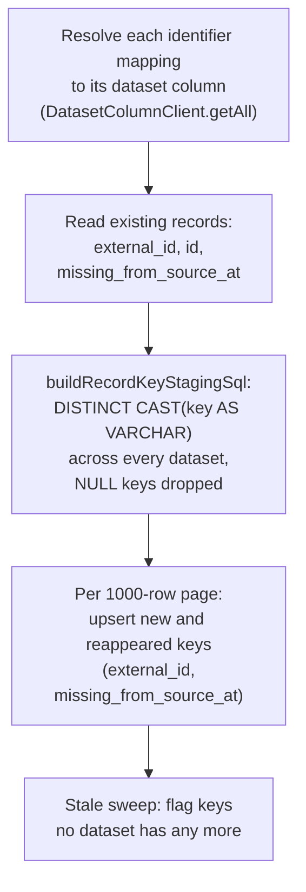

# Joined Cases 6: On-Demand Record Names Implementation Plan

> **For agentic workers:** REQUIRED SUB-SKILL: Use superpowers:subagent-driven-development (recommended) or superpowers:executing-plans to implement this plan task-by-task. Steps use checkbox (`- [ ]`) syntax for tracking.

**Goal:** Stop storing record names. Sync keeps only record keys, `individuals.name` is dropped, and the records list and record page read each record's name from its label field through the concept view, falling back to its `external_id`, with the list ordered by `external_id` and paged without duplicates.

**Architecture:** Sync stages one `VARCHAR` key per record from every identifier column (`buildRecordKeyStagingSql`) and upserts `external_id` and `missing_from_source_at` only. The relational CRUD clients gain `pageOrderColumns` and an exact page range, and `IndividualClient` orders by `external_id`. `useRecordNames` reads each list page's values with `ConceptRecordValuesClient.getConceptRecordValues` through `useQueries`, uses cached values of the same case type as each page's placeholder so known names never flash, and turns the results into a name per `external_id` with `makeRecordNamesFromPages` and `buildRecordNameFromLabelValue`. The record page header uses the same hook through `useRecordName`, sharing G1's query.

**Tech Stack:** Postgres (Supabase declarative schema, pgTAP, migration upgrade tests), TypeScript, React 19, Mantine, TanStack Router and Query, Lingui, DuckDB (QETL, executed tests with `@duckdb/node-api`), Playwright.

**Spec:** `docs/superpowers/specs/2026-11-06-joined-cases-6-on-demand-record-names-design.md` (sections below marked §). **Umbrella:** `docs/superpowers/specs/2026-11-06-joined-cases-design.md`. **Overview and ground rules:** `docs/superpowers/plans/2026-11-06-joined-cases.md`.

---

## Before you start

- Plans 1 to 5 have landed on `feat/joined-cases`. Confirm the G1 names this plan uses, and note the import path of the `ConceptRecordValues` type:

  ```bash
  rg -n "export const ConceptRecordValuesClient|export type ConceptRecordValues\b" src/clients/ontology/ConceptRecordValuesClient
  rg -n "getConceptRecordValues" src/views/IndividualManagerApp
  ```

  Expected (G1 spec §4.5 and §4.7): the client in `ConceptRecordValuesClient.ts`, the type in `ConceptRecordValuesClient.types.ts` (every code block below imports it from there), and `SingleIndividualView/useRecordFields/useRecordFields.ts` calling `useGetConceptRecordValues` with `{ workspaceId: individual.workspaceId, conceptId: concept.id, externalIds: [individual.externalId] }`. If the record page passes other parameters, stop and record the difference in spec §3 before Task 9.
- Plan 1 left the record page header as `title={individual.name}` (`SingleIndividualView/index.tsx`) and removed "Loading case" from it. Task 9 replaces that title.
- Plan 5 landed before this plan and took its "plan 6 not landed" path (G5 plan Task 10, Steps 1 to 5). So in `generateIndividuals.ts`, Sync still names records: `_resolveIndividualSourceMappings` resolves the identifier and label fields with `makeConceptAttributeColumnsFromMetadata` into an `IndividualSourceMappings` (`identifierSources`, a `LabelColumn`, `neededColumnsByDatasetId`, built by `_getMappedColumnIds` and `_getNeededColumnsByDatasetId`), and `_stageIndividuals` renders the name with `buildAttributeValueSql`. Task 11 deletes all six names. Plan 5 also renamed `getAttributesWithMapping` to `getAttributesWithMappings`, made a hydrated attribute hold `mappings: AttributeMapping[]`, moved `value_picker_rule_type` to `concept_attributes`, added `position` to mappings, and left `LABS_DATASET_ID`, `LABS_KEY_COLUMN_ID`, `LABS_NAME_COLUMN_ID`, `_makeTwoSourceConcept`, and a `describe("generateIndividuals over two sources")` block in `generateIndividuals.test.ts`. Task 11 builds on those.
- New case types have one ID field with one source per dataset (G5 spec §6.6), and an ID field over keys of different types is `varchar`. Sync stages one key per identifier mapping row, cast to `VARCHAR`, so both identifier shapes and mixed key types stage the same text keys.
- Plan 3 added the record page's type formatter, `createFieldValueFormatter({ dataType, locale })` in `src/components/caseFields/createFieldValueFormatter/` (with the hook `useFieldValueFormatter`). Task 3 builds record names from non-text labels on it, and its Step 1 checks the name.
- Read `CLAUDE.md`, `docs/rules/typescript.md`, `docs/rules/testing.md`, `docs/rules/e2e-testing.md`, `docs/rules/i18n.md`, `docs/rules/sql.md`, `docs/design/app-view-layout.md`, and the Named Rules in `DESIGN.md`. Nothing here is a new surface, so the `impeccable` skill is not needed.
- Lint rules that shape every code block: `arrow-body-style: always`, `@typescript-eslint/array-type: array-simple`, explicit return types on exported functions, 80-column lines. The formatter has the final word on wrapping and import order: run `pnpm format` before every commit, then re-run the task's tests.
- Never stage `supabase/config.toml`. Commit by path. End every commit message with the trailer `Co-Authored-By: Claude Opus 5.5 <noreply@anthropic.com>` (the second `-m` below). Do not push.
- Before any database command or E2E run, run `ava supabase status` and confirm the first line names the `feat-joined-cases` project. If it does not, run `ava supabase switch` and check again.

## Commands

| Purpose | Command |
| --- | --- |
| Switch check | `ava supabase status` |
| Unit tests for one path | `pnpm test:frontend <path or file pattern>` |
| `@avandar/clients` tests | `pnpm --filter @avandar/clients test <pattern>` |
| Executed DuckDB tests | `pnpm test:executed <pattern>` |
| Reset local DB from migrations | `pnpm db:reset` |
| Generate a migration | `pnpm db:new-migration <name>` |
| Regenerate DB types | `pnpm db:gen-types` |
| pgTAP, privilege reconcile, migration upgrade tests | `pnpm test:db` |
| Desktop SQLite migrations | `pnpm desktop:sqlite:gen-migrations` then `pnpm desktop:sqlite:check-migrations` |
| Type check | `pnpm type-check` |
| Lint | `pnpm lint` |
| Format | `pnpm format` |
| Lingui catalogs | `pnpm i18n:extract && pnpm i18n:compile` |
| One E2E spec | `pnpm test:e2e <spec>.spec.ts` |

## Decisions this plan locks in

| Topic | Decision | Why |
| --- | --- | --- |
| Records order | `pageOrderColumns: ["external_id"]` on `IndividualClient`, a new option honored by the Supabase and SQLite CRUD clients, with the primary key appended | A records-only query through the `queries` escape hatch would always call Supabase, so the desktop list would stop reading SQLite (§6.4) |
| Page range | `range(start, start + pageSize - 1)` for every model | PostgREST ranges include both ends; every page returned one extra row (§1, item 4) |
| Names per page | One `useQueries` entry per list page, keyed by the page's `external_id`s | A restriction never exceeds a page, and scrolling never re-reads earlier pages (§6.6) |
| No flash | Each page's `placeholderData` is `getCachedRecordValues`: cached values of the same keys from any query of the case type | `useQueries` gives a new key a new observer, so `keepPreviousData` keeps nothing across re-paging |
| Loading row | `RecordNameSkeleton` as the label and `aria-busy` on the link; the row is already a link with its status dot | Fixed 50px rows and Postgres order mean nothing moves when names arrive |
| No label field | Every record is named by its `external_id` and no values query runs | Several E2E specs seed case types with no fields |
| Header | `useRecordName` asks with the record page's own parameters | One shared DuckDB read for the header and the rail (§6.7) |
| Refresh | No change: a refresh does not invalidate record values | Sync changes membership only (§6.8); a dataset change marks values stale instead (next row) |
| Record values after a dataset change | Stale after a refresh (G1's `invalidateDatasetRowQueries`), a re-upload of an offline CSV or XLSX, a delete, or a live source's rows aging out (`markRecordValuesStale`, Task 4) | Names are read through record values, so a stale value is a stale name, and Task 5's placeholders spread it to every page |
| Non-text label names | Dates, times, and timestamps through plan 3's `createFieldValueFormatter` (`createLabelValueFormatter`, Task 3); numbers stay plain digits | The view returns temporal values as epoch numbers; a numeric label is usually a code a user searches for |
| Staged key type | `CAST(<key> AS VARCHAR)` | A `BIGINT` key comes back as a JS number and never matches its text `external_id` (§1, item 5) |
| Staging module | `generateIndividuals/buildRecordKeyStagingSql/`, taking `RecordKeySource = { datasetId; primaryKeyColumnName }` | The G7 spec (§5.6) names this module and type; G7 adds `keyMatching` instead of writing a second builder |
| E2E helpers | Seed `external_id` equal to the name a spec looks a record up by | Their case types have no fields, so the app names records by key |
| Overlapping Syncs | A second Sync of a case type waits for the first; the diff compares staged keys as text (Task 12) | Every Sync of a case type stages into one DuckDB table, and a numeric key flagged records missing on every second Sync |

## File structure

| File | Responsibility |
| --- | --- |
| Modify `packages/shared/clients/src/SupabaseCrudClient/createSupabaseCrudClient.ts` | Exact range, `pageOrderColumns` |
| Create `packages/shared/clients/src/SupabaseCrudClient/createSupabaseCrudClient.test.ts` | Range and order against a fake client |
| Modify `packages/shared/clients/src/SqliteCrudClient/createSqliteCrudClient.ts` and its test | `pageOrderColumns` |
| Modify `packages/shared/clients/README.md` | Document `pageOrderColumns` |
| Modify `shared/RdbCrudClient/RdbCrudClient.types.ts` | Pass `pageOrderColumns` through |
| Modify `src/clients/ontology/IndividualClient.ts` | Order records by `external_id` |
| Create `src/views/IndividualManagerApp/buildRecordNameFromLabelValue/buildRecordNameFromLabelValue.ts` and test | The name rule (§6.1) |
| Create `src/views/IndividualManagerApp/createLabelValueFormatter/createLabelValueFormatter.ts` and test | A label value as name text, by the label's type |
| Create `src/clients/ontology/ConceptRecordValuesClient/markRecordValuesStale/markRecordValuesStale.ts` and test | Mark record values stale without importing the client |
| Modify `src/clients/ontology/ConceptRecordValuesClient/ConceptRecordValuesClient.ts` | Client name from the shared constant |
| Modify `src/clients/datasets/DatasetClient/createDatasetMutations.ts` and test | A delete marks record values stale |
| Modify `src/clients/qetl/QueryMediator/relationLoading/RelationLoading.ts` and test | A live source acquired again marks record values stale |
| Create `src/views/DataManagerApp/ResyncDatasetsBlock/resyncOfflineDataset/resyncOfflineDataset.ts` and test | Re-upload an offline file, then mark its rows stale |
| Modify `src/views/DataManagerApp/ResyncDatasetsBlock/ResyncDatasetCard.tsx` | Use `resyncOfflineDataset`; Back marks rows stale |
| Create `src/views/IndividualManagerApp/getCachedRecordValues/getCachedRecordValues.ts` and test | Cached values as placeholders |
| Create `src/views/IndividualManagerApp/makeRecordNamesFromPages/makeRecordNamesFromPages.ts` and test | Page results to names |
| Create `src/views/IndividualManagerApp/useRecordNames/useRecordNames.ts` and test | The per-page names hook |
| Create `src/views/IndividualManagerApp/makeVirtualIndividualLink/makeVirtualIndividualLink.tsx` and test | One list row, moved out of `useVirtualIndividualLinks` |
| Create `src/views/IndividualManagerApp/IndividualNavbar/RecordNameSkeleton.tsx` | The loading name |
| Modify `src/views/IndividualManagerApp/useVirtualIndividualLinks.tsx` | Use `makeVirtualIndividualLink` with `recordNames` |
| Modify `src/views/IndividualManagerApp/IndividualNavbar/IndividualNavbarRows.tsx` | Import `VirtualIndividualLink` from its new module |
| Modify `src/views/IndividualManagerApp/useConceptIndividuals.ts` | Return `externalIdPages` |
| Modify `src/views/IndividualManagerApp/IndividualNavbar/IndividualNavbar.tsx` | Wire `useRecordNames` |
| Modify `apps/ava-video-producer/capture-flows/cases-map/cases.mjs` | Read names once none is loading |
| Create `src/views/IndividualManagerApp/SingleIndividualView/useRecordName/useRecordName.ts` and test | The header's name |
| Modify `src/views/IndividualManagerApp/SingleIndividualView/index.tsx` | Header from `useRecordName` |
| Create `src/views/OntologyDesignerApp/ConceptMetaView/generateIndividuals/buildRecordKeyStagingSql/buildRecordKeyStagingSql.ts` and `.executed.test.ts` | Key-only staging SQL |
| Modify `src/views/OntologyDesignerApp/ConceptMetaView/generateIndividuals/generateIndividuals.ts` and test | Sync reads keys only, one Sync per case type at a time |
| Modify `.../generateIndividuals/diffStagedIndividualsHelpers/diffStagedIndividualsHelpers.ts` and test | No name; staged keys compared as text |
| Modify `supabase/schemas/20.individuals.sql`; create the generated migration | Drop `name` |
| Modify `shared/types/database.types.ts` (generated) | Regenerated |
| Modify `shared/models/ontology/Individual/Individual.types.ts`, `IndividualParsers.ts`, `IndividualParsers.test.ts` | No `name` |
| Modify seven pgTAP files and `supabase/migration-upgrade-tests/case_statuses_backfill.prelude.sql` | No `name` |
| Modify `RecordFactsGroup.test.tsx`, `useRecordStatusChange.test.tsx` | Fixtures without `name` |
| Modify `tests/e2e/helpers/insertE2ECaseTypeWithRecords.ts`, `seedCaseRecord.ts`, `CaseTypeSeedHelpers.ts` | No `name`; key is the name; two-dataset seed |
| Create `apps/desktop/migrations/<ts>_drop_individuals_name.gen.sql` (generated) | SQLite drop |
| Create `tests/data/record-names/record-names-people.csv`, `record-names-visits.csv`; modify `tests/e2e/helpers/constants.ts` | E2E fixtures |
| Create `tests/e2e/case-record-names.spec.ts` | The E2E spec |
| Modify `src/i18n/locales/*/messages.po` and `messages.ts` | Regenerated catalogs |
| Modify `docs/ontology-architecture.md` | Sections 4, 6, 7, 9, 10, 13, 15, 16 |

---

## Task 1: Exact pages, and records in ID order

**Files:**
- Create: `packages/shared/clients/src/SupabaseCrudClient/createSupabaseCrudClient.test.ts`
- Modify: `packages/shared/clients/src/SupabaseCrudClient/createSupabaseCrudClient.ts`
- Modify: `packages/shared/clients/src/SqliteCrudClient/createSqliteCrudClient.ts`
- Modify: `packages/shared/clients/src/SqliteCrudClient/createSqliteCrudClient.test.ts`
- Modify: `packages/shared/clients/README.md`
- Modify: `shared/RdbCrudClient/RdbCrudClient.types.ts`
- Modify: `src/clients/ontology/IndividualClient.ts`

- [ ] **Step 1: Write the failing Supabase test**

`createSupabaseCrudClient.test.ts`:

```ts
import { makeParserRegistry } from "@clients/makeParserRegistry/makeParserRegistry.ts";
import { createSupabaseCrudClient } from "@clients/SupabaseCrudClient/createSupabaseCrudClient.ts";
import { describe, expect, it } from "vitest";
import { z } from "zod";
import type { SupabaseClient } from "@supabase/supabase-js";

/*
 * A fake Supabase client that records every query builder call. `getPage`
 * chains `from`, `select`, filters, `order`, `range`, `overrideTypes`, and
 * `throwOnError`, so the recorded calls are the request the client sends.
 */
type BuilderCall = { method: string; args: unknown[] };

function _makeFakeDbClient(): {
  dbClient: SupabaseClient;
  calls: BuilderCall[];
} {
  const calls: BuilderCall[] = [];
  const builder: Record<string, unknown> = {};
  ["select", "eq", "in", "order", "range", "overrideTypes"].forEach(
    (method) => {
      builder[method] = (...args: unknown[]) => {
        calls.push({ method, args });
        return builder;
      };
    },
  );
  builder.throwOnError = () => {
    return Promise.resolve({ data: [], count: 41 });
  };
  const dbClient = {
    from: (...args: unknown[]) => {
      calls.push({ method: "from", args });
      return builder;
    },
  };
  return { dbClient: dbClient as unknown as SupabaseClient, calls };
}

function _getCallArgs(
  calls: readonly BuilderCall[],
  method: string,
): unknown[][] {
  return calls
    .filter((call) => {
      return call.method === method;
    })
    .map((call) => {
      return call.args;
    });
}

type WidgetModelSpec = {
  modelName: "Widget";
  tableName: "widgets";
  dbTablePrimaryKey: "id";
  modelPrimaryKeyType: string;
  DBRead: { id: string; name: string };
  Read: { id: string; name: string };
  DBInsert: { id?: string; name: string };
  Insert: { name: string };
  DBUpdate: { name?: string };
  Update: { name?: string };
};

const widgetParsers = makeParserRegistry<WidgetModelSpec>().build({
  modelName: "Widget",
  DBReadSchema: z.object({ id: z.string(), name: z.string() }),
  fromDBReadToModelRead: (row) => {
    return row;
  },
  fromModelInsertToDBInsert: (model) => {
    return model;
  },
  fromModelUpdateToDBUpdate: (model) => {
    return model;
  },
});

// The client is typed against the registered Supabase database, which has
// no `widgets` table. These tests exercise the request, not the types.
// eslint-disable-next-line @typescript-eslint/no-explicit-any
type LooseClient = any;

function _makeClient(options: {
  dbClient: SupabaseClient;
  pageOrderColumns?: readonly string[];
}): LooseClient {
  return createSupabaseCrudClient({
    modelName: "Widget",
    tableName: "widgets",
    dbTablePrimaryKey: "id",
    parsers: widgetParsers,
    dbClient: options.dbClient,
    pageOrderColumns: options.pageOrderColumns,
  } as never);
}

describe("createSupabaseCrudClient getPage", () => {
  it("asks for exactly one page of rows", async () => {
    const { dbClient, calls } = _makeFakeDbClient();

    await _makeClient({ dbClient }).getPage({ pageSize: 20, pageNum: 1 });

    expect(_getCallArgs(calls, "range")).toEqual([[20, 39]]);
  });

  it("orders a page by the configured columns, then the primary key", async () => {
    const { dbClient, calls } = _makeFakeDbClient();

    await _makeClient({ dbClient, pageOrderColumns: ["name"] }).getPage({
      pageSize: 20,
      pageNum: 0,
    });

    expect(_getCallArgs(calls, "order")).toEqual([
      ["name", { ascending: true }],
      ["id", { ascending: true }],
    ]);
  });

  it("leaves a page in database order when no order columns are configured", async () => {
    const { dbClient, calls } = _makeFakeDbClient();

    await _makeClient({ dbClient }).getPage({ pageSize: 20, pageNum: 0 });

    expect(_getCallArgs(calls, "order")).toEqual([]);
  });
});
```

- [ ] **Step 2: Write the failing SQLite test**

In `createSqliteCrudClient.test.ts`, let `makeClient` take extra options:

```ts
  function makeClient(extraOptions: Record<string, unknown> = {}): LooseClient {
    return createSqliteCrudClient({
      modelName: "Widget",
      tableName: "widgets" as never,
      dbTablePrimaryKey: "id" as never,
      parsers: widgetParsers as never,
      dbClient: fakeSupabase,
      sqliteTransport,
      ...extraOptions,
    } as never);
  }
```

and add, after `"getPage applies LIMIT/OFFSET correctly"`:

```ts
  it("getPage orders by the configured columns, then the primary key", async () => {
    let pageCall: FakeRequest | undefined;
    sqliteTransport.query.mockImplementation((request) => {
      pageCall = request;
      return { rows: [] };
    });
    const client = makeClient({ pageOrderColumns: ["name"] });

    await client.getPage({ pageSize: 10, pageNum: 0 });

    expect(pageCall?.sql).toMatch(/order by "name", "id" limit \? offset \?$/);
  });
```

- [ ] **Step 3: Run them and watch them fail**

Run: `pnpm --filter @avandar/clients test createSupabaseCrudClient createSqliteCrudClient`
Expected: FAIL. "asks for exactly one page of rows" receives `[[20, 40]]`; "orders a page by the configured columns" receives `[]`; the SQLite order test's SQL has no `order by`. "leaves a page in database order" passes already and guards the default.

- [ ] **Step 4: Implement `pageOrderColumns` and the exact range in the Supabase client**

In `createSupabaseCrudClient.ts`, add to the `options` type, after `dbTablePrimaryKey`:

```ts
  /**
   * Columns every page is ordered by, ascending, before the primary key.
   * `getAll` and `getOne` read through `getPage`, so they follow the same
   * order. Unset leaves rows in whatever order the database returns them.
   */
  pageOrderColumns?: ReadonlyArray<Extract<keyof M["DBRead"], string>>;
```

Destructure it with a default:

```ts
  const {
    modelName,
    tableName,
    parsers,
    dbTablePrimaryKey,
    pageOrderColumns = [],
    queries,
    mutations,
    dbClient,
  } = options;
```

Replace the body of `getPage` from `if (where) {` to the `return dbRows;` with:

```ts
        if (where) {
          query = _applyFiltersToSupabaseQuery(query, where);
        }

        if (pageOrderColumns.length > 0) {
          [...pageOrderColumns, String(dbTablePrimaryKey)].forEach(
            (column) => {
              query = query.order(column, { ascending: true });
            },
          );
        }

        if (pageSize > MAXIMUM_PAGE_SIZE) {
          logger.warn(
            `Page size is greater than ${MAXIMUM_PAGE_SIZE}. Supabase will only return ${MAXIMUM_PAGE_SIZE} rows.`,
          );
        }

        // `range` includes both ends, so a page ends one row before the next
        // page starts.
        const startIndex = pageNum * pageSize;
        const endIndex = startIndex + pageSize - 1;
        const { data: dbRows } = await query
          .range(startIndex, endIndex)
          .overrideTypes<Array<M["DBRead"]>, { merge: false }>()
          .throwOnError();
        return dbRows;
```

- [ ] **Step 5: Implement `pageOrderColumns` in the SQLite client**

In `createSqliteCrudClient.ts`, add the same option and docstring to the `options` type after `dbTablePrimaryKey`, destructure it as `pageOrderColumns = []`, and after `const table = _ident(String(tableName));` add:

```ts
  const orderBy =
    pageOrderColumns.length === 0
      ? ""
      : ` order by ${[...pageOrderColumns, pk]
          .map((column) => {
            return _ident(column);
          })
          .join(", ")}`;
```

In `getPage`, change the SQL to:

```ts
        const sql = `select * from ${table}${where}${orderBy} limit ? offset ?`;
```

- [ ] **Step 6: Pass the option through and use it for records**

In `shared/RdbCrudClient/RdbCrudClient.types.ts`, add to `RdbCrudModelSpec` after `dbTablePrimaryKey`:

```ts
  /**
   * Columns every page is ordered by, ascending, before the primary key.
   * See `createSupabaseCrudClient`.
   */
  pageOrderColumns?: ReadonlyArray<Extract<keyof M["DBRead"], string>>;
```

Replace `src/clients/ontology/IndividualClient.ts` with:

```ts
import { IndividualParsers } from "$/models/ontology/Individual/IndividualParsers";
import { createRdbCrudClient } from "$/RdbCrudClient/createRdbCrudClient";
import { createUsableServiceClient } from "@/utils/createUsableServiceClient";

export const IndividualClient = createUsableServiceClient(
  createRdbCrudClient({
    modelName: "Individual",
    tableName: "individuals",
    dbTablePrimaryKey: "id",
    parsers: IndividualParsers,
    // The records list pages in this order, which the
    // `(concept_id, external_id)` unique index serves.
    pageOrderColumns: ["external_id"],
  }),
);
```

- [ ] **Step 7: Document the option**

In `packages/shared/clients/README.md`, in the `createSupabaseCrudClient(options)` table, add after the `dbTablePrimaryKey` row:

```md
| `pageOrderColumns?` | Columns every page is ordered by, ascending, then the primary key. `getAll` and `getOne` read through `getPage`, so they follow it. Unset leaves rows in database order |
```

In the SQLite section, add after the paragraph that ends "without changing consumer code. It is used for local-first / desktop setups where reads and writes hit a local SQLite mirror.":

```md
It honors `pageOrderColumns` the same way, with `order by` before
`limit ? offset ?`.
```

- [ ] **Step 8: Run the tests and type checks**

Run: `pnpm --filter @avandar/clients test createSupabaseCrudClient createSqliteCrudClient`
Expected: PASS, every test in both files.

Run: `pnpm --filter @avandar/clients type-check && pnpm type-check`
Expected: no errors.

- [ ] **Step 9: Commit**

```bash
pnpm format
git add packages/shared/clients/src/SupabaseCrudClient packages/shared/clients/src/SqliteCrudClient packages/shared/clients/README.md shared/RdbCrudClient/RdbCrudClient.types.ts src/clients/ontology/IndividualClient.ts
git commit -m "fix(joined-cases): page records exactly and in ID order" -m "Co-Authored-By: Claude Opus 5.5 <noreply@anthropic.com>"
```

---

## Task 2: The record name rule

**Files:**
- Create: `src/views/IndividualManagerApp/buildRecordNameFromLabelValue/buildRecordNameFromLabelValue.ts`
- Test: `src/views/IndividualManagerApp/buildRecordNameFromLabelValue/buildRecordNameFromLabelValue.test.ts`

- [ ] **Step 1: Write the failing test**

```ts
import { describe, expect, it } from "vitest";
import { buildRecordNameFromLabelValue } from "@/views/IndividualManagerApp/buildRecordNameFromLabelValue/buildRecordNameFromLabelValue";

function _nameOf(labelValue: unknown): string {
  return buildRecordNameFromLabelValue({ labelValue, externalId: "P-001" });
}

describe("buildRecordNameFromLabelValue", () => {
  it("names a record by its label value", () => {
    expect(_nameOf("Ada Lovelace")).toBe("Ada Lovelace");
  });

  it("names a record by its ID when its label value is NULL", () => {
    expect(_nameOf(null)).toBe("P-001");
  });

  it("names a record by its ID when it has no label value at all", () => {
    expect(_nameOf(undefined)).toBe("P-001");
  });

  it("names a record by its ID when its label is blank", () => {
    expect(_nameOf("   ")).toBe("P-001");
  });

  it("names a record by its ID when its list label has no values", () => {
    expect(_nameOf([])).toBe("P-001");
  });

  it("joins a list label's values with commas", () => {
    expect(_nameOf(["Ada", "Lovelace"])).toBe("Ada, Lovelace");
  });

  it("writes a numeric label without thousands separators", () => {
    expect(_nameOf(12345)).toBe("12345");
  });
});
```

- [ ] **Step 2: Run it and watch it fail**

Run: `pnpm test:frontend buildRecordNameFromLabelValue`
Expected: FAIL, `Failed to resolve import`.

- [ ] **Step 3: Write the rule**

```ts
import { unknownToString } from "@avandar/utils";

/**
 * A record's name: its label field's value as text, or its `external_id`
 * when the value is NULL, blank, or an empty list. The fallback is data, not
 * copy, so it is never translated.
 *
 * @param options.labelValue The label field's value from the concept view.
 *   `undefined` when the record has none, including a case type with no
 *   label field.
 * @param options.externalId The record's key in its source data.
 * @returns The name to show for the record.
 */
export function buildRecordNameFromLabelValue(
  options: Readonly<{ labelValue: unknown; externalId: string }>,
): string {
  const { labelValue, externalId } = options;
  if (labelValue === null || labelValue === undefined) {
    return externalId;
  }
  if (Array.isArray(labelValue) && labelValue.length === 0) {
    return externalId;
  }
  const name = unknownToString(labelValue, {
    arraySeparator: ", ",
    emptyString: "",
    formatNumbers: false,
  });
  return name.trim() === "" ? externalId : name;
}
```

- [ ] **Step 4: Run it and watch it pass**

Run: `pnpm test:frontend buildRecordNameFromLabelValue`
Expected: PASS, 7 tests.

- [ ] **Step 5: Commit**

```bash
pnpm format
git add src/views/IndividualManagerApp/buildRecordNameFromLabelValue
git commit -m "feat(joined-cases): name a record by its label value or its ID" -m "Co-Authored-By: Claude Opus 5.5 <noreply@anthropic.com>"
```

---

## Task 3: Record names from numbers, dates, times, and timestamps

**Files:**
- Create: `src/views/IndividualManagerApp/createLabelValueFormatter/createLabelValueFormatter.ts`
- Test: `src/views/IndividualManagerApp/createLabelValueFormatter/createLabelValueFormatter.test.ts`
- Modify: `src/views/IndividualManagerApp/buildRecordNameFromLabelValue/buildRecordNameFromLabelValue.ts`
- Test: `src/views/IndividualManagerApp/buildRecordNameFromLabelValue/buildRecordNameFromLabelValue.test.ts`

Today Sync stages a numeric label as a JS number although `name` is typed `string`, so every Sync rewrites those rows, and a TIME label fails Sync outright (`TIME::TIMESTAMP`). Task 11 stops storing names, which removes both. What remains is how a name reads once it is computed: the concept view returns a DATE or TIMESTAMP label as epoch milliseconds and a TIME label as microseconds since midnight, so Task 2's rule would name a record `1709596800000`. This task formats dates, times, and timestamps through plan 3's `createFieldValueFormatter`, the formatter the record page uses, and keeps numbers as plain digits: a numeric label is usually a code or a number a user searches for, and Task 2 already pins "no thousands separators". Tasks 6 and 7 pass the formatter through.

- [ ] **Step 1: Check plan 3's formatter**

```bash
rg -n "export function createFieldValueFormatter" src/components/caseFields/createFieldValueFormatter/createFieldValueFormatter.ts
```

Expected: one hit, `createFieldValueFormatter(options: Readonly<{ dataType: AvaDataType.T; locale: string }>): (value: unknown) => string`. If it landed under another name or path, use the landed one in every code block below and record the difference in spec §3.

- [ ] **Step 2: Write the failing formatter test**

Create `createLabelValueFormatter.test.ts`:

```ts
/**
 * A record's name reads its label value as a person would write it: a date
 * as a day, a time as a clock time, and a number as its plain digits.
 */
import { describe, expect, it } from "vitest";
import { createLabelValueFormatter } from "@/views/IndividualManagerApp/createLabelValueFormatter/createLabelValueFormatter";
import type { AvaDataType } from "$/models/datasets/AvaDataType/AvaDataType";

function _format(labelDataType: AvaDataType.T, value: unknown): string {
  // Some ICU versions put a narrow no-break space before AM and PM.
  return createLabelValueFormatter({ labelDataType, locale: "en" })(
    value,
  ).replace(/\s/g, " ");
}

describe("createLabelValueFormatter", () => {
  it.each([
    ["date", 1709596800000, "Mar 5, 2024"],
    ["date", "2026-01-05", "Jan 5, 2026"],
    ["timestamp", Date.UTC(2026, 0, 5, 10, 30), "Jan 5, 2026, 10:30 AM"],
    ["time", 52_200_000_000, "2:30 PM"],
  ] as const)("writes a %s label value %s as %s", (labelDataType, value, name) => {
    expect(_format(labelDataType, value)).toBe(name);
  });

  it("writes a whole number label without thousands separators", () => {
    expect(_format("bigint", 1234567)).toBe("1234567");
  });

  it("writes a decimal label as its digits", () => {
    expect(_format("double", 2.5)).toBe("2.5");
  });

  it("writes a text label as it is", () => {
    expect(_format("varchar", "Ada Lovelace")).toBe("Ada Lovelace");
  });

  it("writes a missing value as empty text, so the name falls back to the ID", () => {
    expect(_format("varchar", null)).toBe("");
    expect(_format("date", null)).toBe("");
  });
});
```

- [ ] **Step 3: Add the type cases to the name rule's test**

Replace the top of `buildRecordNameFromLabelValue.test.ts`, from the imports to the end of `_nameOf`, with:

```ts
import { describe, expect, it } from "vitest";
import { buildRecordNameFromLabelValue } from "@/views/IndividualManagerApp/buildRecordNameFromLabelValue/buildRecordNameFromLabelValue";
import { createLabelValueFormatter } from "@/views/IndividualManagerApp/createLabelValueFormatter/createLabelValueFormatter";
import type { AvaDataType } from "$/models/datasets/AvaDataType/AvaDataType";

function _nameOfType(labelDataType: AvaDataType.T, labelValue: unknown): string {
  return buildRecordNameFromLabelValue({
    labelValue,
    externalId: "P-001",
    formatLabelValue: createLabelValueFormatter({
      labelDataType,
      locale: "en",
    }),
  });
}

function _nameOf(labelValue: unknown): string {
  return _nameOfType("varchar", labelValue);
}
```

Change the body of `"writes a numeric label without thousands separators"` to `expect(_nameOfType("bigint", 12345)).toBe("12345");`, and add inside the `describe`:

```ts
  it("names a record by a date label as the day it holds", () => {
    expect(_nameOfType("date", 1709596800000)).toBe("Mar 5, 2024");
  });

  it("joins a list label's dates as days", () => {
    expect(_nameOfType("date", ["2026-01-05", "2026-02-01"])).toBe(
      "Jan 5, 2026, Feb 1, 2026",
    );
  });

  it("names a record by its ID when every value of its list label is empty", () => {
    expect(_nameOf([null, "  "])).toBe("P-001");
  });
```

- [ ] **Step 4: Run them and watch them fail**

Run: `pnpm test:frontend createLabelValueFormatter buildRecordNameFromLabelValue`
Expected: FAIL, `Failed to resolve import "@/views/IndividualManagerApp/createLabelValueFormatter/createLabelValueFormatter"` in both files.

- [ ] **Step 5: Write the formatter**

Create `createLabelValueFormatter.ts`:

```ts
import { unknownToString } from "@avandar/utils";
import { AvaDataType } from "$/models/datasets/AvaDataType/AvaDataType";
import { createFieldValueFormatter } from "@/components/caseFields/createFieldValueFormatter/createFieldValueFormatter";

/**
 * Builds the function that writes one value of a case type's label field as
 * the text of a record's name. Dates, times, and timestamps read as the
 * record page shows them, because the concept view returns them as epoch
 * numbers. Every other value keeps its plain text: a numeric label is
 * usually a code or a number a user searches for, so it shows no thousands
 * separators. A NULL value is empty text, which the name rule replaces with
 * the record's ID.
 *
 * @param options.labelDataType The label field's `data_type`.
 * @param options.locale The reader's locale, for dates and times.
 * @returns A function that formats one label value. A list label's items
 *   are formatted one at a time by `buildRecordNameFromLabelValue`.
 */
export function createLabelValueFormatter(
  options: Readonly<{ labelDataType: AvaDataType.T; locale: string }>,
): (value: unknown) => string {
  const { labelDataType, locale } = options;
  if (AvaDataType.isTemporal(labelDataType)) {
    return createFieldValueFormatter({ dataType: labelDataType, locale });
  }
  return (value: unknown): string => {
    return unknownToString(value, {
      nullString: "",
      undefinedString: "",
      emptyString: "",
      formatNumbers: false,
    });
  };
}
```

- [ ] **Step 6: Make the name rule take the formatter**

Replace the whole of `buildRecordNameFromLabelValue.ts` with:

```ts
/**
 * A record's name: its label field's value as text, or its `external_id`
 * when the value is NULL, blank, or a list with no non-blank value. The
 * fallback is data, not copy, so it is never translated.
 *
 * @param options.labelValue The label field's value from the concept view.
 *   `undefined` when the record has none, including a case type with no
 *   label field.
 * @param options.externalId The record's key in its source data.
 * @param options.formatLabelValue Writes one label value as text, from
 *   `createLabelValueFormatter` for the label field's type. A list label's
 *   values are each written with it and joined with commas.
 * @returns The name to show for the record.
 */
export function buildRecordNameFromLabelValue(
  options: Readonly<{
    labelValue: unknown;
    externalId: string;
    formatLabelValue: (value: unknown) => string;
  }>,
): string {
  const { labelValue, externalId, formatLabelValue } = options;
  if (labelValue === null || labelValue === undefined) {
    return externalId;
  }
  const name = Array.isArray(labelValue)
    ? labelValue
        .map(formatLabelValue)
        .filter((item) => {
          return item.trim() !== "";
        })
        .join(", ")
    : formatLabelValue(labelValue);
  return name.trim() === "" ? externalId : name;
}
```

- [ ] **Step 7: Run them and watch them pass**

Run: `pnpm test:frontend createLabelValueFormatter buildRecordNameFromLabelValue`
Expected: PASS, 8 formatter tests and 10 name rule tests.

Run: `pnpm type-check`
Expected: no errors. Nothing calls `buildRecordNameFromLabelValue` yet; Task 6 is its first caller and passes `formatLabelValue`.

- [ ] **Step 8: Commit**

```bash
pnpm format
git add src/views/IndividualManagerApp/createLabelValueFormatter src/views/IndividualManagerApp/buildRecordNameFromLabelValue
git commit -m "feat(joined-cases): name a record by a date, time, or number label as it reads" -m "Co-Authored-By: Claude Opus 5.5 <noreply@anthropic.com>"
```

---

## Task 4: Record values go stale with every dataset change

**Files:**
- Create: `src/clients/ontology/ConceptRecordValuesClient/markRecordValuesStale/markRecordValuesStale.ts`
- Test: `src/clients/ontology/ConceptRecordValuesClient/markRecordValuesStale/markRecordValuesStale.test.ts`
- Modify: `src/clients/ontology/ConceptRecordValuesClient/ConceptRecordValuesClient.ts`
- Modify: `src/clients/datasets/DatasetClient/createDatasetMutations.ts`
- Test: `src/clients/datasets/DatasetClient/createDatasetMutations.test.ts`
- Modify: `src/clients/qetl/QueryMediator/relationLoading/RelationLoading.ts`
- Test: `src/clients/qetl/QueryMediator/relationLoading/RelationLoading.test.ts`
- Create: `src/views/DataManagerApp/ResyncDatasetsBlock/resyncOfflineDataset/resyncOfflineDataset.ts`
- Test: `src/views/DataManagerApp/ResyncDatasetsBlock/resyncOfflineDataset/resyncOfflineDataset.test.ts`
- Modify: `src/views/DataManagerApp/ResyncDatasetsBlock/ResyncDatasetCard.tsx`

Plan 1 made a Google Sheets or Postgres refresh mark record values stale (`invalidateDatasetRowQueries`). Three other dataset changes do not: re-uploading an offline CSV or XLSX (`ResyncDatasetCard.tsx`), deleting a dataset (`DatasetClient.fullDelete`, called from four screens), and a live source's rows aging out, which QETL notices on the next query (`probeRelationCache` reads `QueryableRelationColumns.isStale`) and acquires again (`RelationLoading.loadRelationBytes`). An open record page then keeps its old values, and from Task 7 on, the records list names records through the same cached values, so a stale value becomes a stale name, and Task 5's placeholders spread it to every page that reads the record.

This task covers the three. A delete and a re-acquired live source happen inside clients, which cannot import `ConceptRecordValuesClient` (it imports QETL, which imports `DatasetClient`), so a leaf module names the client's queries and marks them stale. It does not change what Refresh records does (decision "Refresh" above): Sync changes which records exist, never a value.

- [ ] **Step 1: Write the failing test for the shared marker**

Create `markRecordValuesStale/markRecordValuesStale.test.ts`:

```ts
/**
 * Clients that change a dataset's rows mark record values stale without
 * importing the record values client, so the name they use must be the
 * client's own.
 */
import { QueryClient, QueryObserver } from "@tanstack/react-query";
import { describe, expect, it, vi } from "vitest";
import { ConceptRecordValuesClient } from "@/clients/ontology/ConceptRecordValuesClient/ConceptRecordValuesClient";
import {
  CONCEPT_RECORD_VALUES_CLIENT_NAME,
  markRecordValuesStale,
} from "@/clients/ontology/ConceptRecordValuesClient/markRecordValuesStale/markRecordValuesStale";
import type { Concept } from "$/models/ontology/Concept/Concept";
import type { Workspace } from "$/models/Workspace/Workspace";
import type { ConceptRecordValues } from "@/clients/ontology/ConceptRecordValuesClient/ConceptRecordValuesClient.types";

const WORKSPACE_ID = "eeeeeeee-5555-4555-8555-eeeeeeeeeeee" as Workspace.Id;
const KEY = ConceptRecordValuesClient.QueryKeys.getConceptRecordValues({
  workspaceId: WORKSPACE_ID,
  conceptId: "cccccccc-3333-4333-8333-cccccccccccc" as Concept.Id,
  externalIds: ["p1"],
});

describe("markRecordValuesStale", () => {
  it("names the record values client's queries by the client's own name", () => {
    expect(CONCEPT_RECORD_VALUES_CLIENT_NAME).toBe(
      ConceptRecordValuesClient.getClientName(),
    );
  });

  it("marks every case type's record values stale", async () => {
    const queryClient = new QueryClient();
    queryClient.setQueryData(KEY, []);

    await markRecordValuesStale(queryClient);

    expect(queryClient.getQueryState(KEY)?.isInvalidated).toBe(true);
  });

  // The read already in flight may be the query that noticed the change, and
  // restarting it would read the same rows twice.
  it("lets a read already in flight finish instead of starting it again", async () => {
    const queryClient = new QueryClient();
    const queryFn = vi.fn((): Promise<ConceptRecordValues[]> => {
      return new Promise(() => {});
    });
    const observer = new QueryObserver(queryClient, { queryKey: KEY, queryFn });
    const unsubscribe = observer.subscribe(() => {});
    await vi.waitFor(() => {
      expect(queryFn).toHaveBeenCalledTimes(1);
    });

    void markRecordValuesStale(queryClient);
    await Promise.resolve();

    expect(queryFn).toHaveBeenCalledTimes(1);
    unsubscribe();
  });
});
```

- [ ] **Step 2: Run it and watch it fail**

Run: `pnpm test:frontend markRecordValuesStale`
Expected: FAIL, `Failed to resolve import "@/clients/ontology/ConceptRecordValuesClient/markRecordValuesStale/markRecordValuesStale"`.

- [ ] **Step 3: Write the marker and name the client by it**

Create `markRecordValuesStale/markRecordValuesStale.ts`:

```ts
import type { QueryClient } from "@tanstack/react-query";

/**
 * The name `ConceptRecordValuesClient` registers its queries under. Code that
 * the client itself depends on, such as QETL and `DatasetClient`, names the
 * client's queries through this rather than importing the client.
 */
export const CONCEPT_RECORD_VALUES_CLIENT_NAME = "ConceptRecordValuesClient";

/**
 * Marks every case type record's field values stale, so the ones on screen
 * read again. A read already in flight is left to finish rather than
 * restarted: it may be the read whose query noticed the change.
 *
 * Call it wherever a dataset's rows change outside a screen that already
 * calls `invalidateDatasetRowQueries`: a dataset delete, or a live source's
 * rows acquired again after they aged out.
 */
export async function markRecordValuesStale(
  queryClient: QueryClient,
): Promise<void> {
  await queryClient.invalidateQueries(
    { queryKey: [CONCEPT_RECORD_VALUES_CLIENT_NAME] },
    { cancelRefetch: false },
  );
}
```

In `ConceptRecordValuesClient.ts`, add:

```ts
import { CONCEPT_RECORD_VALUES_CLIENT_NAME } from "@/clients/ontology/ConceptRecordValuesClient/markRecordValuesStale/markRecordValuesStale";
```

and replace `createServiceClient("ConceptRecordValuesClient")` with `createServiceClient(CONCEPT_RECORD_VALUES_CLIENT_NAME)`.

Run: `pnpm test:frontend markRecordValuesStale ConceptRecordValuesClient invalidateDatasetRowQueries`
Expected: PASS.

- [ ] **Step 4: Write the failing delete tests**

In `createDatasetMutations.test.ts`:

1. Add `markRecordValuesStaleMock` and `AVA_QUERY_CLIENT` to the hoisted values:

   ```ts
   const { rpcMock, markRecordValuesStaleMock, AVA_QUERY_CLIENT } = vi.hoisted(
     () => {
       return {
         rpcMock: vi.fn(),
         markRecordValuesStaleMock: vi.fn(),
         AVA_QUERY_CLIENT: { name: "AvaQueryClient" },
       };
     },
   );
   ```

2. Replace the `LocalDatasetClient` and `DuckDbClient` mocks, and add two more:

   ```ts
   vi.mock("@/clients/datasets/LocalDatasetClient/LocalDatasetClient", () => {
     return {
       LocalDatasetClient: {
         dropLocalDataset: vi.fn(),
         getById: vi.fn(),
         delete: vi.fn(),
       },
     };
   });

   vi.mock("@/clients/DuckDbClient/DuckDbClient", () => {
     return {
       DuckDbClient: { dropTable: vi.fn(), dropTableViewAndFile: vi.fn() },
     };
   });

   vi.mock("@/config/AvaQueryClient", () => {
     return { AvaQueryClient: AVA_QUERY_CLIENT };
   });

   vi.mock(
     "@/clients/ontology/ConceptRecordValuesClient/markRecordValuesStale/markRecordValuesStale",
     () => {
       return { markRecordValuesStale: markRecordValuesStaleMock };
     },
   );
   ```

3. Append:

   ```ts
   describe("fullDelete", () => {
     beforeEach(() => {
       markRecordValuesStaleMock.mockReset();
     });

     async function _fullDelete(deleteRow: () => Promise<void>): Promise<void> {
       const { createDatasetMutations } =
         await import("@/clients/datasets/DatasetClient/createDatasetMutations");
       await createDatasetMutations({
         ...CONFIG,
         client: {
           getById: vi.fn(async () => {
             return undefined;
           }),
           delete: deleteRow,
         },
       } as unknown as DatasetMutationConfig).fullDelete({
         id: BASE_PARAMS.datasetId,
       });
     }

     // A case type that read the dataset now computes its values without it.
     it("marks every case type's record values stale once the dataset is gone", async () => {
       const deleteRow = vi.fn(async () => {
         return undefined;
       });

       await _fullDelete(deleteRow);

       expect(markRecordValuesStaleMock).toHaveBeenCalledWith(AVA_QUERY_CLIENT);
       expect(deleteRow.mock.invocationCallOrder[0]).toBeLessThan(
         markRecordValuesStaleMock.mock.invocationCallOrder[0]!,
       );
     });

     it("leaves record values alone when the delete fails", async () => {
       await expect(
         _fullDelete(async () => {
           throw new Error("delete refused");
         }),
       ).rejects.toThrow("delete refused");

       expect(markRecordValuesStaleMock).not.toHaveBeenCalled();
     });
   });
   ```

- [ ] **Step 5: Write the failing live source tests**

In `RelationLoading.test.ts`:

1. Change the imports and mocks at the top to:

   ```ts
   import { MIMEType } from "@avandar/utils";
   import { afterEach, describe, expect, it, vi } from "vitest";
   import { QueryableRelationColumns } from "@/clients/qetl/QueryMediator/QueryableRelationColumns/QueryableRelationColumns";
   import { RelationLoading } from "@/clients/qetl/QueryMediator/relationLoading/RelationLoading";
   import { createInMemoryRelationCache } from "@/clients/qetl/RelationCache/__tests__/createInMemoryRelationCache";
   import { AvaQueryClient } from "@/config/AvaQueryClient";
   import type { Dataset } from "$/models/datasets/Dataset/Dataset";
   import type { DatasetDuckDbLease } from "@/clients/DuckDbClient/DatasetDuckDbCoordinator/DatasetDuckDbCoordinator";
   import type { AcquiredRelationBytes } from "@/clients/qetl/QueryMediator/QueryMediator.types";

   const DATASET_ID = "aaaaaaaa-1111-4111-8111-aaaaaaaaaaaa" as Dataset.Id;
   const PRINCIPAL_KEY = "w:11111111-1111-4111-8111-111111111111:user";

   const { markRecordValuesStaleMock } = vi.hoisted(() => {
     return { markRecordValuesStaleMock: vi.fn() };
   });

   vi.mock("@/clients/DuckDbClient/DuckDbClient", () => {
     return { DuckDbClient: { loadParquet: vi.fn() } };
   });

   vi.mock("@/clients/datasets/DatasetColumnClient", () => {
     return {
       DatasetColumnClient: {
         withCache: () => {
           return {
             withEnsureQueryData: () => {
               return {
                 getAll: async () => {
                   return [];
                 },
               };
             },
           };
         },
       },
     };
   });

   vi.mock(
     "@/clients/ontology/ConceptRecordValuesClient/markRecordValuesStale/markRecordValuesStale",
     () => {
       return { markRecordValuesStale: markRecordValuesStaleMock };
     },
   );

   vi.mock(
     "@/clients/qetl/QueryMediator/relationLoading/createRegistryForFetch",
     () => {
       return { createRegistryForFetch: vi.fn() };
     },
   );
   ```

   Keep the existing `describe("RelationLoading.probeStorageRelationCache", ...)` unchanged.

2. Append:

   ```ts
   describe("RelationLoading.loadRelationBytes", () => {
     /** `DuckDbClient.loadParquet` is mocked, so the lease is never read. */
     const LEASE = {
       datasetIds: new Set([DATASET_ID]),
     } as unknown as DatasetDuckDbLease;

     afterEach(() => {
       QueryableRelationColumns.clear();
       markRecordValuesStaleMock.mockReset();
     });

     function _makeRelation(): AcquiredRelationBytes {
       return {
         columns: "all",
         datasetId: DATASET_ID,
         parquetBlob: new Blob(["parquet-bytes"], {
           type: MIMEType.APPLICATION_PARQUET,
         }),
         staleAt: undefined,
       };
     }

     async function _loadAcquired(): Promise<void> {
       const relation = _makeRelation();
       await RelationLoading.loadRelationBytes({
         datasetDuckDbLease: LEASE,
         principalKey: PRINCIPAL_KEY,
         relationCache: createInMemoryRelationCache(),
         relations: [relation],
         relationsToStore: [relation],
       });
     }

     it("marks record values stale when a live source's aged-out rows are acquired again", async () => {
       QueryableRelationColumns.remember({
         datasetId: DATASET_ID,
         columns: "all",
         staleAt: 1,
       });

       await _loadAcquired();

       expect(markRecordValuesStaleMock).toHaveBeenCalledWith(AvaQueryClient);
     });

     it("leaves record values alone on a dataset's first load", async () => {
       await _loadAcquired();

       expect(markRecordValuesStaleMock).not.toHaveBeenCalled();
     });

     // Fresh rows acquired again for a wider column set hold the same values.
     it("leaves record values alone when fresh rows are acquired for more columns", async () => {
       QueryableRelationColumns.remember({
         datasetId: DATASET_ID,
         columns: ["person_id"],
         staleAt: undefined,
       });

       await _loadAcquired();

       expect(markRecordValuesStaleMock).not.toHaveBeenCalled();
     });
   });
   ```

- [ ] **Step 6: Write the failing re-upload test**

Create `resyncOfflineDataset/resyncOfflineDataset.test.ts`:

```ts
/**
 * A re-uploaded offline file replaces a dataset's rows, so everything that
 * shows those rows, record values included, must read them again.
 */
import { QueryClient } from "@tanstack/react-query";
import { beforeEach, describe, expect, it, vi } from "vitest";
import { resyncOfflineDataset } from "@/views/DataManagerApp/ResyncDatasetsBlock/resyncOfflineDataset/resyncOfflineDataset";
import type { Dataset } from "$/models/datasets/Dataset/Dataset";
import type { UserId } from "$/models/User/User.types";

const {
  startCsvImportMock,
  startXlsxImportMock,
  getCsvOptionsMock,
  getXlsxOptionsMock,
  invalidateDatasetRowQueriesMock,
} = vi.hoisted(() => {
  return {
    startCsvImportMock: vi.fn(),
    startXlsxImportMock: vi.fn(),
    getCsvOptionsMock: vi.fn(),
    getXlsxOptionsMock: vi.fn(),
    invalidateDatasetRowQueriesMock: vi.fn(),
  };
});

vi.mock("@/clients/datasets/LocalDatasetClient/LocalDatasetClient", () => {
  return {
    LocalDatasetClient: {
      startCsvImport: startCsvImportMock,
      startXlsxImport: startXlsxImportMock,
    },
  };
});
vi.mock("@/clients/datasets/source-datasets/CsvFileDatasetClient", () => {
  return { CsvFileDatasetClient: { getOne: getCsvOptionsMock } };
});
vi.mock("@/clients/datasets/source-datasets/XlsxFileDatasetClient", () => {
  return { XlsxFileDatasetClient: { getOne: getXlsxOptionsMock } };
});
vi.mock(
  "@/views/DataManagerApp/DatasetMetaView/invalidateDatasetRowQueries/invalidateDatasetRowQueries",
  () => {
    return { invalidateDatasetRowQueries: invalidateDatasetRowQueriesMock };
  },
);

const USER_ID = "99999999-9999-4999-8999-999999999999" as UserId;

/** The function reads only a dataset's `id`, `workspaceId`, and `sourceType`. */
function _makeDataset(sourceType: Dataset.T["sourceType"]): Dataset.T {
  return {
    id: "11111111-1111-4111-8111-111111111111",
    workspaceId: "33333333-3333-4333-8333-333333333333",
    sourceType,
  } as unknown as Dataset.T;
}

describe("resyncOfflineDataset", () => {
  beforeEach(() => {
    vi.clearAllMocks();
    getCsvOptionsMock.mockResolvedValue({ rowsToSkip: 0, delimiter: "," });
    getXlsxOptionsMock.mockResolvedValue({
      sheetName: "Sheet1",
      hasHeader: true,
      rowsToSkip: 0,
    });
  });

  it.each([
    ["csv_file", startCsvImportMock],
    ["xlsx_file", startXlsxImportMock],
  ] as const)(
    "marks every view of the rows stale once a re-uploaded %s is loaded",
    async (sourceType, startImportMock) => {
      const queryClient = new QueryClient();

      await resyncOfflineDataset({
        file: new File(["id\n1"], "people"),
        dataset: _makeDataset(sourceType),
        userId: USER_ID,
        queryClient,
      });

      expect(invalidateDatasetRowQueriesMock).toHaveBeenCalledWith(
        queryClient,
      );
      expect(startImportMock.mock.invocationCallOrder[0]).toBeLessThan(
        invalidateDatasetRowQueriesMock.mock.invocationCallOrder[0]!,
      );
    },
  );

  it("leaves every view alone when the re-upload fails", async () => {
    startCsvImportMock.mockRejectedValue(new Error("schema mismatch"));

    await expect(
      resyncOfflineDataset({
        file: new File(["id\n1"], "people.csv"),
        dataset: _makeDataset("csv_file"),
        userId: USER_ID,
        queryClient: new QueryClient(),
      }),
    ).rejects.toThrow("schema mismatch");

    expect(invalidateDatasetRowQueriesMock).not.toHaveBeenCalled();
  });
});
```

- [ ] **Step 7: Run them and watch them fail**

Run: `pnpm test:frontend createDatasetMutations RelationLoading resyncOfflineDataset`
Expected: FAIL. `fullDelete` never calls `markRecordValuesStale`, nor does `loadRelationBytes` for the aged-out source, and `resyncOfflineDataset` does not resolve. The first-load and wider-columns tests already pass; they guard against a fix that marks values stale on every load.

- [ ] **Step 8: A delete marks record values stale**

In `createDatasetMutations.ts`, add:

```ts
import { markRecordValuesStale } from "@/clients/ontology/ConceptRecordValuesClient/markRecordValuesStale/markRecordValuesStale";
import { AvaQueryClient } from "@/config/AvaQueryClient";
```

(and `import type { Dataset } from "$/models/datasets/Dataset/Dataset";` if the file has no `Dataset` import). Add above `_makeFullDelete`:

```ts
/** Removes a deleted dataset's local copy and its DuckDB table, if any. */
async function _dropLocalCopy(datasetId: Dataset.Id): Promise<void> {
  const localDataset = await LocalDatasetClient.getById({ id: datasetId });
  if (!localDataset) {
    return;
  }
  await LocalDatasetClient.delete({ id: localDataset.datasetId });
  await DuckDbClient.dropTableViewAndFile({
    tableOrViewName: localDataset.datasetId,
  });
}
```

and in `_makeFullDelete`, replace everything from `await options.client.delete(params);` to the end of the returned function with:

```ts
    await options.client.delete(params);
    await _dropLocalCopy(params.id);
    // A case type that read this dataset now computes its values without
    // it. Not awaited: the delete is done, and the reads this starts again
    // need nothing from it.
    void markRecordValuesStale(AvaQueryClient);
  };
```

- [ ] **Step 9: A live source acquired again marks record values stale**

In `RelationLoading.ts`, add:

```ts
import { markRecordValuesStale } from "@/clients/ontology/ConceptRecordValuesClient/markRecordValuesStale/markRecordValuesStale";
import { getRelationFreshnessNow } from "@/clients/qetl/RelationCache/getRelationFreshnessNow/getRelationFreshnessNow";
```

Add above `_loadRelationBytes`:

```ts
/**
 * The datasets among `relations` whose rows this process had loaded and that
 * have gone stale: a live source acquired again because its rows aged out.
 * Read before the new rows are recorded, which resets their freshness.
 */
function _getStaleLoadedDatasetIds(
  relations: readonly AcquiredRelationBytes[],
): Dataset.Id[] {
  const freshnessNow = getRelationFreshnessNow();
  return relations.flatMap((relation) => {
    const wasLoaded =
      QueryableRelationColumns.getColumns(relation.datasetId) !== undefined;
    return wasLoaded &&
      QueryableRelationColumns.isStale({
        datasetId: relation.datasetId,
        now: freshnessNow,
      })
      ? [relation.datasetId]
      : [];
  });
}
```

In `_loadRelationBytes`, make the first line:

```ts
  const replacedDatasetIds = _getStaleLoadedDatasetIds(
    options.relationsToStore,
  );
```

and append after the `promiseMap` that loads each relation:

```ts
  if (replacedDatasetIds.length > 0) {
    // Not awaited: the record value reads this starts again need the lease
    // this query holds until it returns, so waiting for them would deadlock.
    void markRecordValuesStale(AvaQueryClient);
  }
```

- [ ] **Step 10: A re-upload marks every view of the rows stale**

Create `resyncOfflineDataset/resyncOfflineDataset.ts`:

```ts
import { assertIsDefined, where } from "@avandar/utils";
import { match } from "ts-pattern";
import { LocalDatasetClient } from "@/clients/datasets/LocalDatasetClient/LocalDatasetClient";
import { CsvFileDatasetClient } from "@/clients/datasets/source-datasets/CsvFileDatasetClient";
import { XlsxFileDatasetClient } from "@/clients/datasets/source-datasets/XlsxFileDatasetClient";
import { invalidateDatasetRowQueries } from "@/views/DataManagerApp/DatasetMetaView/invalidateDatasetRowQueries/invalidateDatasetRowQueries";
import type { Dataset } from "$/models/datasets/Dataset/Dataset";
import type { UserId } from "$/models/User/User.types";
import type { QueryClient } from "@tanstack/react-query";

/** What a re-upload loads: the file, the dataset it replaces, and who. */
type ResyncSource = {
  file: File;
  dataset: Dataset.T;
  userId: UserId;
};

async function _resyncCsvDataset(options: ResyncSource): Promise<void> {
  const { file, dataset, userId } = options;
  const csvParseOptions = await CsvFileDatasetClient.getOne(
    where("dataset_id", "eq", dataset.id),
  );
  assertIsDefined(
    csvParseOptions,
    `CSV parse options could not be found for dataset (ID: ${dataset.id})`,
  );
  await LocalDatasetClient.startCsvImport({
    datasetId: dataset.id,
    workspaceId: dataset.workspaceId,
    userId,
    file,
    parseOptions: {
      numRowsToSkip: csvParseOptions.rowsToSkip,
      delimiter: csvParseOptions.delimiter,
    },
  });
}

async function _resyncXlsxDataset(options: ResyncSource): Promise<void> {
  const { file, dataset, userId } = options;
  const xlsxParseOptions = await XlsxFileDatasetClient.getOne(
    where("dataset_id", "eq", dataset.id),
  );
  assertIsDefined(
    xlsxParseOptions,
    `Excel parse options could not be found for dataset (ID: ${dataset.id})`,
  );
  await LocalDatasetClient.startXlsxImport({
    datasetId: dataset.id,
    workspaceId: dataset.workspaceId,
    userId,
    file,
    parseOptions: {
      sheet: xlsxParseOptions.sheetName,
      hasHeader: xlsxParseOptions.hasHeader,
      rowsToSkip: xlsxParseOptions.rowsToSkip,
    },
  });
}

/**
 * Loads a re-uploaded file as an offline CSV or Excel dataset's rows, with
 * the parse options the dataset was created with, then marks every query
 * that shows the dataset's rows stale: the dataset page, data queries, and
 * every case type record's field values. Throws for any other source type,
 * and marks nothing when the load fails.
 */
export async function resyncOfflineDataset(
  options: Readonly<ResyncSource & { queryClient: QueryClient }>,
): Promise<void> {
  const { queryClient, ...source } = options;
  await match(source.dataset.sourceType)
    .with("csv_file", async () => {
      await _resyncCsvDataset(source);
    })
    .with("xlsx_file", async () => {
      await _resyncXlsxDataset(source);
    })
    .otherwise(() => {
      throw new Error(
        `Resync is not supported for dataset source type ` +
          `'${source.dataset.sourceType}'`,
      );
    });
  await invalidateDatasetRowQueries(queryClient);
}
```

The two helpers are `ResyncDatasetCard.tsx`'s, moved with their bodies unchanged; only their parameter type is now `ResyncSource`.

In `ResyncDatasetCard.tsx`:

1. Delete `_resyncCsvDataset` and `_resyncXlsxDataset`, and the imports only they used: `assertIsDefined`, `CsvFileDatasetClient`, `XlsxFileDatasetClient`. Keep `where` (the preview reads columns with it), `match` (`useUploadControlConfig` uses it), and `LocalDatasetClient` (Back drops the local copy).
2. Add:

   ```tsx
   import { useQueryClient } from "@tanstack/react-query";
   import { invalidateDatasetRowQueries } from "@/views/DataManagerApp/DatasetMetaView/invalidateDatasetRowQueries/invalidateDatasetRowQueries";
   import { resyncOfflineDataset } from "@/views/DataManagerApp/ResyncDatasetsBlock/resyncOfflineDataset/resyncOfflineDataset";
   ```

   and `const queryClient = useQueryClient();` after `const user = useCurrentUser();`.
3. Replace the `resyncDataset` mutation's `mutationFn` with:

   ```tsx
       mutationFn: async (file: File) => {
         await resyncOfflineDataset({
           file,
           dataset,
           userId: user!.id as UserId,
           queryClient,
         });
       },
   ```

4. In `deleteDatasetLocally`'s `mutationFn`, after `await LocalDatasetClient.dropLocalDataset({ datasetId });`, add:

   ```tsx
         // Back drops the rows the re-upload loaded, so every view of them
         // reads again.
         await invalidateDatasetRowQueries(queryClient);
   ```

- [ ] **Step 11: Run them and watch them pass**

Run: `pnpm test:frontend markRecordValuesStale createDatasetMutations RelationLoading resyncOfflineDataset invalidateDatasetRowQueries`
Expected: PASS.

Run: `pnpm type-check && pnpm lint`
Expected: no errors. `pnpm lint` reports any import the move left unused in `ResyncDatasetCard.tsx`.

- [ ] **Step 12: Commit**

No user-facing string changed, so the catalogs need no update.

```bash
pnpm format
git add src/clients/ontology/ConceptRecordValuesClient src/clients/datasets/DatasetClient/createDatasetMutations.ts src/clients/datasets/DatasetClient/createDatasetMutations.test.ts src/clients/qetl/QueryMediator/relationLoading/RelationLoading.ts src/clients/qetl/QueryMediator/relationLoading/RelationLoading.test.ts src/views/DataManagerApp/ResyncDatasetsBlock
git commit -m "fix(joined-cases): mark record values stale on every dataset change" -m "Co-Authored-By: Claude Opus 5.5 <noreply@anthropic.com>"
```

---

## Task 5: Cached record values as placeholders

**Files:**
- Create: `src/views/IndividualManagerApp/getCachedRecordValues/getCachedRecordValues.ts`
- Test: `src/views/IndividualManagerApp/getCachedRecordValues/getCachedRecordValues.test.ts`

- [ ] **Step 1: Write the failing test**

The client is mocked to the key shape `withQueryHooks` builds (`[clientName, queryName, params]`), so the test does not load QETL.

```ts
import { prop } from "@avandar/utils";
import { QueryClient } from "@tanstack/react-query";
import { describe, expect, it, vi } from "vitest";
import { ConceptRecordValuesClient } from "@/clients/ontology/ConceptRecordValuesClient/ConceptRecordValuesClient";
import { getCachedRecordValues } from "@/views/IndividualManagerApp/getCachedRecordValues/getCachedRecordValues";
import type { Concept } from "$/models/ontology/Concept/Concept";
import type { ConceptAttribute } from "$/models/ontology/ConceptAttribute/ConceptAttribute";
import type { Workspace } from "$/models/Workspace/Workspace";
import type { ConceptRecordValues } from "@/clients/ontology/ConceptRecordValuesClient/ConceptRecordValuesClient.types";

vi.mock(
  "@/clients/ontology/ConceptRecordValuesClient/ConceptRecordValuesClient",
  () => {
    return {
      ConceptRecordValuesClient: {
        getClientName: () => {
          return "ConceptRecordValuesClient";
        },
        QueryKeys: {
          getConceptRecordValues: (params: unknown) => {
            return [
              "ConceptRecordValuesClient",
              "getConceptRecordValues",
              params,
            ];
          },
        },
      },
    };
  },
);

const WORKSPACE_ID = "00000000-0000-4000-8000-0000000000e1" as Workspace.Id;
const CONCEPT_ID = "00000000-0000-4000-8000-0000000000c1" as Concept.Id;
const OTHER_CONCEPT_ID = "00000000-0000-4000-8000-0000000000c2" as Concept.Id;
const LABEL_ID = "00000000-0000-4000-8000-0000000000b1" as ConceptAttribute.Id;

function _makeValues(externalId: string, name: string): ConceptRecordValues {
  return { externalId, valuesByAttributeId: { [LABEL_ID]: name } };
}

function _cacheValues(
  options: Readonly<{
    queryClient: QueryClient;
    conceptId: Concept.Id;
    values: ConceptRecordValues[];
    updatedAt: number;
  }>,
): void {
  options.queryClient.setQueryData(
    ConceptRecordValuesClient.QueryKeys.getConceptRecordValues({
      workspaceId: WORKSPACE_ID,
      conceptId: options.conceptId,
      externalIds: options.values.map(prop("externalId")),
    }),
    options.values,
    { updatedAt: options.updatedAt },
  );
}

describe("getCachedRecordValues", () => {
  it("returns the requested records' values from any of the case type's cached queries", () => {
    const queryClient = new QueryClient();
    _cacheValues({
      queryClient,
      conceptId: CONCEPT_ID,
      values: [_makeValues("P-001", "Ada"), _makeValues("P-002", "Grace")],
      updatedAt: 1000,
    });
    _cacheValues({
      queryClient,
      conceptId: CONCEPT_ID,
      values: [_makeValues("P-003", "Katherine")],
      updatedAt: 1000,
    });

    expect(
      getCachedRecordValues({
        queryClient,
        conceptId: CONCEPT_ID,
        externalIds: ["P-003", "P-002"],
      }),
    ).toEqual([_makeValues("P-003", "Katherine"), _makeValues("P-002", "Grace")]);
  });

  it("ignores another case type's cached values", () => {
    const queryClient = new QueryClient();
    _cacheValues({
      queryClient,
      conceptId: OTHER_CONCEPT_ID,
      values: [_makeValues("P-001", "Ada")],
      updatedAt: 1000,
    });

    expect(
      getCachedRecordValues({
        queryClient,
        conceptId: CONCEPT_ID,
        externalIds: ["P-001"],
      }),
    ).toBeUndefined();
  });

  it("returns nothing when none of the requested records is cached", () => {
    const queryClient = new QueryClient();
    _cacheValues({
      queryClient,
      conceptId: CONCEPT_ID,
      values: [_makeValues("P-001", "Ada")],
      updatedAt: 1000,
    });

    expect(
      getCachedRecordValues({
        queryClient,
        conceptId: CONCEPT_ID,
        externalIds: ["P-009"],
      }),
    ).toBeUndefined();
  });

  it("prefers the most recently read values of a record cached twice", () => {
    const queryClient = new QueryClient();
    _cacheValues({
      queryClient,
      conceptId: CONCEPT_ID,
      values: [_makeValues("P-001", "Ada")],
      updatedAt: 1000,
    });
    _cacheValues({
      queryClient,
      conceptId: CONCEPT_ID,
      values: [_makeValues("P-001", "Ada Lovelace"), _makeValues("P-002", "Grace")],
      updatedAt: 2000,
    });

    expect(
      getCachedRecordValues({
        queryClient,
        conceptId: CONCEPT_ID,
        externalIds: ["P-001"],
      }),
    ).toEqual([_makeValues("P-001", "Ada Lovelace")]);
  });
});
```

- [ ] **Step 2: Run it and watch it fail**

Run: `pnpm test:frontend getCachedRecordValues`
Expected: FAIL, `Failed to resolve import "@/views/IndividualManagerApp/getCachedRecordValues/getCachedRecordValues"`.

- [ ] **Step 3: Write the lookup**

```ts
import { isDefined, isPlainObject } from "@avandar/utils";
import { ConceptRecordValuesClient } from "@/clients/ontology/ConceptRecordValuesClient/ConceptRecordValuesClient";
import type { Concept } from "$/models/ontology/Concept/Concept";
import type { ConceptRecordValues } from "@/clients/ontology/ConceptRecordValuesClient/ConceptRecordValuesClient.types";
import type { Query, QueryClient } from "@tanstack/react-query";

const RECORD_VALUES_QUERY_NAME = "getConceptRecordValues";

function _isRecordValuesQueryOfConcept(
  query: Query,
  conceptId: Concept.Id,
): boolean {
  const [clientName, queryName, params] = query.queryKey;
  return (
    clientName === ConceptRecordValuesClient.getClientName() &&
    queryName === RECORD_VALUES_QUERY_NAME &&
    isPlainObject(params) &&
    params.conceptId === conceptId
  );
}

/**
 * The freshest cached values of the given records, from any record values
 * query of the case type that has already succeeded: another page of the
 * records list, another status filter, or a record page.
 *
 * The records list uses it as each page's placeholder, so a record whose
 * page changes key (a new filter, a record moving between pages) keeps the
 * name it already showed while its new page is read.
 *
 * @returns The values found, in the order of `externalIds`, or `undefined`
 *   when none of the records is cached.
 */
export function getCachedRecordValues(
  options: Readonly<{
    queryClient: QueryClient;
    conceptId: Concept.Id;
    externalIds: readonly string[];
  }>,
): ConceptRecordValues[] | undefined {
  const { queryClient, conceptId, externalIds } = options;
  const newestFirstQueries = queryClient
    .getQueryCache()
    .findAll({
      predicate: (query) => {
        return _isRecordValuesQueryOfConcept(query, conceptId);
      },
    })
    .sort((queryA, queryB) => {
      return queryB.state.dataUpdatedAt - queryA.state.dataUpdatedAt;
    });
  const valuesByExternalId = new Map<string, ConceptRecordValues>();
  newestFirstQueries.forEach((query) => {
    const cachedValues = (query.state.data ??
      []) as readonly ConceptRecordValues[];
    cachedValues.forEach((recordValues) => {
      if (!valuesByExternalId.has(recordValues.externalId)) {
        valuesByExternalId.set(recordValues.externalId, recordValues);
      }
    });
  });
  const foundValues = externalIds
    .map((externalId) => {
      return valuesByExternalId.get(externalId);
    })
    .filter(isDefined);
  return foundValues.length === 0 ? undefined : foundValues;
}
```

- [ ] **Step 4: Run it and watch it pass**

Run: `pnpm test:frontend getCachedRecordValues`
Expected: PASS, 4 tests.

- [ ] **Step 5: Commit**

```bash
pnpm format
git add src/views/IndividualManagerApp/getCachedRecordValues
git commit -m "feat(joined-cases): find a case type's cached record values" -m "Co-Authored-By: Claude Opus 5.5 <noreply@anthropic.com>"
```

---

## Task 6: Record names from page results

**Files:**
- Create: `src/views/IndividualManagerApp/makeRecordNamesFromPages/makeRecordNamesFromPages.ts`
- Test: `src/views/IndividualManagerApp/makeRecordNamesFromPages/makeRecordNamesFromPages.test.ts`

- [ ] **Step 1: Write the failing test**

```ts
import { describe, expect, it } from "vitest";
import { createLabelValueFormatter } from "@/views/IndividualManagerApp/createLabelValueFormatter/createLabelValueFormatter";
import { makeRecordNamesFromPages } from "@/views/IndividualManagerApp/makeRecordNamesFromPages/makeRecordNamesFromPages";
import type { ConceptAttribute } from "$/models/ontology/ConceptAttribute/ConceptAttribute";
import type { ConceptRecordValues } from "@/clients/ontology/ConceptRecordValuesClient/ConceptRecordValuesClient.types";

const LABEL_ID = "00000000-0000-4000-8000-0000000000b1" as ConceptAttribute.Id;
const FORMAT_TEXT = createLabelValueFormatter({
  labelDataType: "varchar",
  locale: "en",
});

function _makeValues(externalId: string, name: string): ConceptRecordValues {
  return { externalId, valuesByAttributeId: { [LABEL_ID]: name } };
}

describe("makeRecordNamesFromPages", () => {
  it("names a record by its label value", () => {
    const recordNames = makeRecordNamesFromPages({
      formatLabelValue: FORMAT_TEXT,
      labelAttributeId: LABEL_ID,
      pages: [
        {
          externalIds: ["P-001"],
          recordValues: [_makeValues("P-001", "Ada Lovelace")],
          isSettled: true,
        },
      ],
    });

    expect(recordNames.get("P-001")).toBe("Ada Lovelace");
  });

  it("names a record of a settled page by its ID when the values hold none for it", () => {
    const recordNames = makeRecordNamesFromPages({
      formatLabelValue: FORMAT_TEXT,
      labelAttributeId: LABEL_ID,
      pages: [
        {
          externalIds: ["P-001", "P-002"],
          recordValues: [_makeValues("P-001", "Ada Lovelace")],
          isSettled: true,
        },
      ],
    });

    expect(recordNames.get("P-002")).toBe("P-002");
  });

  it("leaves out a record whose page is still being read", () => {
    const recordNames = makeRecordNamesFromPages({
      formatLabelValue: FORMAT_TEXT,
      labelAttributeId: LABEL_ID,
      pages: [
        { externalIds: ["P-001"], recordValues: undefined, isSettled: false },
      ],
    });

    expect(recordNames.has("P-001")).toBe(false);
  });

  it("names a record from cached values while its page is still being read", () => {
    const recordNames = makeRecordNamesFromPages({
      formatLabelValue: FORMAT_TEXT,
      labelAttributeId: LABEL_ID,
      pages: [
        {
          externalIds: ["P-001", "P-002"],
          recordValues: [_makeValues("P-001", "Ada Lovelace")],
          isSettled: false,
        },
      ],
    });

    expect([...recordNames.entries()]).toEqual([["P-001", "Ada Lovelace"]]);
  });

  it("names a record by its date label through the label formatter", () => {
    const recordNames = makeRecordNamesFromPages({
      formatLabelValue: createLabelValueFormatter({
        labelDataType: "date",
        locale: "en",
      }),
      labelAttributeId: LABEL_ID,
      pages: [
        {
          externalIds: ["P-001"],
          recordValues: [
            {
              externalId: "P-001",
              valuesByAttributeId: { [LABEL_ID]: 1709596800000 },
            },
          ],
          isSettled: true,
        },
      ],
    });

    expect(recordNames.get("P-001")).toBe("Mar 5, 2024");
  });

  it("names every record by its ID when the case type has no label field", () => {
    const recordNames = makeRecordNamesFromPages({
      formatLabelValue: FORMAT_TEXT,
      labelAttributeId: undefined,
      pages: [
        {
          externalIds: ["P-001", "P-002"],
          recordValues: undefined,
          isSettled: true,
        },
      ],
    });

    expect([...recordNames.entries()]).toEqual([
      ["P-001", "P-001"],
      ["P-002", "P-002"],
    ]);
  });
});
```

- [ ] **Step 2: Run it and watch it fail**

Run: `pnpm test:frontend makeRecordNamesFromPages`
Expected: FAIL, `Failed to resolve import`.

- [ ] **Step 3: Write the function**

```ts
import { buildRecordNameFromLabelValue } from "@/views/IndividualManagerApp/buildRecordNameFromLabelValue/buildRecordNameFromLabelValue";
import type { ConceptAttribute } from "$/models/ontology/ConceptAttribute/ConceptAttribute";
import type { ConceptRecordValues } from "@/clients/ontology/ConceptRecordValuesClient/ConceptRecordValuesClient.types";

/** One page of the records list and what is known about its values. */
export type RecordValuesPage = {
  /** The page's records, in list order. */
  externalIds: readonly string[];

  /**
   * The page's values: its own result, or cached values shown while it is
   * read. `undefined` when there are neither.
   */
  recordValues: readonly ConceptRecordValues[] | undefined;

  /**
   * Whether the page's own read has finished, successfully or not. A settled
   * page names every record it holds.
   */
  isSettled: boolean;
};

/**
 * Every record name known for the given pages, by `external_id`.
 *
 * A record is named by its label value when its page's values hold it. On a
 * settled page every other record is named by its `external_id`: its value
 * is NULL, the read failed, or the case type has no label field. A record of
 * a page still being read, with no cached value, is left out, so its row
 * shows a placeholder.
 *
 * @param options.labelAttributeId The case type's label field, `undefined`
 *   when it has none.
 * @param options.formatLabelValue Formats one label value as name text, from
 *   `createLabelValueFormatter` for the label field's type.
 */
export function makeRecordNamesFromPages(
  options: Readonly<{
    pages: readonly RecordValuesPage[];
    labelAttributeId: ConceptAttribute.Id | undefined;
    formatLabelValue: (value: unknown) => string;
  }>,
): Map<string, string> {
  const { pages, labelAttributeId, formatLabelValue } = options;
  const recordNames = new Map<string, string>();
  pages.forEach((page) => {
    page.recordValues?.forEach((recordValues) => {
      recordNames.set(
        recordValues.externalId,
        buildRecordNameFromLabelValue({
          labelValue:
            labelAttributeId === undefined
              ? undefined
              : recordValues.valuesByAttributeId[labelAttributeId],
          externalId: recordValues.externalId,
          formatLabelValue,
        }),
      );
    });
    if (page.isSettled) {
      page.externalIds.forEach((externalId) => {
        if (!recordNames.has(externalId)) {
          recordNames.set(externalId, externalId);
        }
      });
    }
  });
  return recordNames;
}
```

- [ ] **Step 4: Run it and watch it pass**

Run: `pnpm test:frontend makeRecordNamesFromPages`
Expected: PASS, 6 tests.

- [ ] **Step 5: Commit**

```bash
pnpm format
git add src/views/IndividualManagerApp/makeRecordNamesFromPages
git commit -m "feat(joined-cases): turn record value pages into record names" -m "Co-Authored-By: Claude Opus 5.5 <noreply@anthropic.com>"
```

---

## Task 7: `useRecordNames`

**Files:**
- Create: `src/views/IndividualManagerApp/useRecordNames/useRecordNames.ts`
- Test: `src/views/IndividualManagerApp/useRecordNames/useRecordNames.test.ts`

`useQueries` has no wrapper in `@avandar/query-hooks`; import it from `@tanstack/react-query`, as `src/views/GisApp/layers/useMapLayersData/useMapLayersData.ts` does. The hook formats the label through Task 3's `createLabelValueFormatter` for the reader's locale, which it reads with `useLingui`, so the test wrapper adds an `I18nProvider`.

- [ ] **Step 1: Write the failing test**

```ts
import { I18nProvider } from "@lingui/react";
import { QueryClient, QueryClientProvider } from "@tanstack/react-query";
import { createElement } from "react";
import { beforeEach, describe, expect, it, vi } from "vitest";
import { ConceptRecordValuesClient } from "@/clients/ontology/ConceptRecordValuesClient/ConceptRecordValuesClient";
import { i18n } from "@/i18n/i18n";
import { renderHook, waitFor } from "@/test-utils";
import { useRecordNames } from "@/views/IndividualManagerApp/useRecordNames/useRecordNames";
import type { AvaDataType } from "$/models/datasets/AvaDataType/AvaDataType";
import type { Concept } from "$/models/ontology/Concept/Concept";
import type { ConceptAttribute } from "$/models/ontology/ConceptAttribute/ConceptAttribute";
import type { Workspace } from "$/models/Workspace/Workspace";
import type { ReactNode } from "react";

const { getRecordValuesMock, attributesRef } = vi.hoisted(() => {
  return {
    getRecordValuesMock: vi.fn(),
    attributesRef: { current: undefined as ConceptAttribute.T[] | undefined },
  };
});

vi.mock("@/clients/ontology/ConceptAttributeClient", () => {
  return {
    ConceptAttributeClient: {
      useGetAll: () => {
        return [attributesRef.current, attributesRef.current === undefined];
      },
    },
  };
});

vi.mock(
  "@/clients/ontology/ConceptRecordValuesClient/ConceptRecordValuesClient",
  () => {
    return {
      ConceptRecordValuesClient: {
        getClientName: () => {
          return "ConceptRecordValuesClient";
        },
        getConceptRecordValues: getRecordValuesMock,
        QueryKeys: {
          getConceptRecordValues: (params: unknown) => {
            return [
              "ConceptRecordValuesClient",
              "getConceptRecordValues",
              params,
            ];
          },
        },
      },
    };
  },
);

const WORKSPACE_ID = "00000000-0000-4000-8000-0000000000e1" as Workspace.Id;
const CONCEPT_ID = "00000000-0000-4000-8000-0000000000c1" as Concept.Id;
const LABEL_ID = "00000000-0000-4000-8000-0000000000b1" as ConceptAttribute.Id;
const KEY_ID = "00000000-0000-4000-8000-0000000000b2" as ConceptAttribute.Id;

/** The hook reads only a field's `id`, `isLabel`, and `dataType`. */
function _makeAttribute(
  id: ConceptAttribute.Id,
  isLabel: boolean,
  dataType: AvaDataType.T = "varchar",
): ConceptAttribute.T {
  return { id, isLabel, dataType } as unknown as ConceptAttribute.T;
}

function _makeQueryClient(): QueryClient {
  return new QueryClient({ defaultOptions: { queries: { retry: false } } });
}

function _renderRecordNames(
  options: Readonly<{
    queryClient: QueryClient;
    externalIdPages: string[][];
  }>,
): { current: Map<string, string> } {
  const { result } = renderHook(
    () => {
      return useRecordNames({
        workspaceId: WORKSPACE_ID,
        conceptId: CONCEPT_ID,
        externalIdPages: options.externalIdPages,
      });
    },
    {
      wrapper: ({ children }: { children: ReactNode }) => {
        return createElement(
          I18nProvider,
          { i18n },
          createElement(
            QueryClientProvider,
            { client: options.queryClient },
            children,
          ),
        );
      },
    },
  );
  return result;
}

describe("useRecordNames", () => {
  beforeEach(() => {
    vi.clearAllMocks();
    attributesRef.current = [
      _makeAttribute(KEY_ID, false),
      _makeAttribute(LABEL_ID, true),
    ];
  });

  it("names each record by its label value once its page is read", async () => {
    getRecordValuesMock.mockResolvedValue([
      { externalId: "P-001", valuesByAttributeId: { [LABEL_ID]: "Ada" } },
    ]);

    const result = _renderRecordNames({
      queryClient: _makeQueryClient(),
      externalIdPages: [["P-001", "P-002"]],
    });

    await waitFor(() => {
      expect([...result.current.entries()]).toEqual([
        ["P-001", "Ada"],
        ["P-002", "P-002"],
      ]);
    });
  });

  it("names a record by its date label as the day it holds", async () => {
    attributesRef.current = [
      _makeAttribute(KEY_ID, false),
      _makeAttribute(LABEL_ID, true, "date"),
    ];
    getRecordValuesMock.mockResolvedValue([
      {
        externalId: "P-001",
        valuesByAttributeId: { [LABEL_ID]: 1709596800000 },
      },
    ]);

    const result = _renderRecordNames({
      queryClient: _makeQueryClient(),
      externalIdPages: [["P-001"]],
    });

    await waitFor(() => {
      expect(result.current.get("P-001")).toBe("Mar 5, 2024");
    });
  });

  it("names every record by its ID and reads nothing when the case type has no label field", () => {
    attributesRef.current = [_makeAttribute(KEY_ID, false)];

    const result = _renderRecordNames({
      queryClient: _makeQueryClient(),
      externalIdPages: [["P-001"]],
    });

    expect([...result.current.entries()]).toEqual([["P-001", "P-001"]]);
    expect(getRecordValuesMock).not.toHaveBeenCalled();
  });

  it("keeps a record's cached name while its page is read under a new key", () => {
    getRecordValuesMock.mockReturnValue(new Promise(() => {}));
    const queryClient = _makeQueryClient();
    queryClient.setQueryData(
      ConceptRecordValuesClient.QueryKeys.getConceptRecordValues({
        workspaceId: WORKSPACE_ID,
        conceptId: CONCEPT_ID,
        externalIds: ["P-001"],
      }),
      [{ externalId: "P-001", valuesByAttributeId: { [LABEL_ID]: "Ada" } }],
    );

    const result = _renderRecordNames({
      queryClient,
      externalIdPages: [["P-001", "P-002"]],
    });

    expect([...result.current.entries()]).toEqual([["P-001", "Ada"]]);
  });

  it("names a page's records by their IDs when its values fail to load", async () => {
    getRecordValuesMock.mockRejectedValue(new Error("view failed"));

    const result = _renderRecordNames({
      queryClient: _makeQueryClient(),
      externalIdPages: [["P-001"]],
    });

    await waitFor(() => {
      expect([...result.current.entries()]).toEqual([["P-001", "P-001"]]);
    });
  });

  it("names nothing while the case type's fields load, even with cached values", () => {
    attributesRef.current = undefined;
    const queryClient = _makeQueryClient();
    queryClient.setQueryData(
      ConceptRecordValuesClient.QueryKeys.getConceptRecordValues({
        workspaceId: WORKSPACE_ID,
        conceptId: CONCEPT_ID,
        externalIds: ["P-001"],
      }),
      [{ externalId: "P-001", valuesByAttributeId: { [LABEL_ID]: "Ada" } }],
    );

    const result = _renderRecordNames({
      queryClient,
      externalIdPages: [["P-001"]],
    });

    expect(result.current.size).toBe(0);
  });
});
```

- [ ] **Step 2: Run it and watch it fail**

Run: `pnpm test:frontend useRecordNames`
Expected: FAIL, `Failed to resolve import "@/views/IndividualManagerApp/useRecordNames/useRecordNames"`.

- [ ] **Step 3: Write the hook**

```ts
import { propEq, where } from "@avandar/utils";
import { useLingui } from "@lingui/react/macro";
import { useQueries, useQueryClient } from "@tanstack/react-query";
import { useCallback, useMemo } from "react";
import { ConceptAttributeClient } from "@/clients/ontology/ConceptAttributeClient";
import { ConceptRecordValuesClient } from "@/clients/ontology/ConceptRecordValuesClient/ConceptRecordValuesClient";
import { createLabelValueFormatter } from "@/views/IndividualManagerApp/createLabelValueFormatter/createLabelValueFormatter";
import { getCachedRecordValues } from "@/views/IndividualManagerApp/getCachedRecordValues/getCachedRecordValues";
import { makeRecordNamesFromPages } from "@/views/IndividualManagerApp/makeRecordNamesFromPages/makeRecordNamesFromPages";
import type { AvaDataType } from "$/models/datasets/AvaDataType/AvaDataType";
import type { Concept } from "$/models/ontology/Concept/Concept";
import type { ConceptAttribute } from "$/models/ontology/ConceptAttribute/ConceptAttribute";
import type { Workspace } from "$/models/Workspace/Workspace";
import type { ConceptRecordValues } from "@/clients/ontology/ConceptRecordValuesClient/ConceptRecordValuesClient.types";
import type { RecordValuesPage } from "@/views/IndividualManagerApp/makeRecordNamesFromPages/makeRecordNamesFromPages";
import type { UseQueryResult } from "@tanstack/react-query";

/** What is known about a case type's label field. */
type LabelLookup =
  | { status: "loading" }
  | { status: "none" }
  | {
      status: "found";
      labelAttributeId: ConceptAttribute.Id;
      labelDataType: AvaDataType.T;
    };

function _getLabelLookup(
  attributes: readonly ConceptAttribute.T[] | undefined,
): LabelLookup {
  if (attributes === undefined) {
    return { status: "loading" };
  }
  const labelAttribute = attributes.find(propEq("isLabel", true));
  return labelAttribute
    ? {
        status: "found",
        labelAttributeId: labelAttribute.id,
        labelDataType: labelAttribute.dataType,
      }
    : { status: "none" };
}

/**
 * Formats one label value as name text for the reader's locale. Until the
 * label field is known no value is formatted, so the text formatter stands
 * in.
 */
function useLabelValueFormatter(
  labelLookup: LabelLookup,
): (value: unknown) => string {
  const { i18n } = useLingui();
  return useMemo(() => {
    return createLabelValueFormatter({
      labelDataType:
        labelLookup.status === "found" ? labelLookup.labelDataType : "varchar",
      locale: i18n.locale,
    });
  }, [labelLookup, i18n.locale]);
}

function _toRecordValuesPage(
  options: Readonly<{
    externalIds: readonly string[];
    result: UseQueryResult<ConceptRecordValues[]> | undefined;
    labelLookup: LabelLookup;
  }>,
): RecordValuesPage {
  const { externalIds, result, labelLookup } = options;
  if (labelLookup.status === "none") {
    return { externalIds, recordValues: undefined, isSettled: true };
  }
  // Until the label field is known, cached values cannot be read as names.
  if (labelLookup.status === "loading" || result === undefined) {
    return { externalIds, recordValues: undefined, isSettled: false };
  }
  return {
    externalIds,
    recordValues: result.data,
    isSettled:
      result.isError || (result.isSuccess && !result.isPlaceholderData),
  };
}

/**
 * The names of a case type's records, read page by page from the label
 * field's values in the concept view.
 *
 * Each page is one `getConceptRecordValues` read of that page's keys, so
 * scrolling never re-reads earlier pages. While a page is read, a record the
 * case type already read under any other key keeps its name (see
 * `getCachedRecordValues`). A case type with no label field names every
 * record by its `external_id` and reads nothing.
 *
 * @param options.externalIdPages The records, one array per page, in list
 *   order. Each array is one query, keyed by its keys.
 * @returns Each named record's name by `external_id`. A record missing from
 *   the map is still being read.
 */
export function useRecordNames(
  options: Readonly<{
    workspaceId: Workspace.Id;
    conceptId: Concept.Id;
    externalIdPages: ReadonlyArray<readonly string[]>;
  }>,
): Map<string, string> {
  const { workspaceId, conceptId, externalIdPages } = options;
  const queryClient = useQueryClient();
  const [attributes] = ConceptAttributeClient.useGetAll(
    where("concept_id", "eq", conceptId),
  );
  const labelLookup = useMemo(() => {
    return _getLabelLookup(attributes);
  }, [attributes]);
  const formatLabelValue = useLabelValueFormatter(labelLookup);

  const combineRecordNames = useCallback(
    (
      results: Array<UseQueryResult<ConceptRecordValues[]>>,
    ): Map<string, string> => {
      return makeRecordNamesFromPages({
        formatLabelValue,
        labelAttributeId:
          labelLookup.status === "found"
            ? labelLookup.labelAttributeId
            : undefined,
        pages: externalIdPages.map((externalIds, pageIndex) => {
          return _toRecordValuesPage({
            externalIds,
            result: results[pageIndex],
            labelLookup,
          });
        }),
      });
    },
    [externalIdPages, labelLookup, formatLabelValue],
  );

  return useQueries({
    queries: externalIdPages.map((externalIds) => {
      const params = { workspaceId, conceptId, externalIds: [...externalIds] };
      return {
        queryKey:
          ConceptRecordValuesClient.QueryKeys.getConceptRecordValues(params),
        queryFn: (): Promise<ConceptRecordValues[]> => {
          return ConceptRecordValuesClient.getConceptRecordValues(params);
        },
        enabled: labelLookup.status === "found",
        placeholderData: (): ConceptRecordValues[] | undefined => {
          return getCachedRecordValues({ queryClient, conceptId, externalIds });
        },
      };
    }),
    combine: combineRecordNames,
  });
}
```

- [ ] **Step 4: Run it and watch it pass**

Run: `pnpm test:frontend useRecordNames`
Expected: PASS, 6 tests.

- [ ] **Step 5: Type check and commit**

Run: `pnpm type-check`
Expected: no errors.

```bash
pnpm format
git add src/views/IndividualManagerApp/useRecordNames
git commit -m "feat(joined-cases): read record names page by page" -m "Co-Authored-By: Claude Opus 5.5 <noreply@anthropic.com>"
```

---

## Task 8: Records list rows named on demand

**Files:**
- Create: `src/views/IndividualManagerApp/makeVirtualIndividualLink/makeVirtualIndividualLink.tsx`
- Test: `src/views/IndividualManagerApp/makeVirtualIndividualLink/makeVirtualIndividualLink.test.tsx`
- Create: `src/views/IndividualManagerApp/IndividualNavbar/RecordNameSkeleton.tsx`
- Modify: `src/views/IndividualManagerApp/useVirtualIndividualLinks.tsx`
- Modify: `src/views/IndividualManagerApp/IndividualNavbar/IndividualNavbarRows.tsx`
- Modify: `src/views/IndividualManagerApp/useConceptIndividuals.ts`
- Modify: `src/views/IndividualManagerApp/IndividualNavbar/IndividualNavbar.tsx`
- Modify: `apps/ava-video-producer/capture-flows/cases-map/cases.mjs`
- Modify: `src/i18n/locales/*/messages.po` and `messages.ts` (generated)

- [ ] **Step 1: Write the failing test**

`makeVirtualIndividualLink.test.tsx`. The row builder reads only a record's `id`, `externalId`, and `statusId`, and a status's `color` and `name`, so the fixtures carry only those.

```tsx
import { describe, expect, it } from "vitest";
import { render, screen } from "@/test-utils";
import { makeVirtualIndividualLink } from "@/views/IndividualManagerApp/makeVirtualIndividualLink/makeVirtualIndividualLink";
import type { Concept } from "$/models/ontology/Concept/Concept";
import type { ConceptStatus } from "$/models/ontology/ConceptStatus/ConceptStatus";
import type { Individual } from "$/models/ontology/Individual/Individual";
import type { NavLinkProps } from "@avandar/ui";

const CONCEPT_ID = "00000000-0000-4000-8000-0000000000c1" as Concept.Id;
const STATUS_ID = "00000000-0000-4000-8000-0000000000a1" as ConceptStatus.Id;

const RECORD = {
  id: "00000000-0000-4000-8000-0000000000d1" as Individual.Id,
  externalId: "CH-0001",
  statusId: STATUS_ID,
};

function _makeRecordRow(recordNames: ReadonlyMap<string, string>): NavLinkProps {
  const row = makeVirtualIndividualLink({
    virtualRow: { index: 0, size: 50, start: 0 },
    allIndividuals: [RECORD],
    recordNames,
    statusesById: new Map([[STATUS_ID, { color: "#40c057", name: "Active" }]]),
    conceptId: CONCEPT_ID,
    workspaceSlug: "acme",
    loadingText: "Loading more...",
  });
  if (row === undefined || "loadingText" in row) {
    throw new Error("Expected a record row");
  }
  return row;
}

describe("makeVirtualIndividualLink", () => {
  it("labels a record's row with its name", () => {
    const row = _makeRecordRow(new Map([["CH-0001", "Ada Lovelace"]]));

    expect(row).toMatchObject({
      label: "Ada Lovelace",
      "aria-busy": undefined,
    });
  });

  it("marks a row busy with a placeholder while its record's name is read", () => {
    const row = _makeRecordRow(new Map());

    render(<>{row.label}</>);

    expect(row["aria-busy"]).toBe(true);
    expect(screen.getByText("Loading record name")).toBeInTheDocument();
  });
});
```

- [ ] **Step 2: Run it and watch it fail**

Run: `pnpm test:frontend makeVirtualIndividualLink`
Expected: FAIL, `Failed to resolve import`.

- [ ] **Step 3: Write the placeholder**

`src/views/IndividualManagerApp/IndividualNavbar/RecordNameSkeleton.tsx`:

```tsx
import { Trans } from "@lingui/react/macro";
import { Skeleton, VisuallyHidden } from "@mantine/core";
import type { ReactNode } from "react";

/**
 * Stands in for a record's name in the records list while the name is read
 * from its case type's label field. Screen readers hear "Loading record
 * name"; the bar itself is hidden from them.
 */
export function RecordNameSkeleton(): ReactNode {
  return (
    <>
      <Skeleton
        component="span"
        display="block"
        height={12}
        width="60%"
        radius="sm"
        aria-hidden
      />
      <VisuallyHidden>
        <Trans>Loading record name</Trans>
      </VisuallyHidden>
    </>
  );
}
```

- [ ] **Step 4: Write the row builder**

`src/views/IndividualManagerApp/makeVirtualIndividualLink/makeVirtualIndividualLink.tsx` (the row logic moves here from `useVirtualIndividualLinks.tsx`, with the name read from `recordNames`):

```tsx
import { StatusDot } from "@/components/caseStatuses/StatusDot/StatusDot";
import { AppLinks } from "@/config/AppLinks/AppLinks";
import { RecordNameSkeleton } from "@/views/IndividualManagerApp/IndividualNavbar/RecordNameSkeleton";
import type { Concept } from "$/models/ontology/Concept/Concept";
import type { ConceptStatus } from "$/models/ontology/ConceptStatus/ConceptStatus";
import type { Individual } from "$/models/ontology/Individual/Individual";
import type { NavLinkProps } from "@avandar/ui";
import type { CSSProperties } from "react";

/**
 * One row of the virtualized records list: a record link, the trailing
 * loader row while another page exists, or nothing for a row whose record
 * has not arrived.
 */
export type VirtualIndividualLink =
  | (NavLinkProps & { key: string; style: CSSProperties })
  | { loadingText: string; style: CSSProperties }
  | undefined;

type Options = {
  virtualRow: { index: number; size: number; start: number };
  allIndividuals: ReadonlyArray<
    Pick<Individual.T, "id" | "externalId" | "statusId">
  >;

  /** Each record's name by `external_id`; a missing record is being read. */
  recordNames: ReadonlyMap<string, string>;
  statusesById: ReadonlyMap<
    ConceptStatus.Id,
    Pick<ConceptStatus.T, "color" | "name">
  >;
  conceptId: Concept.Id;
  workspaceSlug: string;
  loadingText: string;
};

/**
 * Builds one row of the virtualized records list. A record whose name has
 * not been read yet is still a working link with its status dot: its label
 * is a placeholder and the link is marked busy until the name arrives, so
 * the row neither moves nor changes height.
 */
export function makeVirtualIndividualLink(
  options: Readonly<Options>,
): VirtualIndividualLink {
  const { virtualRow, allIndividuals, recordNames, statusesById } = options;
  const style: CSSProperties = {
    position: "absolute",
    top: 0,
    left: 0,
    width: "100%",
    height: `${virtualRow.size}px`,
    transform: `translateY(${virtualRow.start}px)`,
  };
  if (virtualRow.index >= allIndividuals.length) {
    return { style, loadingText: options.loadingText };
  }
  const individual = allIndividuals[virtualRow.index];
  if (!individual) {
    return undefined;
  }
  const status = statusesById.get(individual.statusId);
  const recordName = recordNames.get(individual.externalId);
  const appLink = AppLinks.individualManagerIndividualView({
    workspaceSlug: options.workspaceSlug,
    conceptId: options.conceptId,
    individualId: individual.id,
    individualName: recordName ?? individual.externalId,
  });
  return {
    ...appLink,
    label: recordName === undefined ? <RecordNameSkeleton /> : appLink.label(),
    "aria-busy": recordName === undefined ? true : undefined,
    // The dot is the row's only mark of its status, so it is announced by
    // the status name.
    leftSection: status ? (
      <StatusDot color={status.color} label={status.name} />
    ) : undefined,
    style,
  };
}
```

- [ ] **Step 5: Run it and watch it pass**

Run: `pnpm test:frontend makeVirtualIndividualLink`
Expected: PASS, 2 tests.

- [ ] **Step 6: Use the row builder in the list**

Replace the whole of `src/views/IndividualManagerApp/useVirtualIndividualLinks.tsx` with:

```tsx
import { constant } from "@avandar/utils";
import { useLingui } from "@lingui/react/macro";
import { useVirtualizer } from "@tanstack/react-virtual";
import { useEffect, useMemo, useRef } from "react";
import { useCurrentWorkspace } from "@/hooks/workspaces/useCurrentWorkspace";
import { makeVirtualIndividualLink } from "@/views/IndividualManagerApp/makeVirtualIndividualLink/makeVirtualIndividualLink";
import type { Concept } from "$/models/ontology/Concept/Concept";
import type { ConceptStatus } from "$/models/ontology/ConceptStatus/ConceptStatus";
import type { Individual } from "$/models/ontology/Individual/Individual";
import type { VirtualIndividualLink } from "@/views/IndividualManagerApp/makeVirtualIndividualLink/makeVirtualIndividualLink";
import type { RefObject } from "react";

const ROW_HEIGHT_PX = 50;

type Options = {
  concept: Concept.T;
  statusesById: ReadonlyMap<ConceptStatus.Id, ConceptStatus.T>;
  allIndividuals: readonly Individual.T[];

  /** Each record's name by `external_id`, from `useRecordNames`. */
  recordNames: ReadonlyMap<string, string>;
  hasNextPage: boolean;
  isFetchingNextPage: boolean;
  fetchNextPage: () => unknown;
};

/**
 * Virtualized nav rows for a case type's records, each marked with its
 * status color and named once its name is read, plus the trailing loader
 * row while another page exists.
 *
 * Attach `parentRef` to the element the list scrolls inside.
 */
export function useVirtualIndividualLinks(options: Readonly<Options>): {
  parentRef: RefObject<HTMLDivElement | null>;
  individualLinks: VirtualIndividualLink[];
  listHeight: number;
} {
  const { allIndividuals, hasNextPage, isFetchingNextPage, fetchNextPage } =
    options;
  const { t } = useLingui();
  const workspace = useCurrentWorkspace();
  const parentRef = useRef<HTMLDivElement | null>(null);
  const rowVirtualizer = useVirtualizer({
    count: hasNextPage ? allIndividuals.length + 1 : allIndividuals.length,
    getScrollElement: () => {
      return parentRef.current;
    },
    estimateSize: constant(ROW_HEIGHT_PX),
    overscan: 5,
  });
  const virtualRows = rowVirtualizer.getVirtualItems();

  useEffect(() => {
    const lastItem = virtualRows[virtualRows.length - 1];
    if (
      lastItem &&
      lastItem.index >= allIndividuals.length - 1 &&
      hasNextPage &&
      !isFetchingNextPage
    ) {
      fetchNextPage();
    }
  }, [
    virtualRows,
    allIndividuals.length,
    hasNextPage,
    isFetchingNextPage,
    fetchNextPage,
  ]);

  const { concept, statusesById, recordNames } = options;
  const individualLinks = useMemo(() => {
    return virtualRows.map((virtualRow) => {
      return makeVirtualIndividualLink({
        virtualRow,
        allIndividuals,
        recordNames,
        statusesById,
        conceptId: concept.id,
        workspaceSlug: workspace.slug,
        loadingText: t`Loading more...`,
      });
    });
  }, [
    virtualRows,
    allIndividuals,
    recordNames,
    statusesById,
    concept.id,
    workspace.slug,
    t,
  ]);

  return {
    parentRef,
    individualLinks,
    listHeight: rowVirtualizer.getTotalSize(),
  };
}
```

In `src/views/IndividualManagerApp/IndividualNavbar/IndividualNavbarRows.tsx`, replace:

```tsx
import type { VirtualIndividualLink } from "@/views/IndividualManagerApp/useVirtualIndividualLinks";
```

with:

```tsx
import type { VirtualIndividualLink } from "@/views/IndividualManagerApp/makeVirtualIndividualLink/makeVirtualIndividualLink";
```

- [ ] **Step 7: Return each page's keys from the records query**

In `src/views/IndividualManagerApp/useConceptIndividuals.ts`, add to `ConceptIndividualsPage` after `allIndividuals`:

```ts
  /** Each fetched page's `external_id`s, in page and list order. */
  externalIdPages: string[][];
```

After the `allIndividuals` memo, add:

```ts
  const externalIdPages = useMemo(() => {
    return query.data
      ? query.data.pages.map((page) => {
          return page.rows.map(prop("externalId"));
        })
      : [];
  }, [query.data]);
```

Add `externalIdPages,` to the returned object after `allIndividuals,`, and change the docstring's first sentence to:

```ts
 * Pages through one case type's records in `external_id` order, narrowed to
 * the given statuses when any are given.
```

- [ ] **Step 8: Wire names into the list pane**

In `src/views/IndividualManagerApp/IndividualNavbar/IndividualNavbar.tsx`, add the import:

```tsx
import { useRecordNames } from "@/views/IndividualManagerApp/useRecordNames/useRecordNames";
```

and replace:

```tsx
  const records = useConceptIndividuals({ conceptId: concept.id, statusIds });
  const { parentRef, individualLinks, listHeight } = useVirtualIndividualLinks({
    concept,
    statusesById,
    ...records,
  });
```

with:

```tsx
  const records = useConceptIndividuals({ conceptId: concept.id, statusIds });
  const recordNames = useRecordNames({
    workspaceId: concept.workspaceId,
    conceptId: concept.id,
    externalIdPages: records.externalIdPages,
  });
  const { parentRef, individualLinks, listHeight } = useVirtualIndividualLinks({
    concept,
    statusesById,
    recordNames,
    ...records,
  });
```

Add this paragraph to the component's docstring, after its first paragraph:

```tsx
 *
 * Rows come from Postgres in `external_id` order. Each row's name is read
 * from the case type's label field after the row arrives, so a row shows a
 * placeholder name until then and never moves.
```

- [ ] **Step 9: Make the video capture flow wait for names**

In `apps/ava-video-producer/capture-flows/cases-map/cases.mjs`, in `verifyRecordCount`, replace:

```js
  for (let scroll = 0; scroll < 80; scroll += 1) {
    for (const item of await links.evaluateAll((elements) =>
```

with:

```js
  for (let scroll = 0; scroll < 80; scroll += 1) {
    // Rows render before their names are read; collect names once no row is
    // still loading one.
    await expect(
      links.and(ctx.page.locator('[aria-busy="true"]')),
    ).toHaveCount(0, { timeout: WAIT });
    for (const item of await links.evaluateAll((elements) =>
```

and replace:

```js
  // The current product repeats pagination boundary keys in its virtual list.
  // Reload the same records route after proving unique labels, restoring a clean view.
```

with:

```js
  // Reload the same records route to put the list back at its top.
```

This flow has no automated test; read the change once more against the surrounding loop.

- [ ] **Step 10: Regenerate the catalogs**

Run: `pnpm i18n:extract && pnpm i18n:compile`
Expected: "Loading record name" added to every locale's `messages.po`.

- [ ] **Step 11: Verify and commit**

Run: `pnpm test:frontend makeVirtualIndividualLink StatusFilter IndividualSelectionEmptyState individual-manager`
Expected: PASS.

Run: `pnpm type-check && pnpm lint`
Expected: no errors.

```bash
pnpm format
git add src/views/IndividualManagerApp/makeVirtualIndividualLink src/views/IndividualManagerApp/IndividualNavbar src/views/IndividualManagerApp/useVirtualIndividualLinks.tsx src/views/IndividualManagerApp/useConceptIndividuals.ts apps/ava-video-producer/capture-flows/cases-map/cases.mjs src/i18n/locales
git commit -m "feat(joined-cases): name records list rows from their label field" -m "Co-Authored-By: Claude Opus 5.5 <noreply@anthropic.com>"
```

---

## Task 9: The record page header

**Files:**
- Create: `src/views/IndividualManagerApp/SingleIndividualView/useRecordName/useRecordName.ts`
- Test: `src/views/IndividualManagerApp/SingleIndividualView/useRecordName/useRecordName.test.ts`
- Modify: `src/views/IndividualManagerApp/SingleIndividualView/index.tsx`

- [ ] **Step 1: Write the failing test**

```ts
import { I18nProvider } from "@lingui/react";
import { QueryClient, QueryClientProvider } from "@tanstack/react-query";
import { createElement } from "react";
import { beforeEach, describe, expect, it, vi } from "vitest";
import { i18n } from "@/i18n/i18n";
import { renderHook, waitFor } from "@/test-utils";
import { useRecordName } from "@/views/IndividualManagerApp/SingleIndividualView/useRecordName/useRecordName";
import type { Concept } from "$/models/ontology/Concept/Concept";
import type { ConceptAttribute } from "$/models/ontology/ConceptAttribute/ConceptAttribute";
import type { Workspace } from "$/models/Workspace/Workspace";
import type { ReactNode } from "react";

const LABEL_ID = "00000000-0000-4000-8000-0000000000b1" as ConceptAttribute.Id;

const { getRecordValuesMock } = vi.hoisted(() => {
  return { getRecordValuesMock: vi.fn() };
});

vi.mock("@/clients/ontology/ConceptAttributeClient", () => {
  return {
    ConceptAttributeClient: {
      useGetAll: () => {
        return [
          [
            {
              id: "00000000-0000-4000-8000-0000000000b1",
              isLabel: true,
              dataType: "varchar",
            },
          ],
          false,
        ];
      },
    },
  };
});

vi.mock(
  "@/clients/ontology/ConceptRecordValuesClient/ConceptRecordValuesClient",
  () => {
    return {
      ConceptRecordValuesClient: {
        getClientName: () => {
          return "ConceptRecordValuesClient";
        },
        getConceptRecordValues: getRecordValuesMock,
        QueryKeys: {
          getConceptRecordValues: (params: unknown) => {
            return [
              "ConceptRecordValuesClient",
              "getConceptRecordValues",
              params,
            ];
          },
        },
      },
    };
  },
);

const CONCEPT = { id: "00000000-0000-4000-8000-0000000000c1" as Concept.Id };
const RECORD = {
  workspaceId: "00000000-0000-4000-8000-0000000000e1" as Workspace.Id,
  externalId: "CH-0001",
};

function _renderRecordName(): { current: string | undefined } {
  const queryClient = new QueryClient({
    defaultOptions: { queries: { retry: false } },
  });
  const { result } = renderHook(
    () => {
      return useRecordName({ concept: CONCEPT, individual: RECORD });
    },
    {
      wrapper: ({ children }: { children: ReactNode }) => {
        return createElement(
          I18nProvider,
          { i18n },
          createElement(QueryClientProvider, { client: queryClient }, children),
        );
      },
    },
  );
  return result;
}

describe("useRecordName", () => {
  beforeEach(() => {
    vi.clearAllMocks();
    getRecordValuesMock.mockResolvedValue([
      {
        externalId: "CH-0001",
        valuesByAttributeId: { [LABEL_ID]: "Ada Lovelace" },
      },
    ]);
  });

  it("reads the record with the parameters the record page's field values use", async () => {
    _renderRecordName();

    await waitFor(() => {
      expect(getRecordValuesMock).toHaveBeenCalledWith({
        workspaceId: RECORD.workspaceId,
        conceptId: CONCEPT.id,
        externalIds: ["CH-0001"],
      });
    });
  });

  it("names the record by its label value", async () => {
    const result = _renderRecordName();

    await waitFor(() => {
      expect(result.current).toBe("Ada Lovelace");
    });
  });
});
```

- [ ] **Step 2: Run it and watch it fail**

Run: `pnpm test:frontend useRecordName.test`
Expected: FAIL, `Failed to resolve import`.

- [ ] **Step 3: Write the hook**

```ts
import { useMemo } from "react";
import { useRecordNames } from "@/views/IndividualManagerApp/useRecordNames/useRecordNames";
import type { Concept } from "$/models/ontology/Concept/Concept";
import type { Individual } from "$/models/ontology/Individual/Individual";

/**
 * The record page's name for its record: the label field's value, or the
 * record's `external_id` when that is empty. `undefined` while it is read.
 *
 * It reads one record by `external_id`, the same parameters the record
 * page's field values use, so the header and the rail share one read, and a
 * record opened from the records list is named at once from the list's
 * cached values.
 */
export function useRecordName(
  options: Readonly<{
    concept: Pick<Concept.T, "id">;
    individual: Pick<Individual.T, "workspaceId" | "externalId">;
  }>,
): string | undefined {
  const { concept, individual } = options;
  const externalIdPages = useMemo(() => {
    return [[individual.externalId]];
  }, [individual.externalId]);
  const recordNames = useRecordNames({
    workspaceId: individual.workspaceId,
    conceptId: concept.id,
    externalIdPages,
  });
  return recordNames.get(individual.externalId);
}
```

- [ ] **Step 4: Run it and watch it pass**

Run: `pnpm test:frontend useRecordName.test`
Expected: PASS, 2 tests.

- [ ] **Step 5: Name the header from it**

In `src/views/IndividualManagerApp/SingleIndividualView/index.tsx`:

1. Add the import:

   ```tsx
   import { useRecordName } from "@/views/IndividualManagerApp/SingleIndividualView/useRecordName/useRecordName";
   ```

2. After the `useRecordFields` call, add:

   ```tsx
   const recordName = useRecordName({ concept, individual });
   ```

3. Replace `title={individual.name}` on `AppViewHeader` with:

   ```tsx
        title={
          recordName === undefined ? (
            <>
              <Skeleton
                component="span"
                height={24}
                width={200}
                display="inline-block"
                aria-hidden
              />
              <VisuallyHidden>{t`Loading case`}</VisuallyHidden>
            </>
          ) : (
            recordName
          )
        }
   ```

4. Make sure the file imports `Skeleton` and `VisuallyHidden` from `@mantine/core`, and that the component has `const { t } = useLingui();` (with `import { useLingui } from "@lingui/react/macro";`). Plan 1 removed the header skeleton, so some of these may be gone.

The header's behaviour end to end is asserted by Task 13's E2E spec.

- [ ] **Step 6: Regenerate the catalogs**

Run: `pnpm i18n:extract && pnpm i18n:compile`
Expected: "Loading case" is back in every locale's `messages.po`, with its translations if plan 1's extraction kept them as obsolete entries.

- [ ] **Step 7: Verify and commit**

Run: `pnpm test:frontend SingleIndividualView`
Expected: PASS.

Run: `pnpm type-check && pnpm lint`
Expected: no errors.

```bash
pnpm format
git add src/views/IndividualManagerApp/SingleIndividualView/useRecordName src/views/IndividualManagerApp/SingleIndividualView/index.tsx src/i18n/locales
git commit -m "feat(joined-cases): name the record page from its label field" -m "Co-Authored-By: Claude Opus 5.5 <noreply@anthropic.com>"
```

---

## Task 10: Key-only staging SQL

**Files:**
- Create: `src/views/OntologyDesignerApp/ConceptMetaView/generateIndividuals/buildRecordKeyStagingSql/buildRecordKeyStagingSql.ts`
- Test: `src/views/OntologyDesignerApp/ConceptMetaView/generateIndividuals/buildRecordKeyStagingSql/buildRecordKeyStagingSql.executed.test.ts`

The builder is not wired into Sync until Task 11, which drops the name in the same commit.

- [ ] **Step 1: Write the failing executed test**

```ts
import { describe, expect, it } from "vitest";
/**
 * Executed tests for Sync's staging SQL. Each case runs the emitted SQL
 * against a real DuckDB and asserts the staged rows and their type, because
 * the properties Sync relies on (one row per key, keys as text, NULL keys
 * dropped) are properties of the table, not of the SQL text.
 */
import { buildRecordKeyStagingSql } from "@/views/OntologyDesignerApp/ConceptMetaView/generateIndividuals/buildRecordKeyStagingSql/buildRecordKeyStagingSql";
import { withDuckDb } from "../../../../../../tests/integration/queries/executedDuckDb";
import type { Dataset } from "$/models/datasets/Dataset/Dataset";
import type { RecordKeySource } from "@/views/OntologyDesignerApp/ConceptMetaView/generateIndividuals/buildRecordKeyStagingSql/buildRecordKeyStagingSql";

const PEOPLE = "aaaaaaaa-1111-4111-8111-aaaaaaaaaaaa" as Dataset.Id;
const VISITS = "bbbbbbbb-2222-4222-8222-bbbbbbbbbbbb" as Dataset.Id;
const HOUSEHOLDS = "dddddddd-4444-4444-8444-dddddddddddd" as Dataset.Id;
const STAGING_TABLE =
  "ava_staging_individuals_cccccccc-3333-4333-8333-cccccccccccc";

/**
 * People key records by `person_id` and also hold names; `P-001` appears
 * twice and one key is NULL. Visits share `P-001` and add `P-003`, which
 * people lack. Households key by a BIGINT.
 */
async function _stage(keySources: readonly RecordKeySource[]): Promise<{
  externalIds: unknown[];
  columns: Array<{ name: unknown; type: unknown }>;
}> {
  return await withDuckDb(async (connection) => {
    await connection.run(`
      CREATE TABLE "${PEOPLE}" AS SELECT * FROM (VALUES
        ('P-001', 'Ada'), ('P-001', 'Ada L.'), ('P-002', NULL), (NULL, 'Nobody')
      ) AS t(person_id, full_name);
      CREATE TABLE "${VISITS}" AS SELECT * FROM (VALUES
        ('P-001'), ('P-003')
      ) AS t(patient_id);
      CREATE TABLE "${HOUSEHOLDS}" AS SELECT * FROM (VALUES
        (7::BIGINT), (7::BIGINT)
      ) AS t(household_id);
    `);
    await connection.run(
      buildRecordKeyStagingSql({ stagingTableName: STAGING_TABLE, keySources }),
    );
    const rows = (
      await connection.runAndReadAll(
        `SELECT * FROM "${STAGING_TABLE}" ORDER BY external_id`,
      )
    ).getRowObjects();
    const described = (
      await connection.runAndReadAll(`DESCRIBE "${STAGING_TABLE}"`)
    ).getRowObjects();
    return {
      externalIds: rows.map((row) => {
        return row.external_id;
      }),
      columns: described.map((column) => {
        return { name: column.column_name, type: column.column_type };
      }),
    };
  });
}

describe("buildRecordKeyStagingSql", () => {
  it("stages each key once across every dataset, without NULL keys", async () => {
    const { externalIds } = await _stage([
      { datasetId: PEOPLE, primaryKeyColumnName: "person_id" },
      { datasetId: VISITS, primaryKeyColumnName: "patient_id" },
    ]);

    expect(externalIds).toEqual(["P-001", "P-002", "P-003"]);
  });

  it("stages a numeric key as text", async () => {
    const { externalIds } = await _stage([
      { datasetId: HOUSEHOLDS, primaryKeyColumnName: "household_id" },
    ]);

    expect(externalIds).toEqual(["7"]);
  });

  it("stages the key as its only column, typed VARCHAR", async () => {
    const { columns } = await _stage([
      { datasetId: PEOPLE, primaryKeyColumnName: "person_id" },
    ]);

    expect(columns).toEqual([{ name: "external_id", type: "VARCHAR" }]);
  });

  it("refuses to stage without a key source", () => {
    expect(() => {
      return buildRecordKeyStagingSql({
        stagingTableName: STAGING_TABLE,
        keySources: [],
      });
    }).toThrow("Sync needs at least one identifier field");
  });
});
```

- [ ] **Step 2: Run it and watch it fail**

Run: `pnpm test:executed buildRecordKeyStagingSql`
Expected: FAIL, `Failed to resolve import`.

- [ ] **Step 3: Write the builder**

```ts
import { quoteSqlIdentifier } from "@avandar/utils/sql";
import type { Dataset } from "$/models/datasets/Dataset/Dataset";

/**
 * The column that keys records in one contributing dataset: one identifier
 * mapping's dataset and key column.
 */
export type RecordKeySource = {
  datasetId: Dataset.Id;
  primaryKeyColumnName: string;
};

/**
 * The SQL that stages a case type's record keys for Sync: one row per
 * distinct key across every contributing dataset, as text, with NULL keys
 * dropped. Sync reads no other column, so no field value is computed here.
 *
 * Keys are cast to VARCHAR because `individuals.external_id` is text and the
 * concept view compares keys as text. A BIGINT key would otherwise reach
 * JavaScript as a number and never match the record it belongs to.
 *
 * @param options.stagingTableName The table to (re)create.
 * @param options.keySources One key source per identifier mapping.
 * @throws When there is no key source: a case type with no identifier field
 *   has no keys to stage. Authoring always creates one.
 */
export function buildRecordKeyStagingSql(
  options: Readonly<{
    stagingTableName: string;
    keySources: readonly RecordKeySource[];
  }>,
): string {
  const { stagingTableName, keySources } = options;
  if (keySources.length === 0) {
    throw new Error(
      "Sync needs at least one identifier field to read record keys from.",
    );
  }
  const stagingTable = quoteSqlIdentifier(stagingTableName);
  const keySelects = keySources
    .map((keySource) => {
      const keyColumnSql = quoteSqlIdentifier(keySource.primaryKeyColumnName);
      const datasetSql = quoteSqlIdentifier(keySource.datasetId);
      return `SELECT CAST(${keyColumnSql} AS VARCHAR) AS external_id FROM ${datasetSql}`;
    })
    .join("\n    UNION ALL\n    ");
  return `DROP TABLE IF EXISTS ${stagingTable};

CREATE TABLE ${stagingTable} AS (
  SELECT DISTINCT external_id
  FROM (
    ${keySelects}
  )
  WHERE external_id IS NOT NULL
);`;
}
```

- [ ] **Step 4: Run it and watch it pass**

Run: `pnpm test:executed buildRecordKeyStagingSql`
Expected: PASS, 4 tests.

- [ ] **Step 5: Commit**

```bash
pnpm format
git add src/views/OntologyDesignerApp/ConceptMetaView/generateIndividuals/buildRecordKeyStagingSql
git commit -m "feat(joined-cases): build Sync's key-only staging SQL" -m "Co-Authored-By: Claude Opus 5.5 <noreply@anthropic.com>"
```

---

## Task 11: Stop storing record names

This task changes Sync, the schema, the model, and every fixture that writes `name` in one commit: Sync without names cannot insert into a `not null` column, and the model without `name` cannot compile while Sync still reads it.

**Files:**
- Modify: `src/views/OntologyDesignerApp/ConceptMetaView/generateIndividuals/generateIndividuals.ts`
- Modify: `src/views/OntologyDesignerApp/ConceptMetaView/generateIndividuals/generateIndividuals.test.ts`
- Modify: `src/views/OntologyDesignerApp/ConceptMetaView/generateIndividuals/diffStagedIndividualsHelpers/diffStagedIndividualsHelpers.ts`
- Modify: `src/views/OntologyDesignerApp/ConceptMetaView/generateIndividuals/diffStagedIndividualsHelpers/diffStagedIndividualsHelpers.test.ts`
- Modify: `supabase/schemas/20.individuals.sql`
- Create: `supabase/migrations/<timestamp>_drop_individuals_name.sql` (generated)
- Modify: `shared/types/database.types.ts` (generated)
- Modify: `shared/models/ontology/Individual/Individual.types.ts`, `IndividualParsers.ts`, `IndividualParsers.test.ts`
- Modify: `supabase/tests/database/individuals__sync_upsert_contract.test.sql`, `individuals__status.test.sql`, `rpc_concept_statuses__save.test.sql`, `permissions/rls_individuals.test.sql`, `permissions/rls_case_activity.test.sql`, `case_activity/activity_page.test.sql`, `case_activity/comment_audit_triggers.test.sql`
- Modify: `supabase/migration-upgrade-tests/case_statuses_backfill.prelude.sql`
- Modify: `src/views/IndividualManagerApp/SingleIndividualView/RecordFactsGroup/RecordFactsGroup.test.tsx`, `src/views/IndividualManagerApp/SingleIndividualView/useRecordStatusChange/useRecordStatusChange.test.tsx`
- Modify: `tests/e2e/helpers/insertE2ECaseTypeWithRecords.ts`, `tests/e2e/helpers/seedCaseRecord.ts`, `tests/e2e/helpers/CaseTypeSeedHelpers.ts`
- Create: `apps/desktop/migrations/<timestamp>_drop_individuals_name.gen.sql` (generated)

- [ ] **Step 1: Check the switch and load the schema skill**

Run: `ava supabase status`
Expected: the first line names the `feat-joined-cases` project.

Load the `supabase-declarative-schema` skill before editing SQL.

- [ ] **Step 2: Rewrite the diff helper tests without names**

Replace the whole of `diffStagedIndividualsHelpers.test.ts` with:

```ts
/**
 * Tests for the pure diff helpers behind incremental record sync.
 */
import { describe, expect, it } from "vitest";
import { uuid } from "$/lib/uuid";
import {
  diffStagedIndividualsPage,
  getNewlyStaleIndividuals,
} from "./diffStagedIndividualsHelpers";
import type { Concept } from "$/models/ontology/Concept/Concept";
import type { IndividualId } from "$/models/ontology/Individual/Individual.types";
import type { Workspace } from "$/models/Workspace/Workspace";
import type { ExistingIndividual } from "./diffStagedIndividualsHelpers";

const WORKSPACE_ID = uuid<Workspace.Id>();
const CONCEPT_ID = uuid<Concept.Id>();

function _makeExisting(
  overrides: Partial<ExistingIndividual> = {},
): ExistingIndividual {
  return {
    id: uuid<IndividualId>(),
    missingFromSourceAt: undefined,
    ...overrides,
  };
}

describe("diffStagedIndividualsPage", () => {
  it("writes a row with no name for a staged key that has no record yet", () => {
    const { rowsToWrite, matchedExternalIds } = diffStagedIndividualsPage({
      stagedRows: [{ external_id: "ext-1" }],
      existingByExternalId: new Map(),
      workspaceId: WORKSPACE_ID,
      conceptId: CONCEPT_ID,
    });

    expect(rowsToWrite).toEqual([
      {
        workspace_id: WORKSPACE_ID,
        concept_id: CONCEPT_ID,
        external_id: "ext-1",
        missing_from_source_at: null,
      },
    ]);
    expect(matchedExternalIds).toEqual([]);
  });

  it("writes nothing for a key whose record is still in its source", () => {
    const { rowsToWrite, matchedExternalIds } = diffStagedIndividualsPage({
      stagedRows: [{ external_id: "ext-1" }],
      existingByExternalId: new Map([["ext-1", _makeExisting()]]),
      workspaceId: WORKSPACE_ID,
      conceptId: CONCEPT_ID,
    });

    expect(rowsToWrite).toEqual([]);
    expect(matchedExternalIds).toEqual(["ext-1"]);
  });

  it("clears the stale flag of a record whose key reappears", () => {
    const { rowsToWrite } = diffStagedIndividualsPage({
      stagedRows: [{ external_id: "ext-1" }],
      existingByExternalId: new Map([
        [
          "ext-1",
          _makeExisting({ missingFromSourceAt: "2026-10-01T00:00:00.000Z" }),
        ],
      ]),
      workspaceId: WORKSPACE_ID,
      conceptId: CONCEPT_ID,
    });

    expect(rowsToWrite).toEqual([
      {
        workspace_id: WORKSPACE_ID,
        concept_id: CONCEPT_ID,
        external_id: "ext-1",
        missing_from_source_at: null,
      },
    ]);
  });
});

describe("getNewlyStaleIndividuals", () => {
  const NOW_ISO = "2026-10-13T00:00:00.000Z";

  it("flags a record whose key no staged page held, with no name", () => {
    const staleRows = getNewlyStaleIndividuals({
      existingByExternalId: new Map([["ext-1", _makeExisting()]]),
      externalIdsSeenInSync: new Set(),
      workspaceId: WORKSPACE_ID,
      conceptId: CONCEPT_ID,
      nowIso: NOW_ISO,
    });

    expect(staleRows).toEqual([
      {
        workspace_id: WORKSPACE_ID,
        concept_id: CONCEPT_ID,
        external_id: "ext-1",
        missing_from_source_at: NOW_ISO,
      },
    ]);
  });

  it("does not re-flag a record already flagged missing", () => {
    const staleRows = getNewlyStaleIndividuals({
      existingByExternalId: new Map([
        [
          "ext-1",
          _makeExisting({ missingFromSourceAt: "2026-10-01T00:00:00.000Z" }),
        ],
      ]),
      externalIdsSeenInSync: new Set(),
      workspaceId: WORKSPACE_ID,
      conceptId: CONCEPT_ID,
      nowIso: NOW_ISO,
    });

    expect(staleRows).toEqual([]);
  });

  it("does not flag a record whose key a staged page held", () => {
    const staleRows = getNewlyStaleIndividuals({
      existingByExternalId: new Map([["ext-1", _makeExisting()]]),
      externalIdsSeenInSync: new Set(["ext-1"]),
      workspaceId: WORKSPACE_ID,
      conceptId: CONCEPT_ID,
      nowIso: NOW_ISO,
    });

    expect(staleRows).toEqual([]);
  });
});
```

- [ ] **Step 3: Change the Sync tests to prove it reads keys only**

In `generateIndividuals.test.ts`:

1. Delete plan 3's case `"refuses to sync a case type whose label names no value rule"` (plan 5 moved its rule onto the attribute). Sync no longer reads the label, so a label without a rule cannot fail it; the concept view's own refusal is tested by plan 3.

2. In `describe("generateIndividuals over two sources")`, replace plan 5's case `"loads every identifier source's key and every name source's value and key"` with these two cases. The block's `beforeEach` already returns the four columns of `_makeTwoSourceConcept`, whose one ID field reads `person_id` and the labs dataset's `patient_ref`, and whose label reads `full_name` and `patient_name`.

   ```ts
     it("reads only each source's key column, never the label's", async () => {
       await generateIndividuals(_makeTwoSourceConcept());

       const [stagingCall] = runQueryMock.mock.calls as Array<
         [{ neededColumnsByDatasetId: Record<string, string[]> }]
       >;
       expect(stagingCall?.[0].neededColumnsByDatasetId).toEqual({
         [DATASET_ID]: ["person_id"],
         [LABS_DATASET_ID]: ["patient_ref"],
       });
     });

     it("upserts a key from the second dataset as a row with no name", async () => {
       _mockSinglePage([{ external_id: "P-003" }]);

       await generateIndividuals(_makeTwoSourceConcept());

       expect(bulkInsertMock).toHaveBeenCalledTimes(1);
       const [{ data }] = bulkInsertMock.mock.calls[0]!;
       expect(data).toStrictEqual([
         {
           workspace_id: WORKSPACE_ID,
           concept_id: CONCEPT_ID,
           external_id: "P-003",
           missing_from_source_at: null,
         },
       ]);
     });
   ```

3. Staged rows no longer have a name. In `_mockSinglePage` and in the determinate progress test, change every `Array<{ external_id: string; name: string }>` to `Array<{ external_id: string }>`, change each staged row literal such as `{ external_id: "ext-1", name: "Jane Doe" }` to `{ external_id: "ext-1" }`, and delete the `name:` line from each `getAllIndividualsMock` record.

- [ ] **Step 4: Rewrite the upsert contract test**

Replace the whole of `supabase/tests/database/individuals__sync_upsert_contract.test.sql` with:

```sql
\set ON_ERROR_STOP on

/**
 * Contract test for the incremental sync upsert shape used by
 * `generateIndividuals` (src/views/OntologyDesignerApp/ConceptMetaView/
 * generateIndividuals/generateIndividuals.ts).
 *
 * The application sends only `workspace_id`, `concept_id`, `external_id`,
 * and `missing_from_source_at`. This locks in that Postgres's
 * `ON CONFLICT ... DO UPDATE SET` leaves every omitted column alone, and
 * that a record needs no name: a key that no label value covers inserts
 * like any other.
 */
begin;

set search_path to extensions, public;

insert into auth.users (id, email, aud, role)
values ('b4000001-0000-4000-8000-000000000001'::uuid, 'sync_contract_owner@test.dev', 'authenticated', 'authenticated')
on conflict (id) do nothing;

insert into public.workspaces (id, owner_id, name, slug)
values ('b4001001-0000-4000-8000-000000000001'::uuid, 'b4000001-0000-4000-8000-000000000001'::uuid, 'sync contract ws', 'sync-contract-ws')
on conflict (id) do nothing;

insert into public.concepts (id, owner_id, workspace_id, name, allow_manual_creation, default_status_id)
values ('b4002001-0000-4000-8000-000000000001'::uuid, 'b4000001-0000-4000-8000-000000000001'::uuid, 'b4001001-0000-4000-8000-000000000001'::uuid, 'sync contract concept', true, 'b4005001-0000-4000-8000-000000000001'::uuid)
on conflict (id) do nothing;

insert into public.concept_statuses (id, workspace_id, concept_id, name, color, position)
values
  ('b4005001-0000-4000-8000-000000000001'::uuid, 'b4001001-0000-4000-8000-000000000001'::uuid, 'b4002001-0000-4000-8000-000000000001'::uuid, 'Active', '#40c057', 0),
  ('b4005002-0000-4000-8000-000000000002'::uuid, 'b4001001-0000-4000-8000-000000000001'::uuid, 'b4002001-0000-4000-8000-000000000001'::uuid, 'Confirmed', '#fa5252', 1)
on conflict (id) do nothing;

insert into public.individuals (id, workspace_id, concept_id, external_id, status_id, assigned_to)
values (
  'b4003001-0000-4000-8000-000000000001'::uuid,
  'b4001001-0000-4000-8000-000000000001'::uuid,
  'b4002001-0000-4000-8000-000000000001'::uuid,
  'ext-sync-contract-1',
  'b4005002-0000-4000-8000-000000000002'::uuid,
  'b4000001-0000-4000-8000-000000000001'::uuid
)
on conflict (id) do nothing;

select plan(6);

-- 1.
select hasnt_column(
  'public', 'individuals', 'name',
  'a record stores no name: the app reads it from the label field'
);

-- The exact upsert shape `generateIndividuals` issues.
insert into public.individuals (workspace_id, concept_id, external_id, missing_from_source_at)
values (
  'b4001001-0000-4000-8000-000000000001'::uuid,
  'b4002001-0000-4000-8000-000000000001'::uuid,
  'ext-sync-contract-1',
  '2026-11-06 00:00:00+00'::timestamptz
)
on conflict (concept_id, external_id) do update set
  missing_from_source_at = excluded.missing_from_source_at;

-- 2.
select is(
  (select id from public.individuals where external_id = 'ext-sync-contract-1'),
  'b4003001-0000-4000-8000-000000000001'::uuid,
  'the upsert never assigns a new id to an existing individual'
);

-- 3.
select is(
  (select status_id from public.individuals where external_id = 'ext-sync-contract-1'),
  'b4005002-0000-4000-8000-000000000002'::uuid,
  'the upsert leaves an existing status untouched'
);

-- 4.
select is(
  (select assigned_to from public.individuals where external_id = 'ext-sync-contract-1'),
  'b4000001-0000-4000-8000-000000000001'::uuid,
  'the upsert leaves an existing assigned_to untouched'
);

-- 5.
select is(
  (select missing_from_source_at from public.individuals where external_id = 'ext-sync-contract-1'),
  '2026-11-06 00:00:00+00'::timestamptz,
  'the upsert still updates the column it does name'
);

-- 6. A key no label value covers, such as one only another dataset has.
insert into public.individuals (workspace_id, concept_id, external_id, missing_from_source_at)
values (
  'b4001001-0000-4000-8000-000000000001'::uuid,
  'b4002001-0000-4000-8000-000000000001'::uuid,
  'ext-sync-contract-2',
  null
)
on conflict (concept_id, external_id) do update set
  missing_from_source_at = excluded.missing_from_source_at;

select is(
  (select count(*)::int from public.individuals where external_id = 'ext-sync-contract-2'),
  1,
  'a new key inserts with no name'
);

select * from finish();

rollback;
```

- [ ] **Step 5: Run the new tests and watch them fail**

Run: `pnpm test:frontend diffStagedIndividualsHelpers generateIndividuals.test`
Expected: FAIL. Every diff row still carries `name`; the two-source case's `neededColumnsByDatasetId` still lists `full_name` and `patient_name`; the upsert row for `P-003` carries a `name` property (`undefined`) that `toStrictEqual` rejects.

Run: `ava supabase status && pnpm test:db`
Expected: FAIL in `individuals__sync_upsert_contract.test.sql` with `null value in column "name" of relation "individuals" violates not-null constraint`, from the setup insert that names no `name`.

- [ ] **Step 6: Drop the column**

In `supabase/schemas/20.individuals.sql`, delete:

```sql
  -- Name of the individual
  name text not null,
```

Run: `pnpm db:reset && pnpm db:new-migration drop_individuals_name`
Expected: a new `supabase/migrations/<timestamp>_drop_individuals_name.sql` whose only statement is:

```sql
alter table "public"."individuals" drop column "name";
```

If it drops anything else, this is the shared-stack bug in `CLAUDE.md`: delete the file, check the switch, reset, and generate again.

Run: `pnpm db:gen-types`
Expected: `shared/types/database.types.ts` loses `name` on `individuals`' `Row`, `Insert`, and `Update`.

- [ ] **Step 7: Drop `name` from the model**

In `shared/models/ontology/Individual/Individual.types.ts`, delete `  name: string;` from `IndividualRead`.

In `shared/models/ontology/Individual/IndividualParsers.ts`, delete `  name: z.string(),` from `DBReadSchema`.

In `shared/models/ontology/Individual/IndividualParsers.test.ts`, delete `      name: "Record one",` from the `dbRow` fixture and `      name: "Record one",` from the `fromModelInsertToDBInsert` argument.

- [ ] **Step 8: Drop `name` from the diff helpers**

Replace the whole of `diffStagedIndividualsHelpers.ts` with:

```ts
import { isDefined } from "@avandar/utils";
import type { Concept } from "$/models/ontology/Concept/Concept";
import type { Individual } from "$/models/ontology/Individual/Individual";
import type { IndividualId } from "$/models/ontology/Individual/Individual.types";
import type { Workspace } from "$/models/Workspace/Workspace";

/** One row of the `generateIndividuals` staging table. */
export type StagedIndividualRow = {
  external_id: string;
};

/** The fields the sync diff reads, plus the row's identity for the caller. */
export type ExistingIndividual = {
  id: IndividualId;
  missingFromSourceAt: string | undefined;
};

/** A DB-shaped row ready for `IndividualClient.crudFunctions.bulkInsert`. */
export type IndividualUpsertRow = {
  workspace_id: Workspace.Id;
  concept_id: Concept.Id;
  external_id: string;
  missing_from_source_at: string | null;
};

/**
 * Types sync rows for `IndividualClient.crudFunctions.bulkInsert`. The
 * generated insert type requires `status_id`, but sync sends none on purpose:
 * a database trigger starts each new record in its case type's default
 * status, and an upsert that omits the column leaves existing statuses alone.
 *
 * A single `as` is rejected by the compiler: the row type lacks the required
 * `status_id` and makes `missing_from_source_at` required, so neither type is
 * assignable to the other.
 */
export function makeBulkInsertRowsFromUpsertRows(
  rows: readonly IndividualUpsertRow[],
): ReadonlyArray<Individual.T<"DBInsert">> {
  return rows as unknown as ReadonlyArray<Individual.T<"DBInsert">>;
}

/** Builds an `IndividualUpsertRow` for the given identity and sync fields. */
function _buildUpsertRow(options: {
  workspaceId: Workspace.Id;
  conceptId: Concept.Id;
  externalId: string;
  missingFromSourceAt: string | null;
}): IndividualUpsertRow {
  const { workspaceId, conceptId, externalId, missingFromSourceAt } = options;
  return {
    workspace_id: workspaceId,
    concept_id: conceptId,
    external_id: externalId,
    missing_from_source_at: missingFromSourceAt,
  };
}

/**
 * Diffs one page of staged keys against the concept's existing records,
 * returning only the rows that need a write.
 *
 * A key writes a row when it has no record yet, or when its record is
 * flagged missing from source and has reappeared. A key whose record is
 * present and not flagged writes nothing: Sync stores no field value, so
 * there is nothing else to change.
 */
export function diffStagedIndividualsPage(options: {
  stagedRows: readonly StagedIndividualRow[];
  existingByExternalId: ReadonlyMap<string, ExistingIndividual>;
  workspaceId: Workspace.Id;
  conceptId: Concept.Id;
}): { rowsToWrite: IndividualUpsertRow[]; matchedExternalIds: string[] } {
  const { stagedRows, existingByExternalId, workspaceId, conceptId } = options;

  const matchedExternalIds = stagedRows
    .filter((row) => {
      return existingByExternalId.has(row.external_id);
    })
    .map((row) => {
      return row.external_id;
    });

  const rowsToWrite = stagedRows
    .map((row) => {
      const existing = existingByExternalId.get(row.external_id);
      const isUnchanged =
        existing !== undefined && existing.missingFromSourceAt === undefined;
      if (isUnchanged) {
        return undefined;
      }
      return _buildUpsertRow({
        workspaceId,
        conceptId,
        externalId: row.external_id,
        missingFromSourceAt: null,
      });
    })
    .filter(isDefined);

  return { rowsToWrite, matchedExternalIds };
}

/**
 * Builds the final-sweep rows for records whose `external_id` was not seen
 * in any staged page of the current sync and are not already flagged.
 *
 * `externalIdsSeenInSync` is the union of every page's staged `external_id`s
 * across the whole sync run (accumulated by the caller across all calls to
 * `diffStagedIndividualsPage`), not just the ids matched on one page.
 */
export function getNewlyStaleIndividuals(options: {
  existingByExternalId: ReadonlyMap<string, ExistingIndividual>;
  externalIdsSeenInSync: ReadonlySet<string>;
  workspaceId: Workspace.Id;
  conceptId: Concept.Id;
  nowIso: string;
}): IndividualUpsertRow[] {
  const {
    existingByExternalId,
    externalIdsSeenInSync,
    workspaceId,
    conceptId,
    nowIso,
  } = options;

  return [...existingByExternalId.entries()]
    .filter(([externalId, existing]) => {
      const isAlreadyFlagged = existing.missingFromSourceAt !== undefined;
      return !externalIdsSeenInSync.has(externalId) && !isAlreadyFlagged;
    })
    .map(([externalId]) => {
      return _buildUpsertRow({
        workspaceId,
        conceptId,
        externalId,
        missingFromSourceAt: nowIso,
      });
    });
}
```

- [ ] **Step 9: Make Sync read keys only**

Read `generateIndividuals.ts` first. It is plan 5's version (G5 plan Task 10, Steps 1 to 5): the record name is read through column resolution and `buildAttributeValueSql`, all of which goes. `getAttributesWithMappings`, `_getExistingIndividualsByExternalId`, `_diffAndUpsertPage`, the progress job, the diff, the stale sweep, and the `finally` that drops the staging table stay.

In `generateIndividuals.ts`:

1. Fix the imports. Remove the ones only the deleted code reads: `quoteSqlIdentifier` (from `@avandar/utils/sql`), `makeConceptAttributeColumnsFromMetadata`, `removeDuplicates`, `buildAttributeValueSql`, `makeIdLookupRecord` (from `@avandar/utils`), and the types `ConceptAttributeColumn`, `ConceptAttributeSource`, and `DatasetColumnId`. Add:

   ```ts
   import { buildRecordKeyStagingSql } from "@/views/OntologyDesignerApp/ConceptMetaView/generateIndividuals/buildRecordKeyStagingSql/buildRecordKeyStagingSql";
   import type { DatasetColumnMapping } from "$/models/ontology/AttributeMapping/DatasetColumnMapping/DatasetColumnMapping.types";
   import type { RecordKeySource } from "@/views/OntologyDesignerApp/ConceptMetaView/generateIndividuals/buildRecordKeyStagingSql/buildRecordKeyStagingSql";
   ```

   and make sure the `@avandar/utils` import has `assertIsDefined`, `makeBucketRecord`, `makeObject`, `objectValuesMap`, `prop`, `sqlTemplate`, and `where`. `pnpm lint` reports any import left unused, and `pnpm type-check` any left missing.

2. In `_getExistingIndividualsByExternalId`, replace the `valueFn` body with:

   ```ts
       valueFn: (individual) => {
         return {
           id: individual.id,
           missingFromSourceAt: individual.missingFromSourceAt,
         };
       },
   ```

3. Delete what plan 5 left for this plan to delete (G5 plan Task 10, Step 3): the `LabelColumn` type, the `IndividualSourceMappings` type, `_getMappedColumnIds`, `_getNeededColumnsByDatasetId`, `_resolveIndividualSourceMappings`, and `_stageIndividuals`. Put in their place:

   ```ts
   /**
    * Resolves each identifier mapping of a concept to the dataset column that
    * keys its records. Sync reads these columns and nothing else: no field
    * value, the record's name included, is computed here.
    *
    * A field with several sources contributes one key source per mapping row,
    * so one ID field with a source per dataset stages the same keys as one
    * identifier field per dataset.
    */
   async function _getRecordKeySources(
     concept: BuildableConcept,
   ): Promise<RecordKeySource[]> {
     const identifierMappings = Concept.bind(concept)
       .getIdentifierAttributes()
       .flatMap(prop("mappings"))
       .filter((mapping): mapping is DatasetColumnMapping => {
         return mapping.type === "dataset_column";
       });
     const keyColumns = await DatasetColumnClient.getAll(
       where("id", "in", identifierMappings.map(prop("datasetColumnId"))),
     );
     const keyColumnsById = makeObject(keyColumns, { key: "id" });
     return identifierMappings.map((mapping) => {
       const keyColumn = keyColumnsById[mapping.datasetColumnId];
       assertIsDefined(
         keyColumn,
         `Could not find column "${mapping.datasetColumnId}"`,
       );
       return {
         datasetId: keyColumn.datasetId,
         primaryKeyColumnName: keyColumn.name,
       };
     });
   }

   /**
    * Stages a concept's record keys into DuckDB under `stagingTableName`.
    */
   async function _stageRecordKeys(
     options: Readonly<{
       workspaceId: Workspace.Id;
       stagingTableName: string;
       keySources: readonly RecordKeySource[];
     }>,
   ): Promise<void> {
     const { workspaceId, stagingTableName, keySources } = options;
     // Spelling out the columns is what keeps this from downloading whole
     // datasets. The statement is a `CREATE TABLE AS SELECT`, and column
     // inference reads a top-level select list, which that shape does not
     // have, so every relation it names would otherwise be acquired as
     // `"all"`. Sync reads one column per contributing dataset: its key.
     await WorkspaceQuerySession.runQuery({
       rawSql: buildRecordKeyStagingSql({ stagingTableName, keySources }),
       workspaceId,
       neededColumnsByDatasetId: objectValuesMap(
         makeBucketRecord([...keySources], { key: "datasetId" }),
         (sources) => {
           return sources.map(prop("primaryKeyColumnName"));
         },
       ),
     });
     Logger.log("Staged every record key. Starting diff/upsert...");
   }
   ```

4. In `_runGenerateIndividuals`, replace plan 5's two calls. Replace:

   ```ts
     const mappings = await _resolveIndividualSourceMappings(concept);
   ```

   with:

   ```ts
     const keySources = await _getRecordKeySources(concept);
   ```

   and replace:

   ```ts
     await _stageIndividuals({
       workspaceId: concept.workspaceId,
       stagingTableName,
       mappings,
     });
   ```

   with:

   ```ts
     await _stageRecordKeys({
       workspaceId: concept.workspaceId,
       stagingTableName,
       keySources,
     });
   ```

- [ ] **Step 10: Remove `name` from the other pgTAP files**

Each insert below loses `name` from its column list and the matching value from each row. Replace each block exactly.

`supabase/tests/database/rpc_concept_statuses__save.test.sql` (the insert at line 72):

```sql
insert into public.individuals (id, workspace_id, concept_id, external_id, status_id)
values
  ('a9006001-0000-4000-8000-000000000001'::uuid, 'a9001001-0000-4000-8000-000000000001'::uuid, 'a9004001-0000-4000-8000-000000000001'::uuid, 'ext-1', 'a9005001-0000-4000-8000-000000000001'::uuid),
  ('a9006002-0000-4000-8000-000000000002'::uuid, 'a9001001-0000-4000-8000-000000000001'::uuid, 'a9004001-0000-4000-8000-000000000001'::uuid, 'ext-2', 'a9005003-0000-4000-8000-000000000003'::uuid);
```

`supabase/tests/database/case_activity/activity_page.test.sql` (line 43):

```sql
insert into public.individuals (id, workspace_id, concept_id, external_id)
values
  ('e3400001-0000-4000-8000-000000000001'::uuid, 'e3100001-0000-4000-8000-000000000001'::uuid, 'e3300001-0000-4000-8000-000000000001'::uuid, 'page-ext-1')
on conflict (id) do nothing;
```

`supabase/tests/database/case_activity/comment_audit_triggers.test.sql`, line 46:

```sql
insert into public.individuals (id, workspace_id, concept_id, external_id)
values
  ('e1400001-0000-4000-8000-000000000001'::uuid, 'e1100001-0000-4000-8000-000000000001'::uuid, 'e1300001-0000-4000-8000-000000000001'::uuid, 'ext-1'),
  ('e1400002-0000-4000-8000-000000000002'::uuid, 'e1100001-0000-4000-8000-000000000001'::uuid, 'e1300001-0000-4000-8000-000000000001'::uuid, 'ext-2'),
  ('e1400003-0000-4000-8000-000000000003'::uuid, 'e1100002-0000-4000-8000-000000000002'::uuid, 'e1300002-0000-4000-8000-000000000002'::uuid, 'ext-9')
on conflict (id) do nothing;
```

line 234 (the Sync replay in test 15):

```sql
insert into public.individuals (workspace_id, concept_id, external_id, missing_from_source_at)
values ('e1100001-0000-4000-8000-000000000001'::uuid, 'e1300001-0000-4000-8000-000000000001'::uuid, 'ext-2', null)
on conflict (external_id, concept_id) do update
set missing_from_source_at = excluded.missing_from_source_at;
```

line 275:

```sql
insert into public.individuals (id, workspace_id, concept_id, external_id)
values ('e1400004-0000-4000-8000-000000000004'::uuid, 'e1100001-0000-4000-8000-000000000001'::uuid, 'e1300001-0000-4000-8000-000000000001'::uuid, 'ext-4')
on conflict (id) do nothing;
```

`supabase/tests/database/permissions/rls_case_activity.test.sql`, line 43:

```sql
insert into public.individuals (id, workspace_id, concept_id, external_id)
values ('e2400001-0000-4000-8000-000000000001'::uuid, 'e2100001-0000-4000-8000-000000000001'::uuid, 'e2300001-0000-4000-8000-000000000001'::uuid, 'ext-1')
on conflict (id) do nothing;
```

line 448:

```sql
insert into public.individuals (id, workspace_id, concept_id, external_id)
values ('e2400002-0000-4000-8000-000000000002'::uuid, 'e2100002-0000-4000-8000-000000000002'::uuid, 'e2300002-0000-4000-8000-000000000002'::uuid, 'ext-9')
on conflict (id) do nothing;
```

`supabase/tests/database/individuals__status.test.sql`, line 54:

```sql
insert into public.individuals (id, workspace_id, concept_id, external_id)
values ('a8006001-0000-4000-8000-000000000001'::uuid, 'a8001001-0000-4000-8000-000000000001'::uuid, 'a8004001-0000-4000-8000-000000000001'::uuid, 'ext-1');
```

line 69:

```sql
  insert into public.individuals (workspace_id, concept_id, external_id, status_id)
  values ('a8001001-0000-4000-8000-000000000001'::uuid, 'a8004001-0000-4000-8000-000000000001'::uuid, 'ext-2', 'a8005003-0000-4000-8000-000000000003'::uuid);
```

line 93:

```sql
  insert into public.individuals (workspace_id, concept_id, external_id, missing_from_source_at)
  values ('a8001001-0000-4000-8000-000000000001'::uuid, 'a8004001-0000-4000-8000-000000000001'::uuid, 'ext-3', null);
```

line 154:

```sql
  insert into public.individuals (workspace_id, concept_id, external_id, status_id)
  values ('a8001001-0000-4000-8000-000000000001'::uuid, 'a8004001-0000-4000-8000-000000000001'::uuid, 'ext-4', 'a8005002-0000-4000-8000-000000000002'::uuid);
```

and replace test 5 (from `-- 5.` to its closing `);`) with a probe of a column Sync does write:

```sql
-- 5.
select lives_ok (
  $t5$
  set local role authenticated;
  select set_config('request.jwt.claims', '{"sub":"a8000002-0000-4000-8000-000000000002","role":"authenticated"}', true);
  update public.individuals
  set missing_from_source_at = '2026-11-06 00:00:00+00'::timestamptz
  where id = 'a8006001-0000-4000-8000-000000000001'::uuid;
  reset role;
  do $chk$
  begin
    if (
      select missing_from_source_at from public.individuals
      where id = 'a8006001-0000-4000-8000-000000000001'::uuid
    ) is distinct from '2026-11-06 00:00:00+00'::timestamptz then
      raise exception 'the sync flag did not reach the row';
    end if;
  end $chk$;
  $t5$,
  'a Case Types editor flags a record missing during sync'
);
```

`supabase/tests/database/permissions/rls_individuals.test.sql`, setup insert at line 82:

```sql
insert into public.individuals (id, workspace_id, concept_id, external_id)
values
  ('f300a001-0000-4000-8000-000000000001'::uuid, 'f3001001-0000-4000-8000-000000000001'::uuid, 'f300b003-0000-4000-8000-000000000003'::uuid, 'ext-1'),
  ('f300a002-0000-4000-8000-000000000002'::uuid, 'f3001001-0000-4000-8000-000000000001'::uuid, 'f300b003-0000-4000-8000-000000000003'::uuid, 'ext-2'),
  ('f300a003-0000-4000-8000-000000000003'::uuid, 'f3001001-0000-4000-8000-000000000001'::uuid, 'f300b003-0000-4000-8000-000000000003'::uuid, 'ext-3'),
  ('f300a004-0000-4000-8000-000000000004'::uuid, 'f3001001-0000-4000-8000-000000000001'::uuid, 'f300b003-0000-4000-8000-000000000003'::uuid, 'ext-4')
on conflict (id) do nothing;
```

and these replacements in the same file. The update tests probe `missing_from_source_at` instead of `name`; a NULL value means the row is untouched.

| Line | Replace | With |
| --- | --- | --- |
| 146-147 | `insert into public.individuals (id, workspace_id, name, concept_id, external_id)` / `values ('f300b001-...'::uuid, 'f3001001-...'::uuid, 'smuggled individual', 'f300b003-...'::uuid, 'ext-smuggled');` | `insert into public.individuals (id, workspace_id, concept_id, external_id)` / `values ('f300b001-0000-4000-8000-000000000001'::uuid, 'f3001001-0000-4000-8000-000000000001'::uuid, 'f300b003-0000-4000-8000-000000000003'::uuid, 'ext-smuggled');` |
| 165 | `set name = 'outsider tried update'` | `set missing_from_source_at = '2026-11-06 00:00:00+00'::timestamptz` |
| 172 | `where t.id = 'f300a001-0000-4000-8000-000000000001'::uuid and t.name = 'ws a individual'` | `where t.id = 'f300a001-0000-4000-8000-000000000001'::uuid and t.missing_from_source_at is null` |
| 249-250 | the `'viewer individual'` insert | `insert into public.individuals (id, workspace_id, concept_id, external_id)` / `values ('f300c005-0000-4000-8000-000000000005'::uuid, 'f3001001-0000-4000-8000-000000000001'::uuid, 'f300b003-0000-4000-8000-000000000003'::uuid, 'ext-c5');` |
| 267-268 | the `'refresh individual'` insert | `insert into public.individuals (id, workspace_id, concept_id, external_id)` / `values ('f300c003-0000-4000-8000-000000000003'::uuid, 'f3001001-0000-4000-8000-000000000001'::uuid, 'f300b003-0000-4000-8000-000000000003'::uuid, 'ext-c3');` |
| 283-284 | the `'records editor individual'` insert | `insert into public.individuals (id, workspace_id, concept_id, external_id)` / `values ('f300c004-0000-4000-8000-000000000004'::uuid, 'f3001001-0000-4000-8000-000000000001'::uuid, 'f300b003-0000-4000-8000-000000000003'::uuid, 'ext-c4');` |
| 301 | `set name = 'viewer tried update'` | `set missing_from_source_at = '2026-11-06 00:00:00+00'::timestamptz` |
| 308 | `... and t.name = 'editable individual'` | `where t.id = 'f300a002-0000-4000-8000-000000000002'::uuid and t.missing_from_source_at is null` |
| 327 | `set name = 'renamed by refresh'` | `set missing_from_source_at = '2026-11-06 01:00:00+00'::timestamptz` |
| 334 | `... and t.name = 'renamed by refresh'` | `where t.id = 'f300a002-0000-4000-8000-000000000002'::uuid and t.missing_from_source_at = '2026-11-06 01:00:00+00'::timestamptz` |
| 353 | `set name = 'renamed by records editor'` | `set missing_from_source_at = '2026-11-06 02:00:00+00'::timestamptz` |
| 360 | `... and t.name = 'renamed by records editor'` | `where t.id = 'f300a002-0000-4000-8000-000000000002'::uuid and t.missing_from_source_at = '2026-11-06 02:00:00+00'::timestamptz` |
| 408 | `... and t.name = 'synced by refresh'` | `where t.id = 'f300a004-0000-4000-8000-000000000004'::uuid and t.missing_from_source_at = '2026-11-06 03:00:00+00'::timestamptz` |

and replace test 15's upsert (lines 398-402) with:

```sql
  insert into public.individuals (workspace_id, concept_id, external_id, missing_from_source_at)
  values ('f3001001-0000-4000-8000-000000000001'::uuid, 'f300b003-0000-4000-8000-000000000003'::uuid, 'ext-4', '2026-11-06 03:00:00+00'::timestamptz)
  on conflict (concept_id, external_id) do update set
    missing_from_source_at = excluded.missing_from_source_at;
```

- [ ] **Step 11: Keep the migration upgrade test replaying**

In `supabase/migration-upgrade-tests/case_statuses_backfill.prelude.sql`, replace the `individuals` insert (lines 49-56) with:

```sql
insert into public.individuals (id, workspace_id, concept_id, external_id, status)
values
  ('ab004001-0000-4000-8000-000000000001'::uuid, 'ab001001-0000-4000-8000-000000000001'::uuid, 'ab002001-0000-4000-8000-000000000001'::uuid, 'ext-1', 'active'),
  ('ab004002-0000-4000-8000-000000000002'::uuid, 'ab001001-0000-4000-8000-000000000001'::uuid, 'ab002001-0000-4000-8000-000000000001'::uuid, 'ext-2', 'Closed'),
  ('ab004003-0000-4000-8000-000000000003'::uuid, 'ab001001-0000-4000-8000-000000000001'::uuid, 'ab002001-0000-4000-8000-000000000001'::uuid, 'ext-3', 'closed'),
  ('ab004004-0000-4000-8000-000000000004'::uuid, 'ab001001-0000-4000-8000-000000000001'::uuid, 'ab002001-0000-4000-8000-000000000001'::uuid, 'ext-4', ' escalated '),
  ('ab004005-0000-4000-8000-000000000005'::uuid, 'ab001001-0000-4000-8000-000000000001'::uuid, 'ab002001-0000-4000-8000-000000000001'::uuid, 'ext-5', 'INACTIVE'),
  ('ab004006-0000-4000-8000-000000000006'::uuid, 'ab001001-0000-4000-8000-000000000001'::uuid, 'ab002001-0000-4000-8000-000000000001'::uuid, 'ext-6', '');
```

The backfill it replays (`20261026115137_backfill_case_statuses.sql`) never reads `individuals.name`.

- [ ] **Step 12: Remove `name` from unit fixtures**

Delete the line `  name: "Case 001",` from `RECORD` in both `src/views/IndividualManagerApp/SingleIndividualView/RecordFactsGroup/RecordFactsGroup.test.tsx` and `src/views/IndividualManagerApp/SingleIndividualView/useRecordStatusChange/useRecordStatusChange.test.tsx`.

- [ ] **Step 13: Seed E2E records without a name**

In `tests/e2e/helpers/insertE2ECaseTypeWithRecords.ts`, in `_insertRecords`, replace the returned row and the map that follows with:

```ts
    return {
      id: randomUUID(),
      workspace_id: options.workspaceId,
      concept_id: options.caseTypeId,
      // These case types have no fields, so the app names each record by its
      // key. The key is the name a spec looks the record up by.
      external_id: record.name,
      status_id: statusId,
    };
  });
  if (rows.length > 0) {
    await options.supabaseAdminClient
      .from("individuals")
      .insert(rows)
      .throwOnError();
  }
  return makeObjectFromEntries(
    rows.map((row) => {
      return [row.external_id, row.id] as const;
    }),
  );
```

In `tests/e2e/helpers/seedCaseRecord.ts`, replace the insert payload with:

```ts
    .insert({
      workspace_id: workspaceId,
      concept_id: conceptId,
      // The case type has no fields, so the app names the record by its key.
      external_id: recordName,
      status_id: statusId,
    })
```

In `tests/e2e/helpers/CaseTypeSeedHelpers.ts`, delete `            name: key,` from both records inserts: `_seedCaseTypeOverDataset`'s and plan 4's `_seedCaseTypeWithPerMonthField`'s. In both the label is the key field, so each record is still named after its key.

- [ ] **Step 14: Generate the desktop SQLite migration**

Run: `pnpm desktop:sqlite:gen-migrations`
Expected: a new `apps/desktop/migrations/<timestamp>_drop_individuals_name.gen.sql` with the generated header and `ALTER TABLE "individuals" DROP COLUMN "name";`, and no `needs hand-edit` warning.

Run: `pnpm desktop:sqlite:check-migrations`
Expected: pass.

- [ ] **Step 15: Run everything this task touches**

Run: `pnpm test:frontend diffStagedIndividualsHelpers generateIndividuals.test IndividualParsers RecordFactsGroup useRecordStatusChange`
Expected: PASS.

Run: `pnpm test:executed buildRecordKeyStagingSql`
Expected: PASS.

Run: `ava supabase status && pnpm test:db`
Expected: PASS, including `individuals__sync_upsert_contract` (6 tests) and the `case_statuses_backfill` replay.

Run: `pnpm type-check && pnpm lint`
Expected: no errors. A remaining `individual.name` or `hydratedIndividual.name` anywhere is a reader this plan missed: stop and add it to spec §11.

Run: `rg -n "individuals?\.name|hydratedIndividual\.name" src shared supabase/schemas supabase/functions`
Expected: no output.

Run each existing case spec on its own, after `ava supabase status`. The last four come from plans 1 to 5 and read seeded or synced records:

```bash
pnpm test:e2e case-statuses-record.spec.ts
pnpm test:e2e case-statuses-edit.spec.ts
pnpm test:e2e case-statuses-data-explorer.spec.ts
pnpm test:e2e case-activity.spec.ts
pnpm test:e2e record-page-field-values.spec.ts
pnpm test:e2e case-list-field.spec.ts
pnpm test:e2e case-bucketed-fields.spec.ts
pnpm test:e2e multi-source-fields.spec.ts
```

Expected: each passes.

- [ ] **Step 16: Commit**

```bash
pnpm format
git add src/views/OntologyDesignerApp/ConceptMetaView/generateIndividuals supabase/schemas/20.individuals.sql supabase/migrations shared/types/database.types.ts shared/models/ontology/Individual supabase/tests/database supabase/migration-upgrade-tests/case_statuses_backfill.prelude.sql src/views/IndividualManagerApp/SingleIndividualView/RecordFactsGroup/RecordFactsGroup.test.tsx src/views/IndividualManagerApp/SingleIndividualView/useRecordStatusChange/useRecordStatusChange.test.tsx tests/e2e/helpers/insertE2ECaseTypeWithRecords.ts tests/e2e/helpers/seedCaseRecord.ts tests/e2e/helpers/CaseTypeSeedHelpers.ts apps/desktop/migrations
git commit -m "feat(joined-cases): stop storing record names and sync record keys only" -m "Co-Authored-By: Claude Opus 5.5 <noreply@anthropic.com>"
```

---

## Task 12: Records stay found when Refresh follows creation

**Files:**
- Modify: `src/views/OntologyDesignerApp/ConceptMetaView/generateIndividuals/diffStagedIndividualsHelpers/diffStagedIndividualsHelpers.ts`
- Test: `src/views/OntologyDesignerApp/ConceptMetaView/generateIndividuals/diffStagedIndividualsHelpers/diffStagedIndividualsHelpers.test.ts`
- Modify: `src/views/OntologyDesignerApp/ConceptMetaView/generateIndividuals/generateIndividuals.ts`
- Test: `src/views/OntologyDesignerApp/ConceptMetaView/generateIndividuals/generateIndividuals.test.ts`

In the browser, creating a case type and clicking Refresh at once marked every record "Missing from source" about 8 seconds after they were created, and a second Refresh cleared the flags. Reading the code gives two causes, and this task closes both:

1. **Numeric keys alternate** (spec §1 item 5). The automatic first Sync (`insertConceptFromFormValues`'s `_syncNewConceptInBackground`) inserts every record. A `BIGINT` key comes back from DuckDB as a JS number, while `existingByExternalId` is keyed by the stored text, so on the next Sync (the Refresh) no staged key matches: `diffStagedIndividualsPage` returns no `matchedExternalIds`, `externalIdsSeenInSync` stays empty, and `getNewlyStaleIndividuals` flags every record. The Sync after that writes every staged key again as a new row, and the upsert on `(external_id, concept_id)` clears the flag. That is the observed flag-then-clear. Task 10 casts every staged key to `VARCHAR`, which removes the cause at its source; this task makes the diff compare keys as text as well, so a staging change that drops the cast (key matching extends this SQL next) cannot bring it back.
2. **Overlapping Syncs.** Nothing stops a Refresh from starting while the automatic first Sync runs, and both stage into the one table `getStagingIndividualsTableName(concept.id)` names. Each Sync runs `DROP TABLE IF EXISTS` before staging and again in its `finally`, so either can drop the table the other is reading, and the second Sync's snapshot of existing records races the first one's inserts. This task makes a second Sync of a case type wait for the first.

This task builds on Task 11's Sync: staged rows carry only `external_id`, and `diffStagedIndividualsHelpers.test.ts` is the file Task 11 rewrote.

- [ ] **Step 1: Reproduce it in the browser**

Check `ava supabase status` names `feat-joined-cases`, start the app (`pnpm dev`), and sign in headless through the Playwright MCP with `TEST_USER_EMAIL` and `TEST_USER_PASSWORD` from `seed/SeedData.ts`. Save these two files under `.temp/feat-joined-cases/`:

`numeric-keys.csv`:

```csv
case_number,full_name
1001,Ada Lovelace
1002,Grace Hopper
1003,Katherine Johnson
```

`text-keys.csv`:

```csv
case_id,full_name
P-001,Ada Lovelace
P-002,Grace Hopper
P-003,Katherine Johnson
```

For each file: upload it as a dataset, create a case type from it with the key column as the ID and `full_name` as the label, and on the case type page click "Refresh ... records" as soon as it appears. Wait 10 seconds, open its records, and take a screenshot into `.temp/feat-joined-cases/`. Click Refresh again, wait, and screenshot again.

Expected, with Tasks 10 and 11 landed: no record of either case type shows "Missing from source". If one does, note which case type, and whether the second Refresh cleared it, in spec §1 item 5. Either way, Steps 2 to 7 close both causes.

- [ ] **Step 2: Write the failing diff test**

In `diffStagedIndividualsHelpers.test.ts`, add inside `describe("diffStagedIndividualsPage", ...)`:

```ts
  // DuckDB returns a BIGINT key as a JS number, and every stored key is text.
  // Staging casts keys to VARCHAR. This holds if a number slips through.
  it("matches a key staged as a number to its record's text key", () => {
    const { rowsToWrite, matchedExternalIds } = diffStagedIndividualsPage({
      stagedRows: [{ external_id: 1001 as unknown as string }],
      existingByExternalId: new Map([["1001", _makeExisting()]]),
      workspaceId: WORKSPACE_ID,
      conceptId: CONCEPT_ID,
    });

    expect(rowsToWrite).toEqual([]);
    expect(matchedExternalIds).toEqual(["1001"]);
  });
```

- [ ] **Step 3: Write the failing Sync tests**

In `generateIndividuals.test.ts`, add inside `describe("generateIndividuals", ...)`:

```ts
  // Creating a case type starts its first Sync in the background, and Refresh
  // can start a second before that one ends. Both stage into one table.
  it("starts a second Sync of a case type only once the first has finished", async () => {
    let finishFirstStaging = (): void => {};
    runQueryMock.mockImplementationOnce(() => {
      return new Promise((resolve) => {
        finishFirstStaging = () => {
          resolve({ data: [], columns: [], numRows: 0 });
        };
      });
    });

    const firstSync = generateIndividuals(_makeConcept());
    const secondSync = generateIndividuals(_makeConcept());
    await vi.waitFor(() => {
      expect(runQueryMock).toHaveBeenCalledTimes(1);
    });
    await new Promise((resolve) => {
      setTimeout(resolve, 0);
    });

    expect(runQueryMock).toHaveBeenCalledTimes(1);
    expect(getAllIndividualsMock).toHaveBeenCalledTimes(1);

    finishFirstStaging();
    await Promise.all([firstSync, secondSync]);

    expect(
      _getRunSqlStatements().map((sql) => {
        return sql.includes("CREATE TABLE") ? "stage" : "drop";
      }),
    ).toEqual(["stage", "drop", "stage", "drop"]);
  });

  it("runs a second Sync of a case type after the first one fails", async () => {
    runQueryMock.mockRejectedValueOnce(new Error("staging failed"));

    const firstSync = generateIndividuals(_makeConcept());
    const secondSync = generateIndividuals(_makeConcept());

    await expect(firstSync).rejects.toThrow("staging failed");
    await expect(secondSync).resolves.toBeUndefined();
  });
```

- [ ] **Step 4: Run them and watch them fail**

Run: `pnpm test:frontend diffStagedIndividualsHelpers generateIndividuals`
Expected: FAIL. The diff test gets `matchedExternalIds` `[]` and one row to write, and the first Sync test sees `runQueryMock` called twice (the second Sync stages while the first is still staging). The failure test may already pass; it guards the fix against a queue that stops at the first rejection.

- [ ] **Step 5: Compare staged keys as text**

In `diffStagedIndividualsHelpers.ts`, replace the body of `diffStagedIndividualsPage` with:

```ts
  const { stagedRows, existingByExternalId, workspaceId, conceptId } = options;
  // DuckDB returns a BIGINT key as a JS number, and every stored key is
  // text, so each staged key is compared as text.
  const stagedExternalIds = stagedRows.map((row) => {
    return String(row.external_id);
  });

  const matchedExternalIds = stagedExternalIds.filter((externalId) => {
    return existingByExternalId.has(externalId);
  });

  const rowsToWrite = stagedExternalIds
    .map((externalId) => {
      const existing = existingByExternalId.get(externalId);
      const isUnchanged =
        existing !== undefined && existing.missingFromSourceAt === undefined;
      if (isUnchanged) {
        return undefined;
      }
      return _buildUpsertRow({
        workspaceId,
        conceptId,
        externalId,
        missingFromSourceAt: null,
      });
    })
    .filter(isDefined);

  return { rowsToWrite, matchedExternalIds };
```

- [ ] **Step 6: One Sync per case type at a time**

In `generateIndividuals.ts`, replace the exported `generateIndividuals` (its docstring included) with:

```ts
/**
 * The Sync running or queued last for each case type. Every Sync of a case
 * type stages into the same DuckDB table, so a second one waits for the
 * first: run side by side, either can drop the table the other is reading.
 */
const lastSyncByConceptId = new Map<Concept.Id, Promise<void>>();

/** Runs one Sync, reporting progress through {@link JobProgressStore}. */
async function _runSyncWithProgress(
  concept: BuildableConcept,
): Promise<void> {
  const jobId = JobProgressStore.startJob(
    t`Refreshing ${concept.name} records…`,
  );

  try {
    await _runGenerateIndividuals(concept, jobId);
    JobProgressStore.finishJob(jobId);
  } catch (error) {
    const message = error instanceof Error ? error.message : String(error);
    JobProgressStore.failJob(jobId, message);
    throw error;
  }
}

/**
 * Runs the QETL pipeline to generate individuals for a concept, reporting
 * progress through {@link JobProgressStore} for the lifetime of the call.
 *
 * A Sync of a case type that already has one running starts once that one
 * has finished, whether it succeeded or failed, and reads the records the
 * first one wrote.
 */
export async function generateIndividuals(
  concept: BuildableConcept,
): Promise<void> {
  const previousSync =
    lastSyncByConceptId.get(concept.id) ?? Promise.resolve();
  const sync = previousSync
    .catch(() => {
      return undefined;
    })
    .then(() => {
      return _runSyncWithProgress(concept);
    });
  lastSyncByConceptId.set(concept.id, sync);
  try {
    await sync;
  } finally {
    if (lastSyncByConceptId.get(concept.id) === sync) {
      lastSyncByConceptId.delete(concept.id);
    }
  }
}
```

The progress job starts when a Sync actually runs, so a queued Refresh shows no progress bar until the first Sync ends. The job label is the existing message, so the catalogs do not change.

- [ ] **Step 7: Run them and watch them pass**

Run: `pnpm test:frontend diffStagedIndividualsHelpers generateIndividuals insertConceptFromFormValues`
Expected: PASS.

Run: `pnpm type-check && pnpm lint`
Expected: no errors.

- [ ] **Step 8: Check it in the browser**

Repeat Step 1 with two new case types (one per file, named differently from Step 1's), screenshots included.
Expected: no record shows "Missing from source" after the first or the second Refresh.

- [ ] **Step 9: Commit**

```bash
pnpm format
git add src/views/OntologyDesignerApp/ConceptMetaView/generateIndividuals
git commit -m "fix(joined-cases): keep records found when Refresh follows creation" -m "Co-Authored-By: Claude Opus 5.5 <noreply@anthropic.com>"
```

---

## Task 13: E2E, a record only the second dataset has is synced and named by its ID

**Files:**
- Create: `tests/data/record-names/record-names-people.csv`
- Create: `tests/data/record-names/record-names-visits.csv`
- Modify: `tests/e2e/helpers/constants.ts`
- Modify: `tests/e2e/helpers/CaseTypeSeedHelpers.ts`
- Create: `tests/e2e/case-record-names.spec.ts`

- [ ] **Step 1: Add the fixtures**

`tests/data/record-names/record-names-people.csv` (P-002's name is blank):

```csv
person_id,full_name
P-001,Ada Lovelace
P-002,
```

`tests/data/record-names/record-names-visits.csv` (P-003 is not a person):

```csv
person_id,visit_date
P-001,2026-01-05
P-003,2026-02-10
```

In `tests/e2e/helpers/constants.ts`, add after `SMALL_CALIFORNIA_CSV_EXPECTED_ROW_COUNT`:

```ts
/** People keyed by `person_id` with a `full_name`, one of them blank. */
export const RECORD_NAMES_PEOPLE_CSV_PATH = path.join(
  process.cwd(),
  "tests/data/record-names/record-names-people.csv",
);

/** Visits keyed by `person_id`, one for a person the people file lacks. */
export const RECORD_NAMES_VISITS_CSV_PATH = path.join(
  process.cwd(),
  "tests/data/record-names/record-names-visits.csv",
);

/** Rows in each record names fixture. */
export const RECORD_NAMES_CSV_EXPECTED_ROW_COUNT = 2;
```

- [ ] **Step 2: Add a two-dataset seed helper**

In `tests/e2e/helpers/CaseTypeSeedHelpers.ts`, add `import { prop } from "@avandar/utils";` and, before `_deleteCaseType`:

```ts
/** A dataset column the seeded case type keys records by. */
type DatasetKeySource = Readonly<{ datasetId: string; keyColumnName: string }>;

type SeedCaseTypeOverTwoDatasetsOptions = Readonly<{
  supabaseAdminClient: AvaSupabaseDBClient;
  workspaceId: string;
  caseTypeName: string;
  /** The dataset that also holds each record's label. */
  labelSource: DatasetKeySource & Readonly<{ labelColumnName: string }>;
  /** A second dataset that only keys records. */
  keySource: DatasetKeySource;
}>;

/** One source column of a seeded field. */
type SeedSource = { datasetId: string; datasetColumnId: string };

/** One field of a seeded case type and the columns it reads, in order. */
type SeedField = {
  name: string;
  isIdentifier: boolean;
  isLabel: boolean;
  sources: readonly SeedSource[];
};

/**
 * The attribute and mapping rows `rpc_concepts__create` takes for the given
 * fields. Every field reads with the `first` rule, and each source's
 * position is its index in `sources`.
 */
function _buildFieldRows(
  options: Readonly<{
    workspaceId: string;
    conceptId: string;
    fields: readonly SeedField[];
  }>,
) {
  const rows = options.fields.map((field) => {
    const attributeId = randomUUID();
    return {
      attribute: {
        id: attributeId,
        workspace_id: options.workspaceId,
        concept_id: options.conceptId,
        name: field.name,
        description: null,
        data_type: "varchar",
        mapping_type: "dataset_column",
        is_label: field.isLabel,
        is_identifier: field.isIdentifier,
        is_array: false,
        allow_manual_edit: false,
        value_picker_rule_type: "first",
      },
      mappings: field.sources.map((source, position) => {
        return {
          workspace_id: options.workspaceId,
          concept_attribute_id: attributeId,
          dataset_id: source.datasetId,
          dataset_column_id: source.datasetColumnId,
          position,
        };
      }),
    };
  });
  return {
    attributes: rows.map(prop("attribute")),
    mappings: rows.flatMap(prop("mappings")),
  };
}

/**
 * The fields of a case type over two datasets, the shape authoring creates:
 * one ID field reading each dataset's key, and a label read from the first.
 */
async function _getTwoDatasetFields(
  options: SeedCaseTypeOverTwoDatasetsOptions,
): Promise<SeedField[]> {
  const { supabaseAdminClient, labelSource, keySource } = options;
  const [personKeyColumnId, labelColumnId, visitKeyColumnId] =
    await Promise.all([
      _getDatasetColumnId({
        supabaseAdminClient,
        datasetId: labelSource.datasetId,
        columnName: labelSource.keyColumnName,
      }),
      _getDatasetColumnId({
        supabaseAdminClient,
        datasetId: labelSource.datasetId,
        columnName: labelSource.labelColumnName,
      }),
      _getDatasetColumnId({
        supabaseAdminClient,
        datasetId: keySource.datasetId,
        columnName: keySource.keyColumnName,
      }),
    ]);
  return [
    {
      name: "Person ID",
      isIdentifier: true,
      isLabel: false,
      sources: [
        {
          datasetId: labelSource.datasetId,
          datasetColumnId: personKeyColumnId,
        },
        { datasetId: keySource.datasetId, datasetColumnId: visitKeyColumnId },
      ],
    },
    {
      name: "Name",
      isIdentifier: false,
      isLabel: true,
      sources: [
        { datasetId: labelSource.datasetId, datasetColumnId: labelColumnId },
      ],
    },
  ];
}

/**
 * Seeds a case type over two datasets with no records: one ID field keyed
 * in both, and a label read from the first. Its records are created by a refresh, so
 * a spec can drive Sync through the UI.
 */
async function _seedCaseTypeOverTwoDatasets(
  options: SeedCaseTypeOverTwoDatasetsOptions,
): Promise<{ conceptId: string }> {
  const { supabaseAdminClient, workspaceId } = options;
  const [ownerId, fields] = await Promise.all([
    _getWorkspaceOwnerId({ supabaseAdminClient, workspaceId }),
    _getTwoDatasetFields(options),
  ]);
  const conceptId = randomUUID();
  const statusId = randomUUID();
  const { attributes, mappings } = _buildFieldRows({
    workspaceId,
    conceptId,
    fields,
  });
  await supabaseAdminClient
    .rpc("rpc_concepts__create", {
      p_concept: {
        id: conceptId,
        workspace_id: workspaceId,
        owner_id: ownerId,
        name: options.caseTypeName,
        description: null,
        allow_manual_creation: false,
        default_status_id: statusId,
      },
      p_statuses: [
        {
          id: statusId,
          workspace_id: workspaceId,
          concept_id: conceptId,
          name: "Active",
          description: "Open and being worked on.",
          color: "#40c057",
          position: 0,
        },
      ],
      p_attributes: attributes,
      p_dataset_column_mappings: mappings,
      p_manual_entry_mappings: [],
    })
    .throwOnError();
  return { conceptId };
}
```

and add it to the exported helpers:

```ts
  /**
   * Seeds a case type over two datasets, one ID field keyed in both and a
   * label from the first, with no records.
   */
  seedCaseTypeOverTwoDatasets: _seedCaseTypeOverTwoDatasets,
```

- [ ] **Step 3: Write the spec**

`tests/e2e/case-record-names.spec.ts`:

```ts
/*
 * Record names are read from each case type's label field, never stored by
 * a refresh. The case type reads two datasets: people holds IDs and names,
 * and visits holds IDs only. P-002's name is blank, and P-003 appears only in
 * visits, the key whose NULL name used to fail a refresh. Both datasets are
 * imported and the case type seeded in `beforeAll`, in a browser context of
 * its own, because the case type list is cached once a session loads it.
 * The refresh and everything after it go through the UI.
 */
import { expect, test } from "./fixtures/e2e.fixture";
import { signInWithEmailPassword } from "./helpers/auth";
import { CaseTypeSeedHelpers } from "./helpers/CaseTypeSeedHelpers";
import {
  RECORD_NAMES_CSV_EXPECTED_ROW_COUNT,
  RECORD_NAMES_PEOPLE_CSV_PATH,
  RECORD_NAMES_VISITS_CSV_PATH,
} from "./helpers/constants";
import { deleteDatasetFixture } from "./helpers/deleteDatasetFixture";
import { importDatasetViaUi } from "./helpers/importDatasetViaUi";
import {
  createSupabaseAdminClient,
  getWorkspaceIdBySlug,
} from "./helpers/supabaseAdminClient";
import { LONG_WAIT, MEDIUM_WAIT } from "./helpers/timeouts";
import { installDuckDbExtensionCache } from "./setup/installDuckDbExtensionCache";
import type { Page } from "@playwright/test";

test.use({ trace: "retain-on-failure" });

const CASE_TYPE_NAME = "E2E named records";

/** What `beforeAll` created, so `afterAll` removes exactly that. */
const seededWorld: {
  workspaceId: string | undefined;
  peopleDatasetId: string | undefined;
  visitsDatasetId: string | undefined;
  conceptId: string | undefined;
} = {
  workspaceId: undefined,
  peopleDatasetId: undefined,
  visitsDatasetId: undefined,
  conceptId: undefined,
};

async function _importDatasets(
  options: Readonly<{ page: Page; workspaceSlug: string }>,
): Promise<void> {
  // Waits for each cloud copy: the session under test has no local one.
  await importDatasetViaUi({
    ...options,
    filePath: RECORD_NAMES_PEOPLE_CSV_PATH,
    expectedRowCount: RECORD_NAMES_CSV_EXPECTED_ROW_COUNT,
    onDatasetCreated: (datasetId) => {
      seededWorld.peopleDatasetId = datasetId;
    },
  });
  await importDatasetViaUi({
    ...options,
    filePath: RECORD_NAMES_VISITS_CSV_PATH,
    expectedRowCount: RECORD_NAMES_CSV_EXPECTED_ROW_COUNT,
    onDatasetCreated: (datasetId) => {
      seededWorld.visitsDatasetId = datasetId;
    },
  });
}

/** Refreshes the case type's records from its page, as a user does. */
async function _refreshRecords(page: Page): Promise<void> {
  await page.getByRole("link", { name: "Case Manager" }).click();
  await page.getByRole("button", { name: `Open ${CASE_TYPE_NAME}` }).click();
  await page
    .getByRole("button", { name: `Refresh ${CASE_TYPE_NAME} records` })
    .click();
  await expect(
    page.getByText(`Finished syncing ${CASE_TYPE_NAME} records`),
  ).toBeVisible({ timeout: LONG_WAIT });
}

test.describe("record names", () => {
  test.beforeAll(async ({ browser, e2eWorkerDb }, testInfo) => {
    const admin = createSupabaseAdminClient();
    const { workspaceSlug, primaryUser } = e2eWorkerDb;
    seededWorld.workspaceId = await getWorkspaceIdBySlug({
      supabaseAdminClient: admin,
      slug: workspaceSlug,
    });

    const context = await browser.newContext({
      baseURL: testInfo.project.use.baseURL,
      reducedMotion: "reduce",
    });
    await installDuckDbExtensionCache(context);
    try {
      const page = await context.newPage();
      await signInWithEmailPassword(page, {
        email: primaryUser.email,
        password: primaryUser.password,
        workspaceSlug,
      });
      await _importDatasets({ page, workspaceSlug });
    } finally {
      await context.close();
    }

    if (!seededWorld.peopleDatasetId || !seededWorld.visitsDatasetId) {
      throw new Error("The people and visits datasets were not created.");
    }
    const { conceptId } = await CaseTypeSeedHelpers.seedCaseTypeOverTwoDatasets(
      {
        supabaseAdminClient: admin,
        workspaceId: seededWorld.workspaceId,
        caseTypeName: CASE_TYPE_NAME,
        labelSource: {
          datasetId: seededWorld.peopleDatasetId,
          keyColumnName: "person_id",
          labelColumnName: "full_name",
        },
        keySource: {
          datasetId: seededWorld.visitsDatasetId,
          keyColumnName: "person_id",
        },
      },
    );
    seededWorld.conceptId = conceptId;
  });

  // Removes the case type (with its records) and both datasets, whatever the
  // test did.
  test.afterAll(async () => {
    const admin = createSupabaseAdminClient();
    if (seededWorld.conceptId) {
      await CaseTypeSeedHelpers.deleteCaseType({
        supabaseAdminClient: admin,
        conceptId: seededWorld.conceptId,
      });
    }
    const datasetIds = [
      seededWorld.peopleDatasetId,
      seededWorld.visitsDatasetId,
    ];
    for (const datasetId of datasetIds) {
      if (datasetId && seededWorld.workspaceId) {
        await deleteDatasetFixture({
          admin,
          datasetId,
          workspaceId: seededWorld.workspaceId,
        });
      }
    }
  });

  test("a refresh keeps the record only the visits dataset has, and every record is named by its label or its ID", async ({
    page,
    e2eWorkerDb,
  }) => {
    const { workspaceSlug, primaryUser } = e2eWorkerDb;
    const { conceptId } = seededWorld;
    if (!conceptId) {
      throw new Error("beforeAll did not seed the case type.");
    }

    await signInWithEmailPassword(page, {
      email: primaryUser.email,
      password: primaryUser.password,
      workspaceSlug,
    });
    await _refreshRecords(page);
    await page.getByRole("button", { name: "View records" }).click();

    // Rows come from Postgres in ID order; each name is read after its row.
    const recordLinks = page.locator(
      `a[href*="/individual-manager/${conceptId}/"]`,
    );
    await expect(recordLinks).toHaveText(["Ada Lovelace", "P-002", "P-003"], {
      timeout: LONG_WAIT,
    });

    await recordLinks.filter({ hasText: "P-003" }).click();
    await expect(
      page.getByRole("heading", { name: "P-003", level: 3 }),
    ).toBeVisible({ timeout: MEDIUM_WAIT });

    await recordLinks.filter({ hasText: "Ada Lovelace" }).click();
    await expect(
      page.getByRole("heading", { name: "Ada Lovelace", level: 3 }),
    ).toBeVisible({ timeout: MEDIUM_WAIT });
  });
});
```

- [ ] **Step 4: Run it**

Run: `ava supabase status` and confirm the project, then `pnpm test:e2e case-record-names.spec.ts`
Expected: PASS. If the list shows `P-002` as an empty row or "Empty text", the CSV import kept the blank as `""` and the name rule's trim is not applied: check `buildRecordNameFromLabelValue`. If the refresh fails with a not-null error on `name`, Task 11's migration is not applied: run `pnpm db:reset`.

This spec is written after the fix, so it has no red run of its own. The red for the missing-key failure is Task 11 Step 5: the generateIndividuals test that upserts `P-003`, and the pgTAP contract test that inserts a key with no name.

- [ ] **Step 5: Commit**

```bash
pnpm format
git add tests/data/record-names tests/e2e/helpers/constants.ts tests/e2e/helpers/CaseTypeSeedHelpers.ts tests/e2e/case-record-names.spec.ts
git commit -m "test(joined-cases): e2e for records named on demand" -m "Co-Authored-By: Claude Opus 5.5 <noreply@anthropic.com>"
```

---

## Task 14: Update the ontology architecture doc

**Files:**
- Modify: `docs/ontology-architecture.md`

Earlier plans edit this doc too. Each change below names the passage as it reads at `473e133c1`; if an earlier plan reworded it, make the same change to its current wording. No em dashes, and nothing in the doc may refer to this plan or to "G6".

- [ ] **Step 1: Section 4, data model**

In the ER diagram's `individuals` entity, delete the line `    text name`.

In the table row for `individuals`, replace:

```md
`unique (concept_id, external_id)`; `name` is `not null`; `status_id` and `assigned_to` are the only per-case state
```

with:

```md
`unique (concept_id, external_id)`; no name column: a record's name is its label field's value, read when it is shown (section 9); `status_id` and `assigned_to` are the only per-case state
```

- [ ] **Step 2: Section 6, Sync**

Replace the whole of section 6, from `## 6. Generating records (Sync records)` up to `## 7.`, with:

````md
## 6. Generating records (Sync records)

`generateIndividuals`
(`src/views/OntologyDesignerApp/ConceptMetaView/generateIndividuals/generateIndividuals.ts`)
runs when a user presses **Refresh records** on the case type page, and once,
without being awaited, after a case type is created. It keeps one
`individuals` row per distinct key across the case type's datasets. It
computes no field value, the record's name included.



_Each page is a separate PostgREST request, so a sync has no atomicity: a
failed page leaves the earlier pages written._

Design points:

- The staging table carries the `ava_staging_individuals_` prefix because a
  bare UUID in a DuckDB table name always means a dataset to
  `RelationRef.fromTableName`.
- `buildRecordKeyStagingSql` casts every key to `VARCHAR`, so a numeric key
  matches its record's text `external_id` in the diff, and the diff compares
  every staged key as text in case one arrives as a number.
- One Sync of a case type runs at a time: a second one, such as a Refresh
  pressed while the first Sync after creation runs, waits for the first,
  because every Sync of a case type stages into the same table.
- `neededColumnsByDatasetId` names only each dataset's key column, so the
  mediator does not acquire whole datasets for a `CREATE TABLE AS`, which has
  no top-level select list to infer from.
- The upsert payload is `workspace_id`, `concept_id`, `external_id`, and
  `missing_from_source_at`. A record's `id`, `status_id`, and `assigned_to`
  are never sent, so a sync cannot change them. A key whose record exists
  and is not flagged writes nothing (`diffStagedIndividualsHelpers`).
- A record whose key no dataset has any more gets `missing_from_source_at`,
  cleared if the key returns. Sync never deletes a record.
- Sync reads no field, so a key that only one dataset has, or whose label is
  NULL, syncs like any other. Its name is its `external_id` until a label
  value exists.
````

- [ ] **Step 3: Section 7.2, when record values go stale**

In section 7.2, replace:

```md
`invalidateDatasetRowQueries` marks every case type's values stale after a
Google Sheets or Postgres dataset refresh.
```

with:

```md
`invalidateDatasetRowQueries` marks every case type's values stale after a
Google Sheets or Postgres dataset refresh, and after an offline CSV or XLSX
is re-uploaded (`resyncOfflineDataset`) or its re-upload is backed out.
`markRecordValuesStale`
(`src/clients/ontology/ConceptRecordValuesClient/markRecordValuesStale/`)
does the same from inside clients: `DatasetClient.fullDelete` calls it once
a dataset is deleted, and `RelationLoading.loadRelationBytes` calls it when
it acquires a live source again because its loaded rows aged out. It leaves
a read already in flight to finish.
```

In the "Record value invalidation" bullet further down, replace:

```md
  marks every `ConceptRecordValuesClient` query stale after a Google Sheets or
  Postgres dataset refresh.
```

with:

```md
  marks every `ConceptRecordValuesClient` query stale after a Google Sheets or
  Postgres dataset refresh or an offline file re-upload, and
  `markRecordValuesStale` after a dataset delete or a live source's rows
  aging out (section 7.2).
```

- [ ] **Step 4: Section 9, UI map**

In the `individual-manager/$conceptId/route.tsx` row, replace its "Renders" cell with:

```md
Records slate: an `AppListPane` with a status filter and the count of records it matches, each row marked with its status color, ordered by `external_id`, and named from the label field after the row arrives (a placeholder until then), plus the outlet
```

and add `useRecordNames/`, `makeVirtualIndividualLink/`, `IndividualNavbar/RecordNameSkeleton.tsx` to its "Key files" cell.

In the `individual-manager/$conceptId/$individualId.tsx` row, replace:

```md
the status beside the name
```

with:

```md
the status beside the name (the label field's value, or the record's `external_id`, from `useRecordName`)
```

and add `useRecordName/` to its key files.

Add this bullet to the "Outside the routes" list:

```md
- **Record names**: never stored. `useRecordNames` reads each records list
  page's values with `ConceptRecordValuesClient.getConceptRecordValues`, one
  query per page keyed by its `external_id`s, and uses cached values of the
  same case type as each page's placeholder (`getCachedRecordValues`), so a
  known name never flashes. `buildRecordNameFromLabelValue` names a record by
  its `external_id` when the label value is NULL, blank, or an empty list,
  and writes a date, time, or timestamp label as it reads
  (`createLabelValueFormatter`). Names go stale with the record values they
  come from (section 7.2), so Refresh records does not need to touch them.
```

- [ ] **Step 5: Section 10, invariants**

Add this row to the table:

```md
| A record's name is never stored | `individuals` has no name column; `useRecordNames` and `useRecordName` read the label field | Server code cannot run DuckDB, so it names a record by its case type's name and its `external_id` ("Measles case P-003") |
```

- [ ] **Step 6: Section 13, per-case capabilities**

In the italic paragraph under the flowchart, replace:

```md
upserts only `external_id`, `name`, and
`missing_from_source_at`
```

with:

```md
upserts only `external_id` and
`missing_from_source_at`
```

In item 5, replace:

```md
The pane still has no ordering or search.
```

with:

```md
The pane orders records by `external_id` (`IndividualClient`'s
`pageOrderColumns`) and has no search.
```

- [ ] **Step 7: Section 15, testing**

Add these rows to the table:

```md
| Sync staging against real DuckDB | `src/views/OntologyDesignerApp/ConceptMetaView/generateIndividuals/buildRecordKeyStagingSql/buildRecordKeyStagingSql.executed.test.ts` | `pnpm test:executed buildRecordKeyStagingSql` |
| Record names | `src/views/IndividualManagerApp/{buildRecordNameFromLabelValue,createLabelValueFormatter,getCachedRecordValues,makeRecordNamesFromPages,useRecordNames}/*.test.ts`, `SingleIndividualView/useRecordName/useRecordName.test.ts` | `pnpm test:frontend <path>` |
| Paging order and range | `packages/shared/clients/src/SupabaseCrudClient/createSupabaseCrudClient.test.ts`, `packages/shared/clients/src/SqliteCrudClient/createSqliteCrudClient.test.ts` | `pnpm --filter @avandar/clients test` |
| Record values going stale | `src/clients/ontology/ConceptRecordValuesClient/markRecordValuesStale/markRecordValuesStale.test.ts`, `src/clients/datasets/DatasetClient/createDatasetMutations.test.ts`, `src/clients/qetl/QueryMediator/relationLoading/RelationLoading.test.ts`, `src/views/DataManagerApp/ResyncDatasetsBlock/resyncOfflineDataset/resyncOfflineDataset.test.ts` | `pnpm test:frontend <path>` |
| Record names end to end | `tests/e2e/case-record-names.spec.ts` | `pnpm test:e2e case-record-names.spec.ts`, on its own |
```

In the paragraph after the table, replace:

```md
Sync's upsert semantics (its tests assert the staging SQL text)
```

with:

```md
how the virtualized records list renders rows beyond
`makeVirtualIndividualLink`
```

- [ ] **Step 8: Section 16, known limitations**

Delete these rows, which this work closes:

- `Sync takes keys from every dataset but the name from one`
- `` `getPage` in `createSupabaseCrudClient` uses an inclusive range with no order ``
- `The form allows a manual-entry label` (Sync no longer reads the label, and the record page reads a manual-entry field as no value)
- `Only a Google Sheets or Postgres refresh marks record values stale` (a re-upload, a delete, and a live source's aged-out rows now mark them stale too)

Add this row:

```md
| Records list names need DuckDB | The first list page loads every contributing dataset's mapped columns before names show; rows show at once with a placeholder name | Read |
```

- [ ] **Step 9: Check and commit**

Run: `rg -n "individuals\.name|name text not null|\bname\b is .not null" docs/ontology-architecture.md`
Expected: no output.

Run: `rg -n "\x{2014}" docs/ontology-architecture.md`
Expected: no output.

```bash
git add docs/ontology-architecture.md
git commit -m "docs(joined-cases): record names are read, not stored" -m "Co-Authored-By: Claude Opus 5.5 <noreply@anthropic.com>"
```

---

## Verification once this plan lands

- [ ] `pnpm type-check`, `pnpm lint`, `pnpm test:frontend`, `pnpm test:executed`, and `pnpm --filter @avandar/clients test` pass.
- [ ] `ava supabase status` names `feat-joined-cases`, then `pnpm test:db` passes, including the `case_statuses_backfill` replay.
- [ ] `pnpm desktop:sqlite:check-migrations` passes.
- [ ] `case-record-names.spec.ts`, `case-statuses-record.spec.ts`, `case-statuses-edit.spec.ts`, `case-statuses-data-explorer.spec.ts`, `case-activity.spec.ts`, and the specs plans 1 to 5 added (`record-page-field-values.spec.ts`, `case-list-field.spec.ts`, `case-bucketed-fields.spec.ts`, `multi-source-fields.spec.ts`) pass, each run on its own.
- [ ] A date, time, or timestamp label names its record as it reads (`pnpm test:frontend createLabelValueFormatter buildRecordNameFromLabelValue`, Task 3).
- [ ] A re-upload, a delete, and a live source's aged-out rows each mark record values stale (`pnpm test:frontend markRecordValuesStale createDatasetMutations RelationLoading resyncOfflineDataset`, Task 4).
- [ ] Creating a case type and clicking Refresh at once leaves no record "Missing from source", for a numeric and a text ID column (Task 12, Steps 1 and 8).
- [ ] `pnpm i18n:check` is clean.
- [ ] `rg -n "individuals?\.name|hydratedIndividual\.name" src shared supabase/schemas supabase/functions` prints nothing.
- [ ] `git status` shows only `supabase/config.toml` (and the switch's `.env.development` block) modified.
- [ ] Nothing was run against production.
