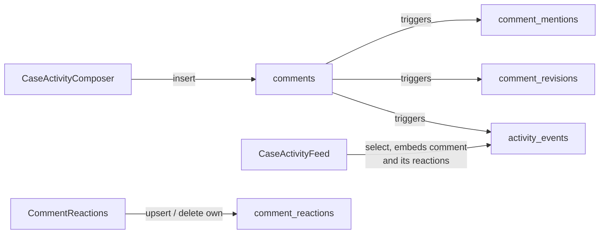

# Case comments and the case activity feed - design

- **Status:** Approved in brainstorming, awaiting written-spec review
- **Date:** 2026-11-06
- **Author:** pablo@avandarlabs.com
- **Branch:** `feat/comments`
- **Scope:** Phase 1 of two. Phase 2 (embedding platform objects in a comment)
  gets its own spec and plan after this phase is built and QA'd. Section 11
  records what Phase 1 does to be ready for it.
- **Touches:** `supabase/schemas`, `supabase/tests/database`, `shared/models`,
  `src/clients`, `src/components/RichText` (new),
  `src/views/IndividualManagerApp/SingleIndividualView`,
  `apps/desktop/sync/syncable-tables.ts`, `tests/e2e`, `docs/`

## 1. Summary

A case record ("individual" in code) has a Notes card whose editor saves
nothing (`ActivityBlock.tsx` calls `notifyNotImplemented`). This design makes
the record page a place where a team works a case:

- Members write comments in a rich text editor with markdown shortcuts and
  pasted markdown.
- Typing `@` opens a typeahead of workspace members and inserts a mention.
- Authors edit and delete their own comments.
- Anyone in the workspace reacts to a comment with one of six reactions
  modeled on LinkedIn's set.
- Each case has its own **activity feed**. In Phase 1 the feed shows comments
  only, but it is built on an append-only audit log, `activity_events`, so
  status changes, manual field edits, and history pulled from a connected
  service later become new event kinds in the same feed rather than a rewrite.

## 2. Goals and non-goals

### Goals

- Post, edit, and delete (own) comments on a case, with rich text: bold,
  italic, strike, inline code, code block, bullet and numbered lists,
  blockquote, links, and headings via markdown shortcut.
- Markdown input rules while typing, and markdown converted on paste.
- `@` mentions of workspace members, stored by user id.
- Reactions: Like, Celebrate, Support, Love, Insightful, Funny. One per
  person per comment.
- A per-case activity feed, oldest to newest, opening at the latest entry.
- Every change to a comment is auditable: creation, each edit (with the
  previous body), and deletion (with the deleted body), written by database
  triggers that no client can bypass.
- The record page moves onto the standard app view layout (layout B from
  brainstorming): the feed fills the content column with the composer docked
  at the bottom, and the case's fields move to the properties rail.

### Non-goals (Phase 1)

- Notifications of any kind (email, in-app) for mentions or activity.
  Tracked as roadmap P5c.8.
- A workspace-wide activity feed across cases.
- Live updates over Supabase Realtime.
- Threaded replies.
- A screen for viewing a comment's edit history.
- Admin moderation (deleting someone else's comment).
- Mentioning user groups.
- Writing status-change, field-edit, assignment, or external-history events.
  The schema and feed are ready for them; nothing writes them yet.
- Queueing posts made while offline.
- Comments on anything other than a case.
- Embedding platform objects (Phase 2).

## 3. Vocabulary

| User-facing (UI copy) | Code and schema |
| --- | --- |
| Case, record | Individual (`individuals`) |
| Case type | Concept (`concepts`) |
| Activity | `activity_events` |
| Comment, update | `comments` |
| Reaction | `comment_reactions` |
| Mention | `comment_mentions`, editor node `userMention` |
| Field | Concept attribute |

UI copy never says "individual", "concept", "event", or "entity". The feed's
section heading is "Activity"; the composer placeholder says "Write an update".

## 4. Current state

- `src/views/IndividualManagerApp/SingleIndividualView/index.tsx` renders the
  record page as a `Container` holding two `Paper` cards (Details, Notes). It
  predates `docs/design/app-view-layout.md` and breaks its one-surface rule.
- `ActivityBlock.tsx` mounts TipTap (`StarterKit`, `Link`, `Highlight`,
  `Placeholder`) through `@mantine/tiptap`. StarterKit 3 already includes
  `Link` and `Underline`, so `Link` is registered twice today.
- `individuals` RLS is workspace membership for every verb
  (`supabase/schemas/20.individuals.sql`).
- Sync no longer rewrites `individuals.id`, `status`, or `assigned_to`: the
  incremental sync (`diffStagedIndividualsHelpers.ts`) upserts only
  `external_id`, `name`, and `missing_from_source_at` on conflict
  `(concept_id, external_id)`. A child table keyed on `individuals.id` is
  therefore safe. `docs/ontology-architecture.md` section 13 still describes
  the old behavior and is updated by this work (section 10).
- `WorkspaceClient.getUsersForWorkspace` returns workspace members with
  `userId`, `fullName`, `displayName`, and `email`, which is what the mention
  typeahead needs.
- No app code uses Supabase Realtime today.

## 5. Data model

All tables live in `public`, carry `workspace_id`, enable RLS, and test
membership with the same predicate as `individuals`
(`workspace_id = any (array(select public.util__get_auth_user_workspaces ()))`).
Every table is added to `EXCLUDED_TABLES` in
`apps/desktop/sync/syncable-tables.ts`: this is collaborative, server-of-truth
data, and the desktop does not render it offline.

### 5.1 Enums

| Enum | Values |
| --- | --- |
| `activity_events__kind` | `comment_created`, `comment_edited`, `comment_deleted` |
| `activity_events__source` | `avandar`, `external` |
| `comment_reactions__kind` | `like`, `celebrate`, `support`, `love`, `insightful`, `funny` |
| `comment_revisions__reason` | `edit`, `delete` |

Planned `activity_events__kind` values, documented but not added in Phase 1:
`case_created`, `case_status_changed`, `case_assigned`,
`case_field_value_changed`, `case_external_record`.

### 5.2 `comments`

| Column | Type | Notes |
| --- | --- | --- |
| `id` | `uuid` pk | |
| `workspace_id` | `uuid` not null | fk `workspaces`, cascade |
| `individual_id` | `uuid` | fk `individuals`, `on delete cascade`. The comment's subject. |
| `author_user_id` | `uuid` | default `auth.uid()`, fk `auth.users`, `on delete set null` |
| `body` | `jsonb` | The TipTap (ProseMirror) document. Null only when deleted. |
| `body_schema_version` | `smallint` not null | Starts at `1`. |
| `body_text` | `text` | Plain text of the body, for previews, length checks, and future search and notifications. Null only when deleted. |
| `created_at`, `updated_at` | `timestamptz` | `updated_at` via `util__set_updated_at` |
| `edited_at` | `timestamptz` | Set by trigger when `body` changes |
| `deleted_at` | `timestamptz` | Soft delete |

Constraints:

- `num_nonnulls(individual_id) = 1`: exactly one subject. A later subject
  (a dashboard, a dataset) adds its own typed fk column and joins this check,
  so foreign keys, cascades, and RLS stay simple.
- `(deleted_at is null) = (body is not null and body_text is not null)`.
- `char_length(body_text) <= 10000` and `pg_column_size(body) <= 262144`.
- A trigger checks that `individual_id` belongs to `workspace_id`.

Grants: `authenticated` gets `select`, `insert`, and column-level
`update (body, body_schema_version, body_text, deleted_at)`. No `delete`
grant: deleting a comment is setting `deleted_at`. Policies: select and
insert for members (insert also requires `author_user_id = auth.uid()`),
update only when `author_user_id = auth.uid()` and `deleted_at is null`.

Index: `(individual_id, created_at)`.

### 5.3 `comment_revisions`

Every body a comment has had before its current one.

| Column | Type | Notes |
| --- | --- | --- |
| `id` | `uuid` pk | |
| `workspace_id` | `uuid` not null | |
| `comment_id` | `uuid` not null | fk `comments`, cascade |
| `reason` | `comment_revisions__reason` | |
| `body`, `body_schema_version`, `body_text` | | The body as it was before the change |
| `revised_by_user_id` | `uuid` | `auth.uid()` at the time, `on delete set null` |
| `created_at` | `timestamptz` | |

No grants to `authenticated` in Phase 1. Only the trigger functions (security
definer) and `service_role` touch it. It is an audit store, not a feature.

### 5.4 `comment_reactions`

| Column | Type | Notes |
| --- | --- | --- |
| `comment_id` | `uuid` | fk `comments`, cascade. Part of the pk. |
| `user_id` | `uuid` | default `auth.uid()`, fk `auth.users`, cascade. Part of the pk. |
| `workspace_id` | `uuid` not null | Denormalized for the RLS predicate |
| `kind` | `comment_reactions__kind` | |
| `created_at`, `updated_at` | `timestamptz` | |

Primary key `(comment_id, user_id)` enforces one reaction per person.
Changing a reaction is an upsert. Policies: select for members; insert,
update, and delete only for `user_id = auth.uid()`, and insert or update only
while the comment is not deleted. Reactions write no activity events.

### 5.5 `comment_mentions`

| Column | Type | Notes |
| --- | --- | --- |
| `comment_id` | `uuid` | fk `comments`, cascade |
| `mentioned_user_id` | `uuid` | fk `auth.users`, cascade |
| `workspace_id` | `uuid` not null | |
| `created_at` | `timestamptz` | |

Primary key `(comment_id, mentioned_user_id)`. Select for members. No write
grants: the trigger in 5.7 owns this table.

### 5.6 `activity_events`

Append-only. The feed reads it, and nothing but database triggers writes it.

| Column | Type | Notes |
| --- | --- | --- |
| `id` | `uuid` pk | |
| `workspace_id` | `uuid` not null | |
| `individual_id` | `uuid` | fk `individuals`, cascade. Subject, same exactly-one rule as `comments`. |
| `kind` | `activity_events__kind` not null | |
| `source` | `activity_events__source` not null | default `avandar` |
| `actor_user_id` | `uuid` | Nullable: system and external events have no Avandar actor. `on delete set null`. |
| `comment_id` | `uuid` | fk `comments`, cascade. Set for comment kinds. |
| `occurred_at` | `timestamptz` not null | When the thing happened. For external events this is the third party's timestamp. |
| `recorded_at` | `timestamptz` not null | default `now()`. When Avandar learned of it. |
| `payload` | `jsonb` not null | default `'{}'`. Kind-specific detail. |
| `payload_version` | `smallint` not null | default `1` |

Phase 1 payloads:

| Kind | Payload |
| --- | --- |
| `comment_created` | `{}` |
| `comment_edited` | `{ "revision_id": "<uuid>" }` |
| `comment_deleted` | `{ "revision_id": "<uuid>" }` |

Grants: `select` only for `authenticated`. Feed order is
`occurred_at, recorded_at, id`. Index: `(individual_id, occurred_at desc)`.

### 5.7 Triggers

All trigger functions are `security definer` with a pinned `search_path`, and
`execute` is revoked from `public`, `anon`, and `authenticated` (functions are
the one place this repo's schemas declare a revoke).

| Trigger | On | Does |
| --- | --- | --- |
| `comments__validate_subject` | before insert or update | Rejects an `individual_id` outside `workspace_id`. Rejects changes to `individual_id`, `workspace_id`, or `author_user_id`. Rejects clearing `deleted_at`. |
| `comments__record_revision` | before update | When `body` changes: insert an `edit` revision with the old body, set `edited_at = now()`. When `deleted_at` goes from null to set: insert a `delete` revision with the old body, then null `body` and `body_text`. |
| `comments__record_activity` | after insert or update | Insert `comment_created`, `comment_edited`, or `comment_deleted` with `actor_user_id = auth.uid()` and, for edits and deletes, the id of the revision the before trigger just wrote in the payload. An update that changes neither `body` nor `deleted_at` writes nothing. |
| `comments__sync_mentions` | after insert or update, when `body` is distinct from the old row's (no column list: a delete only sets `deleted_at` in the statement, and the before trigger nulls `body`) | Replace the comment's `comment_mentions` rows with the distinct `attrs.id` of every `userMention` node (`jsonb_path_query(body, 'lax $.**? (@.type == "userMention").attrs.id')`), keeping only users who are members of the workspace. A deleted comment has no mentions. |

## 6. Rich text editor

TipTap 3 stays the editor. It is already a dependency, `@mantine/tiptap`
gives it a Mantine-native toolbar, and its static renderer can draw a stored
document without an editor instance. Slate was evaluated and rejected: it is
still officially beta (0.147.x, breaking changes in minor releases), and
mentions, markdown, and input rules would all have to come from Plate, whose
UI is built on Tailwind.

### 6.1 Packages

Add, at the same version as the other `@tiptap/*` packages (bump them
together):

- `@tiptap/extension-mention` (brings `@tiptap/suggestion`)
- `@tiptap/markdown`
- `@tiptap/static-renderer`

`@mantine/tiptap` must stay in lockstep with `@mantine/core`.

### 6.2 Units

All under `src/components/RichText/`.

| Unit | Responsibility |
| --- | --- |
| `createRichTextExtensions` | The one extension list both the editor and the renderer use: `StarterKit` (link included, configured once), `Placeholder`, `UserMention`, the markdown extension, and `PasteMarkdown`. Phase 2 adds its nodes here. |
| `UserMention` | `Mention.extend({ name: "userMention" })`. Attributes: `id` (user id) only. Never stores the label. |
| `UserMentionSuggestion` | The `@` dropdown. Built on Mantine `Combobox`, positioned from the suggestion's `clientRect`, receives `onKeyDown` from the suggestion plugin. Lists workspace members matched on name or email (substring, case-insensitive), at most 8. |
| `PasteMarkdown` | A ProseMirror plugin: when the clipboard has `text/plain` and no `text/html`, parse it as markdown and insert the result. `@tiptap/markdown` has no paste handler of its own. |
| `RichTextComposer` | The editor plus a compact toolbar (bold, italic, bullet list, numbered list, link, inline code, blockquote, mention). Submits on `Mod-Enter`. Used for new comments and for editing in place. |
| `RichTextView` | Read-only rendering through `renderToReactElement` with an explicit `nodeMapping`. `userMention` maps to a component that looks up the member's current display name, or shows a muted "Former member" chip. Unknown node types render their text content instead of throwing. |

### 6.3 Stored document

`shared/models/RichTextDocument/` holds:

- The document type (ProseMirror JSON with the node and mark names above) and
  `RICH_TEXT_SCHEMA_VERSION = 1`.
- A parser that validates the document before a write and rejects unknown
  node types.
- `richTextToPlainText`, which produces `body_text`.
- `getMentionedUserIds`, the TypeScript mirror of the database extraction,
  used by tests to keep the two in agreement.

## 7. Record page and feed

### 7.1 Layout

`SingleIndividualView` is rebuilt on `AppView`:

- `AppViewHeader`: the case name, and a facts line with the case type name
  and the time of the latest activity. This work adds no header actions; the
  slate toolbar keeps "Edit case type".
- `AppViewBody` content column: the `Activity` section.
- `AppViewRail`: a "Details" group listing the case's fields, each as an
  `AppViewRail.Fact` with the value and, when known, its source dataset as
  secondary text. This replaces the Details `Paper`.

`ActivityBlock.tsx` is removed.

### 7.2 `CaseActivityFeed`

Under `src/views/IndividualManagerApp/SingleIndividualView/CaseActivityFeed/`.

- The section heading is "Activity" with the visible entry count as `meta`.
- Entries are grouped under day separators and ordered oldest to newest. The
  feed opens scrolled to the newest entry.
- It loads the latest 50 visible events. "Show earlier activity" at the top
  loads the previous 50 and keeps the scroll position.
- `activityFeedItemRenderers`: a map from `activity_events__kind` to a row
  component, or `null` for kinds that do not get their own row.
  - `comment_created` renders `CommentCard`.
  - `comment_edited` and `comment_deleted` are `null`: they change the card
    (the "edited" marker, the deleted placeholder) rather than adding rows.
  - Adding a status-change or field-edit row later is one more entry here.
    Those rows render as a single quiet line with an icon, per panel 5 of the
    brainstorm mockup.
  - The feed query filters to kinds with a renderer, so pages are not padded
    with hidden events.
- `CommentCard`: avatar initials, author name, time (full timestamp in a
  tooltip), "edited" marker with the edit time in a tooltip, the body via
  `RichTextView`, the reaction row, and the hover actions (reaction picker
  button, overflow menu). A deleted comment renders "This comment was
  deleted." in place of its body and has no actions or reactions.
- `CommentReactions`: a summary chip (icons of the kinds present plus the
  total), whose tooltip lists who reacted grouped by kind, then a "Like"
  button. Clicking "Like" toggles Like. Hovering it, or pressing the down
  arrow while it has focus, opens the six-reaction picker. Your current
  reaction is shown in the button and highlighted. Picking another swaps it;
  picking the current one removes it. Icons come from `@tabler/icons-react`,
  not emoji.
- `CommentActionsMenu` (own comments only): Edit, Copy link to comment, then
  Delete in `danger` color behind a confirm modal.
- Copy link produces the record URL with a `comment` search param. Opening it
  loads pages until that comment is present (at most 10 pages), scrolls to
  it, and highlights it briefly.
- `CaseActivityComposer`: `RichTextComposer` docked at the bottom of the
  content column with a "Post" button (the view's one filled action).

### 7.3 Data flow

Clients (`src/clients/`, built with the `ava-model-creation` skill and the
existing CRUD client factory):

- `CommentClient`: `createComment`, `editComment`, `deleteComment` (sets
  `deleted_at`).
- `CommentReactionClient`: `setReaction`, `clearReaction`.
- `ActivityEventClient`: `getCaseActivityPage({ individualId, before, limit })`,
  which selects events with their comment and reactions embedded.

Every mutation invalidates the case's feed query. The feed also refetches on
window focus. There is no Realtime subscription in Phase 1.

### 7.4 Drafts and offline

- The composer saves its draft per case to `localStorage` under
  `ava:case-activity-draft:<workspaceId>:<individualId>`, read and written in
  `try/catch`, and clears it after a successful post.
- When `navigator.onLine` is false, "Post" is disabled and a strip above the
  editor says the draft is saved on this device and can be posted on
  reconnect.

## 8. Error handling and edge cases

| Case | Behavior |
| --- | --- |
| Post or edit fails | The text stays in the composer, an error notification names the failure, and the user can retry. |
| Body over 10,000 characters | The composer shows a counter near the limit and disables "Post" past it. The database check is the backstop. |
| Mention of someone who left the workspace | The mention renders as a muted "Former member" chip. No mention row is written for non-members. |
| Author removed from the workspace | Their comments remain and show "Former member" as the author. |
| Author account deleted | `author_user_id` becomes null. Same rendering. |
| Edit or react on a deleted comment | Rejected by policy and trigger; the UI hides those controls. |
| Case deleted, or its case type deleted | Comments, reactions, mentions, revisions, and events cascade away with it. |
| Sync runs | No effect: Sync does not change `individuals.id`. Covered by a pgTAP test. |
| A stored document with an unknown node | `RichTextView` renders its text. The editor refuses to load it for editing and says so. |

## 9. Testing

Red/green TDD throughout.

**Database (pgTAP, `supabase/tests/database/permissions/` and a new
`supabase/tests/database/case_activity/`):**

- RLS per table: members read; non-members see nothing; only the author edits
  or deletes; only the reactor changes their reaction.
- `authenticated` cannot insert, update, or delete `activity_events` or
  `comment_mentions`, and cannot read `comment_revisions`. Add the new tables
  to `exact_data_api_grants.test.sql`.
- Triggers: insert writes `comment_created`; editing writes an `edit` revision
  and `comment_edited` and sets `edited_at`; deleting writes a `delete`
  revision and `comment_deleted` and nulls the body; un-deleting and moving a
  comment to another case are rejected.
- Mentions: extraction from nested lists and quotes, de-duplication, and
  non-members ignored.
- Constraints: length limits and the exactly-one-subject check.
- Sync safety: replay the Sync upsert against a case that has comments and
  assert the comments survive.

**Unit and component (Vitest):**

- `RichTextDocument` parser, `richTextToPlainText`, and
  `getMentionedUserIds`.
- `PasteMarkdown` converting a markdown paste.
- `activityFeedItemRenderers` dispatch, including the hidden kinds.
- Reaction toggle and swap logic.
- `CaseActivityFeed` empty state, deleted placeholder, and edited marker.
- `CaseActivityComposer` offline state and draft restore.

**End to end (Playwright):** one spec, `tests/e2e/case-activity.spec.ts`,
driven entirely through the UI. It opens a seeded case, posts a comment with
bold text, a list, and a mention picked from the typeahead, reacts with
Celebrate and swaps to Like, edits the comment, and deletes it. Cleanup in
`afterEach` deletes only the rows it created, using the service role.

## 10. Documentation and roadmap updates

- New `docs/case-activity-architecture.md`: the event model, every built and
  planned event kind, why only triggers write the log, how external history
  will arrive (`source = 'external'`, `occurred_at` from the third party,
  idempotency via an external id in the payload), and the Phase 2 extension
  points.
- `docs/ontology-architecture.md`: rewrite the Sync caveat in section 13 now
  that Sync no longer rewrites `id`, `status`, or `assigned_to`; add the new
  tables to sections 3 and 4; remove "comments" from the "Not built" list in
  section 16.
- `docs/production-plan-world-humanitarian-day.md`:
  - P5c.2 (comments): mark built, with a link to this spec.
  - P5c.5 (activity and audit log): widen it to every change to a case
    (status, assignment, manual field values, case creation) plus history
    pulled from a connected third-party service, all as `activity_events`
    kinds.
  - P5c.8 (notifications): add mention notifications reading
    `comment_mentions`.
  - Record the follow-ups in section 12.

## 11. Readiness for Phase 2 (object embeds)

Phase 2 lets a comment reference any platform object (dashboard, dashboard
tile, dataset, map, another case) as an inline link or an interactive
embedded block. Phase 1 leaves these seams:

- **One extension list, one renderer.** Phase 2 adds two nodes to
  `createRichTextExtensions`: an inline atom `objectRef` and a block atom
  `objectEmbed`, sharing the same attributes (object type, object id, and an
  optional sub-path such as a dashboard widget id). Switching between link and
  embed is replacing one node with the other. The editor draws them with
  `ReactNodeViewRenderer` and `RichTextView` draws the same components through
  `nodeMapping`.
- **Reference extraction.** `comments__sync_mentions` shows the pattern for a
  `comment_references` table filled from `objectRef` and `objectEmbed` nodes,
  which Phase 2 needs for backlinks and permission checks.
- **Comments are addressable.** "Copy link to comment" gives each comment a
  stable URL, so a comment is itself a referenceable object.
- **Schema versioning.** `body_schema_version` lets Phase 2 change the
  document shape with a parser upgrade rather than a data migration.

Phase 2's own spec decides the nomenclature and the registry of which objects
are referenceable. `resource_type` already means "a row that can be owned,
shared, and permissioned" (dashboard, dataset, map), which is narrower than
"anything referenceable": a dashboard tile is a sub-part of a resource, and a
case is not a resource. Known gaps to record there: there is no saved-query
object to reference, and tables such as analytics events and subscriptions
are never referenceable.

## 12. Follow-ups

- Notifications for mentions and activity (P5c.8).
- A workspace-wide activity feed.
- Live updates with Supabase Realtime.
- Status, assignment, field-edit, and case-created events (P5c.5).
- History pulled from connected third-party services.
- A viewer for a comment's earlier versions, readable by workspace admins.
- Admin moderation of other members' comments.
- Mentioning user groups.
- Queueing posts made while offline.
- Comments on other objects (dashboards, datasets, maps).

## 13. Decisions

| Decision | Chosen | Rejected and why |
| --- | --- | --- |
| Editor | TipTap 3 | Slate: still beta, no built-in mentions or markdown, Plate's UI is Tailwind. Lexical: no first-party mentions, all UI custom. BlockNote: about 440 KB gzipped, lossy markdown, its own theme instead of ours. |
| Feed storage | `comments` plus an append-only `activity_events` log | Comments as events (awkward edits, no stable row for reactions and mentions). Comments only (no audit, feed rewrite later). |
| Comment subject | Typed fk column per subject plus an exactly-one check | Polymorphic `subject_type, subject_id` (no fk, no cascade, harder RLS). |
| Who writes the log | Database triggers only | Client writes (bypassable, misses other write paths). |
| Mention extraction | Database trigger reading the stored JSON | Client-supplied list (can disagree with the body). |
| Deleting | Soft delete; body moves to `comment_revisions` | Hard delete (loses the audit trail). |
| Reactions | LinkedIn's six, one per person, no activity events | Slack-style multiple reactions (noisier for case work). |
| Feed order | Oldest to newest, composer docked at the bottom | Newest first (reads backwards in a conversation). |
| Freshness | Refetch after mutations and on focus | Realtime (deferred). |
