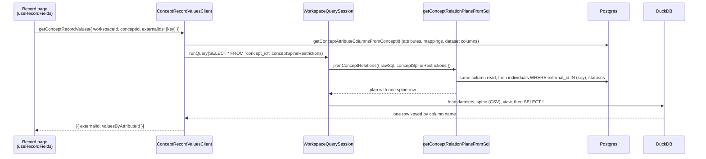

# Joined cases 1: the record page reads the concept view - design

**Status:** Draft
**Date:** 2026-11-06
**Author:** Juan Pablo Sarmiento <pablo@avandarlabs.com>
**Umbrella:** `docs/superpowers/specs/2026-11-06-joined-cases-design.md`
(principles in section 2, this gap's decisions in section 5 "G1", shared
names in section 6)
**Plan:** `docs/superpowers/plans/2026-11-06-joined-cases-1-record-page-concept-view.md`
**Parents:** `docs/ontology-architecture.md` sections 7, 8, 10, 15, 16;
`docs/qetl-architecture.md` sections 4 and 13

> Code blocks are illustrative. The repository is the authority on every
> existing signature, and umbrella section 6 is the authority on every shared
> name. Line numbers refer to `demo/measles` at `473e133c1`.

---

## 1. Problem

A case type's field values are computed when they are read. Today two pieces
of code do that computation, and they disagree.

- **The concept view** (`concept_<id>`, built by `buildConceptViewSql`) reads
  every field through `getSQLSelectOfMapping`
  (`src/clients/ontology/AttributeAssertionClient/getAttributeAssertions/getSQLSelectOfMapping.ts:18-139`)
  for single values and `_buildArraySelector`
  (`src/clients/qetl/QueryMediator/conceptRelation/buildConceptViewSql/buildConceptViewSql.ts:133-155`)
  for lists. The Data Explorer, chat, and dashboards read this view.
- **The record page** reads through an inline copy of the seven rules in
  `AttributeAssertionClient.getAttributeAssertions`
  (`src/clients/ontology/AttributeAssertionClient/AttributeAssertionClient.ts:88-352`),
  called from `useHydratedIndividual`
  (`src/views/IndividualManagerApp/SingleIndividualView/useHydratedIndividual.ts:49-54`).

What is wrong, each verified by reading the code and, where marked, by running
it:

| # | Defect | Evidence |
| --- | --- | --- |
| 1 | `most_frequent` counts NULL as a value in the view and skips it on the record page, so a record with two NULL cells and one `'x'` shows NULL in the Data Explorer and `x` on its page | `getSQLSelectOfMapping.ts:67-80` has no NULL filter; `AttributeAssertionClient.ts:256-264` has `WHERE ... IS NOT NULL`. Ran both shapes in DuckDB (`@duckdb/node-api` 1.5.5): view gives `NULL`, the inline copy gives `x` |
| 2 | `first` returns NULL whenever the first row's cell is NULL, in both copies | `getSQLSelectOfMapping.ts:55-65`, `AttributeAssertionClient.ts:240-246`. DuckDB run: rows `(NULL, 'b', 'a')` give `NULL` |
| 3 | Lists keep NULL elements: `[NULL, 'b', 'a']` | `buildConceptViewSql.ts:147-154`. DuckDB run confirms |
| 4 | The record page ignores list fields: it reduces every field with its rule even when `is_array` is set | `AttributeAssertionClient.ts:228-302` has no list arm |
| 5 | The record page splices `external_id` into SQL, unescaped and uncast | `AttributeAssertionClient.ts:214` and `:227`; `ontology-architecture.md` section 16 verified the failure |
| 6 | The record page throws for any manual-entry field, where the view emits a typed NULL | `AttributeAssertionClient.ts:141-143`; `makeConceptAttributeColumnsFromMetadata.ts:196-201` |
| 7 | Any failure renders as placeholder rows that never stop: the hook drops the query's error, the view turns missing values into `undefined`, and the rail draws skeletons for `undefined` | `useHydratedIndividual.ts:49-54,125-128`; `SingleIndividualView/index.tsx:70-73`; `CaseDetailsRail.tsx:38-46` |
| 8 | Identifiers are interpolated inside bare double quotes, so a column name containing `"` breaks the SQL | `getSQLSelectOfMapping.ts:58-59,71-77`; `getEntityKeyComparisonSql` in `src/clients/DuckDbClient/duckDbSqlText.ts:126-129` |
| 9 | A record with no value shows the word `null` | `CaseDetailsRail.tsx:66` calls `unknownToString`, whose default `nullString` is `"null"` (`packages/shared/utils/src/strings/unknownToString/unknownToString.ts:129,146-148`) |
| 10 | Any query that returns a list of text or numbers fails in the browser, so the record page would fail for a list field as soon as it reads the view | `_toJsValueFromArrowValue` calls `item.toJSON()` on every list element (`src/clients/DuckDbClient/duckDbArrowResults.ts:14-18`); primitives have no `toJSON`. Ran it with `apache-arrow` 17.0.0: `item.toJSON is not a function` |

A legacy third reader also survives: `getConceptExtension`
(`AttributeAssertionClient.ts:72-86`) runs one statement per dataset and
concatenates the results (`getDatasetColumnAssertions.ts:195-212`), so a record
in two datasets comes back as two partial rows. It is reached from
`_runConceptQuery`
(`src/clients/queries/runStructuredQuery/runStructuredQueryWithMetadata.ts:180-208`)
and from `ConceptWrapper.pushDown`
(`src/clients/qetl/wrappers/ConceptWrapper/ConceptWrapper.ts:165-179`). Its
import of `AttributeAssertionClient` closes the module cycle described in
`ontology-architecture.md` section 3.

Umbrella principle 3 says the concept view is the only code that turns
mappings into values, and principle 6 says every rule ignores NULL. This gap
makes both true.

## 2. Scope

**In**

1. One value implementation, `buildAttributeValueSql`, used by the concept
   view (single values and lists) and by Sync's name. Every rule ignores NULL.
   Every identifier is quoted with `quoteSqlIdentifier`, including those in
   `getEntityKeyComparisonSql`.
2. `ConceptAttributeColumn` carries `attributeId`, and an attribute named
   `external_id` is suffixed like one named `status`, so every attribute keeps
   a column in the view.
3. Spine restrictions: `conceptSpineRestrictions` on
   `WorkspaceQuerySession.runQuery`, through the mediator, into the concept
   planner, which reads only the named records.
4. `ConceptRecordValuesClient.getConceptRecordValues` and the
   `ConceptRecordValues` type.
5. The record page reads through that client, shows "No value" for a field
   without one, reads provenance from the field's mappings, and shows a
   load-failure callout with a retry instead of endless placeholders.
6. Lists of primitives convert to plain arrays when DuckDB results reach
   JavaScript.
7. A dataset refresh marks record values stale.
8. Deleted: the inline rule copy, `getConceptExtension`,
   `getAttributeAssertions.ts`, `getDatasetColumnAssertions.ts`,
   `getSQLSelectOfMapping.ts`, the `AttributeAssertion` model,
   `useHydratedIndividual`, `_runConceptQuery`, and `ConceptWrapper` with
   `buildConceptQueryResult`.
9. `docs/ontology-architecture.md`, and the passages of
   `docs/qetl-architecture.md` and `docs/description-logic-nomenclature.md`
   that name deleted code.

**Out**

- Rule output types. `max`, `min`, `count`, `sum`, and `avg` keep their
  `CAST(... AS DOUBLE)` (umbrella G2).
- Rendering lists well. A list value reaches the rail as a JavaScript array
  and renders through `unknownToString` (`;`-joined) until umbrella G3.
- The record's display name. The header keeps `individuals.name` until
  umbrella G6.
- Sync's own key SQL. `generateIndividuals` keeps its `externalIdSelectors`
  (`src/views/OntologyDesignerApp/ConceptMetaView/generateIndividuals/generateIndividuals.ts:294-299`)
  until umbrella G6 and G7 rewrite it.
- The records list, public sessions, and caching the spine.

## 3. Approaches

### A. Restrict the spine, read the whole view (recommended)

`getConceptRecordValues` runs `SELECT * FROM "concept_<id>"` and passes the
record keys as data. The planner reads only those individuals from Postgres,
so the spine (and therefore the view) has only those rows. Keys reach DuckDB
through the CSV spine, exactly as today.

- One value path, already tested against real DuckDB.
- Cost scales with the requested records, not the case type: the spine is a
  handful of rows and each correlated subquery runs once per row.
- Needs one new option threaded through four layers.

### B. Read the whole view, filter in SQL

`SELECT * FROM "concept_<id>" WHERE external_id IN (...)`.

- Splices user keys into SQL (violates umbrella principle 4), or needs a
  second CSV of keys and a join, which is more machinery than A.
- Every record page reads every individual of the case type from Postgres and
  loads them all into the spine.

### C. Keep a per-record reader built on the shared rule function

A record-page-only statement keyed by a CSV-loaded key, built from
`buildAttributeValueSql`.

- Two assemblies of the same rules remain: manual-entry handling, list
  handling, and column naming exist twice, which is the defect this gap
  removes.

| | A | B | C |
| --- | --- | --- | --- |
| One value implementation | yes | yes | no |
| Keys never in SQL | yes | no, or a second CSV | yes |
| Postgres rows read per record page | the record | the whole case type | the record |
| New plumbing | one option, four layers | none | a second reader |

A is the umbrella's decision and the recommendation.

## 4. Design

### 4.1 Data flow



_The client and the planner resolve columns with the same function over the
same rows, so the client can map each result column back to its attribute by
`attributeId`._

### 4.2 Value SQL: `buildAttributeValueSql`

New module
`src/clients/qetl/QueryMediator/conceptRelation/buildAttributeValueSql/buildAttributeValueSql.ts`
(umbrella section 6). It replaces `getSQLSelectOfMapping` and
`_buildArraySelector`.

```ts
type AttributeValueSqlOptions = {
  selectColumnName: string;
  primaryKeyColumnName: string;
  datasetId: string;
  valuePickerRuleType: DatasetColumnMapping["valuePickerRuleType"];
  isArray: boolean;
  outputColumnName: string;
  externalIdsTable: string;
  externalIdColumn: string;
};
export function buildAttributeValueSql(options: Readonly<AttributeValueSqlOptions>): string;
```

Every arm reads its dataset under the alias `dataset`, filters with
`<key comparison> AND dataset."<value>" IS NOT NULL`, and emits
`(<subquery>) AS "<output>"`:

| Shape | Source view | Subquery body |
| --- | --- | --- |
| `isArray` | `ava_rows_<id>` | `COALESCE(list(value ORDER BY dataset.file_row_number), [])` |
| `first` | `ava_rows_<id>` | `value ... ORDER BY dataset.file_row_number LIMIT 1` |
| `most_frequent` | `<id>` | `value ... GROUP BY value ORDER BY COUNT(*) DESC, value LIMIT 1` |
| `sum`, `avg`, `count`, `max`, `min` | `<id>` | `CAST(<AGG>(value) AS DOUBLE)` |

- **NULL rule.** The `IS NOT NULL` filter applies to every arm. For the
  aggregates it changes nothing (they skip NULL already) and keeps the rule in
  one place. `first` now returns the first non-NULL value, `most_frequent`
  the most frequent non-NULL value, and a list holds only non-NULL values.
  This changes values the Data Explorer, chat, and dashboards show today for
  `first` and `most_frequent` (section 4.9).
- **Quoting.** Column names, view names, and the output alias go through
  `quoteSqlIdentifier`, and every column is qualified with `dataset.` so a
  value column named like a spine column (`status`) can never bind to the
  outer row. `getEntityKeyComparisonSql` (`duckDbSqlText.ts:117-130`) quotes
  its three identifiers the same way and stays the one key comparison until
  umbrella G7 replaces it with `buildRecordKeySql`.
- **The list arm lives here too.** The umbrella moves only
  `getSQLSelectOfMapping`. Folding `_buildArraySelector` in as well means the
  NULL rule, the quoting, and the key comparison exist once, and G3 to G5
  extend one function.

`buildConceptViewSql` keeps the typed NULL for `unmapped` columns and calls
`buildAttributeValueSql` for every `dataset_column` column. `generateIndividuals`
calls it for the name with `isArray: false` (until umbrella G6 removes the
name). Sync's names therefore improve: a key whose first label cell is NULL
now gets the first non-NULL label instead of failing the page on
`individuals.name not null`.

### 4.3 Columns: `attributeId`, and `external_id` reserved

- Both arms of `ConceptAttributeColumn`
  (`buildConceptViewSql.ts:17-40`) gain `attributeId: ConceptAttribute.Id`
  (umbrella section 6). `makeConceptAttributeColumnsFromMetadata` sets it in
  `_buildUnmappedColumn` (`:161-171`) and in the `dataset_column` return
  (`:224-235`).
- `takenNames` is seeded with `status` only (`:286`), so an attribute named
  `external_id` keeps its name and `buildConceptViewSql` then drops it to
  protect the spine's key (`buildConceptViewSql.ts:83-91`). On the record page
  that field would read "No value". G1 seeds `takenNames` with `external_id`
  as well, so such an attribute becomes `external_id_2`. No query can depend
  on the old behaviour: the column was never in the view.

### 4.4 Spine restrictions

**Type** (umbrella section 6), in `conceptRelation.types.ts`:

```ts
export type ConceptSpineRestriction = {
  conceptId: Concept.Id;
  externalIds: readonly string[];
};
```

**Threading.** Each layer passes the option through unchanged.

| Layer | Change |
| --- | --- |
| `WorkspaceQuerySession.runQuery` (`WorkspaceQuerySession.ts:26-51,182-218`) | Both overloads accept `conceptSpineRestrictions?: readonly ConceptSpineRestriction[]` and pass it to the mediator |
| `IQueryMediator.runQuery` (`QueryMediator.ts:52-65`), `RunQetlQueryOptions` (`QueryMediator.types.ts:139-160`) | Same optional field |
| Planner hook `planConceptRelations` (`QueryMediator.types.ts:104`, `QueryMediator.ts:25`) | Signature becomes `(options: Readonly<{ rawSql; conceptSpineRestrictions }>) => Promise<ConceptRelationPlan[]>`. `IQueryMediator` reuses `QetlRunnerOptions["planConceptRelations"]` so the two declarations cannot drift |
| `queryRunner._runQuery` (`queryRunner.ts:242-245`) | A new `_getConceptRelationPlans` passes the restrictions to the planner. A session with no planner (the public session) refuses a non-empty restriction rather than silently answering unrestricted |
| `WorkspaceQuerySession` planner closure (`:133-143`) | Passes the restrictions to `getConceptRelationPlansFromSql` |
| `getConceptRelationPlansFromSql` (`:223-253`) | Validates and indexes the restrictions, then plans each concept with its restriction |

Nested virtual-dataset queries (`runParquetQuery` in relation loading) carry no
restriction: it applies only to the statement the caller wrote.

**Validation** (fails closed, before any Postgres read):

1. A restriction must name a concept the statement reads. Otherwise the
   caller believes its records are narrowed when nothing is.
2. At most one restriction per concept.
3. At most `MAX_RESTRICTED_EXTERNAL_IDS = 500` keys per restriction. A
   restricted spine costs one Postgres read per 50 keys, so this bounds one
   query to ten reads. Callers needing more read the view unrestricted. The
   records list (umbrella G6) asks for one page, 20 records
   (`useConceptIndividuals.ts:10`).

**Restricted read.** `_getSpineRows` (`getConceptRelationPlansFromSql.ts:144-163`)
calls a new `getIndividualsByExternalIds({ conceptId, externalIds })` when a
restriction is present, and `IndividualClient.getAll` as today otherwise. The
status read and the status match are unchanged. The new function:

- de-duplicates the keys;
- reads keys in batches of `MAX_EXTERNAL_IDS_PER_READ = 50` with
  `where: { concept_id: { eq }, external_id: { in: batch } }`, which keeps the
  PostgREST URL short and stays inside the CRUD client's filter vocabulary, so
  the desktop SQLite client
  (`packages/shared/clients/src/SqliteCrudClient/createSqliteCrudClient.ts:303-316`)
  answers it too;
- reads any key containing `"` or `\` alone with an `eq` filter.
  `postgrest-js` 2.112.3 wraps an `in` value in double quotes only when it
  holds `,`, `(` or `)`, and never escapes `"` or `\` inside it
  (`node_modules/.pnpm/@supabase+postgrest-js@2.112.3/node_modules/@supabase/postgrest-js/dist/index.mjs:1464,1688-1695`),
  so PostgREST's list parser can read such a key as a different one. An `eq`
  value is taken verbatim;
- returns the rows found. A key that names no record is simply absent, so its
  spine has no row and the view returns nothing for it.

An empty restriction reads no individuals and yields an empty view.

**Names and the lease.** A restricted spine and view keep their usual names
(`concept_<id>__individuals`, `concept_<id>`). That is safe in a workspace
session: the lease covers the spine name (`queryRunner.ts:217-229`), and every
query that names the concept rebuilds both inside its own lease
(`loadConceptRelations.ts:66-84`), so a restricted view never answers another
query of that session. The one reader that does not rebuild views is the
public session, which already cannot plan concepts
(`qetl-architecture.md` section 13). After a restricted read, a leftover view
in the same tab covers only the restricted records. Section 16 of the ontology
doc records this beside the existing public-session limitation.

**Shared column read.** The attribute, mapping, and dataset-column reads in
`_getConceptRelationPlan` (`getConceptRelationPlansFromSql.ts:179-190`) move to
an exported `getConceptAttributeColumnsFromConceptId(conceptId)` in
`conceptRelation/getConceptAttributeColumnsFromConceptId.ts`, together with
`_getMappedDatasetColumns` (`:119-130`). The planner and the new client both
call it.

### 4.5 `ConceptRecordValuesClient`

Umbrella section 6 fixes the path, the query, the hook, and the return type.

```ts
// ConceptRecordValuesClient.types.ts
export type ConceptRecordValues = {
  externalId: string;
  valuesByAttributeId: Partial<Record<ConceptAttribute.Id, unknown>>;
};

// ConceptRecordValuesClient.ts
getConceptRecordValues(params: {
  workspaceId: Workspace.Id;
  conceptId: Concept.Id;
  externalIds: readonly string[];
}): Promise<ConceptRecordValues[]>;
```

1. De-duplicate `externalIds`. With none left, return `[]` and read nothing.
2. `getConceptAttributeColumnsFromConceptId(conceptId)`.
3. `WorkspaceQuerySession.runQuery({ workspaceId, rawSql: SELECT * FROM
   "concept_<id>", conceptSpineRestrictions: [{ conceptId, externalIds }] })`.
   The table name comes from `RelationRef.toTableName` and
   `quoteSqlIdentifier`.
4. `makeConceptRecordValuesFromRows({ rows, attributeColumns, externalIds })`,
   a pure function: one entry per requested key that has a row, in request
   order; each column's value under its `attributeId`; a column the row lacks
   is left out. `external_id` and `status` columns are not attributes and are
   not returned.

**How a view column maps back to an attribute.** The query result has column
names only. Three options:

| Option | Verdict |
| --- | --- |
| Map by attribute name | Breaks on duplicate names, which the view suffixes (`age`, `age_2`) |
| Return the plan from `runQuery` | Changes the return type of every QETL query for one caller |
| Re-derive the columns with the planner's own function and match by name to `attributeId` | Chosen. Same rows, same function, same names. Costs three small Postgres reads |

The client and the planner read the rows a few milliseconds apart. Case types
cannot be edited after creation (umbrella section 8), so the only change
between the reads is a deletion, which fails both. An attribute added between
them would surface as "No value" rather than a wrong value.

**Service client.** `createServiceClient("ConceptRecordValuesClient")`,
`withLogger`, and `withQueryHooks` with `queryFns: ["getConceptRecordValues"]`,
following `DatasetQueryClient`. (The deleted `AttributeAssertionClient`
registered itself as `"DatasetRawDataClient"`, `AttributeAssertionClient.ts:69`,
so its query keys carried another client's name.)

**Query key.** The generated key
(`packages/web/query-hooks/src/withQueryHooks/withQueryHooks.ts:337-355`):
`["ConceptRecordValuesClient", "getConceptRecordValues", { workspaceId,
conceptId, externalIds }]`. Callers pass keys in a stable order (the record
page passes one).

**Invalidation.**

| Event | Changes record values? | Action |
| --- | --- | --- |
| A dataset refresh (Google Sheets, Postgres table) | yes, rows changed | `invalidateDatasetRowQueries` also invalidates `[ConceptRecordValuesClient.getClientName()]` |
| A record's status change, a status set save | no, values exclude `status` | none (`invalidateCaseStatusQueries` unchanged) |
| Sync records | no, membership only | none. A record that is new gets a new key |
| Case type edit | not possible after creation | none |

Otherwise the default policy applies: stale after six minutes online, served
from the persisted cache offline (`src/config/AvaQueryClient.ts`).

### 4.6 Lists reach JavaScript as plain arrays

`_toJsValueFromArrowValue` (`duckDbArrowResults.ts:10-29`) converts a list
cell with `value.toArray().map((item) => item.toJSON())`. A list of text or
numbers yields primitives (or a typed array), which have no `toJSON`, so the
whole query throws. The fix iterates the vector with `Array.from` and calls
`toJSON` only on items that have it, converting each item recursively
(`bigint` to `number`, nested vectors to arrays). Verified with `apache-arrow`
17.0.0 on lists of `Utf8`, `Int64`, and `Float64`, including NULL elements and
a NULL list. The module moves into a `duckDbArrowResults/` directory so its new
test sits beside it (`docs/rules/testing.md`).

### 4.7 The record page

`useHydratedIndividual` is deleted. A new hook,
`SingleIndividualView/useRecordFields/useRecordFields.ts`, returns:

```ts
type RecordFields = {
  rows: CaseDetailsRow[] | undefined; // undefined while loading
  isLoadError: boolean;
  isRetrying: boolean;
  retry: () => void; // refetches only the reads that failed
};
```

It reads the case type's attributes, their mappings, the mapped datasets (for
names), and `useGetConceptRecordValues` for `[individual.externalId]`. The
values query is disabled while attributes load and when the case type has no
attributes, so a case type with no fields shows "No fields yet" without
starting DuckDB. `isLoadError` is true when the attribute read or the values
read fails. A failed mapping or dataset read only hides source names.

Rows come from a pure `makeCaseDetailsRowsFromAttributes({ attributes,
valuesByAttributeId, mappings, datasets })`:

- one row per attribute, every field of the case type, ordered by name then
  id (the order the view's columns use);
- `value` from `valuesByAttributeId[attribute.id]`, which is `null` for a
  manual-entry field (the view's typed NULL) and `undefined` when the record
  is not in the view;
- `sourceNames`: the names of the datasets the attribute's `dataset_column`
  mappings read, de-duplicated and sorted. This is provenance from the
  mappings (umbrella G1), and it already holds several names for umbrella G5.

`CaseDetailsRow` changes `sourceName?: string` to `sourceNames: string[]`.
`CaseDetailsRail` (`CaseDetailsRail.tsx`):

- renders a NULL or missing value as dimmed "No value";
- renders each source name on its own dimmed line;
- takes an optional `loadError: { isRetrying; onRetry }`, and when set shows a
  `Callout` ("This record's fields failed to load", the activity feed's
  "Try again in a moment, or reach out to support if it keeps happening.",
  and a "Try again" button) instead of placeholder rows. This mirrors
  `CaseActivityFeedContent.tsx:51-67`. The retry reloads the view's own data;
  it is not an action on the record, so the rail rule in
  `docs/design/app-view-layout.md` ("The rail never holds actions on the
  record") holds.

`SingleIndividualView` shows `individuals.name` in the header immediately.
Today the header waits on the field reads (`index.tsx:87-101`) although the
name never came from them. Umbrella G6 replaces this title.

### 4.8 What is deleted, and why `_runConceptQuery` and `ConceptWrapper` go

| Deleted | Why it can go |
| --- | --- |
| `AttributeAssertionClient/` (client, `getAttributeAssertions.ts`, `getDatasetColumnAssertions.ts`, `getSQLSelectOfMapping.ts`) | The record page reads the view; Sync and the view use `buildAttributeValueSql` |
| `shared/models/ontology/AttributeAssertion/` | Its only users are the deleted client and `useHydratedIndividual`. Its `id`, `createdAt`, and `updatedAt` were invented at read time (`AttributeAssertionClient.ts:319-323`) and identified nothing. `ConceptRecordValues` replaces it |
| `useHydratedIndividual.ts` | Replaced by `useRecordFields` |
| `_runConceptQuery` | It runs only when a structured query has a concept source and no SQL to run: raw SQL is absent and the form is out of sync, or compiles to nothing (`runStructuredQueryWithMetadata.ts:229-249`, `selectSqlToExecute.ts:20-29`). For a dataset source the same situation already compiles the form with `StructuredQuery.toRawDuckDbQuery` (`runStructuredQueryWithMetadata.ts:156-161`), and that compiler emits `concept_<id>` for a concept source (`structuredQueryToSql.ts:84-87`). So the concept branch becomes the dataset branch. It gains filters, grouping, aggregation, sorting, and the status column, all of which the legacy path ignored (`qetl-architecture.md` section 13) |
| `ConceptWrapper/` (`ConceptWrapper.ts`, its test, `buildConceptQueryResult.ts`) | The registry is resolved only for dataset refs: `getWrapperForRef` has one production caller, `_fetchRelationSource`, which builds `{ kind: "dataset" }` (`RelationLoading.ts:286-287`). Its `pushDown` has no caller. Removing it from `createDefaultRegistry` (`:5,244`) leaves the `concept` kind unclaimed, which `createRelationRegistry` already treats as a first-class outcome (`resolve` returns `undefined`). It also removes the last import from QETL back into the ontology read path |

Tests that only mocked the deleted client lose their mocks
(`runColumnSchemaQuery.test.ts:25-30`, `useMapLayersData.test.ts:62-69`), and
comments that cite deleted code are rewritten (`loadConceptSpine.ts:109-112,129-132`,
`toCsvRows.ts:20-26`, `makeConceptAttributeColumnsFromMetadata.ts:174-182,268-270`,
`buildConceptViewSql.ts:48-52`).

### 4.9 Behaviour users will see change

| Where | Before | After |
| --- | --- | --- |
| Record page | Values from the inline copy; `null` printed; endless placeholders on failure; broken by a manual-entry field or a quoted key | The view's values; "No value"; a failure callout with Try again; manual-entry fields show "No value"; every key works |
| Data Explorer, chat, dashboards | `first` NULL when the first cell is NULL; `most_frequent` NULL when NULL is most common; lists contain NULL | First non-NULL value; most frequent non-NULL value; lists without NULL |
| Any list column in a result | The query fails in the browser | An array |
| Sync record names | NULL (page fails) when the first or most common label cell is NULL | The first or most common non-NULL label |
| Out-of-sync structured query over a case type | All rows, no filter, no sort, no status | The compiled SQL over the view |

### 4.10 What later gaps inherit

- **G2 (typed rules):** `buildAttributeValueSql` is the only place rule SQL
  and its casts live. The aggregates still cast to `DOUBLE`.
- **G3 (list fields):** list cells now reach JavaScript as arrays
  (section 4.6). This gap carries the only copy of that fix, landing before
  the record page reads the view. `buildAttributeValueSql` has the list arm,
  keyed on `isArray` in both its options and `ConceptAttributeColumn`; G3's
  rename of that field to a value shape covers both. The rail still renders a
  list with `unknownToString`; `CaseDetailsRow.value` is `unknown`.
- **G4 (bucketed lists):** a struct list element is converted with its own
  `toJSON()`, whose fields are not converted further (a `DATE` or `bigint`
  inside a struct arrives as Arrow returns it). G4 must extend
  `_toJsValueFromArrowValue` for struct fields.
- **G5 (multi-source):** `buildAttributeValueSql` takes one source today.
  `makeCaseDetailsRowsFromAttributes` already lists every mapping's dataset
  name. `getConceptAttributeColumnsFromConceptId` is the single column read.
- **G6 (record names):** `getConceptRecordValues` accepts up to 500 keys and
  reads every field. The record page header still shows `individuals.name`.
  The E2E seed helpers (`tests/e2e/helpers/CaseTypeSeedHelpers.ts`,
  `seedCaseRecord.ts`) insert `individuals.name`. Sync still computes the name
  with `buildAttributeValueSql`.
- **G7 (key matching):** `getEntityKeyComparisonSql` now quotes its
  identifiers and is still the one key comparison in value SQL. Sync's
  `externalIdSelectors` still interpolate names inside bare quotes.

## 5. Error handling

| Failure | Where it surfaces | What the user sees |
| --- | --- | --- |
| A Postgres read fails (attributes, mappings, dataset columns, individuals, statuses) | The client or the planner throws | The rail's failure callout; Try again refetches |
| Broken ontology: a mapping names a missing column, or a dataset has no key | `makeConceptAttributeColumnsFromMetadata` throws, in the client and the planner | The callout. Fail closed, as the umbrella's principle 7 requires |
| A mapped dataset is no longer in the workspace | `_assertContributorsAllowed` throws | The callout |
| A record's status is not among its case type's (a status set saved between two reads) | `_getSpineRows` throws "Run the query again" | The callout; Try again succeeds |
| DuckDB fails (a source cannot be acquired, a cast fails) | `runQuery` rejects | The callout |
| A restriction names a concept the statement does not read, names one twice, or names more than 500 keys | `getConceptRelationPlansFromSql` throws before any read | A programming error; the callout if it ever ships |
| A restriction reaches a session with no planner | `_getConceptRelationPlans` throws | Same |
| The record is no longer in the case type (deleted after the page loaded) | The view has no row; the client returns no entry | Every field shows "No value" |
| An attribute was added between the client's and the planner's column reads | The row lacks the column | That field shows "No value" |
| The mapping or dataset-name read fails | Only `sourceNames` is affected | Values without source lines |

The query hook retries once online and not at all offline
(`src/config/AvaQueryClient.ts`), so the callout appears after the second
failure.

## 6. Testing

Every test follows `docs/rules/testing.md`. Value-rule fixtures construct ties
and NULLs.

| Layer | File | Asserts |
| --- | --- | --- |
| Value SQL, real DuckDB | `conceptRelation/buildAttributeValueSql/buildAttributeValueSql.executed.test.ts` (new) | `first` skips a leading NULL; `most_frequent` ignores NULL when it is most common; ties break by value; lists keep non-NULL values in file order and are `[]` when empty; aggregates ignore NULL; key and value columns containing `"` are read |
| View, real DuckDB | `buildConceptViewSql.executed.test.ts` | The view applies the NULL rule to `first`, `most_frequent`, and lists |
| Column resolution, real DuckDB | `conceptRelation/__tests__/conceptAttributeColumns.integration.executed.test.ts` | Each column carries its attribute's id through a suffix; an attribute named `external_id` keeps a column |
| Restricted read | `conceptRelation/getIndividualsByExternalIds/getIndividualsByExternalIds.test.ts` (new) | Batches of 50; `eq` for keys with `"` or `\`; each key read once |
| Planner | `getConceptRelationPlansFromSql.test.ts` | Only restricted records reach the spine; the three validation refusals, with no read |
| Mediator | `QueryMediator/__tests__/QueryMediator.concepts.test.ts` | Restrictions reach the planner; a session without a planner refuses them |
| Session | `WorkspaceQuerySession.membership.test.ts` | A member's restrictions reach the mediator, and the planner closure hands them to `getConceptRelationPlansFromSql` |
| Arrow conversion | `DuckDbClient/duckDbArrowResults/duckDbArrowResults.test.ts` (new) | Lists of text and of 64-bit integers become plain arrays |
| Client | `ConceptRecordValuesClient.test.ts`, `makeConceptRecordValuesFromRows.test.ts` (new) | SQL and restriction sent; no read for no keys; values keyed by attribute id through a duplicate name; request order; non-records omitted |
| Invalidation | `invalidateDatasetRowQueries/invalidateDatasetRowQueries.test.ts` (new) | A dataset refresh marks record values stale |
| Rail | `CaseDetailsRail.test.tsx` | "No value"; source names; the failure callout replaces placeholders and its button retries |
| Rows and hook | `useRecordFields/useRecordFields.test.ts`, `makeCaseDetailsRowsFromAttributes.test.ts` (new) | Load error instead of endless loading; retry only what failed; no values read for a case type with no fields; name order; source names from mappings |
| Structured queries | `runStructuredQuery.test.ts` | An out-of-sync concept query runs compiled SQL over the view and selects `status` |
| Registry | `createDefaultRegistry.test.ts` | Only the dataset wrapper is registered; a concept ref is unresolved |
| End to end | `tests/e2e/record-page-field-values.spec.ts` (new) | A record of a case type over a real dataset shows its field's value and the dataset's name |

Existing E2E specs that open record pages (`case-statuses-record.spec.ts`,
`case-activity.spec.ts`, `case-statuses-data-explorer.spec.ts`) run once each,
one at a time.

## 7. Exit criteria

1. `rg -n "AttributeAssertion|getConceptExtension|getAttributeAssertions|getDatasetColumnAssertions|getSQLSelectOfMapping|ConceptWrapper|buildConceptQueryResult|_runConceptQuery|useHydratedIndividual" src shared tests supabase apps`
   returns nothing.
2. The record page of a case type with a manual-entry field shows "No value"
   for it, and a failed read shows the callout with Try again.
3. The executed tests prove the NULL rule for `first`, `most_frequent`, the
   aggregates, and lists, through `buildAttributeValueSql` and through the
   view.
4. A record key containing `'`, `"`, `,`, or `\` reaches DuckDB only through
   the spine CSV, and Postgres only through CRUD filters.
5. `pnpm type-check`, `pnpm lint`, `pnpm test:frontend`, `pnpm test:executed`,
   and `pnpm i18n:check` pass. `record-page-field-values.spec.ts`,
   `case-statuses-record.spec.ts`, `case-activity.spec.ts`, and
   `case-statuses-data-explorer.spec.ts` pass, one at a time.
6. `docs/ontology-architecture.md` section 7 describes one value
   implementation, and section 16 no longer lists the record-page, NULL, and
   quoting limitations.

## 8. Files

| File | Change |
| --- | --- |
| `src/clients/qetl/QueryMediator/conceptRelation/buildAttributeValueSql/buildAttributeValueSql.ts` (+ `.executed.test.ts`) | New |
| `src/clients/DuckDbClient/duckDbSqlText.ts` | `getEntityKeyComparisonSql` quotes identifiers |
| `src/clients/qetl/QueryMediator/conceptRelation/buildConceptViewSql/buildConceptViewSql.ts` (+ executed test) | `attributeId` on the column type; every dataset column through `buildAttributeValueSql`; `_buildArraySelector` removed |
| `src/clients/qetl/QueryMediator/conceptRelation/makeConceptAttributeColumnsFromMetadata.ts` (+ integration test) | Sets `attributeId`; reserves `external_id` |
| `src/clients/qetl/QueryMediator/conceptRelation/conceptRelation.types.ts` | `ConceptSpineRestriction` |
| `src/clients/qetl/QueryMediator/conceptRelation/getConceptAttributeColumnsFromConceptId.ts` | New, moved out of the planner |
| `src/clients/qetl/QueryMediator/conceptRelation/getIndividualsByExternalIds/` | New, with test |
| `src/clients/qetl/QueryMediator/conceptRelation/getConceptRelationPlansFromSql/` | Restrictions; uses the two new functions |
| `src/clients/qetl/QueryMediator/QueryMediator.types.ts`, `QueryMediator.ts`, `queryRunner.ts` (+ concepts test) | Threading |
| `src/clients/qetl/WorkspaceQuerySession/WorkspaceQuerySession.ts` (+ membership test) | Threading |
| `src/clients/DuckDbClient/duckDbArrowResults.ts` | Moves to `duckDbArrowResults/duckDbArrowResults.ts` with a test; list fix. Importers `duckDbRawQuery.ts`, `duckDbStructuredQuery.ts` |
| `src/clients/ontology/ConceptRecordValuesClient/` | New: client, types, `makeConceptRecordValuesFromRows/`, tests |
| `src/views/DataManagerApp/DatasetMetaView/invalidateDatasetRowQueries.ts` | Moves to `invalidateDatasetRowQueries/` with a test; invalidates record values. Importers `useRefreshGoogleSheetDataset.ts`, `useRefreshPostgresTableDataset/useRefreshPostgresTableDataset.ts` |
| `src/views/IndividualManagerApp/SingleIndividualView/CaseDetailsRail.tsx` (+ test) | "No value", `sourceNames`, `loadError` |
| `src/views/IndividualManagerApp/SingleIndividualView/useRecordFields/` | New: hook, `makeCaseDetailsRowsFromAttributes/`, tests |
| `src/views/IndividualManagerApp/SingleIndividualView/index.tsx` | Uses `useRecordFields`; header shows the name at once |
| `src/views/OntologyDesignerApp/ConceptMetaView/generateIndividuals/generateIndividuals.ts` | Name through `buildAttributeValueSql` |
| `src/clients/queries/runStructuredQuery/runStructuredQueryWithMetadata.ts` (+ test) | `_runConceptQuery` removed |
| `src/clients/qetl/wrappers/createDefaultRegistry.ts` (+ test) | Concept wrapper removed |
| `src/clients/queries/runColumnSchemaQuery/runColumnSchemaQuery.test.ts`, `src/views/GisApp/layers/useMapLayersData/useMapLayersData.test.ts` | Dead mocks removed |
| `loadConceptSpine.ts`, `toCsvRows.ts` | Comments only |
| `tests/e2e/record-page-field-values.spec.ts` | New |
| `src/i18n/locales/*` | Extracted and compiled |
| Deleted | `src/clients/ontology/AttributeAssertionClient/`, `shared/models/ontology/AttributeAssertion/`, `src/clients/qetl/wrappers/ConceptWrapper/`, `SingleIndividualView/useHydratedIndividual.ts` |
| `docs/ontology-architecture.md`, `docs/qetl-architecture.md`, `docs/description-logic-nomenclature.md` | Updated |

No schema, migration, or edge function changes.

## 9. Deviations from the umbrella spec

None.

Four additions go beyond the umbrella's G1 decisions without contradicting
them, and later gaps rely on them: `buildAttributeValueSql` also owns the list
arm (section 4.2); an attribute named `external_id` is suffixed (section 4.3);
lists of primitives now convert to arrays (section 4.6); and
`getConceptAttributeColumnsFromConceptId` is the shared column read
(section 4.4).

## 10. Open questions for Kristi

1. **Field order on the record page.** Today the order is an accident of the
   per-dataset reads. This design orders fields by name, the same order the
   Data Explorer's view columns use. Fields have no stored position, so the
   alternative is a schema change (a `position` on `concept_attributes`).
   Name order unless you want authoring order.
