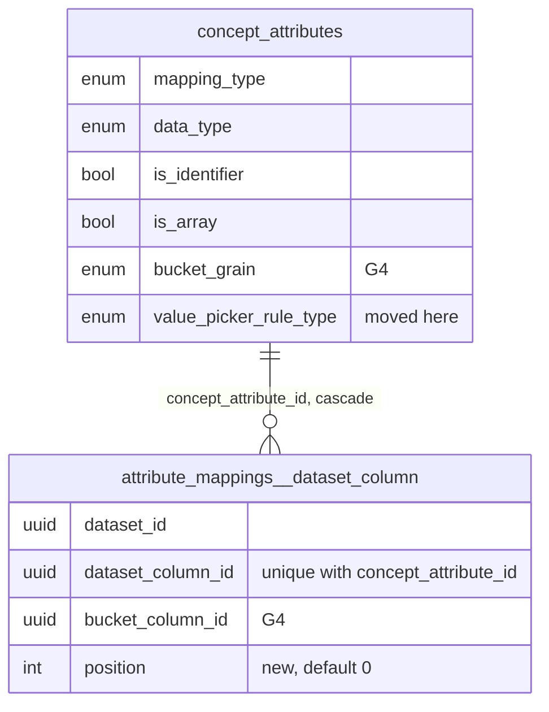

# Joined cases 5: multi-source fields - design

**Status:** Draft
**Date:** 2026-11-06
**Author:** Juan Pablo Sarmiento <pablo@avandarlabs.com>
**Umbrella:** `docs/superpowers/specs/2026-11-06-joined-cases-design.md`
(gap G5; sections 2, 3, 5 and 6 there are binding)
**Plan:** `docs/superpowers/plans/2026-11-06-joined-cases-5-multi-source-fields.md`
**Parents:** `docs/ontology-architecture.md` sections 4, 5, 7, 8, 10, 12
**Builds on:** the G1 to G4 child specs and plans
(`2026-11-06-joined-cases-{1,2,3,4}-*`)

> Code blocks are illustrative. The repository is the authority on every
> existing signature, and the umbrella's section 6 is the authority on every
> shared name. Line numbers cite `demo/measles` at `473e133c1`, before G1 to
> G4 land; section 4 lists what those gaps change that this design edits.

---

## 1. Problem

A field of a case type reads exactly one dataset column. The values of one
field are often spread over several columns: lab results kept in two sheets,
or a person's phone 1 and phone 2 in one sheet. Today those cannot be one
field, so a case type shows two half-empty fields, and a rule such as "most
frequent result" is computed per sheet instead of over every result.

The limit is enforced in four places:

- **Schema.** `attribute_mappings__dataset_column.concept_attribute_id` is
  `unique` (`supabase/schemas/30.attribute_mappings__dataset_column.sql:17`),
  so a field has at most one dataset-column mapping, and the value rule lives
  on that one row (`:18`).
- **Column resolution.** `makeConceptAttributeColumnsFromMetadata` takes the
  first mapping of each field and ignores the rest
  (`src/clients/qetl/QueryMediator/conceptRelation/makeConceptAttributeColumnsFromMetadata.ts:191-194`),
  and the view column names one dataset, one value column and one key column
  (`buildConceptViewSql/buildConceptViewSql.ts:17-29`). G1 to G4 keep that
  shape: one source per column, read by G1's `buildAttributeValueSql` and
  G4's `buildBucketedListValueSql`.
- **Everything downstream of the column.** Needed-column inference reads one
  dataset per column
  (`src/clients/qetl/QueryMediator/getNeededColumnsFromQuery/getNeededColumnsFromQuery.ts:78-93`),
  Sync reads one mapping per field
  (`src/views/OntologyDesignerApp/ConceptMetaView/generateIndividuals/generateIndividuals.ts:179-185`),
  a hydrated case type holds one `mapping` per field
  (`shared/models/ontology/Concept/Concept.types.ts:58-65`), and the case
  type page names one source dataset per field
  (`src/views/OntologyDesignerApp/ConceptMetaView/CaseTypeAttributesList.tsx:114-125`).
- **Authoring.** The form keeps one mapping draft per field
  (`src/views/OntologyDesignerApp/ConceptCreatorView/conceptFormTypes.ts:26-37`),
  and the chat contract gives each field one `datasetId` and one `columnId`
  (`shared/types/chat.types.ts:123-137`, `:192-201`).

## 2. Scope

**In**

1. Schema per umbrella section 3.1: drop `unique (concept_attribute_id)`, add
   `attribute_mappings__dataset_column__attribute_column_unique unique
   (concept_attribute_id, dataset_column_id)`, add `position integer not null
   default 0`, and move `value_picker_rule_type` to `concept_attributes`
   (required for single and bucketed list dataset-column fields, null
   otherwise) with a data migration that keeps every rule the view reads.
2. The concept view reads a field by stacking its sources and reducing them
   once, for all three value shapes.
3. Identifier fields under the relaxed constraint (section 6.6).
4. Every reader of mappings: column resolution and its rule checks,
   needed-column inference, the planner's contributor allowlist, Sync, the
   hydrated case type, the case type page, and the record page's provenance
   order.
5. The five hand-written homes of the rule names (ontology doc section 7.1),
   `rpc_concepts__create`, models and parsers, and
   `ConceptAttributeClient.getAllAttributeMappings`.
6. Chat: `ChatCaseAttributeSource` and `sources` on both chat attribute
   types, both parsers, the prompt, both tool schemas, and the draft card.
7. The create form's multi-source editor (a new surface).
8. Desktop SQLite mirror and generated database types.
9. `docs/ontology-architecture.md`.

**Out**

- Editing an existing case type's sources (umbrella section 8).
- Merging an existing case type's per-dataset identifier fields into one. No
  migration re-shapes an existing case type (umbrella principle 8).
- Sources of different types in one non-identifier field (umbrella 3.3).
- A source with its own rule. One rule reduces all of a field's rows.
- Key normalization and crosswalks per source (G7) and removing the record
  name from Sync (G6). Section 11 names the seams.
- Reordering sources in the chat draft card (open question 3).
- A schema-level marker for multi-source columns. A field's view column has
  the same type and shape with one source or several, so
  `QueryColumn.baseColumn`, `QueryResultColumn` and `RelationColumn` need
  nothing from this gap.
- Turning G3's `list_field_is_key_or_label` RPC check into a table
  constraint. It becomes expressible once the rule is on the field, but it is
  not needed for several sources.

## 3. Approaches

The core question is where several sources become one value.

**A. Stack the sources, then reduce once (recommended).** One module,
`buildStackedSourceRowsSql`, builds a field's rows for the outer record: one
`SELECT` per source, each keyed by its own dataset's key column, tagged with
the source's place in the read order (`source_position`) and the row's
`file_row_number` (`row_order`), stacked with `UNION ALL`. G1's
`buildAttributeValueSql` (single value and list) and G4's
`buildBucketedListValueSql` (per period) read those rows instead of one
dataset's, and keep their reductions.

- Plus: every rule keeps its meaning. `most_frequent` counts a value across
  every source, `avg` divides by every row, a list holds every value. Order is
  total (source position, then row).
- Plus: it is the seam G4 left for this gap (G4 spec 5.3): G4's
  `_buildSourceRowsSql` already emits `bucket, value, row_order`, and only
  that step changes. G1's per-dataset `FROM ... WHERE` becomes a `FROM` over
  the stacked rows.
- Plus: the key comparison, the NULL rule, the bucket date and the cast live
  in one module, so G7 changes one place per source.
- Minus: a field with N sources runs N scans per record instead of one, the
  same as N separate fields today.

**B. Reduce each source, then combine.** Run today's per-dataset subquery
per source and combine: `COALESCE` for `first`, a sum of sums for `sum`,
`list_concat` for lists.

- Minus: wrong for two rules. `most_frequent` cannot be combined from
  per-source winners (A: x twice, y once; B: y twice; the answer is y, which
  neither winner says alone), and `avg` needs sums and counts carried apart.
  Every rule would need a combine step, a second rule implementation.

**C. One stacked DuckDB view per multi-source field.** Create
`ava_field_<id>` as the union of the sources, renamed to `value` and `key`,
then treat it as one dataset.

- Minus: a new relation name per field that `RelationRef.fromTableName`, the
  SQL analyzer, the lease and needed-column inference must all learn, plus a
  second key comparison. It buys nothing A does not give inside one subquery.

| | A. Stack then reduce | B. Reduce then combine | C. View per field |
| --- | --- | --- | --- |
| `most_frequent` and `avg` correct | Yes | No, without per-rule partials | Yes |
| New relation names and lease entries | None | None | One per field |
| Rule implementations | Unchanged (G1/G2, G4) | Plus one combine per rule | Unchanged |
| Deterministic order | Source position, then row | Per rule | Source position, then row |

DuckDB 1.5 (the executed-test runtime, `@duckdb/node-api@1.5.5-r.4`) runs
shape A's SQL, including correlated keys inside a `UNION ALL` derived table,
`ORDER BY ... LIMIT 1`, ordered aggregates, and `COALESCE` to an untyped `[]`
for both list types. The plan's Task 6 records the probe and the values it
measured. `UNION ALL` of a `BIGINT` key and a `VARCHAR` key resolves to
`VARCHAR` (probed), which Sync's staging relies on (section 6.7).

## 4. What G1 to G4 change that this design edits

| Gap | Delivered (per its spec and plan) | What G5 does with it |
| --- | --- | --- |
| G1 | `buildAttributeValueSql(options: AttributeValueSqlOptions)` (`conceptRelation/buildAttributeValueSql/`) reads one source (`selectColumnName`, `primaryKeyColumnName`, `datasetId`) through a `rowFilter` that holds the key comparison and the NULL rule, for single values and lists. `buildConceptViewSql` and Sync's name call it. `ConceptAttributeColumn` arms carry `attributeId`. The record page builds `CaseDetailsRow.sourceNames: string[]` in `makeCaseDetailsRowsFromAttributes`, de-duplicated and sorted, one name per line in the rail. | Replaces the three one-source options with `sources` and `sharedSourceDuckDbDataType`, and its `FROM` with the stacked rows. Orders `sourceNames` by read order. |
| G2 | `ValuePickerRule` (`getOutputDataType`, `isAllowedForColumnType`, `toAllowedRuleType`, `DEFAULT_RULE_TYPE`). `max`, `min`, `count` stop casting. `_assertRuleAllowedForColumn` in column resolution throws for a single-value field whose rule its column's type disallows. The chat parser takes catalog columns and replaces a disallowed rule. A hand-written migration corrects `data_type` and rewrites disallowed rules, with an upgrade replay (`value_rule_data_types.*`). | Moves the check onto the field's rule and its sources' shared type. Repeats the migration's correction while moving the rule. Patches G2's replay prelude so it still runs on the final schema. |
| G3 | `ConceptAttribute.ValueShape`, `getValueShape`, `getOutputDataType({ valueShape, ruleType, columnDataType })`. The mapping's rule is nullable, and `rpc_concepts__create` refuses a rule on a list or none on a single field (`value_rule_mismatch`) and a list label or identifier (`list_field_is_key_or_label`). `ConceptAttributeColumn`'s `dataset_column` arm is `{ ...; selectColumnName; datasetId; primaryKeyColumnName } & ConceptAttributeValueRule`, with `ConceptAttributeValueRule = { valueShape: "single"; valuePickerRuleType } \| { valueShape: "list" }`, built by `_getValueRule({ attribute, mapping })`. The form uses `keepKeyAndLabelFieldsSingle` and G2's `withFieldDataTypes` at submit. | Builds the value rule from the field. Replaces `value_rule_mismatch` with the table constraint. Reads `withFieldDataTypes`' column from the first source. |
| G4 | `concept_attributes.bucket_grain` (with `..._requires_array` and `..._dataset_value_only` checks), `attribute_mappings__dataset_column.bucket_column_id` checked per mapping row by `tr__attribute_mappings__dataset_column__validate_bucket_column`. `buildBucketedListValueSql` with internal `_buildSourceRowsSql` (`bucket, value, row_order`), `_buildPerBucketValuesSql`, and `DATE_TRUNC_PART_BY_GRAIN`. The `dataset_column` arm gains `bucketGrain` and `bucketColumnName`; `ConceptAttributeValueRule` gains a `"bucketed_list"` arm with a rule. `_resolveBucketColumnName({ attribute, mapping, metadata })` fails closed. Chat attributes carry `bucketGrain` and `bucketColumnId`. | Moves `bucketColumnName` into each source and `_buildSourceRowsSql` into the stacked module. Applies `_resolveBucketColumnName` per source. Moves the chat `bucketColumnId` into each source. |

Where a landed name differs, the plan keeps the landed name (plan Task 0).
Where a landed decision differs, the executor stops and records it here.

## 5. The model after this gap



_A field (`concept_attributes`) says what its value looks like and how rows
are reduced. Each of its mapping rows is one source: one column of one
dataset, its bucket date column, and its place in the read order._

| Value shape | `value_picker_rule_type` on the field | What the view emits |
| --- | --- | --- |
| `single` | required | the rule over every source's rows |
| `list` | null | every non-NULL value of every source, in read order |
| `bucketed_list` | required | the rule per period over every source's rows |
| manual entry | null | G3 and G4's typed NULL or empty list, as today |

**Read order** is ascending `position`, ties broken by `dataset_column_id`.
Because `(concept_attribute_id, dataset_column_id)` is unique, that order is
total for every field. Within one source, rows are in `file_row_number`
order. New sources are written with positions `0..n-1` in the order the
author listed them.

## 6. Design

### 6.1 Schema

- `supabase/schemas/00.enum.attribute_mappings__value_picker_rule_type.sql`
  (new) holds the enum, moved from
  `30.attribute_mappings__dataset_column.sql:1-9`: `concept_attributes`
  (layer 20) now uses it, and a layer cannot use a type a later one defines.
  The type keeps its name (umbrella 3.1).
- `concept_attributes.value_picker_rule_type`, nullable, with
  `concept_attributes__value_picker_rule_type_by_shape check
  ((value_picker_rule_type is not null) = (mapping_type = 'dataset_column'
  and (not is_array or bucket_grain is not null)))`: required exactly on
  single and bucketed-list dataset-column fields, which is umbrella 3.1's
  rule in one equality.
- `attribute_mappings__dataset_column`: `value_picker_rule_type` dropped,
  `concept_attribute_id` no longer `unique`,
  `attribute_mappings__dataset_column__attribute_column_unique` added, and
  `position integer not null default 0` added. The index on
  `(concept_attribute_id, workspace_id)` still serves the foreign key.
- `rpc_concepts__create` writes `value_picker_rule_type` with each attribute
  and `position` with each mapping (`coalesce(m.position, 0)`), stops reading
  the mapping's rule, and drops G3's `value_rule_mismatch` block, which the
  table constraint replaces. G3's `list_field_is_key_or_label` block stays.
  A refused rule now fails the attribute insert with `23514` naming the
  constraint, and the transaction rolls back as before.
- Unchanged and still correct for several sources: the label and identifier
  trigger (`20.concept_attributes.sql:105-136`) counts identifier mapping rows
  per dataset, so one ID field with a source per dataset passes and two key
  columns of one dataset fail; G4's bucket column trigger checks each mapping
  row against its own dataset; G4's two `bucket_grain` checks.

### 6.2 Models and parsers

- `ConceptAttribute.T` gains `valuePickerRuleType:
  ConceptAttribute.ValuePickerRuleType | undefined` (umbrella name). The
  `ValuePickerRuleType` alias moves from `DatasetColumnMapping.types.ts` to
  `ConceptAttribute.types.ts` and onto the namespace (`ValuePickerRule.T`
  from G2 stays an alias of it). `ConceptAttributeParsers` reads the column
  as a nullable enum.
- `DatasetColumnMapping` loses `valuePickerRuleType` (G3 made it optional)
  and gains `position: number`.
- New `AttributeSources` module
  (`shared/models/ontology/AttributeMapping/DatasetColumnMapping/AttributeSources/AttributeSources.ts`):
  `getSourceMappingsFromMappings({ attributeId, mappings })` and
  `getDatasetIdsFromMappings({ attributeId, mappings })`, both in read order.
  Every consumer that lists or reads a field's sources goes through it.
- `Concept.T<"Full">` attributes hold `mappings?: AttributeMapping[]` instead
  of `mapping?`, and `BuildableConcept` requires them
  (`Concept.types.ts:58-65`, `:92-94`). `ConceptModule`'s attribute type
  follows.
- `ConceptAttributeClient.getAllAttributeMappings`
  (`src/clients/ontology/ConceptAttributeClient.ts:33-80`) already returns
  every row for the given attributes, so several sources come back without a
  behavior change. Its docstring says so and points at `AttributeSources`.

### 6.3 The view column

`ConceptAttributeSource` is the umbrella's type, defined in the module that
reads it (`buildStackedSourceRowsSql.ts`):

```ts
type ConceptAttributeSource = {
  datasetId: string;
  selectColumnName: string;
  primaryKeyColumnName: string;
  bucketColumnName: string | undefined;
  position: number;
};
```

The `dataset_column` arm keeps G3's `valueShape` discrimination and gains
`sources`:

```ts
| ({
    kind: "dataset_column";
    attributeId: ConceptAttribute.Id;
    attributeName: string;
    sources: ConceptAttributeSource[];           // never empty, read order
    sharedSourceDuckDbDataType: DuckDbDataType | undefined;
    bucketGrain: ConceptAttribute.BucketGrain | undefined;  // G4
  } & ConceptAttributeValueRule)                 // G3, widened by G4
```

`selectColumnName`, `datasetId`, `primaryKeyColumnName` and
`bucketColumnName` move off the arm into `sources`. The `unmapped` arm is
unchanged. `sharedSourceDuckDbDataType` is the type every source's value is
cast to so the stacked rows share one type, and `undefined` for one source,
which reads its column as stored (section 6.5).

### 6.4 The value SQL

`buildStackedSourceRowsSql({ sources, sharedSourceDuckDbDataType,
bucketGrain, externalIdsTable, externalIdColumn })` returns the stacked
rows. For a field reading `result` from a line list and `lab_result` from a
lab sheet:

```sql
SELECT CAST(dataset."result" AS VARCHAR) AS value, 0 AS source_position, dataset.file_row_number AS row_order
FROM "ava_rows_<line list id>" dataset
WHERE CAST("individuals"."external_id" AS VARCHAR) = CAST(dataset."case_id" AS VARCHAR)
  AND dataset."result" IS NOT NULL
UNION ALL
SELECT CAST(dataset."lab_result" AS VARCHAR) AS value, 1 AS source_position, dataset.file_row_number AS row_order
FROM "ava_rows_<labs id>" dataset
WHERE CAST("individuals"."external_id" AS VARCHAR) = CAST(dataset."patient_ref" AS VARCHAR)
  AND dataset."lab_result" IS NOT NULL
```

- One branch per source in read order; `source_position` is the branch's
  index. Each reads `ava_rows_<datasetId>`, is keyed by its own dataset's key
  column through `getEntityKeyComparisonSql`, and drops NULL values
  (umbrella principle 6). A bucketed field's branch adds
  `CAST(date_trunc('<grain>', <bucket column>) AS DATE) AS bucket` and drops
  rows whose date is NULL. The NULL rule therefore lives in one place.
- **Single value** (`buildAttributeValueSql`, G1 and G2's reductions over
  `(<stacked rows>) source_rows`): `first` is `ORDER BY source_position,
  row_order LIMIT 1`; `most_frequent` groups by value and orders by count
  then value; `sum` and `avg` cast to `DOUBLE`; `count`, `max`, `min` do not
  cast (G2).
- **List** (`buildAttributeValueSql`): `COALESCE(list(value ORDER BY
  source_position, row_order), [])`.
- **Bucketed list** (`buildBucketedListValueSql`, G4's
  `_buildPerBucketValuesSql` and list wrapper over the same rows): `first`
  orders by `source_position, row_order`; every other per-period expression
  is unchanged.

`DATE_TRUNC_PART_BY_GRAIN` moves with the bucket expression into the stacked
module. G4's `_buildSourceRowsSql` and G1's `ValueSqlParts` disappear.

### 6.5 Column resolution, rules and types

`makeConceptAttributeColumnsFromMetadata`:

- A field's sources are `AttributeSources.getSourceMappingsFromMappings`
  (read order), replacing `_getDatasetColumnMappingsForAttribute` and its
  take-the-first.
- The key column per dataset keeps its meaning: the first identifier source
  of each dataset, identifier fields in name then id order and each field's
  sources in read order. One ID field with a source per dataset fills the map
  as N identifier fields do.
- Each mapping row becomes a `ConceptAttributeSource`, failing closed with
  the field named (umbrella principle 7) when the value column is missing,
  when the source's dataset has no key, or when G4's
  `_resolveBucketColumnName` (now called per source) refuses its date column.
- **Shared type.** The sources' Ava types come from the current
  `dataset_columns` rows. One source: no cast. Several of one type: cast to
  that type's DuckDB type. Several of different types: an identifier field is
  read as `varchar` (section 6.6); any other field throws, naming the types.
- **Rule.** G3's `_getValueRule` reads `attribute.valuePickerRuleType`
  instead of the mapping's: a list carries none, and a single or bucketed
  field without one throws. G2's check moves with it: a single or bucketed
  field whose rule its sources' shared type disallows throws, with G2's
  message for one source (`applies 'sum' to dataset column 'tag', whose type
  'varchar' does not allow it`) and the list of columns for several.
- `contributingDatasetIds` gains every source's dataset, so the planner's
  allowlist (`getConceptRelationPlansFromSql.ts:200-204`) refuses a field
  whose second source is outside the workspace.

`getNeededColumnsFromQuery` collects every source's value, key and bucket
column into that source's dataset.

**How a stale `data_type` is kept out of the cast.** The cast target is
computed at planning time from the sources' current column types, never from
the field's stored `data_type`, and a single source is not cast at all. A
stale `data_type` (G2 open question 2) therefore never reaches the SQL. What
a later column type edit can do instead: make two sources disagree, which
throws "reads columns of different types", or make the shared type disallow
the rule, which throws G2's message. Both fail at planning, naming the field,
before DuckDB sees a cast. The stored `data_type` can still lag the view's
type after such an edit and only misleads the Data Explorer's menus, as G2
already records; the data migration recomputes it once when the rule moves
(section 7).

### 6.6 Identifier fields

The relaxed constraint allows two shapes. The engine accepts both, because it
already reasons per identifier mapping row: the key lookup above, Sync's
staging (`generateIndividuals.ts:294-299`) and the trigger all iterate
identifier mapping rows.

| | I1. One identifier field per dataset (today) | I2. One ID field, one source per dataset (recommended for new case types) |
| --- | --- | --- |
| View, record page, Data Explorer | N near-identical key columns | One key column |
| What the authoring UIs already show | The form says "join data when A = B = C" (`IdentifierBlock/index.tsx:81-136`); the card has a join key per dataset | Same UIs, and the result matches them |
| Where G7's key options live | On each identifier field's one mapping | On each source of the one ID field |
| Keys of different types | Each field keeps its own type | The field needs one type (below) |
| Change to authoring | None | The form and chat fold key columns into one field |

**Decision.** New case types get **one ID field** (I2): its sources are each
contributing dataset's key column in the order the datasets were added, its
rule is `first`, and it is named after the first dataset's key field (the
user's name for it if they added it, else the column name). A field whose
every source is a key column is folded into it; if that field was the label,
the ID field is the label and keeps the label's id. Existing case types keep
their per-dataset identifier fields (I1) and are not migrated. The invariant
becomes "every contributing dataset has exactly one identifier source".

**Key types.** Keys are compared as text (`getEntityKeyComparisonSql`), so
an ID field's sources may differ in type, unlike any other field's. When they
agree the field has their type; when they differ its `data_type` is `varchar`
and every source is cast to `VARCHAR`. This keeps G7's "keys that differ in
leading zeros" case (a `bigint` key against a text key) one field (section
12, deviation 2).

One pure function, `makeAttributesWithIdentifierFromKeyColumns`, does the
fold for the form's `transformValues` and for `createdCaseTypeToFormValues`,
replacing the form's per-dataset identifiers (`index.tsx:84-152`) and
`_makeMissingIdentifierAttributes` (`createdCaseTypeToFormValues.ts:81-117`).

### 6.7 Sync

Sync keeps its job until G6 removes the name. It changes so that it reads
several sources:

- The external ids are every identifier source's key column (one `SELECT`
  per source, `UNION ALL`). The selectors stay uncast: casting a key column
  in DuckDB would re-key a record whose key is a number (`7.0` becomes
  `'7.0'`), and DuckDB already unifies a mixed `BIGINT`/`VARCHAR` union to
  `VARCHAR`.
- The record name is the label field's column from
  `makeConceptAttributeColumnsFromMetadata` (identifier and label fields
  only), turned into SQL by `buildAttributeValueSql`, so a name read from two
  sources matches the view.
- `neededColumnsByDatasetId` lists every identifier source's key column and
  every label source's value and key column.
- `getAttributesWithMapping` becomes `getAttributesWithMappings` (a field with
  at least one mapping row), for its two callers.

### 6.8 Provenance

G1 already lists every dataset a field's mappings read, one per line in the
record page's rail, sorted by name (`makeCaseDetailsRowsFromAttributes`).
G5 orders them by read order instead, through
`AttributeSources.getDatasetIdsFromMappings`, so the source a `first` field
prefers is listed first. `CaseTypeAttributesList` shows the same list,
joined by `Intl.ListFormat` in its one-line source slot.

### 6.9 Chat

- `ChatCaseAttributeSource = { datasetId: string; columnId: string;
  bucketColumnId?: string }` (umbrella name). `ChatProposedCaseAttribute` and
  the `dataset_column` arm of `ChatCreatedCaseAttribute` hold `sources:
  ChatCaseAttributeSource[]` instead of `datasetId` and `columnId`, and G4's
  attribute-level `bucketColumnId` moves into each source. `valueShape`,
  `valuePickerRuleType` and `bucketGrain` stay on the attribute.
- A proposed field is keyed by its first source's column: `labelColumnId`,
  G3's join-key and label coercions, and every card setter name that column.
  The parser keeps it unique (a later field whose first source repeats an
  earlier field's is dropped), and the card never removes or reorders a first
  source, so the key never changes while the user edits.
- `parseProposeCaseType` and `parseCreateCaseTypes` share
  `parseChatCaseAttributeSources`: each field's sources in the order given,
  dropping a source whose dataset is undeclared or whose column repeats, and
  a field left with none. `parseProposeCaseType` also has G2's catalog
  columns: it drops a source whose type differs from the field's first
  catalogued source, checks the rule against that type (G2), and for a
  bucketed field drops a source without a `bucketColumnId`, falling back to
  one value when the first source has none (G4's stance, per source).
- Both tool schemas replace `datasetId` and `columnId` on attributes with
  `sources` (`minItems: 1`). The prompt explains when a field has several
  sources, that they are listed in priority order, that they share a column
  type, and that the join keys become one ID field.
- `createdCaseTypeToFormValues` resolves each source against the catalog and
  drops an unknown column, a source whose dataset has no identity, a source
  whose type differs from the first, and, on a bucketed field, a source whose
  date column G4 would refuse. It then folds the key columns (section 6.6).
- **The draft card** groups fields by their first source's dataset, as
  today. Each included field lists its sources and offers "Add a source"
  (same-type columns of the declared datasets) and remove for every source
  but the first. A bucketed field's sources each show a date column select.
  Sources keep the model's order (open question 3). A card with two or more
  datasets says the join keys become one ID field.

### 6.10 The create form

- `AttributeFormValues.mappings.datasetColumn` becomes
  `AttributeSourceFormValues[]`, a field's sources in read order (empty for a
  manual-entry field), and the rule moves onto the attribute. The type test at
  `conceptFormTypes.ts:39-51` compares mapping key sets instead of shapes,
  since an array is not a partial mapping.
- `insertConceptFromFormValues` writes one mapping per source with
  `position` set to its index, and writes the field's rule only for a single
  or bucketed field (G3 dropped it from a list's mapping; G5 drops it from a
  list's attribute).
- `transformValues`: flag the label, then G3's `keepKeyAndLabelFieldsSingle`,
  then G2's `withFieldDataTypes` (reading the field's first source and its
  attribute-level rule), then the ID fold, which sets the ID field's own type
  last.
- `sourceDatasets` is recomputed from every field's sources by a pure helper
  (`makeSourceDatasetsFromAttributes`) after any source change, keeping each
  dataset's chosen key. It replaces the bookkeeping in
  `DatasetColumnAttributesBlock/index.tsx:123-131` and `:160-173`.
- **The multi-source editor** (`FieldSourcesEditor`, in
  `src/components/caseFields/` beside G3's `ValueShapeControl`) sits in the
  selected field's settings. It lists each source as dataset and column, with
  move up, move down and remove (the last source cannot be removed), a date
  column select per source on a bucketed field (replacing G4's one field-level
  select), and an "Add a source" select of same-type columns grouped by
  dataset. Adding a column from a dataset not yet used adds that dataset to
  the join key block. It is a new surface, so its task loads `impeccable` and
  follows the Named Rules.
- User-facing copy says "source", "field" and "column", never "mapping".

### 6.11 The five homes of the rule names

The names do not change; each now describes a field's rule:

| Home | Change |
| --- | --- |
| Database enum | Moves to `00.enum.attribute_mappings__value_picker_rule_type.sql` with an `Enum values:` docstring; used by `concept_attributes` |
| `DatasetColumnMappings.ValuePickerTypes` | Imports the alias from `ConceptAttribute.types.ts` |
| `ChatCaseValuePickerRuleType` | Docstring: the rule that reduces a field's rows from every source |
| `VALUE_PICKER_RULE_TYPES` (`parseProposeCaseType.ts:14-22`) | Unchanged list; docstring as above |
| Tool schema (`makeChatToolConfigFromOptions.ts`) | `valuePickerRuleType` says it reduces every source's rows |

## 7. Migration

`db diff` cannot move data: generated from the final schema in one step, it
drops the mapping's rule before anything can copy it (the pr-feature-log's
reason for hand-writing renames). So the move is three migrations, in order:

| Order | Migration | Kind | Contents |
| --- | --- | --- | --- |
| 1 | `<ts>_add_attribute_rule_and_source_position.sql` | generated | nullable `concept_attributes.value_picker_rule_type`; `attribute_mappings__dataset_column.position integer not null default 0` |
| 2 | `<ts>_move_value_picker_rule_to_concept_attributes.sql` | hand-written | copy, correct, and complete each field's rule and type |
| 3 | `<ts>_allow_many_sources_per_attribute.sql` | generated | drop the mapping's rule; swap the unique constraint; add the shape check; replace `rpc_concepts__create` |

The unique constraint is swapped in migration 3, after the copy, so the copy
runs while every field still has at most one mapping row and the `update ...
from` join is unambiguous.

Migration 2, with the label and identifier trigger paused around it (the
move changes no label or identifier, and the trigger would otherwise stop
the deploy on any case type it rejects today; G2's migration does the same,
for the same reason):

1. Copy the mapping's rule onto every single-value and bucketed-list
   dataset-column field that has none. A plain list is left NULL, which also
   clears the rule of a list made before G3, which nothing read.
2. Apply G2's table to the moved rule against the source column's current
   type (`sum`/`avg` off `bigint` and `double`, `max`/`min` on `boolean`
   become `most_frequent`). G2's migration already did this to the mapping;
   repeating it here covers a column type edited between the two deploys.
3. Give `most_frequent` to a single or bucketed dataset-column field still
   without a rule (no mapping row, or a mapping with none). It reads nothing,
   so every rule yields the same NULL, and migration 3's check then holds.
4. Recompute `data_type` from the source column's type and the rule, as G2
   and G4 define it (`list`: the column's type; `sum`/`avg`: `double`;
   `count`: `bigint`; otherwise the column's type), where they differ.

Every step skips rows that are already right, so a re-run changes nothing.
The upgrade test (`supabase/migration-upgrade-tests/value_picker_rule_move.*`)
replays migration 2 on pre-move data: each shape, a list made before G3 with
a rule, a field with no mapping row, a field that already holds a rule, a
`sum` over a column since retyped to text, a `count` whose `data_type` is
stale, and a case type with two identifier fields in one dataset. It asserts
every rule and type, that the trigger is enabled afterwards, and that
migration 3's check accepts the result.

The existing replays run against the final schema, so G2's
`value_rule_data_types.prelude.sql` gains the same two lines this replay's
prelude starts with: re-add the mapping's rule column if missing and drop the
shape check if present.

**Interim state while the plan runs.** Between migration 3 and the client
tasks, creating a case type fails, because the RPC reads the rule from the
attribute and the client still sends it on the mapping. The plan names the
tasks that must land together.

**Desktop.** The SQLite mirror still has a unique index on
`concept_attribute_id`, named `value_extractors__dataset_column_val_entity_field_config_id_key`
(`apps/desktop/migrations/20250820162238_*.gen.sql:52`), which would refuse a
field's second source on sync. Migration 3 gets a manual SQLite body in
`apps/desktop/scripts/gen-sqlite-migrations/getManualMigrationBodyFromSourceFile.ts`
that drops it (under either name), drops the rule column, and creates the new
two-column unique index.

## 8. Error handling

| Situation | Where | Behavior |
| --- | --- | --- |
| Single or bucketed dataset-column field without a rule, or any other field with one | `concept_attributes__value_picker_rule_type_by_shape` | `23514` naming the constraint; creation rolls back whole |
| One column twice in one field | `attribute_mappings__dataset_column__attribute_column_unique` | `23505`; creation rolls back whole |
| A source names a missing column, its dataset has no key, or G4 refuses its date column | Column resolution | Throws at planning time, naming the field |
| Non-identifier sources of different types | Column resolution | Throws, naming the types; authoring never offers them |
| A rule the sources' shared type disallows | Column resolution (G2's check, moved) | Throws with G2's message |
| A field's second source dataset is outside the workspace | `getConceptRelationPlansFromSql` | Throws, as for any contributor |
| A built column with no sources, or no rule where one is needed | The value builders | Throws; unreachable from stored rows |
| Chat names an undeclared dataset or a repeated column as a source | Both parsers | Source dropped; a field left with none is dropped |
| Chat names a source of another type, or a bucketed source without a date column | `parseProposeCaseType`, `createdCaseTypeToFormValues` | Source dropped; a bucketed field whose first source has no date column falls back to one value |
| The user removes a field's last source | `FieldSourcesEditor` | The remove button is disabled |
| The migration meets a case type the trigger would reject | Migration 2 | Moved anyway, trigger paused |

## 9. Testing

Value tests construct ties and NULLs (umbrella ground rule 5).

1. **Executed DuckDB, through the view** (`buildConceptViewSql.executed.test.ts`,
   so both value builders are covered whatever module holds each shape): two
   datasets with different key columns, an `INTEGER` and a `BIGINT` column of
   one Ava type, two columns of one dataset, NULL values, a NULL bucket date,
   a record only the second source holds, one with only NULLs, and one in
   neither. For each rule in the single and bucketed shapes, and for lists:
   `first` follows source position, skips NULLs, and is stable over ten runs;
   `most_frequent` counts across sources and breaks ties by value; `count`,
   `sum`, `avg`, `min`, `max` cover both sources; lists keep every value in
   source then file order, duplicates included; empty is `[]`.
2. **Executed integration** (`conceptAttributeColumns.integration.executed.test.ts`):
   a field over two datasets each keyed by its own identifier; one ID field
   over a text key and a `BIGINT` key reads as text; the same values with one
   identifier field per dataset; mixed types on a non-identifier field throw;
   a second source in an unkeyed dataset throws; a bucketed source without a
   date column throws; a rule the shared type disallows throws with G2's
   message.
3. **Unit**: `AttributeSources`; `getNeededColumnsFromQuery`;
   `getConceptRelationPlansFromSql`; `makeAttributesWithIdentifierFromKeyColumns`;
   `makeSourceDatasetsFromAttributes`; `getAddableSourceColumns`;
   `FieldSourcesEditor`; `makeCaseDetailsRowsFromAttributes`;
   `generateIndividuals`; `insertConceptFromFormValues`;
   `createdCaseTypeToFormValues`; `proposedCaseTypeToCreatedCaseType`;
   `useCaseTypeDraftEditor`; both chat parsers and the shared sources parser;
   the tool schemas; the prompt.
4. **pgTAP**: `concept_attributes__value_picker_rule_type.test.sql` (the
   check, all four shapes, both directions);
   `attribute_mappings__dataset_column__sources.test.sql` (position default,
   two sources, one column twice refused, one column in two fields);
   `rpc_concepts__create.test.sql` (a two-source case type; G3's rule
   assertions now refused by the constraint);
   `concept_attributes__bucketed_list.test.sql` and the mapping RLS file move
   off the mapping's rule.
5. **Migration upgrade**: section 7.
6. **E2E** (`tests/e2e/multi-source-fields.spec.ts`): through the create
   form, a field reading one column of each of two uploaded datasets. The
   record page shows, for a record only the second dataset holds a value for,
   that value; for a record both hold values for, the most frequent value
   across both; and both datasets as the field's sources.

## 10. Exit criteria

1. A field with sources in two datasets shows, on the record page, in the
   Data Explorer and in chat SQL, the value its rule computes over both.
2. A list field over phone 1 and phone 2 of one dataset holds both columns'
   values in source then file order.
3. The upgrade replays pass, and every executed test from G1 to G4 passes
   with fixtures changed only in shape (sources instead of one dataset).
4. `rg -n "valuePickerRuleType" shared/models/ontology/AttributeMapping` and
   `rg -n "value_picker_rule_type" supabase/schemas/30.attribute_mappings__dataset_column.sql`
   return nothing.
5. A case type created by the form or chat over two datasets has one ID
   field with one source per dataset; existing case types still show their
   per-dataset identifier fields with the same values.
6. The record page and the case type page list every source dataset of a
   field, in read order.
7. G2's exit query, restated on the field, returns `0` on any database the
   migrations ran against:

   ```sql
   select count(*)
   from public.concept_attributes a
   join public.attribute_mappings__dataset_column m on m.concept_attribute_id = a.id
   join public.dataset_columns c on c.id = m.dataset_column_id and c.dataset_id = m.dataset_id
   where
     (a.value_picker_rule_type in ('sum', 'avg') and c.data_type not in ('bigint', 'double'))
     or (a.value_picker_rule_type in ('max', 'min') and c.data_type = 'boolean');
   ```

8. `pnpm type-check`, `pnpm lint`, `pnpm test:frontend`, `pnpm test:executed`
   and `pnpm test:db` pass, and the e2e spec passes on its own.
9. `docs/ontology-architecture.md` describes sources, the moved rule, ID
   fields and the stacked SQL.

## 11. Files

```text
supabase/schemas/
  00.enum.attribute_mappings__value_picker_rule_type.sql   new: the enum, moved
  20.concept_attributes.sql                                rule column, shape check
  30.attribute_mappings__dataset_column.sql                no rule, position, unique swap
  50.rpc_concepts__create.sql                              rule on attributes, position on mappings,
                                                           no value_rule_mismatch
supabase/migrations/<ts>_{add_attribute_rule_and_source_position,
  move_value_picker_rule_to_concept_attributes,
  allow_many_sources_per_attribute}.sql
supabase/migration-upgrade-tests/value_picker_rule_move.{prelude,assertions}.sql   new
supabase/migration-upgrade-tests/value_rule_data_types.prelude.sql   (G2's) restores the old shape
scripts/test-dashboard-publishing-migrations.sh            one replay
supabase/tests/database/
  concept_attributes__value_picker_rule_type.test.sql      new
  attribute_mappings__dataset_column__sources.test.sql     new
  rpc_concepts__create.test.sql                            two-source case; G3's rule assertions
  concept_attributes__bucketed_list.test.sql               (G4's) rule on the field
  permissions/rls_attribute_mappings__dataset_column.test.sql  rule on attributes, position probe
shared/types/database.types.ts, apps/desktop/migrations/*.gen.sql   generated
apps/desktop/scripts/gen-sqlite-migrations/getManualMigrationBodyFromSourceFile.ts
shared/models/ontology/
  ConceptAttribute/ConceptAttribute{.ts,.types.ts,Parsers.ts}
  AttributeMapping/DatasetColumnMapping/DatasetColumnMapping{.types.ts,Parsers.ts}, DatasetColumnMappings.ts
  AttributeMapping/DatasetColumnMapping/AttributeSources/  new module and test
  Concept/Concept.types.ts, Concept/ConceptModule.ts
shared/types/chat.types.ts
src/clients/ontology/ConceptAttributeClient.ts             docstring
src/clients/qetl/QueryMediator/
  conceptRelation/buildStackedSourceRowsSql/               new: ConceptAttributeSource, the stacked rows
  conceptRelation/buildAttributeValueSql/buildAttributeValueSql.ts     reads the stacked rows
  conceptRelation/buildBucketedListValueSql/buildBucketedListValueSql.ts   reads the stacked rows
  conceptRelation/buildConceptViewSql/                     arm with sources; dispatch; executed tests
  conceptRelation/makeConceptAttributeColumnsFromMetadata.ts
  conceptRelation/__tests__/conceptAttributeColumns.integration.executed.test.ts
  conceptRelation/getConceptRelationPlansFromSql/getConceptRelationPlansFromSql.test.ts
  getNeededColumnsFromQuery/getNeededColumnsFromQuery{.ts,.test.ts}
  __tests__/QueryMediator.concepts.test.ts                 fixture shape
src/components/caseFields/FieldSourcesEditor/              new component, helper, tests
src/components/ChatPanel/CaseTypeDraftBlock/               editor, card, source section, row
src/views/OntologyDesignerApp/
  makeAttributesWithIdentifierFromKeyColumns/              new
  ConceptCreatorView/ (conceptFormTypes, index.tsx, DatasetColumnAttributesBlock/*,
    makeSourceDatasetsFromAttributes/ new)
  createdCaseTypeToFormValues/, proposedCaseTypeToCreatedCaseType/, insertConceptFromFormValues/
  ConceptMetaView/ (useHydratedConcept, CaseTypeAttributesList, RefreshRecordsButton,
    CaseTypeActions.test.tsx, generateIndividuals/)
src/views/IndividualManagerApp/SingleIndividualView/useRecordFields/makeCaseDetailsRowsFromAttributes/
supabase/functions/chat/PostChatMessages/
  parsing/parseChatCaseAttributeSources.ts                 new, shared by both parsers
  parsing/parseProposeCaseType.ts, parsing/parseCreateCaseTypes.ts (+ tests)
  prompt/makeChatToolConfigFromOptions.ts, prompt/buildCaseManagerSystemPrompt.ts (+ tests)
apps/ava-video-producer/avandar-adapter/                   OntologyScreen, AttributeMappingScreen, CasesScreen
tests/e2e/helpers/CaseTypeSeedHelpers.ts                   rule on the attribute, position
tests/e2e/multi-source-fields.spec.ts                      new
tests/data/multi-source-fields/{line-list,lab-results}.csv new
src/i18n/locales/*                                         generated
docs/ontology-architecture.md
```

## 12. Deviations from the umbrella spec

1. **Cast target.** The umbrella says each source is "cast to the field's
   DuckDB type". The field's `data_type` is its rule's output type (umbrella
   3.3), which is not the type to stack: `count` over text sources would cast
   text to `BIGINT` and fail, and `sum` would cast before adding. Sources are
   cast to their **shared column type**, taken from the current column rows
   at planning time, which equals the field's type for `first`,
   `most_frequent`, `max`, `min` and lists. A field with **one** source is not
   cast, so existing fields keep the exact type they emit today (G2 spec 4.2
   gives the same reason not to cast). This is also what keeps a stale
   `data_type` from becoming a cast error (section 6.5).
2. **ID fields may stack different types.** Umbrella 3.3 says every source of
   a field has the same Ava data type. An identifier field is the one
   exception: keys are compared as text, so its sources may differ, and it is
   then `varchar` with every source cast to `VARCHAR`. Without this, a
   `bigint` key in one dataset and a text key in another (G7's leading-zeros
   case) could not share one ID field.
3. **Clarification, not a change: read order.** "`first` orders by position
   then `file_row_number`" is completed as: position, then
   `dataset_column_id` for equal positions, then `file_row_number` within a
   source. The unique `(concept_attribute_id, dataset_column_id)` makes this
   total.
4. **Clarification, not a change: no column default.** Umbrella principle 8
   says every new column defaults to today's behavior.
   `concept_attributes.value_picker_rule_type` has no column default; the data
   migration fills it with each field's current rule, which is today's
   behavior row by row.

## 13. Open questions for Kristi

1. **One ID field per new case type.** A case type built from three datasets
   gets one ID field reading each dataset's key, instead of three ID fields
   that show the same key. Existing case types keep their ID fields. Default
   if unanswered: as designed.
2. **ID keys of different types become text.** When one dataset's key is a
   number and another's is text, the one ID field is text, so it sorts as
   text ("10" before "9"). The alternative is to refuse the combination,
   which keeps those datasets out of one case type until G7. Default: text.
3. **No reordering in the chat card.** The draft card can add and remove a
   field's extra sources but keeps the order the model proposed. Order
   matters only for "first value" and for list order; the create form can
   reorder. Default: as designed.
