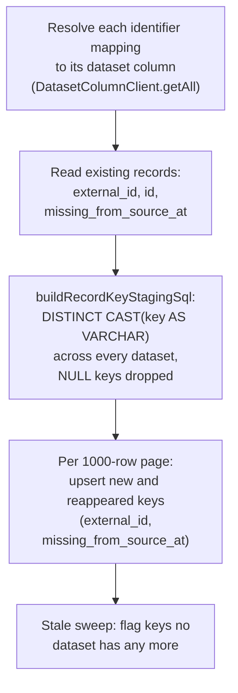
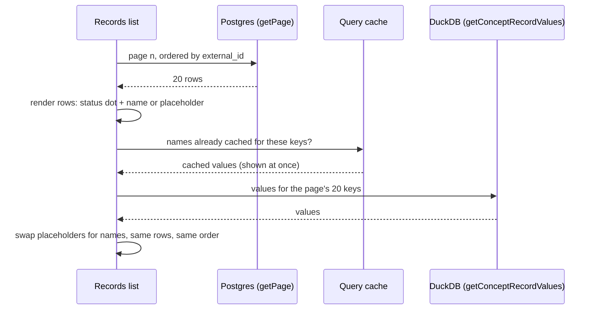

# Joined cases G6: on-demand record names - design

**Status:** Draft
**Date:** 2026-11-06
**Author:** Juan Pablo Sarmiento <pablo@avandarlabs.com>
**Umbrella spec:** `docs/superpowers/specs/2026-11-06-joined-cases-design.md`
(section 5, "G6. On-demand record names")
**Plan:** `docs/superpowers/plans/2026-11-06-joined-cases-6-on-demand-record-names.md`
**Parents:** `docs/ontology-architecture.md` (sections 4, 6, 9, 13, 16),
`docs/superpowers/archive/2026-10-12-incremental-individual-sync-design.md`

> Code blocks are illustrative. The repository is the authority on every
> existing signature, and umbrella section 6 is the authority on every shared
> name. Line numbers cite `demo/measles` at `473e133c1`; G1 to G5 land before
> this work and move some of them.

---

## 1. Problem

A record's display name is a stored copy of one field value. Sync computes
the case type's label field through its value rule and writes the result to
`individuals.name`:

- `generateIndividuals.ts:170-242` resolves the label attribute and its
  dataset column, and `generateIndividuals.ts:300-308` renders the label's
  value rule (`getSQLSelectOfMapping`) into the staging `CREATE TABLE AS`.
- `supabase/schemas/20.individuals.sql:10-11` declares `name text not null`.
- The records list labels each row with `individual.name`
  (`useVirtualIndividualLinks.tsx:64-69`), and the record page header shows it
  (`SingleIndividualView/index.tsx:86-102`).

Three things are wrong with that:

1. **It breaks principle 1 of the umbrella.** Every other field value is
   computed by QETL when it is read. The name is the one value that is stored,
   so it goes stale whenever a dataset changes and nobody presses Refresh, and
   it can disagree with the label field shown on the same record page.
2. **It fails Sync.** Sync takes keys from every dataset that has an
   identifier mapping but the name from the label's dataset alone. A key that
   appears only in another dataset, or whose label cells are all NULL, stages
   a NULL name. Postgres rejects that row (`name text not null`), so the page
   of 1000 rows that holds it fails after earlier pages were written
   (`ontology-architecture.md` section 16, first row; roadmap P5.8).
3. **It is a second value implementation.** Sync renders the label's rule
   with its own SQL. G2 to G5 change rules, add list and bucketed shapes, and
   give a field several sources. Sync would have to follow every one of those
   changes, which umbrella principle 3 forbids.

Two neighbouring defects are fixed here because the records list is rebuilt
around them:

4. **Duplicate rows in the records list.** `createSupabaseCrudClient`'s
   `getPage` (`packages/shared/clients/src/SupabaseCrudClient/createSupabaseCrudClient.ts:187-215`)
   has no `ORDER BY`, and calls `.range(startIndex, endIndex)` with
   `endIndex = (pageNum + 1) * pageSize`. PostgREST ranges are inclusive at
   both ends, so every page returns `pageSize + 1` rows: page 0 of 20 returns
   rows 0 to 20 and page 1 returns rows 20 to 40. `getAll` pages through the
   same function in batches of 500 (`createModelCrudClient.ts:52,191-216`),
   which is why the concept spine sees duplicate keys past 500 records
   (`getConceptRelationPlansFromSql.ts:147-148`). Ordering alone would make
   the duplicate deterministic (the boundary row every time); the range has
   to be fixed too.
5. **Numeric keys look missing after every second sync** (read, not
   reproduced). The staging SQL selects keys uncast. DuckDB returns a `BIGINT`
   key as a JS number (`duckDbArrowResults.ts:10-12`), while the existing
   records map is keyed by the Postgres `text` value
   (`generateIndividuals.ts:76-92`). `1 !== "1"`, so no staged numeric key
   ever matches an existing record: each one is rewritten, and the stale sweep
   then flags it `missing_from_source_at`. Staging the key as `VARCHAR` makes
   the declared type (`StagedIndividualRow.external_id: string`) true and
   matches how the concept view already compares keys
   (`getEntityKeyComparisonSql`, `duckDbSqlText.ts:117-129`).

## 2. Scope

**In**

1. Sync stages and upserts only `external_id` and `missing_from_source_at`
   (plus the constant `workspace_id` and `concept_id`). It no longer reads the
   label field, so a key missing from the label's dataset syncs.
2. Staged keys are `VARCHAR`, and the staging SQL quotes every identifier
   with `quoteSqlIdentifier` (umbrella principle 4).
3. `individuals.name` is dropped: declarative schema, generated migration,
   generated DB types, the `Individual` model and parsers, the desktop SQLite
   migration, and every test, fixture, and E2E helper that writes it.
4. The records list orders records by `external_id` and fetches exactly one
   page at a time (the range fix), through a new `pageOrderColumns` option on
   the relational CRUD clients.
5. The records list reads each page's names with `getConceptRecordValues`
   after the page's rows arrive, shows a placeholder until they do, and never
   reorders.
6. The record page header shows the same name from the same values.
7. A NULL, empty, or missing label value shows the record's `external_id`.
8. `docs/ontology-architecture.md` describes the result.

**Out**

- Searching or sorting the records list by name. Names live in DuckDB, so
  either would be a DuckDB query over the whole case type, not a Postgres
  filter. Searching by ID stays possible in Postgres.
- Loading only the label's datasets for the list. `getConceptRecordValues`
  builds the whole concept view, and DuckDB binds every source when a view is
  defined, so every contributing dataset's mapped columns are loaded (section
  6.9). A plan restricted to some attributes is a later QETL change.
- Notifications and mention emails. None exist today (no edge function reads
  `individuals`, and `comment_mentions` has no sender). Section 6.10 fixes
  what they will show.
- Atomic Sync (roadmap P5.10) and what a stale record's status becomes
  (P5.9).
- The video producer capture flow's stale "Sync records" button name
  (`apps/ava-video-producer/capture-flows/cases-map/cases.mjs:139-141,229-231`),
  which predates this work.

## 3. What this work assumes from G1 to G5

The child specs for G1 to G5 were written alongside this one. Where they had
settled a detail when this spec was finished, it is cited; otherwise this spec
relies on the umbrella's shared names. It assumes:

| Gap | Delivered, and used here |
| --- | --- |
| G1 | (G1 spec sections 4.5 and 4.7.) `ConceptRecordValuesClient` in `src/clients/ontology/ConceptRecordValuesClient/ConceptRecordValuesClient.ts`, named `"ConceptRecordValuesClient"` and built with `withQueryHooks`, so it has `getClientName()`, `getConceptRecordValues({ workspaceId, conceptId, externalIds })` returning `Promise<ConceptRecordValues[]>` (one entry per requested key that has a row, in request order, up to 500 keys), `QueryKeys.getConceptRecordValues(params)` (the key `["ConceptRecordValuesClient", "getConceptRecordValues", params]`), and `useGetConceptRecordValues`. `ConceptRecordValues = { externalId; valuesByAttributeId }` lives in `ConceptRecordValuesClient.types.ts`. `useHydratedIndividual` is replaced by `useRecordFields`, which reads `{ workspaceId: individual.workspaceId, conceptId: concept.id, externalIds: [individual.externalId] }`; the header is left as `title={individual.name}`. A dataset refresh invalidates every record values query, and Sync does not. The NULL rule (principle 6) holds, and a manual-entry field reads as no value. |
| G2 | Rules emit typed values (a date label arrives as a date, a `count` label as a number). |
| G3 | A field may be a list. A list label arrives as an array, `[]` when empty. |
| G4 | Bucketed lists exist; nothing here reads them. |
| G5 | (G5 spec sections 6.2 and 6.6.) The rule lives on the field, and a hydrated attribute holds `mappings: AttributeMapping[]` instead of one `mapping`. Sync's label SQL, which G5 makes multi-source, is deleted here. `rpc_concepts__create` takes `value_picker_rule_type` on each attribute and `position` on each mapping. New case types get one ID field with one source per dataset; Sync reads every identifier mapping row either way. |

If G1's record page query uses different parameters, the record page header
still works but issues its own query instead of sharing G1's cache entry
(section 6.7).

## 4. Approaches

**A. Compute names on demand through the concept view (recommended).** Sync
keeps only membership. The records list and the record page read the label
field's value from `getConceptRecordValues` for the records on screen, and
fall back to `external_id`.

- Plus: one value implementation, so the name always equals the label field
  shown on the record page, under every rule and shape G2 to G5 add.
- Plus: the Sync failure disappears instead of being patched: Sync never
  computes a value, so there is nothing to be NULL.
- Plus: a dataset edit renames records without a Refresh.
- Minus: the list needs DuckDB, and the case type's datasets loaded, before
  names show. Rows still render from Postgres at once (section 6.6).
- Minus: no server code can produce the name (section 6.10).

**B. Keep a cached name, made nullable.** Drop `not null`, keep writing the
label from Sync, and show `coalesce(name, external_id)`.

- Plus: smallest change; names render with the row, server code can read
  them.
- Minus: the name stays stale between syncs and disagrees with the record
  page's label field whenever a dataset changes.
- Minus: Sync keeps its own label SQL. After G5 that SQL must stack several
  sources and apply list and bucket shapes, a second value implementation
  that has already drifted once (the `most_frequent` NULL disagreement G1
  fixes).
- **The umbrella rejects it** under principles 1 ("Field values are never
  stored ... including the record's display name once G6 lands") and 3 ("One
  value implementation"). A cache is a stored value with an invalidation
  problem, and nothing in Avandar today invalidates on a dataset change.

**C. Store names in their own table, refreshed by Sync.** A
`record_names (concept_id, external_id, name)` table, upserted by Sync with
NULLs allowed.

- Same staleness and second implementation as B, plus a table, policies, and
  a join. It only moves the cached value somewhere else.

Recommendation: **A**, as the umbrella decided.

## 5. Shared names this spec adds

Only `buildRecordKeyStagingSql` and `RecordKeySource` are used by another
gap: the G7 spec (section 5.6) names the same module and type and adds
`keyMatching` to it (section 6.12).

| Kind | Name | Where |
| --- | --- | --- |
| Removed column | `individuals.name` (umbrella shared name) | `supabase/schemas/20.individuals.sql` |
| Client option | `pageOrderColumns?: ReadonlyArray<Extract<keyof M["DBRead"], string>>` | `createSupabaseCrudClient`, `createSqliteCrudClient`, `RdbCrudModelSpec` |
| Function | `buildRecordKeyStagingSql({ stagingTableName, keySources })`, type `RecordKeySource = { datasetId: Dataset.Id; primaryKeyColumnName: string }` | `src/views/OntologyDesignerApp/ConceptMetaView/generateIndividuals/buildRecordKeyStagingSql/buildRecordKeyStagingSql.ts` |
| Function | `buildRecordNameFromLabelValue({ labelValue, externalId }): string` | `src/views/IndividualManagerApp/buildRecordNameFromLabelValue/buildRecordNameFromLabelValue.ts` |
| Function | `getCachedRecordValues({ queryClient, conceptId, externalIds }): ConceptRecordValues[] \| undefined` | `src/views/IndividualManagerApp/getCachedRecordValues/getCachedRecordValues.ts` |
| Function | `makeRecordNamesFromPages({ pages, labelAttributeId }): Map<string, string>`, type `RecordValuesPage` | `src/views/IndividualManagerApp/makeRecordNamesFromPages/makeRecordNamesFromPages.ts` |
| Hook | `useRecordNames({ workspaceId, conceptId, externalIdPages }): Map<string, string>` | `src/views/IndividualManagerApp/useRecordNames/useRecordNames.ts` |
| Hook | `useRecordName({ concept, individual }): string \| undefined` | `src/views/IndividualManagerApp/SingleIndividualView/useRecordName/useRecordName.ts` |
| Function | `makeVirtualIndividualLink(options)` (moved out of `useVirtualIndividualLinks.tsx`) | `src/views/IndividualManagerApp/makeVirtualIndividualLink/makeVirtualIndividualLink.tsx` |
| Component | `RecordNameSkeleton` | `src/views/IndividualManagerApp/IndividualNavbar/RecordNameSkeleton.tsx` |

## 6. Design

### 6.1 The name rule

A record's name is its label field's value, formatted as text. One function
decides it, `buildRecordNameFromLabelValue`:

| Label value | Name |
| --- | --- |
| `null` or `undefined` (NULL, no label field, manual-entry label, record missing from the result) | `external_id` |
| A string that is empty after trimming | `external_id` |
| An empty array (a list label with no values) | `external_id` |
| A string | the string, untrimmed |
| An array | its values formatted and joined with `", "` |
| A number, boolean, or date | `unknownToString(value, { formatNumbers: false })`, so an ID-like number stays `12345`, not `12,345` |

The fallback is the bare `external_id`, with no prefix, so the list and the
header read the same as the "Source ID" fact in the record rail
(`RecordFactsGroup.tsx:27-29`). It is data, not copy, so it is not
translated.

### 6.2 Sync stages record keys only

`generateIndividuals` keeps its incremental shape (archived incremental sync
design, section 5) and loses everything about the label:



- `_resolveIndividualSourceMappings` becomes `_getRecordKeySources`, which
  returns one `RecordKeySource` per identifier mapping row (every entry of
  every identifier attribute's `mappings`). It no longer calls
  `getLabelAttribute`, so a case type whose label is a manual-entry field
  (section 16, "The form allows a manual-entry label") also syncs.
- `neededColumnsByDatasetId` names only each dataset's key column.
- `buildRecordKeyStagingSql` is pure and executed-tested:

  ```sql
  DROP TABLE IF EXISTS "ava_staging_individuals_<conceptId>";

  CREATE TABLE "ava_staging_individuals_<conceptId>" AS (
    SELECT DISTINCT external_id
    FROM (
      SELECT CAST("person_id" AS VARCHAR) AS external_id FROM "<dataset A>"
      UNION ALL
      SELECT CAST("patient_id" AS VARCHAR) AS external_id FROM "<dataset B>"
    )
    WHERE external_id IS NOT NULL
  );
  ```

  It throws when given no key columns, which today fails later as a DuckDB
  syntax error on `FROM ()`.
- The diff helpers lose `name`. A staged key writes a row when it is new or
  was flagged missing, and nothing otherwise. The rename case is gone. Rows
  are `{ workspace_id, concept_id, external_id, missing_from_source_at }`.
- `getSQLSelectOfMapping` (or, after G1, `buildAttributeValueSql`) is no
  longer imported by Sync.

### 6.3 Dropping `individuals.name`

`supabase/schemas/20.individuals.sql` loses lines 10-11. The generated
migration is one `alter table "public"."individuals" drop column "name";`.
No policy, trigger, index, function, or view references the column (section
8). The `Individual` model loses `name` on `Read` (and so on `Insert` and
`Update`), and `IndividualParsers.DBReadSchema` loses it; its
`ZodSchemaEqualsTypes` check keeps the parser and the regenerated
`database.types.ts` in step.

### 6.4 Records list order and the paging fix

`createSupabaseCrudClient` and `createSqliteCrudClient` gain an optional
`pageOrderColumns`. When set, every `getPage` (and so every `getAll` and
`getOne`) orders by those columns ascending and then by the primary key, so
the order is total even across case types. When unset, nothing changes, so
no other list in the app reorders. `createRdbCrudClient` passes it through
(`RdbCrudModelSpec` gains the field), and `IndividualClient` sets
`pageOrderColumns: ["external_id"]`.

- Postgres serves `concept_id = $1 order by external_id, id` from
  `individuals__concept_external_id_unique (concept_id, external_id)`.
- The Supabase `getPage` asks for `range(start, start + pageSize - 1)`. This
  is a fix for every model, not only records: every `getAll` over more than
  one batch has been returning one duplicate per batch boundary.
- The order is text order in the database collation, so `P-10` sorts before
  `P-2` (open question 1).
- A records-list-only query through the client's `queries` escape hatch was
  rejected: escape hatches always call Supabase REST, so the desktop shell
  would stop reading its SQLite mirror for the list.

### 6.5 Query keys

| Query | Key | Invalidated by |
| --- | --- | --- |
| Records list page | `IndividualClient.QueryKeys.getAll(makeRecordsWhereFromStatusFilter(...))` (unchanged, infinite query) | Status changes (`invalidateCaseStatusQueries`), Refresh |
| Names of one page | `ConceptRecordValuesClient.QueryKeys.getConceptRecordValues({ workspaceId, conceptId, externalIds })`, `externalIds` in the page's `external_id` order | A dataset refresh (G1's `invalidateDatasetRowQueries`), staleness (6 minutes online, `AvaQueryClient.ts:23-25`) |
| Record page values and header name | The same key with `externalIds: [individual.externalId]`, shared with G1's record page query | As above |
| Label field id | `ConceptAttributeClient.QueryKeys.getAll(where("concept_id", "eq", conceptId))`, the case type's attributes read the record page already makes | Unchanged |

A status change does not invalidate names: no value depends on status, and
`invalidateCaseStatusQueries` matches only `IndividualClient` and
`ConceptStatusClient` keys (`invalidateCaseStatusQueries.ts:30-50`).

Like every successful query, the names are persisted to IndexedDB by
`AvandarQueryClientProvider`, so after a reload the list shows the last names
at once and re-reads them once they are stale.

### 6.6 Records list: names per page, without flashing or reordering



- `useConceptIndividuals` also returns `externalIdPages: string[][]`, one
  array per fetched page, in page order.
- `useRecordNames` runs one `useQueries` entry per page. Each entry's
  `queryFn` is `ConceptRecordValuesClient.getConceptRecordValues`, so each
  restriction is at most 20 keys and a page appended by scrolling never
  re-reads earlier pages. A `combine` callback turns the results into one
  `Map<external_id, name>` with `makeRecordNamesFromPages`.
- **No label field.** When the case type's attributes have loaded and none is
  the label, every record is named by its `external_id` and no values query
  runs. Case types seeded with no fields (several E2E specs) take this path.
- **Loading.** A row whose name is not in the map renders
  `RecordNameSkeleton` in place of the text (a 12px `Skeleton`, hidden from
  assistive technology, plus a visually hidden "Loading record name") and
  `aria-busy="true"` on the link. The row is already a working link with its
  status dot. Rows are fixed at 50px in the virtualizer
  (`useVirtualIndividualLinks.tsx:14`), so the swap moves nothing, and order
  comes from Postgres, so names never reorder rows.
- **No flash on re-paging.** `useQueries` gives a changed key a new observer
  (`queriesObserver.ts` `#findMatchingObservers`), so `keepPreviousData`
  cannot carry names across a new page composition. Each entry's
  `placeholderData` therefore calls `getCachedRecordValues`, which returns the
  freshest cached values of the requested keys from any record values query
  of the same case type: earlier pages, other filters, or a record page. So a
  status filter change, a status change that shifts pages, or a Refresh that
  inserts a record keeps every known name on screen. Only keys never read
  before show the placeholder.
- **Settling.** A page whose own query succeeded names every one of its keys:
  from its values, or by `external_id` when the result has no entry for that
  key. A page whose query failed names every key by `external_id`. A page
  still loading names only the keys its placeholder covered.
- The header spinner and the empty states stay tied to the Postgres rows
  (`IndividualNavbar.tsx:72-75`, `IndividualNavbarRows.tsx`), not to names.

`makeVirtualIndividualLink` moves out of `useVirtualIndividualLinks.tsx` so
its row logic can be tested without a virtualizer. It still calls
`AppLinks.individualManagerIndividualView`, passing the name (or the
`external_id` while loading) as `individualName`, and overrides `label` with
the placeholder while loading.

### 6.7 Record page header

`useRecordName({ concept, individual })` calls `useRecordNames` with
`externalIdPages: [[individual.externalId]]`. Its query key is the one G1's
record page query uses (section 3), so the header and the rail share one
DuckDB read. Opened from the list, the header is named at once from the
list's cached values. Until the name settles the header shows a skeleton with
a visually hidden "Loading case", the state the header had before G1 replaced
it with `title={individual.name}`.

### 6.8 Refresh

Refresh records does not invalidate names. G1 decided that record values go
stale when a dataset's rows change (`invalidateDatasetRowQueries` invalidates
every `ConceptRecordValuesClient` query) and not on Sync, which changes
membership only (G1 spec section 4.5). Names are record values, so they
follow the same rule: a dataset refresh renames records with no Refresh
records, and a record a Sync adds has a key no query has read yet.
`RefreshRecordsButton` keeps invalidating `IndividualClient` queries, so the
list shows the new rows.

### 6.9 Cost

Each list page adds one QETL query: Postgres reads for the plan, a 20-row CSV
spine, the concept view, and `SELECT *` over 20 records.

- The concept view binds all of its sources, so the first list page loads
  every contributing dataset's mapped columns
  (`getNeededColumnsFromQuery.ts:78-93`), not only the label's. The relation
  cache keeps them, so later pages, the record page, and the Data Explorer
  reuse the load.
- A workspace session leases every workspace dataset
  (`ontology-architecture.md` section 8), so name queries queue behind other
  DuckDB work in the tab, such as a running Data Explorer query. Rows render
  meanwhile.
- Each query computes every field for its 20 records, not only the label.
  That is milliseconds once the datasets are loaded.
- Postgres work drops: Sync no longer rewrites a row when a label changes,
  and the list query is index-ordered.

### 6.10 Readers that cannot run DuckDB

A search of `src/`, `shared/`, `supabase/schemas`, `supabase/functions`,
`supabase/tests`, `seed/`, `tests/e2e`, `apps/desktop`, and
`apps/ava-video-producer` found no server-side reader of `individuals.name`:
no RPC (`50.rpc_activity_events__get_case_page.sql` returns
`activity_events` rows only), trigger, view, or edge function reads it, and
no notification or mention email exists yet.

Rule for any future server-side reader: name a record by its case type's
name and its `external_id` ("Measles case P-003"), read from Postgres. The
label value is never computed on the server (open question 2).

### 6.11 Desktop

`individuals` is an active desktop table (`apps/desktop/sync/syncable-tables.ts:52`).
`pnpm desktop:sqlite:gen-migrations` emits
`ALTER TABLE "individuals" DROP COLUMN "name";`, which SQLite supports
because the column is in no index or constraint (the same shape as
`20261026115457_require_case_statuses.gen.sql:8`). The records list reads the
SQLite mirror through `createSqliteCrudClient`, which honors
`pageOrderColumns`. Names need DuckDB, which the desktop already runs.

### 6.12 What G7 inherits

G7 changes how Sync and the view compute a key. After G6:

- Sync's only key SQL is `buildRecordKeyStagingSql`, in
  `generateIndividuals/buildRecordKeyStagingSql/`, the module and name the G7
  spec (section 5.6) gives its builder. It takes
  `RecordKeySource = { datasetId; primaryKeyColumnName }`, so G7 adds
  `keyMatching` to the type and extends this module instead of creating it.
  Each source is one
  `SELECT CAST(<key column> AS VARCHAR) AS external_id FROM <dataset>` arm.
  G7 replaces the arm's key expression with `buildRecordKeySql` and must keep
  its output `VARCHAR`, or the diff stops matching existing records and the
  stale sweep flags them (section 1, item 5). Sync reads no non-key column, so
  the lookup dataset's columns are the only ones G7 adds to
  `neededColumnsByDatasetId`.
- `external_id` is the stored key, so after G7 it is the normalized or
  translated key. That is what the records list orders by and what a record
  with no label value is named. With `lowercase`, such a record shows
  `p-001`, not the raw `P-001`, because the raw key is not stored.
- The list and record page pass stored `external_id` values to
  `getConceptRecordValues`, so the spine holds normalized keys. Every
  normalization is idempotent, so applying them to the spine side of the
  view's comparison as well is harmless.
- A key G7 excludes (no crosswalk match, or several) is never staged, so the
  stale sweep flags an existing record with that key missing from source,
  which is what the G7 spec (section 5.6) expects.

## 7. Migration

1. **Schema.** Declarative edit, then `pnpm db:reset` and
   `pnpm db:new-migration drop_individuals_name`, which must contain only the
   column drop. No data moves: names are recomputed on read, so nothing is
   lost that matters.
2. **Generated artefacts.** `pnpm db:gen-types` regenerates
   `shared/types/database.types.ts`, and the desktop generator emits the
   SQLite drop.
3. **Migration upgrade test.**
   `supabase/migration-upgrade-tests/case_statuses_backfill.prelude.sql:49-56`
   runs against the current schema and inserts `name`. The backfill it
   replays (`20261026115137_backfill_case_statuses.sql`) never reads
   `individuals.name`, so the insert drops the column and its values. No new
   upgrade scenario is needed: the drop moves no data.
4. **Deploy order.** Apply the migration, then deploy the frontend. In the
   gap, an open tab of the old frontend fails to parse records
   (`DBReadSchema` requires `name`) and its Sync sends a column that no longer
   exists; a reload fixes both. The other order breaks Sync for new records
   until the migration runs, because the new Sync sends no name to a
   `not null` column. An old desktop build fails to mirror `individuals`
   until it updates, as it did for the `status` drop.
5. **Rollback.** `alter table public.individuals add column name text;`
   restores the shape (nullable). An older frontend needs `not null` names,
   so it also needs a Refresh of every case type.

## 8. Error handling

| Failure | Behaviour |
| --- | --- |
| A key exists only in a dataset other than the label's | Synced like any key. Its name is its `external_id` until a label value exists |
| A label cell is NULL or blank | Name is `external_id` |
| The case type has no label field, or its label is a manual-entry field | Every name is `external_id`; with no label field no values query runs |
| A page's values query fails (a broken mapping fails closed at planning, umbrella principle 7, or DuckDB errors) | After the client's one retry (`AvaQueryClient.ts:33-49`) the page's rows show their `external_id`. No toast: the record page's rail shows G1's error for the same failure, and the rows stay usable |
| The values result has no entry for a requested key | That record shows its `external_id` |
| A Postgres page fails | Unchanged: the infinite query's error and loading states |
| Sync on a case type with no identifier mapping | `buildRecordKeyStagingSql` throws a clear error, reported through the Refresh button's existing `notifyError` and the progress job, as any Sync failure is |
| Sync fails partway | Unchanged (P5.10): earlier pages stay written. A NULL label can no longer cause it |

## 9. Testing

| Layer | Test | Proves |
| --- | --- | --- |
| Package unit | `createSupabaseCrudClient.test.ts` (new, fake `dbClient`) | `range(20, 39)` for page 1 of 20; order by `pageOrderColumns` then the primary key; no order when unset |
| Package unit | `createSqliteCrudClient.test.ts` (add) | `order by "name", "id"` before `limit ? offset ?` |
| Executed DuckDB | `buildRecordKeyStagingSql.executed.test.ts` | Each key once across datasets; NULL keys dropped; a `BIGINT` key staged as `VARCHAR`; only `external_id` staged |
| Unit | `diffStagedIndividualsHelpers.test.ts` (rewrite) | Rows carry no name; new and reappeared keys write; present keys write nothing; stale rows carry no name |
| Unit | `generateIndividuals.test.ts` (add) | Only key columns are read; **a key only the second dataset has is upserted with no name** |
| pgTAP | `individuals__sync_upsert_contract.test.sql` (rewrite) | `hasnt_column('individuals', 'name')`; the narrowed upsert leaves `id`, `status_id`, `assigned_to` alone; **a new key inserts with no name** |
| pgTAP | The six other files in section 11 | Unchanged assertions, with `name` removed or replaced by `missing_from_source_at` as the probe column |
| Unit | `buildRecordNameFromLabelValue.test.ts` | The section 6.1 table |
| Unit | `getCachedRecordValues.test.ts` (real `QueryClient`) | Finds requested keys in any of the case type's cached queries, newest first; ignores other case types; `undefined` when none cached |
| Unit | `makeRecordNamesFromPages.test.ts` | Label names; ID fallback on a settled page; unsettled keys absent; placeholder names used |
| Unit | `useRecordNames.test.ts` | Names arrive per page; no query without a label field; cached names survive a new page key; a failed page falls back to IDs |
| Unit | `useRecordName.test.ts` | The header asks with the record page's own parameters and returns the label |
| Unit | `makeVirtualIndividualLink.test.tsx` | Named row; busy row with "Loading record name" |
| Unit | `IndividualParsers.test.ts`, fixtures in `RecordFactsGroup.test.tsx` and `useRecordStatusChange.test.tsx` | Unchanged assertions without `name` |
| Upgrade | `case_statuses_backfill` prelude | The backfill still replays |
| Desktop | `pnpm desktop:sqlite:check-migrations` | The generated SQLite migration matches |
| E2E | `tests/e2e/case-record-names.spec.ts` (new) | Through the UI, Refresh on a case type over two datasets creates `P-003` (only in the second dataset); the list shows `Ada Lovelace`, `P-002` (blank label), `P-003` in that order; each record page heading matches its row |

Existing E2E specs keep passing because their helpers seed `external_id`
equal to the name they assert (`insertE2ECaseTypeWithRecords`,
`seedCaseRecord`) or a label equal to the key (`seedCaseTypeOverDataset`).

## 10. Exit criteria

1. `individuals` has no `name` column, and
   `rg -n "individuals?\.name|hydratedIndividual\.name" src shared supabase/schemas supabase/functions`
   returns nothing.
2. Refresh on a case type whose second dataset has a key the label's dataset
   lacks completes, and that key becomes a record named by its
   `external_id`.
3. The records list shows each record's label value, or its `external_id`
   when the value is NULL, blank, or absent, ordered by `external_id`, with no
   duplicate across page boundaries. Rows appear before their names and do
   not move when names arrive.
4. The record page header shows the same name as the record's row.
5. Changing a label value in a dataset changes the record's name on the next
   read, with no Refresh.
6. `pnpm type-check`, `pnpm lint`, `pnpm test:frontend`,
   `pnpm test:executed`, `pnpm test:clients`, `pnpm test:db`,
   `pnpm desktop:sqlite:check-migrations`, and
   `pnpm test:e2e case-record-names.spec.ts` pass, and the existing case E2E
   specs pass one at a time.
7. `docs/ontology-architecture.md` sections 4, 6, 9, 10, 13, 15, and 16
   describe the result.

## 11. Files

Every reader and writer of `individuals.name`, and every file this work
touches.

| File | Today | After |
| --- | --- | --- |
| `supabase/schemas/20.individuals.sql:10-11` | `name text not null` | Removed |
| `supabase/migrations/<ts>_drop_individuals_name.sql` | | Generated drop |
| `shared/types/database.types.ts` | `name` on `individuals` | Regenerated |
| `shared/models/ontology/Individual/Individual.types.ts:17` | `name: string` | Removed |
| `shared/models/ontology/Individual/IndividualParsers.ts:28` | `name: z.string()` | Removed |
| `shared/models/ontology/Individual/IndividualParsers.test.ts:16,32` | Fixture names | Removed |
| `src/views/OntologyDesignerApp/ConceptMetaView/generateIndividuals/generateIndividuals.ts:76-92,151-314` | Reads the label, stages `name` | Keys only, through `buildRecordKeyStagingSql` |
| `.../generateIndividuals/diffStagedIndividualsHelpers/diffStagedIndividualsHelpers.ts` | `name` on staged, existing, and upsert rows | Removed; rename case gone |
| `.../generateIndividuals/buildRecordKeyStagingSql/` | | New builder and executed test |
| `.../generateIndividuals/generateIndividuals.test.ts`, `diffStagedIndividualsHelpers.test.ts` | Name fixtures | Rewritten |
| `shared/models/ontology/Concept/ConceptModule.ts:40-51` (`getLabelAttribute`) | Called by Sync | No caller left; kept, since removing a model helper is outside this work |
| `src/views/IndividualManagerApp/useVirtualIndividualLinks.tsx:44-80` | Row label `individual.name` | Calls `makeVirtualIndividualLink` with `recordNames` |
| `src/views/IndividualManagerApp/makeVirtualIndividualLink/` | | New, with test |
| `src/views/IndividualManagerApp/IndividualNavbar/IndividualNavbar.tsx`, `RecordNameSkeleton.tsx` | | Wires `useRecordNames`; new placeholder |
| `src/views/IndividualManagerApp/useConceptIndividuals.ts` | | Adds `externalIdPages` |
| `src/views/IndividualManagerApp/{buildRecordNameFromLabelValue,getCachedRecordValues,makeRecordNamesFromPages,useRecordNames}/` | | New, with tests |
| `src/views/IndividualManagerApp/SingleIndividualView/index.tsx:86-102` | Header `hydratedIndividual.name`; after G1, `title={individual.name}` | `useRecordName`, with a skeleton and "Loading case" until it settles |
| `src/views/IndividualManagerApp/SingleIndividualView/useRecordName/` | | New, with test |
| `src/views/IndividualManagerApp/SingleIndividualView/useHydratedIndividual.ts:20` | `HydratedIndividual` inherits `name` | Deleted by G1 (replaced by `useRecordFields`); no edit here |
| `src/views/IndividualManagerApp/SingleIndividualView/RecordFactsGroup/RecordFactsGroup.test.tsx:20`, `useRecordStatusChange/useRecordStatusChange.test.tsx:78` | Fixture `name` | Removed |
| `src/config/AppLinks/AppLinks.tsx:269-293` | `individualName` from the stored name | Same signature, given the computed name |
| `src/views/OntologyDesignerApp/ConceptMetaView/RefreshRecordsButton.tsx:49-51` | Invalidates `IndividualClient` | No change (section 6.8) |
| `src/clients/ontology/IndividualClient.ts` | | `pageOrderColumns: ["external_id"]` |
| `packages/shared/clients/src/SupabaseCrudClient/createSupabaseCrudClient.ts:187-215` | Inclusive range, no order | Exact range, `pageOrderColumns` |
| `packages/shared/clients/src/SupabaseCrudClient/createSupabaseCrudClient.test.ts` | | New |
| `packages/shared/clients/src/SqliteCrudClient/createSqliteCrudClient.ts:122-131` and its test | No order | `pageOrderColumns` |
| `packages/shared/clients/README.md` | | Documents `pageOrderColumns` |
| `shared/RdbCrudClient/RdbCrudClient.types.ts` | | `pageOrderColumns?` |
| `src/clients/qetl/QueryMediator/conceptRelation/getConceptRelationPlansFromSql/getConceptRelationPlansFromSql.ts:147-162` | Reads `external_id`, `status_id`; duplicate keys past 500 | No edit; ordered and exact through `IndividualClient` |
| `supabase/schemas/21.comments.sql`, `22.activity_events.sql`, `23.comments__audit_triggers.sql`, `50.rpc_activity_events__get_case_page.sql`, `50.rpc_concept_statuses__save.sql` | Read `individuals.id` or `status_id` only | No change |
| `supabase/functions/**` | No reader (no notification or mention email sender) | No change; future rule in section 6.10 |
| `seed/` | No reader | No change |
| `src/config/SpotlightLinks.tsx` | No record links | No change |
| Chat (`fetchWorkspaceSchema`, `fetchOfflineChatSchema`, `supabase/functions/chat`) | No reader | No change |
| `apps/desktop/sync/syncable-tables.ts:52` | Mirrors `individuals` | No change |
| `apps/desktop/migrations/<ts>_drop_individuals_name.gen.sql` | | Generated |
| `apps/ava-video-producer/avandar-adapter/CasesScreen/*` | Static fixture names | No change |
| `apps/ava-video-producer/capture-flows/cases-map/cases.mjs:165-210` | Reads each row's text as its name | Waits until no row is `aria-busy` before reading; comment no longer claims repeated boundary keys |
| `supabase/tests/database/individuals__sync_upsert_contract.test.sql` | Upserts `name` | Rewritten (section 9) |
| `supabase/tests/database/individuals__status.test.sql:54,69,93,117-127,154` | Inserts and renames `name` | Inserts drop it; test 5 probes `missing_from_source_at` |
| `supabase/tests/database/permissions/rls_individuals.test.sql:82-88,146-147,165-172,249-250,267-268,283-284,301-308,327-334,353-360,398-408` | Inserts `name`, probes updates with it | Inserts drop it; probes use `missing_from_source_at` |
| `supabase/tests/database/permissions/rls_case_activity.test.sql:43-45,448-450` | Inserts `name` | Dropped |
| `supabase/tests/database/case_activity/activity_page.test.sql:43-46` | Inserts `name` | Dropped |
| `supabase/tests/database/case_activity/comment_audit_triggers.test.sql:46-51,234-237,275-277` | Inserts `name`; Sync replay sets it | Dropped; replay sets `missing_from_source_at` only |
| `supabase/tests/database/rpc_concept_statuses__save.test.sql:72-75` | Inserts `name` | Dropped |
| `supabase/migration-upgrade-tests/case_statuses_backfill.prelude.sql:49-56` | Inserts `name` | Dropped |
| `tests/e2e/helpers/insertE2ECaseTypeWithRecords.ts:98-111` | `name`, key `e2e-record-N` | Key is the record's name |
| `tests/e2e/helpers/seedCaseRecord.ts:61-69` | `name`, key `e2e-<ms>` | Key is `recordName` |
| `tests/e2e/helpers/CaseTypeSeedHelpers.ts:141-153` | `name: key` | Removed; adds `seedCaseTypeOverTwoDatasets` |
| `tests/e2e/case-record-names.spec.ts`, `tests/data/record-names/*.csv`, `tests/e2e/helpers/constants.ts` | | New spec and fixtures |
| `src/i18n/locales/*/messages.po`, `messages.ts` | | "Loading record name" added; "Loading case" back after G1 removed it |
| `docs/ontology-architecture.md` | Stored name, unordered list, stale section 6 | Sections 4, 6, 9, 10, 13, 15, 16 |

## 12. Deviations from the umbrella spec

1. **The ordering does not by itself fix the duplicate rows.** Umbrella
   section 5 (G6, last bullet) says ordering by `external_id` "also fixes the
   duplicate-row bug in `getPage`". The duplicates come from an inclusive
   PostgREST range that returns `pageSize + 1` rows (section 1, item 4), so an
   ordered list would repeat each page's boundary row. G6 also corrects the
   range, for every model. The shared name and the decision are unchanged.
2. **Staged keys are cast to `VARCHAR`** (section 1, item 5). The umbrella
   says Sync stages `external_id`; it does not mention the type. This is an
   addition, needed for the diff to match numeric keys, and it matches the
   concept view's text comparison that G7 replaces with `buildRecordKeySql`.

No umbrella shared name changes.

## 13. Open questions for Kristi

1. **Records are ordered by ID as text.** `P-10` lists before `P-2`, and `10`
   before `9`. A numeric-aware order needs a sort key computed in Postgres
   (and the same in SQLite) and an index on it. Recommendation: ship text
   order now and revisit when the list gets sorting and search. Is text order
   acceptable for the demo?
2. **What a future notification or mention email calls a record.** The
   server cannot compute a label, so the plan is "case type name plus ID"
   ("Measles case P-003"). The alternative is for the browser that posts a
   comment to include the name it is showing, which the email would then
   carry as a snapshot. Recommendation: case type plus ID, which is always
   true. Which do you want when P5c.8 lands?
