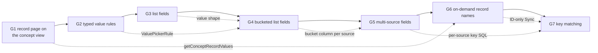

# Joined cases: closing the case management gaps - design

**Status:** Draft
**Date:** 2026-11-06
**Author:** Juan Pablo Sarmiento <pablo@avandarlabs.com>
**Parents:** `docs/ontology-architecture.md` (sections 6, 7, 8, 10, 16),
`docs/qetl-architecture.md`
**Overview plan:** `docs/superpowers/plans/2026-11-06-joined-cases.md`

> This is the umbrella spec. It fixes the decisions and the names that cross
> more than one gap. Each gap has its own child spec and plan (section 7).
> A child spec elaborates its gap and may not contradict this document
> without saying so in a "Deviations from the umbrella spec" section.
>
> Code blocks are illustrative. The repository is the authority on every
> existing signature. The names in section 6 are the authority on every new
> one.

---

## 1. Problem

A case type should assemble one record from several datasets, with each
field reading whichever dataset holds it, and with many dataset rows per
record collapsed into a value computed at read time. An audit of
`demo/measles` at `25466ba17` on 2026-11-06 found that the query engine
already does the core of this, and that seven gaps stop it from being a
complete product.

What works today:

- Fields of one case type read different datasets. Each field is a
  correlated subquery against its own dataset, keyed by that dataset's own
  identifier column (`makeConceptAttributeColumnsFromMetadata.ts`,
  `buildConceptViewSql.ts`). The grain is one row per record.
- Seven value rules collapse many rows into one value: `first`,
  `most_frequent`, `sum`, `avg`, `count`, `max`, `min`.
- The concept view can already emit a list of every value
  (`_buildArraySelector`).
- Field values are not stored. The concept view is rebuilt inside every
  query's lease.

The seven gaps:

| ID | Gap | Evidence |
| --- | --- | --- |
| G1 | The record page reads values through its own inline copy of the value rules, not the concept view. The copies disagree on NULL under `most_frequent`, the record page ignores list fields, splices `external_id` into SQL unescaped and uncast, and throws on any manual-entry field. | `AttributeAssertionClient.ts:228`; `ontology-architecture.md` section 7 |
| G2 | `max` and `min` cast to `DOUBLE`, so they fail on dates and text. `count` is typed `DOUBLE`. A field's stored `data_type` can disagree with the type the view emits. | `getSQLSelectOfMapping.ts:118,129` |
| G3 | List fields exist in the engine but not in the product: chat always creates single-value fields, and the record page shows one value where the Data Explorer shows a list. | `createdCaseTypeToFormValues.ts:57`; `shared/types/chat.types.ts` has no list option |
| G4 | No bucketed lists: a field cannot hold "the monthly average of column X" as an ordered list of period and value. | No date column, grain, or per-bucket rule exists in the schema |
| G5 | A field reads exactly one dataset column. Values for one field spread over several datasets (lab results in two sheets) or several columns (phone 1, phone 2) cannot be combined. | `attribute_mappings__dataset_column.concept_attribute_id` is `unique` |
| G6 | The record name is a stored field value. Sync computes the label field through its rule and writes it to `individuals.name`. It goes stale between syncs, and a key missing from the label's dataset yields a NULL name that fails the sync page (`name text not null`) after earlier pages were written. | `generateIndividuals.ts:300`; `20.individuals.sql:11` |
| G7 | Keys must match exactly as text. `P-001` in one dataset never matches `p-001 ` or `1` in another, and there is no way to translate one dataset's ids to another's. | `getEntityKeyComparisonSql` in `duckDbSqlText.ts` |

## 2. Principles every gap keeps

1. **Field values are never stored.** Every field value, including the
   record's display name once G6 lands, is computed by QETL from the
   datasets when it is read. This is the ontology-based data access reading
   of the ontology (`ontology-architecture.md` section 1).
2. **What Postgres does store** is the TBox (case types, fields, mappings,
   statuses), record membership (one `individuals` row per key: `id`,
   `external_id`, `status_id`, `assigned_to`, `missing_from_source_at`,
   timestamps), and state people author about a case (comments, reactions,
   activity). Nothing in this work adds a stored value.
3. **One value implementation.** After G1 the concept view is the only code
   that turns mappings into values. Every reader (Data Explorer, chat,
   dashboards, record page, records list) reads `concept_<id>`.
4. **No user data spliced into SQL.** Record keys reach DuckDB only through
   the CSV spine (`loadConceptSpine`). Identifiers in generated SQL are
   always quoted with `quoteSqlIdentifier`.
5. **Every rule is deterministic.** Order is total: source position (G5),
   then `file_row_number`. Ties in `most_frequent` break by value.
6. **NULL means "no value", and every rule ignores it.** `first` returns the
   first non-NULL value, `most_frequent` the most frequent non-NULL value,
   aggregates already skip NULL, and lists and buckets skip NULL values. A
   bucket whose date is NULL is dropped. This settles the disagreement G1
   found, in favour of the record page's behaviour. G1 implements it for
   every rule that exists when G1 lands.
7. **Fail closed on a broken ontology.** A mapping that names a missing
   column, or a dataset with no key, throws at planning time rather than
   answering with NULLs (as `makeConceptAttributeColumnsFromMetadata` does
   today).
8. **Existing case types keep working unchanged.** Every new column has a
   default equal to today's behaviour. No gap re-keys existing records.

## 3. The attribute model after all seven gaps

The split that the seven gaps converge on:

- **A field (`concept_attributes`) says what its value looks like:** its
  output data type, whether it is one value, a list, or a bucketed list,
  the rule that reduces rows, and the bucket grain.
- **A mapping (`attribute_mappings__dataset_column`) says where rows come
  from:** dataset, value column, bucket date column, source position, and
  for identifier mappings, how keys are normalized and translated.

### 3.1 End-state columns

`concept_attributes` (new or changed columns only):

| Column | Type | Added by | Meaning |
| --- | --- | --- | --- |
| `data_type` | `datasets__ava_data_type` | exists; G2 changes its rule | The type of one value as the view emits it: the rule's output type (section 3.3). For a bucketed list it is the type of `value`. |
| `is_array` | `boolean` | exists | True for list and bucketed list fields |
| `bucket_grain` | `concept_attributes__bucket_grain`, null | G4 | Set only on bucketed list fields. `check (bucket_grain is null or is_array)` |
| `value_picker_rule_type` | `attribute_mappings__value_picker_rule_type`, null | G5 (moved from the mapping table) | The one rule that reduces all of the field's rows. Required for single and bucketed list dataset-column fields, null otherwise |

`attribute_mappings__dataset_column` (new or changed columns only):

| Column | Type | Added by | Meaning |
| --- | --- | --- | --- |
| `value_picker_rule_type` | | removed by G5 | Moved to `concept_attributes` |
| `bucket_column_id` | `uuid`, null | G4 | The date or timestamp column of this source that assigns each row to a bucket. Required when the field has a `bucket_grain` |
| `position` | `integer not null default 0` | G5 | Source priority within one field. `first` reads sources in ascending `position`, then `file_row_number` |
| `key_normalizations` | `attribute_mappings__key_normalization[] not null default '{}'` | G7 | Only meaningful on an identifier field's mapping |
| `crosswalk_dataset_id`, `crosswalk_source_key_column_id`, `crosswalk_record_key_column_id` | `uuid`, null, all or none | G7 | Only meaningful on an identifier field's mapping |

Constraint change (G5): `unique (concept_attribute_id)` becomes
`attribute_mappings__dataset_column__attribute_column_unique unique
(concept_attribute_id, dataset_column_id)`.

`individuals`: `name` is dropped (G6).

### 3.2 Value shapes

| Shape | `is_array` | `bucket_grain` | `value_picker_rule_type` | DuckDB type of the view column |
| --- | --- | --- | --- | --- |
| `single` | false | null | required | the rule's output type |
| `list` | true | null | null | `T[]`, `T` the column type |
| `bucketed_list` | true | set | required, applied per bucket | `STRUCT(bucket DATE, value R)[]`, `R` the rule's output type |

A list keeps every non-NULL value, in source position then
`file_row_number` order, and is `[]` (not NULL) when there is none. A
bucketed list has one element per bucket that has at least one non-NULL
value, ordered by `bucket` ascending, and is `[]` when there is none. The
`bucket` is the start date of the period: `CAST(date_trunc(grain,
<bucket column>) AS DATE)`. Weeks start on Monday (DuckDB's ISO weeks).
Quarters are calendar quarters.

Empty buckets are not filled. A missing month means "no data that month",
which is not the same as zero for `avg`, `min`, `max`, `first`, or
`most_frequent`.

### 3.3 Rule output types (G2)

| Rule | Column types allowed | Output type |
| --- | --- | --- |
| `first`, `most_frequent` | any | the column's type |
| `max`, `min` | any except `boolean` | the column's type |
| `sum`, `avg` | `bigint`, `double` | `double` |
| `count` | any | `bigint` |

A field's `data_type` is always the output type. Authoring computes it with
`ValuePickerRule.getOutputDataType` and refuses a disallowed rule with
`ValuePickerRule.isAllowedForColumnType`. With several sources (G5), every
source column must have the same Ava data type.

## 4. Order and dependencies

Kristi accepted this order on 2026-11-06. Each plan leaves working software
behind it and assumes every earlier plan has landed.

_Solid arrows are the build order. Dotted arrows name what a later gap uses
from an earlier one. G6 needs only G1, so it can move earlier if the Sync
failure blocks a demo; its plan must then rebase onto whichever plans have
landed._

## 5. Per-gap decisions

Each child spec elaborates its gap. The decisions below are fixed here
because another gap depends on them.

### G1. Record page reads the concept view

- The record page reads values with `getConceptRecordValues` (section 6),
  which runs `SELECT * FROM "concept_<id>"` with the spine restricted to the
  requested records. The restriction travels as data
  (`conceptSpineRestrictions`), never as a SQL literal.
- `ConceptAttributeColumn` gains `attributeId` so a view column maps back to
  its field even after a duplicate-name suffix.
- `getSQLSelectOfMapping` moves out of `AttributeAssertionClient/` to
  `buildAttributeValueSql` (section 6). Identifiers are quoted with
  `quoteSqlIdentifier`.
- The NULL rule (principle 6) applies to every rule, including lists.
- Deleted: the inline rule copy in `AttributeAssertionClient`, the legacy
  extension (`getConceptExtension`, `getAttributeAssertions.ts`,
  `getDatasetColumnAssertions.ts`), and every caller that only exists for
  them. The child spec decides, from the code, whether `_runConceptQuery`
  and `ConceptWrapper` go too (both are documented as legacy or unused).
- A manual-entry field shows as "no value" on the record page instead of
  breaking it.
- Provenance on the record page (which dataset a value came from) is read
  from the field's mappings, not from the value, because after G5 a value
  can come from several datasets.

### G2. Typed value rules

- Section 3.3 is the rule. `max`/`min` stop casting. `count` emits
  `BIGINT`.
- Chat parsing, the draft card, the concept creator form, and
  `createdCaseTypeToFormValues` all set `data_type` from
  `ValuePickerRule.getOutputDataType` and only offer allowed rules.
- Existing rows whose `data_type` disagrees with their rule's output type
  are corrected by a hand-written data migration.

### G3. List fields

- `ConceptAttribute.ValueShape` and `ConceptAttribute.getValueShape` exist
  from G3 on, with `"single" | "list"`. G4 adds `"bucketed_list"`.
- Chat proposes and creates list fields (`valueShape` on the chat
  contract), the draft card lets the user switch a field between one value
  and every value, and the record page renders lists.
- Chat's schema context marks list fields so the model writes list SQL
  (`list_contains`, `UNNEST`).
- The Data Explorer must render list columns readably and must not offer
  an operation that would fail on them. The child spec decides which
  operations it supports.

### G4. Bucketed list fields

- Schema per section 3.1. A bucketed field's grain is on the field; each
  source's date column is on its mapping.
- Per-bucket rules have exactly the single-value rule's semantics,
  including tie-breaks and the NULL rule.
- `RelationColumn` gains `bucketGrain` so every consumer can tell a
  bucketed list from a plain list.
- The record page shows a bucketed list as a period and value table with
  period labels formatted for the grain. This is a new surface, so its
  plan loads the `impeccable` skill.
- Chat proposes bucketed fields when the user asks for a value "per month"
  (or week, quarter, year), and its schema context describes the struct so
  the model can `UNNEST` it.

### G5. Multi-source fields

- Schema per section 3.1. The rule moves to the field; sources gain
  `position`.
- The view reads a field by stacking its sources (`UNION ALL`, each source
  keyed by its own dataset's key column and cast to the field's type), then
  applying the field's rule or list or bucket logic once.
- Every source dataset still needs a key (an identifier mapping), as today.
- The chat contract, draft card, and concept creator form let a field name
  several sources.

### G6. On-demand record names

- Sync stages and upserts only `external_id` (plus membership columns). It
  no longer reads the label field, so a key missing from the label's
  dataset no longer fails the sync.
- `individuals.name` is dropped.
- The records list fetches each page of records from Postgres as today,
  then fetches the label values for that page with
  `getConceptRecordValues`. The record page header uses the same values.
  When a label value is NULL the UI shows the record's `external_id`.
- Any server-side reader of `individuals.name` (edge functions, email
  copy, triggers, desktop sync) moves to values it can compute without
  DuckDB. The child spec finds every reader.
- The records list gets a deterministic order (`external_id`), which also
  fixes the duplicate-row bug in `getPage` noted in
  `ontology-architecture.md` section 16.

### G7. Key matching

- **Normalization:** each identifier mapping can apply any of `trim`,
  `lowercase`, `strip_leading_zeros`, `alphanumeric_only`, always in that
  canonical order whatever order they are stored in.
- **Crosswalk:** an identifier mapping can translate its dataset's keys
  through a crosswalk dataset: the dataset key is looked up in
  `crosswalk_source_key_column_id` and replaced by
  `crosswalk_record_key_column_id`. Normalizations apply to the dataset key
  and to both crosswalk columns.
- A key with no crosswalk match, or more than one distinct match, joins
  nothing. Sync excludes it and reports how many it excluded. The view
  applies the same rule, so membership and values always agree.
- Sync and the view build every key expression with one function,
  `buildRecordKeySql`, which replaces `getEntityKeyComparisonSql`.
- Case types created before G7 have no normalizations and no crosswalk, so
  their keys do not change.

## 6. Shared names

Later child specs and plans use these names exactly.

| Gap | Kind | Name |
| --- | --- | --- |
| G1 | Type | `ConceptSpineRestriction = { conceptId: Concept.Id; externalIds: readonly string[] }` in `src/clients/qetl/QueryMediator/conceptRelation/conceptRelation.types.ts` |
| G1 | Option | `conceptSpineRestrictions?: readonly ConceptSpineRestriction[]` on `WorkspaceQuerySession.runQuery`, threaded through the mediator to the concept planner |
| G1 | Field | `attributeId: ConceptAttribute.Id` on both arms of `ConceptAttributeColumn` |
| G1 | Function | `buildAttributeValueSql` in `src/clients/qetl/QueryMediator/conceptRelation/buildAttributeValueSql/buildAttributeValueSql.ts` (replaces `getSQLSelectOfMapping`) |
| G1 | Client | `ConceptRecordValuesClient` in `src/clients/ontology/ConceptRecordValuesClient/ConceptRecordValuesClient.ts`, with query `getConceptRecordValues({ workspaceId, conceptId, externalIds })` and its generated hook `useGetConceptRecordValues` |
| G1 | Type | `ConceptRecordValues = { externalId: string; valuesByAttributeId: Partial<Record<ConceptAttribute.Id, unknown>> }` |
| G2 | Module | `ValuePickerRule` in `shared/models/ontology/ValuePickerRule/ValuePickerRule.ts`, with `getOutputDataType({ ruleType, columnDataType })` and `isAllowedForColumnType({ ruleType, columnDataType })` |
| G3 | Type | `ConceptAttribute.ValueShape = "single" \| "list" \| "bucketed_list"` (G3 ships the first two) |
| G3 | Function | `ConceptAttribute.getValueShape(attribute)` |
| G3 | Chat type | `ChatCaseValueShape`, and `valueShape` on `ChatProposedCaseAttribute` and on the `dataset_column` arm of `ChatCreatedCaseAttribute` (optional there, default `"single"`) |
| G4 | Enum | `public.concept_attributes__bucket_grain` with `'day', 'week', 'month', 'quarter', 'year'`; TS `ConceptAttribute.BucketGrain` |
| G4 | Columns | `concept_attributes.bucket_grain`, `attribute_mappings__dataset_column.bucket_column_id`; TS `bucketGrain`, `bucketColumnId` |
| G4 | Field | `bucketGrain` on `RelationColumn` |
| G4 | SQL | Struct field names `bucket` and `value` |
| G4 | Chat type | `ChatCaseBucketGrain`; `bucketGrain` and `bucketColumnId` on chat attributes |
| G5 | Constraint | `attribute_mappings__dataset_column__attribute_column_unique` |
| G5 | Column | `attribute_mappings__dataset_column.position`; TS `position` |
| G5 | Column | `concept_attributes.value_picker_rule_type`; TS `ConceptAttribute.T.valuePickerRuleType` |
| G5 | Type | `ConceptAttributeSource = { datasetId: string; selectColumnName: string; primaryKeyColumnName: string; bucketColumnName: string \| undefined; position: number }`; the `dataset_column` arm of `ConceptAttributeColumn` holds `sources: ConceptAttributeSource[]` instead of one dataset |
| G5 | Chat type | `ChatCaseAttributeSource = { datasetId: string; columnId: string; bucketColumnId?: string }`; chat attributes hold `sources` instead of `datasetId` and `columnId` |
| G6 | Removed column | `individuals.name` |
| G7 | Enum | `public.attribute_mappings__key_normalization` with `'trim', 'lowercase', 'strip_leading_zeros', 'alphanumeric_only'`; TS `DatasetColumnMapping.KeyNormalization` |
| G7 | Columns | `key_normalizations`, `crosswalk_dataset_id`, `crosswalk_source_key_column_id`, `crosswalk_record_key_column_id` on `attribute_mappings__dataset_column` |
| G7 | Function | `buildRecordKeySql` in `src/clients/DuckDbClient/duckDbSqlText.ts`, replacing `getEntityKeyComparisonSql` |

## 7. Child specs and plans

| Gap | Spec | Plan |
| --- | --- | --- |
| G1 | `2026-11-06-joined-cases-1-record-page-concept-view-design.md` | `2026-11-06-joined-cases-1-record-page-concept-view.md` |
| G2 | `2026-11-06-joined-cases-2-typed-value-rules-design.md` | `2026-11-06-joined-cases-2-typed-value-rules.md` |
| G3 | `2026-11-06-joined-cases-3-list-fields-design.md` | `2026-11-06-joined-cases-3-list-fields.md` |
| G4 | `2026-11-06-joined-cases-4-bucketed-list-fields-design.md` | `2026-11-06-joined-cases-4-bucketed-list-fields.md` |
| G5 | `2026-11-06-joined-cases-5-multi-source-fields-design.md` | `2026-11-06-joined-cases-5-multi-source-fields.md` |
| G6 | `2026-11-06-joined-cases-6-on-demand-record-names-design.md` | `2026-11-06-joined-cases-6-on-demand-record-names.md` |
| G7 | `2026-11-06-joined-cases-7-key-matching-design.md` | `2026-11-06-joined-cases-7-key-matching.md` |

Specs live in `docs/superpowers/specs/`, plans in `docs/superpowers/plans/`.

## 8. Out of scope

- Editing a case type after creation. The new shapes and options apply to
  case types created after each gap lands. Editing is its own roadmap item
  (`ontology-architecture.md` section 16, "Not built").
- Filling empty buckets, rolling windows ("last 12 months"), and
  distinct-only lists. A query can do each of these over the view
  (`list_distinct`, `UNNEST` with a calendar join).
- Fuzzy or probabilistic record linkage (edit distance, phonetic matching).
  G7 is deterministic normalization and explicit translation only.
- Roles between case types, subsumption, and manual-entry value storage.
- Concepts on public dashboards (`PublicQuerySession` has no concept
  planner).

## 9. Exit criteria for the whole effort

1. A case type whose fields come from three datasets, with a list field, a
   monthly bucketed `avg` field, a field drawn from two datasets, and keys
   that differ in case and leading zeros, syncs and shows identical values
   on the record page, in the Data Explorer, and in a chat SQL answer.
2. `rg -n "entity_field_values|individuals.name|getSQLSelectOfMapping|getEntityKeyComparisonSql"`
   over `src/`, `shared/`, and `supabase/` returns nothing outside
   migrations.
3. `docs/ontology-architecture.md` describes the end state, and its
   section 16 no longer lists the limitations these gaps close.
